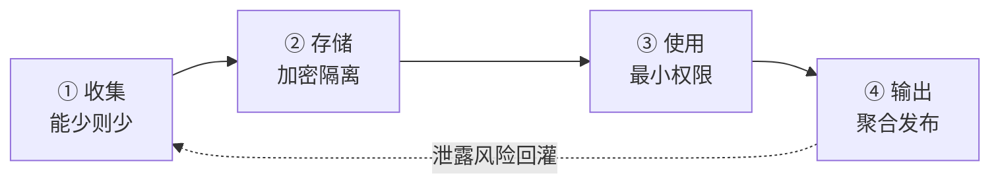

# 隐私保护核心 20% — 先分清"数据在哪一层"

> **一句话**：隐私工程 80% 的坑，都来自没分清数据处于**收集、存储、使用、发布**哪一层。层次清楚之后，技术选型就不再靠猜。

---

## 🎯 这 20% 能解决哪些问题

| 常见困惑 | 本质 | 本页答案 |
|----------|------|----------|
| 把姓名删掉就算脱敏了吗 | 混淆删除与不可复原 | 见「脱敏、假名化、匿名化」 |
| 差分隐私、联邦学习、同态加密该选哪个 | 把它们当成同一层的替代品 | 见「四类技术决策表」 |
| 用户同意书签了就没问题了 | 忽视最小必要与目的限制 | 见「合规四原则」 |
| 模型训练完把原始数据删掉就安全 | 忽视模型本身会记住数据 | 见「模型也是数据出口」 |
| 打印日志时顺手记了手机号 | 隐私泄露多发生在非核心链路 | 见「十条操作红线」 |

---

## 一、数据四层模型

| 层次 | 主要风险 | 关键动作 |
|------|----------|----------|
| 收集 | 过度采集、默认勾选 | 字段级审批，能不用就不用 |
| 存储 | 明文落库、备份外泄 | 加密、分库、保留期限 |
| 使用 | 越权查询、训练滥用 | 最小权限、审计日志 |
| 输出 | 报表反推个体 | 聚合、加噪、抑制小样本 |

> **层次判断法**：拿到一个隐私问题，先问"它发生在哪一层"。90% 的争论会因此自动收敛。

---

## 二、脱敏、假名化、匿名化

| 手段 | 做法 | 可复原 | 适用 |
|------|------|--------|------|
| 脱敏 | 遮蔽部分字符（138****8888） | 否，但信息未必不可推断 | 展示层 |
| 假名化 | 用假 ID 替换直接标识 | 是（有映射表） | 分析层、需回查 |
| 匿名化 | 破坏可识别性，不可复原 | 否 | 对外发布、科研 |

**三条铁律**：

1. **删除直接标识（姓名、手机号、身份证）≠ 匿名化**，准标识（年龄+邮编+性别）组合起来常能唯一定位到人。
2. **映射表必须与数据分离存放**，否则假名化退化为脱敏。
3. 匿名化结果要防**差分攻击**：同一人出现在两个数据集，比对即可去匿名化。

---

## 三、四类隐私技术决策表

| 场景 | 选什么 | 为什么 | 主要代价 |
|------|--------|--------|----------|
| 对外发布统计报表 | 差分隐私 | 有可证明的隐私保证 | 精度下降、需管理隐私预算 |
| 多方数据不能出域，但要联合建模 | 联邦学习 | 原始数据留在本地 | 通信开销、仍可能被梯度反演 |
| 数据必须存第三方（云），但要在密文上算 | 同态加密 | 计算方全程看不到明文 | 慢 2–4 个数量级，仅适合小模型/简单算子 |
| 两方各持一部分数据，要联合求出结果 | 安全多方计算 | 谁都不泄露输入 | 协议复杂、参与方需在线 |

**选型顺序**（从便宜到贵）：先问能不能**不收集** → 再问能不能**聚合后再用** → 再问能不能**本地计算只传参数** → 最后才考虑同态加密与 MPC。

> 常见错误：为了"技术先进"直接上同态加密，结果性能不达标，项目下线。**能用聚合解决的，别用密码学。**

---

## 四、差分隐私的两件事

| 概念 | 含义 | 实践建议 |
|------|------|----------|
| ε（隐私预算） | 越小越私密，噪声越大 | 内部报表常用 ε ∈ [0.1, 1]，先定业务可接受误差再反推 |
| 组合性质 | 多次查询的预算可累加 | 必须**集中记账**，否则重复查询等同零保护 |

**必踩的坑**：

- 只对小样本表格加噪，重复发布不同切片 = 预算被无限消耗。
- 把 ε 写进论文却不说清楚是 RDP 还是 (ε,δ)-DP，结果无法复核。
- 局部差分隐私（LDP）在稀疏数据上噪声淹没信号，慎用。

---

## 五、联邦学习的真实风险

| 风险 | 说明 | 缓解 |
|------|------|------|
| 梯度反演 | 从上传的梯度可重建训练样本图像 | 安全聚合、梯度裁剪、加噪 |
| 成员推断 | 判断某人是否在训练集 | 差分隐私训练、正则化 |
| 参与方投毒 | 恶意节点上传错误梯度 | 鲁棒聚合（中位数、截尾均值） |
| 激励缺失 | 没人愿意白贡献数据 | 贡献度量化 + 收益分配 |

> **一句话**：联邦学习**不等于**隐私保护，它只是"数据不出域"。要不要再加 DP 和安全聚合，取决于对手强度。

---

## 六、合规四原则（GDPR / 个人信息保护法通用）

| 原则 | 落地动作 |
|------|----------|
| 最小必要 | 每个字段写明业务用途，无用途即删 |
| 目的限制 | 数据用途变更需重新取得同意 |
| 存储期限 | 到期自动删除，写进系统而非制度 |
| 可问责 | 留下数据处理记录（谁、何时、为何） |

**用户权利三件套**：查阅、更正、删除。系统设计时就应支持按用户 ID 一键导出与删除（含备份与模型训练集）。

---

## 七、模型也是数据出口

| 泄露途径 | 表现 | 缓解 |
|----------|------|------|
| 记忆化 | 大模型复述训练集中的手机号、身份证 | 训练前去重与脱敏、输出侧过滤 |
| 成员推断 | 用置信度判断样本是否在训练集 | DP-SGD、温度缩放 |
| 提示注入套取 | 诱导模型吐出系统提示与上下文 | 输入输出双向过滤、权限隔离 |

**新手最容易忽略**：把用户对话直接喂给模型做微调，等于把隐私写进权重。

---

## 八、十条操作红线

| # | 红线 |
|---|------|
| 1 | 生产库不直连个人设备，必须经网关与脱敏层 |
| 2 | 日志默认脱敏，禁止记录完整身份证、银行卡、密码 |
| 3 | 测试环境不得使用真实个人数据 |
| 4 | 导出的 Excel/CSV 必须审批并设定有效期 |
| 5 | 任何"临时查询"也要走审计 |
| 6 | 模型训练集需登记来源与授权 |
| 7 | 第三方 SDK 需列出采集字段清单 |
| 8 | 数据删除需覆盖备份、缓存、索引 |
| 9 | 上线前做一次"假如数据泄露"的复盘演练 |
| 10 | 隐私影响评估（PIA）在立项阶段做，不是上线前补 |

---

## 📋 一页速查

| 问题 | 答案 |
|------|------|
| 先做什么 | 分清数据处于哪一层 |
| 删除姓名算脱敏吗 | 不算，准标识仍可重识别 |
| 报表对外发布用什么 | 差分隐私 + 小样本抑制 |
| 联合建模不能出域用什么 | 联邦学习（加安全聚合） |
| 云上密文计算用什么 | 同态加密，注意性能代价 |
| 联邦学习能替代 DP 吗 | 不能，只解决数据不出域 |
| 谁最容易泄露隐私 | 日志、导出、模型训练集 |

---

## 🔗 相关链接

| 主题 | 链接 |
|------|------|
| AI 伦理概览 | [AI伦理与安全](../index.md) |
| 安全性 | [安全性核心 20%](../safety/01-essentials.md) |
| 公平性 | [公平性核心 20%](../fairness/01-essentials.md) |
| 可解释性 | [可解释性核心 20%](../explainable-ai/01-essentials.md) |
| 安全合规 | [AI安全合规](../../ai-core/engineering/06-ai-safety-compliance.md) |
