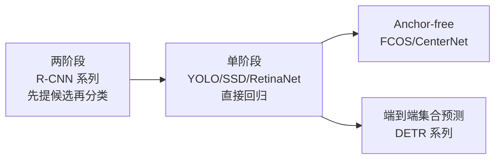

# 目标检测核心 20% — 一切围绕"框 + 类 + 分数"

> **一句话**：检测模型有几十种，但输出永远是三元组（框、类别、置信度），评估永远靠 **IoU 阈值的 mAP**。搞懂这两件事，换任何模型都只需重新读一遍后处理。

---

## 🎯 这 20% 能解决哪些问题

| 常见困惑 | 本质 | 本页答案 |
|----------|------|----------|
| mAP 0.5 和 mAP 0.5:0.95 差在哪 | IoU 阈值是否严格 | 见「IoU 与 mAP」 |
| 同一物体被框了三次 | NMS 没调好 | 见「NMS 与它的替代」 |
| 小目标总是检不到 | 特征图分辨率不足 | 见「三类范式」与「小目标四招」 |
| 训练集 mAP 95%，现场一塌糊涂 | 数据与场景不匹配 | 见「数据比模型重要」 |
| 边缘设备跑不动 | 未量化/未剪枝 | 见「部署五步」 |

---

## 一、三类范式

| 范式 | 代表 | 优点 | 代价 |
|------|------|------|------|
| 两阶段 | Faster R-CNN | 精度高，小目标友好 | 慢 |
| 单阶段 | YOLO 系列、RetinaNet | 快，易部署 | 密集小目标弱 |
| Anchor-free | FCOS、CenterNet | 超参少，框更灵活 | 需调中心/尺寸头 |
| 集合预测 | DETR、RT-DETR | 无需 NMS，流程简洁 | 收敛慢、显存高 |

**锚框（anchor）的作用与代价**：预置不同尺度/长宽比的参考框，让网络回归偏移量。代价是要为数据集调 anchor 尺寸（用 k-means 聚类标注框）。

---

## 二、IoU 与 mAP

\[
\text{IoU} = \frac{|A \cap B|}{|A \cup B|}
\]

| 指标 | 含义 |
|------|------|
| mAP@0.5 | IoU ≥ 0.5 视为命中，按类平均 |
| mAP@0.5:0.95 | IoU 从 0.5 到 0.95 每 0.05 取一次再平均，最严格 |
| AP_small / medium / large | 按目标面积分组，暴露小目标弱点 |

**常见误区**：

- 只看 mAP@0.5 → 框定位很粗也能高分，实际用起来"框不准"。
- 平均掩盖类别差异 → 一定要打印**逐类 AP**，长尾类往往惨不忍睹。
- 训练集与验证集同分布 → mAP 虚高，务必留**不同摄像头/不同场景**的测试集。

---

## 三、NMS 与它的替代

| 方法 | 做法 | 适用 |
|------|------|------|
| 硬 NMS | 剔除与最高分框 IoU > 阈值者 | 默认方案 |
| Soft-NMS | 按 IoU 衰减分数而非直接删 | 密集人群 |
| 可学习 NMS / DETR | 模型内部去重 | 端到端 |
| 按类 NMS | 每类独立做 NMS | 多类别必做 |

**调参直觉**：阈值 0.5–0.7。阈值太低 → 相邻物体被误删；太高 → 重复框残留。

---

## 四、数据比模型重要

| 环节 | 关键实践 |
|------|----------|
| 标注规范 | 遮挡多少算标、截断物体标不标、同类合并规则，先写清 |
| 一致性 | 双人标注 10% 抽样交叉校验，IoU 一致性 > 0.7 |
| 难例 | 专门收集漏检/误检场景，做"难例集" |
| 增广 | 马赛克、随机缩放、色彩抖动、模糊、亮度变化 |
| 负样本 | 加入纯背景图，降低误检 |

**小目标四招**：提高输入分辨率、切片推理（SAHI 式滑窗）、特征金字塔加层、专门采集小目标数据。

---

## 五、部署五步

| 步骤 | 动作 | 收益 |
|------|------|------|
| 1 | 固定输入尺寸，导出 ONNX | 跨框架 |
| 2 | FP16 / INT8 量化（需校准集） | 2–4 倍加速 |
| 3 | 算子融合与层剪枝 | 10–30% 提速 |
| 4 | 批处理与异步流水 | 提升吞吐 |
| 5 | 后处理移出 Python | 消除瓶颈 |

**常被忽略**：后处理（解码 + NMS）在 CPU 上可能比推理还慢。用向量化实现或放进推理引擎。

---

## 六、六个高频坑

| 坑 | 表现 | 纠正 |
|----|------|------|
| 类别不平衡 | 长尾类 AP 接近 0 | 重采样、focal loss |
| 框抖动 | 视频中框剧烈跳动 | 时序平滑（卡尔曼/EMA） |
| 置信度不可校准 | 0.9 的框经常错 | 温度缩放校准 |
| 忽略空场景 | 无目标时也硬框 | 加背景类 / 阈值+二次判定 |
| 训练分辨率与推理不一致 | 效果骤降 | 保持 letterbox 一致 |
| 类别名顺序错 | 全类错乱 | 用同一份 labels 文件校验 |

---

## 📋 一页速查

| 问题 | 答案 |
|------|------|
| 检测输出是什么 | 框 + 类 + 分数 |
| 首选评估指标 | mAP@0.5:0.95 + 逐类 AP |
| 重复框怎么去 | NMS，按类独立做 |
| 小目标怎么救 | 高分辨率 + 切片 + 加层 |
| 落地提速关键 | INT8 量化 + 后处理移出 Python |
| 最常被忽略的检查 | 逐类 AP 与跨场景测试集 |

---

## 🔗 相关链接

| 主题 | 链接 |
|------|------|
| 计算机视觉概览 | [计算机视觉](../index.md) |
| 图像处理 | [图像处理核心 20%](../image-processing/01-essentials.md) |
| 图像生成 | [图像生成核心 20%](../image-generation/01-essentials.md) |
| 视频分析 | [视频分析核心 20%](../video-analysis/01-essentials.md) |
| 深度学习 | [深度学习](../../machine-learning/deep-learning/01-essentials.md) |
