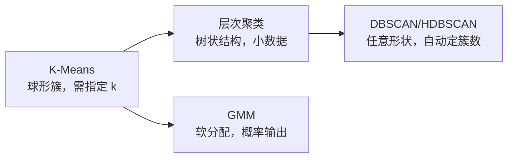

# 无监督学习核心 20% — 没有标签，怎么知道做得对不对

> **一句话**：无监督学习的真正难点不是算法，而是**没有正确答案时如何验收**。先定义"结果好用来做什么"（分群运营？降维可视化？发现异常？），算法选择与验证方式就都清楚了。

---

## 🎯 这 20% 能解决哪些问题

| 常见困惑 | 本质 | 本页答案 |
|----------|------|----------|
| K-Means、DBSCAN、层次聚类怎么选 | 簇形状与是否需指定 k | 见「聚类三选一」 |
| 聚出的类别业务看不懂 | 只做了数值聚类没做解释 | 见「让聚类可用」 |
| t-SNE 图上分得很开，是不是能分类 | 降维可视化 ≠ 可分性 | 见「降维的两种用途」 |
| 异常检测没有标签怎么评 | 需要替代验证方式 | 见「异常检测四种思路」 |
| 用什么指标评聚类 | 内部指标与人感不一致 | 见「无标签评估」 |

---

## 一、聚类三选一

| 算法 | 需要 k | 簇形状 | 适合 |
|------|--------|--------|------|
| K-Means | 是 | 球形、等大小 | 大样本、快速基线 |
| GMM | 是 | 椭圆、可重叠 | 需要概率归属 |
| 层次聚类 | 否 | 任意（取决于连接） | 样本 < 万级、要树结构 |
| DBSCAN/HDBSCAN | 否（需 eps） | 任意、含噪声 | 有离群点、形状不规则 |

**选 k 的三个方法**：肘部法、轮廓系数、业务可解释性（**这一条往往最重要**——分 8 群但只能运营 3 个，就该取 3）。

---

## 二、让聚类可用

| 问题 | 做法 |
|------|------|
| 数值尺度差异大 | 先标准化（K-Means 对尺度极敏感） |
| 高维失效 | 先 PCA 降维或选 10–20 个业务特征 |
| 类别特征 | 用 K-Modes / Gower 距离 / 嵌入后聚类 |
| 结果不可解释 | 对每簇算特征均值与差异度，命名成"人群画像" |
| 结果不稳定 | 多次随机初始化、换随机种子看稳定性 |

---

## 三、降维的两种用途

| 用途 | 合适方法 | 禁忌 |
|------|----------|------|
| 特征压缩/去噪（喂给下游模型） | PCA、SVD、自编码器 | 不要用 t-SNE/UMAP 做特征（不稳定、不可逆） |
| 可视化探索 | t-SNE、UMAP | 不要用图上距离下结论 |

**三个误用**：

1. 把 t-SNE 的簇间距当相似度——它只保留局部邻域，全局距离无意义。
2. 每次跑 t-SNE 结果不同，就认为数据不稳定——是算法随机性。
3. 用 PCA 解释"重要性"却不看解释方差比——前三主成分可能只占 30%。

---

## 四、异常检测四种思路

| 思路 | 方法 | 适用 |
|------|------|------|
| 距离/密度 | KNN、LOF | 低维、样本中等 |
| 边界 | One-Class SVM、SVDD | 需明确"正常"边界 |
| 集成 | 孤立森林 | 高维、大样本、通用首选 |
| 重构误差 | 自编码器、PCA 残差 | 时序、图像 |
| 时序预测 | 预测区间外的点 | 监控指标、传感器 |

**验证方式（没标签时）**：

- 人工抽检 Top-100 异常，统计"真异常比例"（精度视角）；
- 注入合成异常，看能否召回；
- 与业务事件（故障、投诉）做时间对齐，看命中率。

---

## 五、无标签评估

| 指标 | 衡量 | 局限 |
|------|------|------|
| 轮廓系数 | 簇内紧、簇间远 | 偏好凸簇，DBSCAN 不适用 |
| Calinski-Harabasz | 方差比 | 同样偏好球形 |
| 稳定性（重采样一致率） | 结果可复现性 | 计算成本 |
| 业务指标 | 分群后转化/留存差异 | 需 A/B，滞后 |

**务实原则**：内部指标用于**同一算法的参数选择**，跨算法比较一律靠"业务可解释性 + 下游任务效果"。

---

## 六、典型落地路径

| 场景 | 路径 |
|------|------|
| 用户分群 | 行为特征 → 标准化 → 降维 → 聚类 → 画像命名 → 运营验证 |
| 商品分组 | 文本/图像嵌入 → 降维 → 聚类 → 人工审校 |
| 异常监控 | 指标序列 → 预测模型 → 残差超阈值告警 |
| 冷启动推荐 | 内容嵌入 → 相似度检索 → 人工规则兜底 |

---

## 📋 一页速查

| 问题 | 答案 |
|------|------|
| 聚类第一步 | 标准化特征 |
| k 怎么定 | 业务可运营的群数优先 |
| 有离群点选什么 | DBSCAN / 孤立森林 |
| 可视化用什么 | t-SNE / UMAP（不能当特征） |
| 特征压缩用什么 | PCA / 自编码器 |
| 无标签怎么验收 | 抽检精度 + 注入异常 + 业务对齐 |

---

## 🔗 相关链接

| 主题 | 链接 |
|------|------|
| 机器学习概览 | [机器学习](../index.md) |
| 监督学习 | [监督学习核心 20%](../supervised/01-essentials.md) |
| 模型评估 | [模型评估核心 20%](../model-evaluation/01-essentials.md) |
| 深度学习 | [深度学习核心 20%](../deep-learning/01-essentials.md) |
| 推荐系统 | [推荐系统](../../intelligent-systems/recommender-systems/index.md) |
