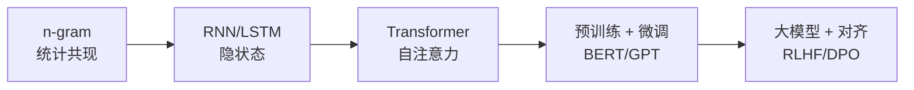

# 语言模型核心 20% — 只有一条主线：预测下一个 token

> **一句话**：所有语言模型（包括 GPT）做的事只有一件——**给定前文，预测下一个 token 的概率分布**。理解这句话，就能解释为什么它会幻觉、为什么会"遗忘"长文、为什么分词方式会影响数学能力。

---

## 🎯 这 20% 能解决哪些问题

| 常见困惑 | 本质 | 本页答案 |
|----------|------|----------|
| 模型为什么会"胡说" | 目标是概率最大，不是事实正确 | 见「为什么必然幻觉」 |
| 上下文窗口标 128k，为什么中间内容被忽略 | 注意力分布不均衡 | 见「长上下文真相」 |
| 为什么模型算不好乘法 | 分词把数字切碎 | 见「Tokenization 的三个后果」 |
| 微调还是提示工程 | 没分清知识注入与行为对齐 | 见「三阶段训练」 |
| 困惑度低就说明模型好吗 | 指标只衡量拟合 | 见「评估的两个层次」 |

---

## 一、一条主线：从 n-gram 到 Transformer

| 阶段 | 核心机制 | 解决什么 | 遗留问题 |
|------|----------|----------|----------|
| n-gram | 统计 P(w\|前 n-1 个词) | 简单可用 | 稀疏、无长依赖 |
| RNN/LSTM | 隐状态传递 | 变长依赖 | 串行、难并行 |
| Transformer | 自注意力，全局可见 | 并行 + 长依赖 | 计算随长度平方增长 |
| 对齐 | RLHF / DPO | 让输出符合偏好 | 对齐税、谄媚 |

---

## 二、Tokenization 的三个后果

| 现象 | 原因 | 工程应对 |
|------|------|----------|
| 数不清"strawberry 里有几个 r" | 被切成 1–2 个 token | 让它逐字符拆开处理 |
| 中文比英文更费 token | 常用词表以英文为主 | 选中文词表更优的模型 |
| 算术错误 | 数字被切成不规则片段 | 用工具调用/代码解释器 |

**记住**：模型的"读写单位"是 token，不是字符也不是词。任何涉及字符级、数字位的任务，都要先考虑分词。

---

## 三、三阶段训练与你要做什么

| 阶段 | 数据 | 目标 | 你的对应动作 |
|------|------|------|--------------|
| 预训练 | 海量无标注文本 | 学会语言与世界知识 | 一般无法参与，选底座即可 |
| 监督微调（SFT） | 指令-回答对 | 学会遵循指令 | 高质量 1k–10k 条胜过 100k 条噪声数据 |
| 偏好对齐（RLHF/DPO） | 偏好对比 | 符合人类偏好 | 定义"什么是好回答"比算法更重要 |

**选择顺序**：先改提示（成本最低）→ 再补检索（RAG，注入知识）→ 再微调（改行为/格式）→ 最后才考虑继续预训练（改领域分布）。

> **常见错误**：想用微调让模型"记住公司文档"。这既昂贵又不可靠，正确答案是 RAG。

---

## 四、为什么必然幻觉

\[
P(\text{下一个 token}) \ne P(\text{事实为真})
\]

| 原因 | 说明 |
|------|------|
| 目标错配 | 训练目标是"像人写的"，不是"说真话" |
| 知识截止 | 训练后发生的事它不知道，但会照常补全 |
| 缺乏拒答机制 | 不会说"我不知道"，因为训练数据里少 |
| 长尾稀疏 | 冷门实体只出现过一两次，更易编 |

**四层缓解**：

1. 检索增强（给出证据并要求引用）
2. 结构化输出 + 字段校验
3. 明确允许"不知道"并在提示中给出示例
4. 关键结论二次核验（另一个模型或规则）

---

## 五、长上下文真相

| 现象 | 原因 | 应对 |
|------|------|------|
| 中间内容被忽略（lost in the middle） | 注意力对首尾更强 | 把关键信息放开头或结尾 |
| 上下文越长越慢越贵 | 注意力计算随长度增长 | 分块摘要、只放相关片段 |
| 长文回答问题质量下降 | 干扰信息增多 | 先检索再回答 |

---

## 六、评估的两个层次

| 层次 | 指标 | 局限 |
|------|------|------|
| 语言拟合 | 困惑度（Perplexity） | 只衡量"像不像语料"，不衡量有用 |
| 任务效果 | 准确率、通过率、人工评分 | 成本高、需要固定测试集 |

**实用做法**：建 30–100 条"黄金测试集"，覆盖典型任务与边界情况，每次换模型/改提示都跑一遍。这比任何榜单都可靠。

---

## 七、选型速查

| 需求 | 建议 |
|------|------|
| 高频简单分类/抽取 | 小模型微调，成本低延迟低 |
| 复杂推理与长文 | 大模型 + 结构化提示 |
| 强事实性要求 | 大模型 + RAG + 引用校验 |
| 私有数据不出域 | 私有化部署开源模型 |
| 中文场景 | 优先中文语料占比高的底座 |

---

## 📋 一页速查

| 问题 | 答案 |
|------|------|
| 语言模型的本质 | 预测下一个 token 的概率 |
| 幻觉的根因 | 目标是最可能，不是最真实 |
| 为什么数学差 | 分词把数字切碎 |
| 长文关键信息放哪 | 开头或结尾 |
| 想注入知识用什么 | RAG，不是微调 |
| 怎么评估 | 自建黄金测试集 |

---

## 🔗 相关链接

| 主题 | 链接 |
|------|------|
| 自然语言处理概览 | [自然语言处理](../index.md) |
| 文本处理 | [文本处理核心 20%](../text-processing/01-essentials.md) |
| 机器翻译 | [机器翻译核心 20%](../machine-translation/01-essentials.md) |
| 提示工程 | [LLM 提示工程](../../../ai-core/theory/02-llm-prompt-engineering.md) |
| RAG | [RAG 检索增强生成](../../../ai-core/practice/03-rag-retrieval-augmented-generation.md) |
