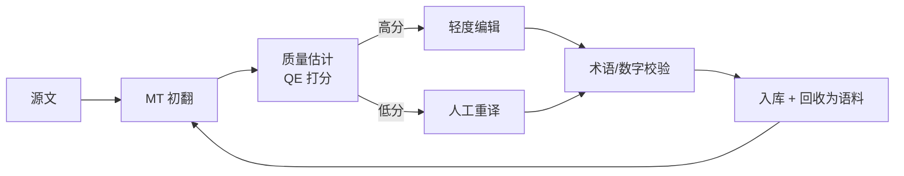

# 机器翻译核心 20% — 先定"谁在用、错在哪可以接受"

> **一句话**：机器翻译的质量上限由**语料与术语**决定，不由模型结构决定。80% 的落地问题，是"术语没统一、领域没适配、没人做译后编辑"。

---

## 🎯 这 20% 能解决哪些问题

| 常见困惑 | 本质 | 本页答案 |
|----------|------|----------|
| BLEU 涨了但用户说更差 | 指标与人感不一致 | 见「两个指标的真实含义」 |
| 通用模型翻专业文本一塌糊涂 | 领域分布不匹配 | 见「领域适配四招」 |
| 模型把品牌名翻成通用词 | 缺少术语表约束 | 见「领域适配四招」与「六类高频错误」 |
| 长段落翻译前后不一致 | 上下文与术语漂移 | 见「长文五条规则」 |
| 上线后怎么控质量 | 没有质量估计环节 | 见「译后编辑流程」 |

---

## 一、两个指标的真实含义

| 指标 | 计算思路 | 优点 | 局限 |
|------|----------|------|------|
| BLEU | n-gram 精确率 + 长度惩罚 | 快、可复现 | 与词序/语义无关，换个同义表达就扣分 |
| chrF | 字符级 F 值 | 对形态丰富语言更稳 | 仍不看语义 |
| COMET / BERTScore | 神经模型打语义相似分 | 与人判断相关性更高 | 需模型，慢、有偏 |
| 人工 MQM | 按错误类型加权计数 | 最贴近业务 | 昂贵 |

**结论**：BLEU +1 不代表更好。真正决策应该用 **MQM 标注 200–500 条**建立基线，再用 COMET 做日常监控。

---

## 二、数据是天花板

| 数据类型 | 作用 | 获取方式 |
|----------|------|----------|
| 通用平行语料 | 基础能力 | 开源数据集、公开双语网站 |
| 领域平行语料 | 领域适配 | 历史人工译文（最宝贵的资产） |
| 单语语料 | 回译、语言模型 | 内部文档 |
| 术语表 | 一致性 | 从历史译文中抽取高频对照 |

**回译（Back-translation）的标准做法**：单语目标语 → 反向模型译成源语 → 与原单语构成伪平行对 → 混入训练。注意：伪数据比例过高会引入翻译腔。

---

## 三、领域适配四招

| 手段 | 成本 | 效果 | 适用 |
|------|------|------|------|
| 提示中给术语与风格示例 | 最低 | 中 | 大模型场景首选 |
| 术语表强制替换（前后处理） | 低 | 高（一致性） | 产品名、法规名 |
| 少量高质量微调（1k–10k 句） | 中 | 高 | 稳定领域 |
| 继续预训练 + 微调 | 高 | 高 | 数据量大、长期投入 |

> **顺序**：术语表 → 提示工程 → 微调。跳过前两步直接微调，往往做完发现"其实术语表就够了"。

---

## 四、长文五条规则

1. **按句切分翻译，再拼接**，不要整篇塞进去。
2. **保留原文段落结构**，便于对照与回填。
3. **术语表全篇生效**，出现即替换或标注。
4. **代词与人称统一**，中文常省略主语，译文需按上下文补。
5. **数字、单位、日期单独校验**，这是最高频的严重错误。

---

## 五、译后编辑流程

| 环节 | 关键动作 |
|------|----------|
| 质量估计 | 用 QE 模型或回译一致性打分，决定人工投入 |
| 轻度编辑 | 只改错译与术语，不改风格 |
| 校验 | 数字、单位、专名、格式（加粗/链接）逐项过 |
| 回收 | 人工定稿回流为平行语料，形成闭环 |

---

## 六、六类高频错误

| 错误类型 | 例子 | 应对 |
|----------|------|------|
| 术语不一致 | 同一术语三种译法 | 术语表 |
| 漏译 | 长句后半段丢失 | 句对齐检查、长度比告警 |
| 数字单位错 | 5 million → 5 万 | 正则抽取比对 |
| 专名误译 | 品牌名意译 | 白名单保护 |
| 语序生硬 | 直译导致的中文欧化 | 提示中给风格示例 |
| 幻觉补全 | 原文没有的内容被补上 | 长度比与回译检测 |

---

## 📋 一页速查

| 问题 | 答案 |
|------|------|
| BLEU 涨了就更好吗 | 不一定，用 MQM 或 COMET 校验 |
| 质量上限由什么决定 | 语料与术语 |
| 领域适配第一步 | 术语表 + 提示示例 |
| 最宝贵的资产 | 历史人工译文 |
| 最高频的严重错误 | 数字与单位 |
| 怎么控上线质量 | QE 打分 + 分级人工介入 |

---

## 🔗 相关链接

| 主题 | 链接 |
|------|------|
| 自然语言处理概览 | [自然语言处理](../index.md) |
| 语言模型 | [语言模型核心 20%](../language-models/01-essentials.md) |
| 文本处理 | [文本处理核心 20%](../text-processing/01-essentials.md) |
| 提示工程实践 | [提示工程实践](../../../ai-core/practice/01-prompt-engineering-practice.md) |
