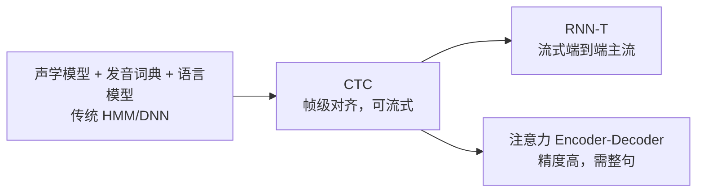

# 语音识别核心 20% — 效果差 90% 是录音问题，不是模型问题

> **一句话**：ASR 的准确率排序是 **麦克风与噪声 > 领域词汇 > 模型选择**。同一个模型，换个麦克风 WER 可能从 8% 掉到 25%，而换个更大的模型通常只改善 1–2 个点。

---

## 🎯 这 20% 能解决哪些问题

| 常见困惑 | 本质 | 本页答案 |
|----------|------|----------|
| WER 5% 听起来很好，为什么用户还是不满意 | 指标与体验错位 | 见「WER 的三个陷阱」 |
| 人名地名总识别错 | 缺少热词/上下文偏置 | 见「热词与上下文偏置」 |
| 实时字幕比录音转写差很多 | 流式牺牲了未来上下文 | 见「流式 vs 批量」 |
| 换了模型提升不明显 | 瓶颈在输入端 | 见「录音工程六条」 |
| 三人会议记录混在一起 | 需要说话人分离 | 见「说话人分离」 |

---

## 一、三条技术路线

| 路线 | 对齐方式 | 流式 | 特点 |
|------|----------|------|------|
| CTC | 帧级，允许重复与空白 | 天然支持 | 帧独立假设，需语言模型补 |
| RNN-T | 预测网络 + 联合网络 | 支持 | 流式精度折中最好 |
| 注意力 | 软对齐，整句编码 | 需分块或二次修正 | 批量精度最高 |
| Conformer 主干 | 卷积 + 自注意力 | 视结构 | 目前主流编码器 |

**Whisper 类模型属于"批量 + 大规模弱监督"路线**：多语言与鲁棒性强，但流式需要改造，且幻觉（安静段凭空生成文本）是已知问题。

---

## 二、WER 的三个陷阱

\[
\text{WER} = \frac{S + D + I}{N}
\]

| 陷阱 | 说明 |
|------|------|
| 中文按字算 | 同样 WER，字错比词错的观感差异很大 |
| 归一化不一致 | 阿拉伯数字与汉字、标点、大小写是否计入，会差几个点 |
| 平均掩盖长尾 | 整体 5% 可能在专业术语上 40% |

**更贴近体验的指标**：术语准确率、句级完全正确率（Sentence Accuracy）、人工可读率。

---

## 三、错误来源排序（实测经验）

| 排序 | 来源 | 占比感觉 | 应对 |
|------|------|----------|------|
| 1 | 远场/混响/噪声 | 最大 | 麦克风阵列、降噪、近场麦 |
| 2 | 专业词汇与口音 | 大 | 热词、领域微调、口音数据 |
| 3 | 语速与打断 | 中 | VAD 调参、端点检测 |
| 4 | 模型本身 | 小 | 换更大模型 |

---

## 四、录音工程六条

1. **优先换硬件**：耳麦/领夹麦 > 手机免提 > 会议室远端。
2. **采样率与码率**：16 kHz 单声道足够，别用 8 kHz 电话音。
3. **降噪但要保人声**：过度降噪会削掉辅音，反而更差。
4. **VAD 端点**：静音阈值过严会切断句首。
5. **统一格式**：转 16-bit PCM/WAV，避免二次压缩。
6. **多通道就分开**：不要把两路混成一轨。

---

## 五、热词与上下文偏置

| 手段 | 做法 | 效果 |
|------|------|------|
| 热词表 | 给模型加权词表（人名、产品名） | 立竿见影 |
| 提示/偏置解码 | 把领域词作为解码偏置 | 中等 |
| 替换后处理 | 对同音错词做映射表 | 高，但需维护 |
| 领域微调 | 用领域语料继续训练 | 最彻底 |

> **务实顺序**：先用"热词 + 同音替换表"解决 80% 的专名问题，再考虑微调。

---

## 六、流式 vs 批量

| 维度 | 流式 | 批量 |
|------|------|------|
| 延迟 | 几百毫秒 | 整段时长 |
| 精度 | 较低（缺未来上下文） | 较高 |
| 适用 | 字幕、语音助手、电话 | 会议纪要、播客转写 |

**折中方案**：流式出草稿 + 结束后批量重打分（two-pass），体验与精度兼得。

---

## 七、说话人分离

| 场景 | 方法 |
|------|------|
| 说话人已知（注册过） | 声纹比对 |
| 未知人数 | 聚类（谱聚类/在线聚类）+ 分段 |
| 多麦克风 | 用通道或到达时间差辅助 |

**难点**：重叠说话、短句（不足 1 秒）、音色相近。工程上先把"谁在说"标粗粒度（A/B），再用 ASR 结果人工校正。

---

## 📋 一页速查

| 问题 | 答案 |
|------|------|
| 效果差先查什么 | 麦克风与噪声 |
| 中文 WER 怎么算 | 按字，需统一归一化规则 |
| 流式精度为什么低 | 缺少未来上下文 |
| 专名识别错的快解 | 热词表 + 同音替换 |
| 安静段凭空出字 | 幻觉，需 VAD + 置信度过滤 |
| 会议记录全流程 | 分离 → 分段 → ASR → 重标点 |

---

## 🔗 相关链接

| 主题 | 链接 |
|------|------|
| 自然语言处理概览 | [自然语言处理](../index.md) |
| 语言模型 | [语言模型核心 20%](../language-models/01-essentials.md) |
| 文本处理 | [文本处理核心 20%](../text-processing/01-essentials.md) |
| 机器翻译 | [机器翻译核心 20%](../machine-translation/01-essentials.md) |
| AI 应用场景 | [AI 应用场景](../../../ai-core/practice/02-ai-application-scenarios.md) |
