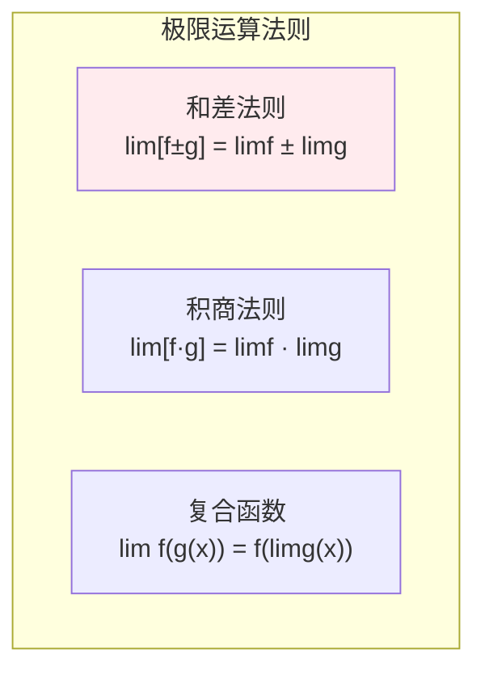
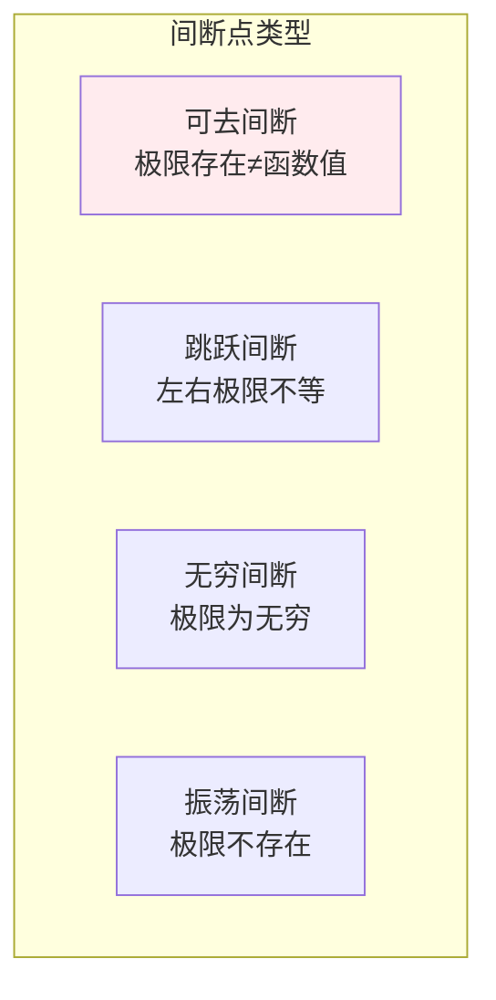

# 极限与连续

> **核心观点**：极限是微积分的基础，连续性是微分和积分的前提条件。

## 🎯 这 20% 能解决哪些问题

| 你遇到的困惑 | 本质原因 | 马上能改的动作 |
|---|---|---|
| 迭代算法、训练损失就是不收敛 | 迭代序列不满足单调有界，映射不是压缩的 | 检查步长使映射导数模 < 1，加收敛判据与提前停止 |
| `softmax` / 指数计算溢出 | 主导项太大，数学上等价变形被忽略 | 先减去最大值再计算，结果不变但不溢出 |
| 两个接近的数相减后结果乱跳 | 灾难性抵消（有效位数丢失） | 用恒等变形避开相减，或提高中间精度 |
| 在不可导点优化器抖动 | 函数不连续或导数不连续 | 用光滑近似替换硬拐点（如 ReLU → Leaky/GELU） |
| 浮点数判等出现偶发错 | 极限思想下的「多近算够」没定义 | 统一用相对 + 绝对容差判等，不用 `==` |
| `0/0`、`∞/∞` 型报错 | 未定义点的局部行为需要用极限描述 | 用等价无穷小或洛必达先化简，再写代码求值 |

---

## 📊 极限基本概念

### 极限定义

| 类型 | 定义 | 记法 |
|------|------|------|
| 数列极限 | \|aₙ - A\| → 0 | lim(n→∞) aₙ = A |
| 函数极限 | \|f(x) - L\| → 0 | lim(x→x₀) f(x) = L |
| 单侧极限 | x→x₀⁺ 或 x→x₀⁻ | 右极限/左极限 |

### 极限性质



---

## 📈 连续性

### 连续定义

| 概念 | 定义 | 意义 |
|------|------|------|
| 连续 | lim(x→x₀)f(x) = f(x₀) | 无跳跃、无断点 |
| 一致连续 | δ与x₀无关 | 全局连续 |
| 间断点 | 不连续的点 | 跳跃、可去、无穷 |

### 间断点分类



---

## 🔢 无穷小与无穷大

### 无穷小

| 概念 | 定义 | 性质 |
|------|------|------|
| 无穷小 | limα(x) = 0 | 极限为0 |
| 高阶无穷小 | limβ/α = 0 | β比α更快趋于0 |
| 同阶无穷小 | limβ/α = C | 同速趋于0 |

### 等价无穷小

| 等价关系 | 条件 |
|----------|------|
| sinx ~ x | x→0 |
| tanx ~ x | x→0 |
| 1-cosx ~ x²/2 | x→0 |
| ln(1+x) ~ x | x→0 |
| eˣ-1 ~ x | x→0 |

---

## 🎯 重要极限

### 两个重要极限

| 极限 | 公式 | 意义 |
|------|------|------|
| sinx/x | lim(x→0) sinx/x = 1 | 三角函数极限 |
| (1+1/x)ˣ | lim(x→∞)(1+1/x)ˣ = e | 自然常数e |

---

## 🤖 机器学习应用

### 连续性假设

| 应用 | 内容 | 意义 |
|------|------|------|
| 损失函数 | 连续可导 | 可微优化 |
| 激活函数 | 连续 | 梯度存在 |
| 模型假设 | 连续映射 | 泛化能力 |

---

## 🎯 核心结论

### 极限与连续核心概念

1. **极限**：函数趋近的值
2. **连续**：无跳跃、无断点
3. **可微**：连续+光滑
4. **可积**：连续或有限间断
5. **应用**：微分和积分的基础

### 学习路径

```
极限与连续学习四步骤：
1. 极限定义：ε-δ语言
2. 极限运算：法则和性质
3. 连续性：定义和分类
4. 应用：微分和积分的基础
```

---

## 🎓 实战场景（TIL）

- **场景**：数值梯度检查时，步长越小误差反而越大。**本质**：截断误差随 h 变小，舍入误差随 h 变大，两者叠加有最优区间。**要点**：中心差分取 `h ≈ ∛ε · |x|`（双精度约 1e-6 量级）。
- **场景**：学习率调小后损失仍然震荡。**本质**：迭代映射在该区域导数模接近或大于 1，不是压缩映射。**要点**：先看局部斜率与 Lipschitz 常数，再决定是否需要动量或梯度裁剪。
- **场景**：判等逻辑把 0.1+0.2 与 0.3 判为不等。**本质**：二进制浮点表示误差与精确比较矛盾。**要点**：`isclose(a, b, rel_tol=1e-9, abs_tol=1e-12)` 同时给两个容差。

---

## 📋 一页速查

| 我要用 | 记住这条 |
|---|---|
| 等价无穷小（x→0） | `sin x ~ x`，`1-cos x ~ x²/2`，`ln(1+x) ~ x`，`e^x-1 ~ x`，`(1+x)^a-1 ~ ax` |
| 两个重要极限 | `sin x / x → 1`；`(1 + 1/n)^n → e` |
| 连续判定 | 左极限 = 右极限 = 函数值；否则按可去/跳跃/无穷分类处理 |
| 求根依据 | 介值定理 → 二分法；单调 + 有界 → 迭代收敛 |
| 收敛判据 | `\|xₖ₊₁ − xₖ\| < atol + rtol·\|xₖ\|`，相对与绝对容差一起用 |
| 数值稳定三招 | 先减主导项（softmax）、避免小数相减、必要时换更高精度 |

---

## 🔗 相关链接

- 上级：[微积分](index.md)
- 下一步：[导数与微分](02-derivatives.md) — 极限定义的瞬时变化率
- 同域：[积分学](03-integral-calculus.md) — 累积量与广义积分收敛
- 邻域：[组合数学](../discrete-math/03-combinatorics.md) — 阶乘增长与极限比较
- 邻域：[无约束优化](../optimization/01-unconstrained-optimization.md) — 迭代收敛条件的工程用法

---

## 📚 参考文献

1. 《高等数学》- 同济大学
2. 《微积分》- James Stewart
3. 《普林斯顿微积分读本》
4. 《数学分析》- 陈纪修
5. 《Calculus Made Easy》- Silvanus Thompson
6. 《微积分教程》
7. 《极限与连续》
8. 《数学分析新讲》- 张筑生