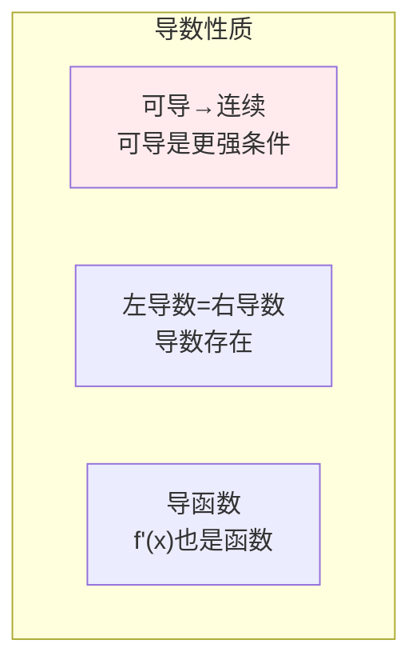
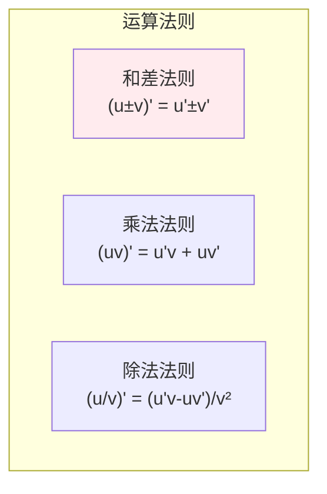
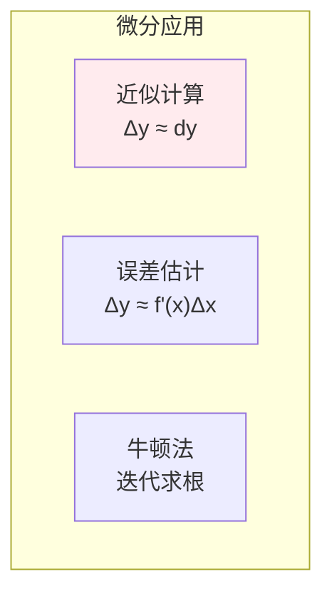
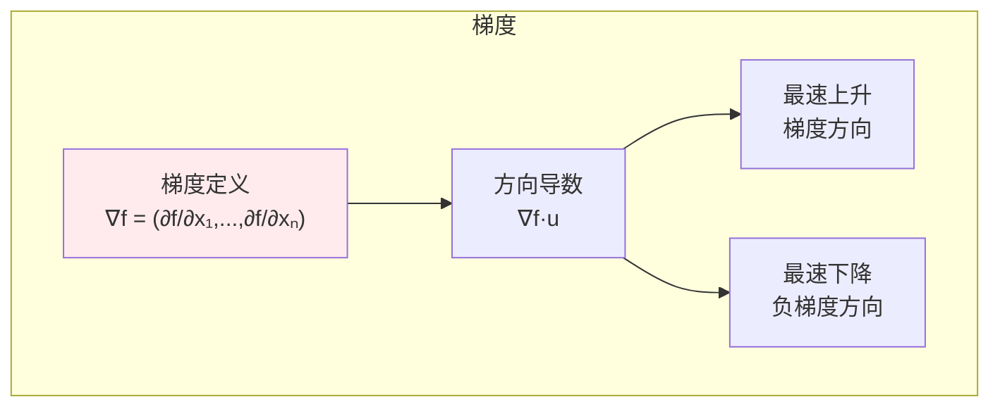

# 导数与微分

> **核心观点**：导数是函数变化率的度量，是优化算法和反向传播的数学基础。

## 🎯 这 20% 能解决哪些问题

| 你遇到的困惑 | 本质原因 | 马上能改的动作 |
|---|---|---|
| 反向传播到底是什么 | 一元链式法则在多变量上的展开 | 把网络看成计算图，逐层乘以后面传来的梯度 |
| 梯度为什么指向下降方向 | 负梯度是局部下降最快方向，不是全局最优方向 | 区分方向（由梯度定）与步长（由线搜索/学习率定） |
| 深层网络梯度消失/爆炸 | 每层雅可比连乘，谱范数决定总放大率 | 残差连接、归一化、合理初始化，必要时用梯度裁剪 |
| Sigmoid 后训练变慢 | `σ'(x) ≤ 0.25`，每过一层至少缩 4 倍 | 隐藏层换 ReLU/GELU，输出层才用 sigmoid |
| 在拐点处梯度不稳定 | 不可导点需要次梯度 | 用光滑近似或明确定义次梯度取值 |
| 数值导数不准/不稳 | 前向差分一阶精度，步长选择不当 | 用中心差分 `O(h²)`，并控制 h 与溢出 |
| 二阶优化该不该上 | 牛顿法靠曲率修正步长，代价是黑塞矩阵 | 大规模用拟牛顿（BFGS/L-BFGS）或共轭梯度近似 |

---

## 📊 导数基本概念

### 导数定义

| 定义 | 公式 | 意义 |
|------|------|------|
| 极限定义 | f'(x) = lim(h→0)[f(x+h)-f(x)]/h | 瞬时变化率 |
| 几何意义 | 切线斜率 | 局部线性化 |
| 物理意义 | 瞬时速度/加速度 | 运动学 |

### 导数性质



---

## 🔢 求导法则

### 基本法则

| 法则 | 公式 | 例子 |
|------|------|------|
| 常数法则 | (c)' = 0 | (5)' = 0 |
| 幂法则 | (xⁿ)' = nxⁿ⁻¹ | (x³)' = 3x² |
| 指数法则 | (eˣ)' = eˣ | (2ˣ)' = 2ˣln2 |
| 对数法则 | (lnx)' = 1/x | (logₐx)' = 1/(xlna) |

### 四则运算法则



### 链式法则

| 概念 | 公式 | 意义 |
|------|------|------|
| 链式法则 | [f(g(x))]' = f'(g(x))·g'(x) | 复合函数求导 |
| 多元推广 | ∂z/∂x = ∂z/∂u·∂u/∂x | 偏导链式法则 |

---

## 📈 高阶导数

### 高阶导数

| 概念 | 记法 | 应用 |
|------|------|------|
| 二阶导数 | f''(x) | 加速度、凹凸性 |
| n阶导数 | f⁽ⁿ⁾(x) | 泰勒展开 |
| 莱布尼茨公式 | (uv)⁽ⁿ⁾ = ∑C(n,k)u⁽ᵏ⁾v⁽ⁿ⁻ᵏ⁾ | 乘积高阶导数 |

---

## 🎯 微分

### 微分定义

| 概念 | 公式 | 意义 |
|------|------|------|
| 微分 | dy = f'(x)dx | 线性近似 |
| 近似公式 | f(x+Δx) ≈ f(x)+f'(x)Δx | 局部线性化 |

### 微分应用



---

## 🤖 机器学习应用

### 梯度计算



### 反向传播

| 步骤 | 内容 | 导数应用 |
|------|------|----------|
| 前向传播 | 计算输出 | 函数复合 |
| 损失计算 | 比较输出与标签 | 损失函数 |
| 反向传播 | 计算梯度 | 链式法则 |
| 参数更新 | 梯度下降 | θ = θ - α∇L |

---

## 🎯 核心结论

### 导数与微分核心概念

1. **导数**：变化率的度量
2. **求导法则**：基本法则+链式法则
3. **微分**：线性近似工具
4. **梯度**：多元函数的导数
5. **应用**：优化和反向传播

### 学习路径

```
导数与微分学习四步骤：
1. 导数定义：极限定义、几何意义
2. 求导法则：基本法则、链式法则
3. 高阶导数：二阶导数、泰勒展开
4. 应用：梯度计算、反向传播
```

---

## 🎓 实战场景（TIL）

- **场景**：自己写的反向传播与自动微分对不上。**本质**：多变量链式法则里漏了同一条分支的多路累加。**要点**：每个节点把 incoming 梯度求和再往前传，单元测试用小张量逐个参数验证。
- **场景**：学习率一调大就发散。**本质**：局部曲率 L 决定了稳定步长上限约为 `1/L`。**要点**：先估梯度 Lipschitz 常数（或用预热 + 衰减），而不是拍脑袋。
- **场景**：梯度爆炸使损失变 NaN。**本质**：连乘雅可比的谱范数大于 1，指数级放大。**要点**：先开梯度裁剪（按总范数）+ 检查初始化，再考虑结构调整。

---

## 📋 一页速查

| 我要用 | 记住这条 |
|---|---|
| 基本求导 | `(x^a)' = a·x^(a-1)`，`(e^x)' = e^x`，`(ln x)' = 1/x`，`(sin x)' = cos x`，`(cos x)' = -sin x` |
| 乘积/商 | `(uv)' = u'v + uv'`；`(u/v)' = (u'v - uv')/v² |
| 链式法则 | `(f∘g)' = f'(g)·g'`，多元时按分支累加 |
| 凹凸判据 | 一阶：`f(y) ≥ f(x) + ∇f(x)·(y-x)`；二阶：黑塞半正定 |
| Sigmoid/ReLU | `σ' = σ(1-σ) ≤ 0.25`；`ReLU'` 在 0 处不可导，负区恒 0 会「死掉」 |
| 泰勒展开 | 一阶给线性近似（梯度下降），二阶给曲率修正（牛顿法） |
| 数值微分 | 前向 `O(h)`，中心 `O(h²)`；h 取 `∛ε·|x|` 量级 |
| 条件数影响 | 椭圆等高线（条件数大）时梯度法呈螺旋震荡，需预条件或带动量 |

---

## 🔗 相关链接

- 上级：[微积分](index.md)
- 前置概念：[极限与连续](01-limits-continuity.md) — 导数的定义来源
- 同域：[积分学](03-integral-calculus.md) — 微分基本定理把两者接起来
- 邻域：[无约束优化](../optimization/01-unconstrained-optimization.md) — 梯度信息与收敛速度
- 邻域：[深度学习和理论](../../../ai-core/theory/01-ai-fundamentals.md) — 反向传播的工程位置

---

## 📚 参考文献

1. 《高等数学》- 同济大学
2. 《微积分》- James Stewart
3. 《普林斯顿微积分读本》
4. 《数学分析》- 陈纪修
5. 《深度学习》- 数学基础
6. 《机器学习中的微积分》
7. 《Calculus Made Easy》
8. 《微分学》