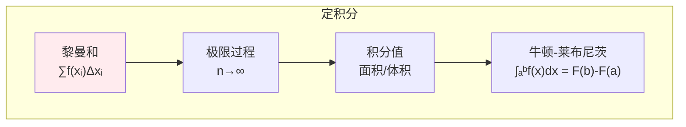
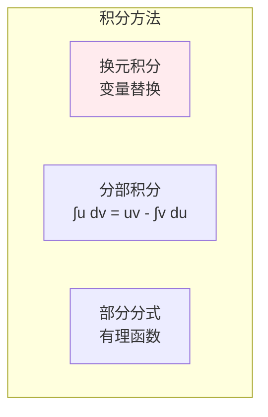
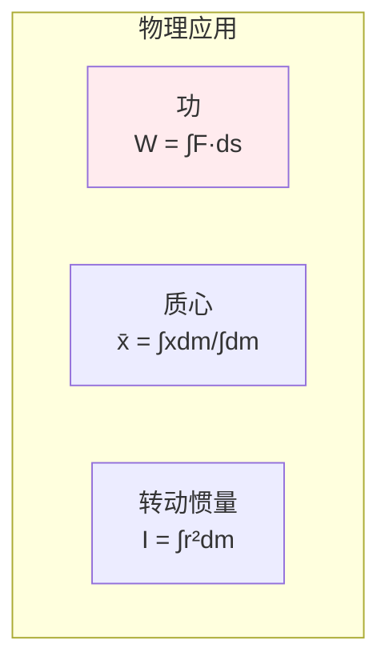

# 积分学

> **核心观点**：积分是微分的逆运算，是计算面积、体积和累积量的工具。

## 🎯 这 20% 能解决哪些问题

| 你遇到的困惑 | 本质原因 | 马上能改的动作 |
|---|---|---|
| 概率密度为什么「可以大于 1」 | 密度不是概率，积分为 1 才归一 | 讨论区间概率，不要拿单点密度值下结论 |
| 期望、互信息这些公式到底怎么算 | 期望是密度与 x 乘积的积分 | 先定积分区间与测度，再推公式 |
| 两个独立变量相加后分布怎么求 | 密度相加就是卷积（一个积分） | 用卷积或特征函数，不靠模拟碰运气 |
| 归一化常数 k 怎么定 | 利用 `∫f = 1` 列方程 | 先积出总面积再回代，适合拒绝采样 |
| 高维积分算不动 | 数值积分复杂度随维度爆炸 | 改用蒙特卡洛，误差 `O(1/√N)` 与维度无关 |
| AUC 为什么能衡量排序 | AUC 是 ROC 曲线下面积（排序的积分） | 用「正例排在负例前面的概率」理解指标 |
| 变上限积分求导易错 | 微分基本定理 + 链式法则 | 先确认上限是变量还是函数，再求导 |

---

## 📊 积分基本概念

### 不定积分

| 概念 | 定义 | 意义 |
|------|------|------|
| 不定积分 | ∫f(x)dx = F(x) + C | 原函数族 |
| 被积函数 | f(x) | 要积分的函数 |
| 积分变量 | dx | 积分变量 |
| 积分常数 | C | 任意常数 |

### 定积分



---

## 🔢 积分公式

### 基本积分公式

| 函数 | 积分 | 说明 |
|------|------|------|
| xⁿ | xⁿ⁺¹/(n+1) + C | 幂函数 |
| 1/x | ln\|x\| + C | 对数函数 |
| eˣ | eˣ + C | 指数函数 |
| sinx | -cosx + C | 三角函数 |
| cosx | sinx + C | 三角函数 |

### 积分方法



---

## 📈 微积分基本定理

### 牛顿-莱布尼茨公式

| 定理 | 公式 | 意义 |
|------|------|------|
| 牛顿-莱布尼茨 | ∫ₐᵇf(x)dx = F(b) - F(a) | 微分与积分互逆 |
| 变上限积分 | d/dx∫ₐˣf(t)dt = f(x) | 原函数存在 |

### 定积分性质

```
定积分性质：
1. 线性性：∫(af+bg) = a∫f + b∫g
2. 区间可加：∫ₐᵇ = ∫ₐᶜ + ∫ᶜᵇ
3. 保号性：f≥0 → ∫f ≥ 0
4. 中值定理：∫ₐᵇf = f(ξ)(b-a)
```

---

## 🎯 应用

### 几何应用

| 应用 | 公式 | 说明 |
|------|------|------|
| 曲线长度 | L = ∫√(1+(y')²)dx | 弧长公式 |
| 旋转体积 | V = π∫y²dx | 绕x轴旋转 |
| 面积 | A = ∫|f(x)-g(x)|dx | 两曲线间面积 |

### 物理应用



---

## 🤖 机器学习应用

### 期望与方差

| 概念 | 公式 | 应用 |
|------|------|------|
| 期望 | E[X] = ∫xf(x)dx | 期望计算 |
| 方差 | Var(X) = ∫(x-μ)²f(x)dx | 方差计算 |
| 概率 | P(a<X<b) = ∫ₐᵇf(x)dx | 概率计算 |

---

## 🎯 核心结论

### 积分学核心概念

1. **不定积分**：原函数族
2. **定积分**：面积/累积量
3. **微积分基本定理**：微分与积分互逆
4. **积分方法**：换元、分部、部分分式
5. **应用**：几何、物理、概率

### 学习路径

```
积分学学习四步骤：
1. 不定积分：基本公式、积分方法
2. 定积分：定义、性质
3. 微积分基本定理：牛顿-莱布尼茨
4. 应用：几何、物理、概率
```

---

## 🎓 实战场景（TIL）

- **场景**：自定义密度函数采样，统计结果带固定偏差。**本质**：只在部分区间归一化，尾部被截断。**要点**：广义积分要验尾部收敛（`p > 1`），采样前用数值积分校核总质量。
- **场景**：算 `E[g(X)]` 时解析积分太难。**本质**：被积函数无初等原函数。**要点**：蒙特卡洛抽样估计，同时报样本量与估计标准差；方差大时用重要性采样或对偶变量。
- **场景**：模型输出概率不合法（总和不接近 1）。**本质**：没把离散求和/连续积分的归一化条件写进测试。**要点**：任何概率输出都加一条 `sum ≈ 1` 的属性测试。

---

## 📋 一页速查

| 我要用 | 记住这条 |
|---|---|
| 微分基本定理 | `d/dx ∫_a^x f(t)dt = f(x)`；上限为函数时再乘链式因子 |
| 定积分求面积 | 上曲线减下曲线；先交点分区间，不要直接相减取绝对值 |
| 换元 vs 分部 | 内函数导数出现 → 换元；两类不同函数相乘 → 分部 |
| 广义积分收敛 | `∫_1^∞ 1/x^p dx` 收敛当 `p > 1`；用于验尾部与归一化 |
| 数值积分选型 | 低维光滑 → 梯形/辛普森；高维/复杂区域 → 蒙特卡洛 |
| 蒙特卡洛误差 | 标准差 `σ/√N`；要 1% 精度需约万量级样本 |
| Gamma/Beta | 归一化常数常出现于指数族与共轭先验，记住它们就是积分 |
| 卷积 | 独立和的密度 = 密度卷积；正态相加仍是正态（方差相加） |

---

## 🔗 相关链接

- 上级：[微积分](index.md)
- 前置概念：[导数与微分](02-derivatives.md) — 积分的逆运算对象
- 邻域：[概率基础](../probability-statistics/01-probability-basics.md) — 期望是积分的直接应用
- 邻域：[信息与熵](../information-theory/01-information-entropy.md) — 连续熵与积分测度
- 邻域：[凸优化](../optimization/02-convex-optimization.md) — 目标函数中的积分形式

---

## 📚 参考文献

1. 《高等数学》- 同济大学
2. 《微积分》- James Stewart
3. 《普林斯顿微积分读本》
4. 《数学分析》- 陈纪修
5. 《积分学》
6. 《微积分应用》
7. 《Calculus Made Easy》
8. 《数学分析新讲》- 张筑生