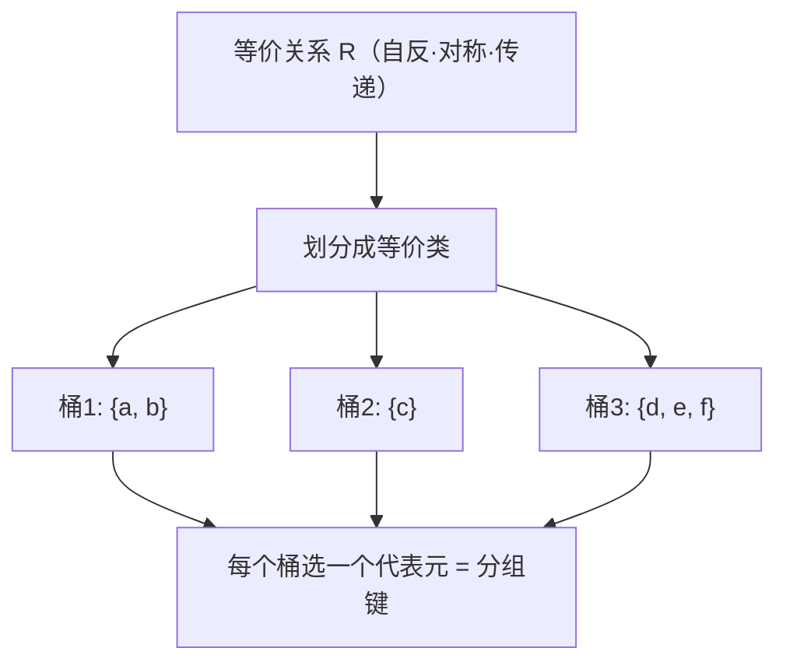
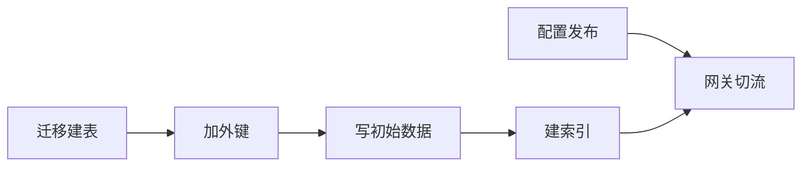

# 集合与关系 — 所有数据模型背后的那张表

> 一句话：表是集合，约束是关系，分组必须靠等价关系，执行顺序必须由偏序决定——把这四句话对上，数据库设计、缓存 key、迁移顺序、依赖管理里 80% 的"凭感觉"都能变成可验证的规则。

## 🎯 这 20% 能解决哪些问题

| 你遇到的困惑 | 本质原因 | 马上能改的动作 |
|---|---|---|
| UNIQUE 索引凭什么能去重，外键又到底约束了什么 | 约束就是「满足特定性质的关系」 | 用性质表（自反/对称/传递/单值）逐条对照你的建表语句 |
| 分组聚合的结果漏数据、同一批数据被分到两个桶 | 用的关系不满足传递性，不是等价关系 | 换用「确定性函数」作为分组键，别用"相邻""好友的"这类关系 |
| 上线顺序一乱就白屏，回滚做不到完全对称 | 任务之间存在偏序但没有按拓扑序执行 | 画出依赖 DAG，按拓扑序部署；每个变更写成可逆的 up/down |
| 多对多关系怎么建表最稳 | 关系本身是笛卡尔积的子集 | 建独立关系表，两个外键 + 联合唯一索引 |
| set 去重后顺序变了，导致 diff 出噪音 | 集合无序，顺序是额外结构 | 需要顺序就显式存有序结构（数组/序号列） |
| 学号做主键，转班后数据错乱 | 标识与属性混在一起 | 主键用无意义且永不变更的 id，业务属性走唯一索引 |

---

## 一、集合：无序、互异，剩下的都靠运算

| 概念 | 记法 | 工程对应 |
|---|---|---|
| 属于 / 包含 | `a ∈ A`、`A ⊆ B` | 值校验、枚举范围、类型约束 |
| 空集 | `∅` | 「查无结果」，与 `null` 语义不同：空集是确定的无 |
| 幂集 | `2^A`，元素数 `2^\|A\|` | 权限组合、特性开关的全组合数量 |
| 基数 | `\|A\|` | 基数估计决定索引还是全表扫描 |
| 笛卡尔积 | `A × B`，基数相乘 | 未加条件的 join 行数 = 两表乘积 |

| 运算 | 定律 | 一句工程结论 |
|---|---|---|
| 并 `∪` | 交换、结合、`A∪B=B∪A` | 合并两个集合顺序无关，可并行做 |
| 交 `∩` | 交换、结合、`A∩A=A` | 交是「与」，多条件过滤可任意重排 |
| 差 `−` | **不交换**：`A−B ≠ B−A` | 「在 A 但不在 B」只有一个方向，别写反 |
| 补 `∁` | 德摩根：`∁(A∪B)=∁A∩∁B` | 排除条件取反后，并变交、交变并——最容易写错的一步 |

**分配律**：`A ∩ (B ∪ C) = (A∩B) ∪ (A∩C)`。SQL 里 `WHERE status='active' AND (a OR b)` 与 `OR` 加括号的区别就在这里，漏括号等于改了集合运算优先级。

---

## 二、二元关系：约束的本质是「满足某条性质」

关系 `R ⊆ A × B`——关系就是笛卡尔积里挑出来的合法配对。数据库的外键表、用户-角色表、标签映射表，全都是这句话的具体形态。

| 性质 | 定义 | 工程对应 |
|---|---|---|
| 自反 | ∀a, aRa | 每个实体都可被自己查询到；迁移的 `identity` 回滚 |
| 对称 | aRb ⇒ bRa | 无向关系（好友、同群）；查询要双向建索引 |
| 反对称 | aRb ∧ bRa ⇒ a=b | 层级/所有权（父子、拥有）：出现双向就是环 |
| 传递 | aRb ∧ bRc ⇒ aRc | 权限继承、依赖推导；不传递就不能压缩计算 |
| 单值（函数性） | 每个 a 只对应一个 b | 唯一约束 / 一对一关系 |

多对多关系落库的标准形态：**独立关系表 = 两个外键 + 联合唯一索引**，因为关系本身是笛卡尔积的子集，重复配对会让基数失真（join 后行数翻倍是最常见的表现）。

---

## 三、等价关系与划分：分桶的合法性依据

等价关系 = 自反 + 对称 + 传递。它和「把集合划分成互不相交的块」是一一对应的，这是分组、分区、分桶、去重唯一正确的数学基础。

| 想用某关系分组 | 是否是等价关系 | 结论 |
|---|---|---|
| 同哈希值、同租户 id、同日期 | ✅ 由函数导出 | 可以分桶、分区、聚合 |
| 相似度 ≥ 0.9 | ❌ 不传递 | 不能直接当分组键，需先做连通分量或选代表元 |
| 好友 / 同事（ symmetric 但非传递） | ❌ | "好友的分组"会把不同圈子合并 |
| 前驱-后继（传递但不对称） | ❌ 是偏序 | 该用拓扑排序而不是分组 |

**反例的代价**：不传递的关系当等价类用，同一批数据会被分到多个桶或漏桶——表现为「统计口径对不上」「缓存命中率莫名偏低」。

---

## 四、偏序与拓扑排序：谁先执行、谁后执行

偏序 = 自反 + 反对称 + 传递（`≤`）。它给出的不是分组，而是**顺序**。有限偏序集可以排成拓扑序；出现环就不存在任何合法顺序。

| 场景 | 偏序关系 | 工程做法 |
|---|---|---|
| 数据库迁移 | 依赖列先于依赖它的视图 | 按文件名编号 + 每个变更写可逆 up/down（回滚是反序拓扑） |
| 微服务发布 | 被调用方先于调用方 | expand-contract：先兼容双写，再切换，最后收缩 |
| 包/模块依赖 | import 关系 | 循环依赖 = 不是偏序，必须先拆环 |
| 任务调度 | 前驱任务完成 | DAG 调度器（拓扑分层，同层并行） |

「禁止双向依赖」这条架构纪律，本质是要求依赖图是反对称的，否则拓扑排序无解。

---

## 五、函数：单射、满射、双射决定「能不能反过来」

函数 `f: A → B` 要求每个 a 只对应一个 b（这就是函数性约束）。区别在于反向能不能走通：

| 类型 | 定义 | 工程含义 |
|---|---|---|
| 单射 | 不同 a 映射到不同 b | 可去重、可反查；唯一索引保证单射 |
| 满射 | B 中每个元素都被命中 | 覆盖完整：枚举/状态机不遗漏目标值 |
| 双射 | 既单射又满射 | **存在逆函数**：编码↔解码、迁移↔回滚、id↔业务键可完全还原 |
| 常数函数 | 全都映射到同一个 b | 信息全丢，等价于把所有数据塞进一个桶 |

只有双射才允许「无损反向」。回滚脚本做不到精确还原、加密后无法解密、映射表丢数据，根因几乎都是函数不是双射（多对一或存在未覆盖值）。

---

## 六、基数：能不能不冲突，先看容量

| 结论 | 公式 | 用途 |
|---|---|---|
| 映射只能压进有限桶 | `\|A\| > \|B\|` ⇒ 必有两元素同桶（鸽笼） | 哈希冲突不可避免，只谈负载因子不谈"消灭冲突"是错的 |
| 组合撑不住标识空间 | `\|A × B\| = \|A\|·\|B\|` | 短随机串做主键迟早撞，容量按 `62^len` 估算 |
| 幂集指数增长 | `\|2^A\| = 2^\|A\|` | 特性开关组合、权限矩阵规模评估 |

计数细节与冲突概率（生日界、容斥、可重复选择）见 [组合数学](03-combinatorics.md)。

---

## 🎓 实战场景（TIL）

- **场景**：join 之后行数暴涨，报表金额翻倍。**本质**：关系表里存在重复配对，笛卡尔积基数被放大。**要点**：多对多关系表加联合唯一索引，写报表前先 `COUNT(DISTINCT)` 验证配对基数。
- **场景**：缓存按「用户 + 设备 + 时间窗」分桶，命中率极低。**本质**：分桶键粒度过细，等价类数量接近键空间上限。**要点**：先用组合计数估算桶数，桶数接近基数时等于没有缓存。
- **场景**：灰度发布后回滚，发现新配置已被旧服务读取。**本质**：发布顺序违反偏序（切流早于兼容层上线）。**要点**：把部署顺序写成 DAG 里的显式依赖，而不是 wiki 里的口头约定。

---

## 📋 一页速查

| 我要判断 | 照着做 |
|---|---|
| 这个约束是什么 | 写成关系，指出它要求哪条性质（自反/对称/反对称/传递/单值） |
| 能不能分组/分桶 | 检查是否等价关系：自反 + 对称 + 传递，缺一不能用 |
| 该用什么顺序执行 | 画依赖 DAG 做拓扑排序；有环先拆环 |
| 多对多怎么建表 | 独立关系表 + 两个外键 + 联合唯一索引 |
| 主键怎么选 | 无意义、单调/随机可接受、永不变更；业务属性走唯一索引 |
| 回滚能否无损 | 变更是否为双射；不是就补一张映射/备份表 |
| `WHERE` 加不加括号 | 交对并的分配律；`AND` 优先级高于 `OR` |
| 冲突概率该不该担心 | 鸽笼：元素数 > 桶数必冲突；接近时用生日界 ≈ `√桶数` |

---

## 🔗 相关链接

- 上级：[离散数学](index.md)
- 同域下一步：[数理逻辑](02-mathematical-logic.md) — 在集合与关系之上做形式化推理
- 同域下一步：[组合数学](03-combinatorics.md) — 数清楚集合有多大
- 同域下一步：[图论](04-graph-theory.md) — 关系的一般形式与图上算法
- 邻域：[数据库设计](../../../data-fundamentals/01-database-design.md) — 集合与关系落成表结构
- 邻域：[部署与发布](../../software/08-deployment-release.md) — 偏序与拓扑序的工程版本
