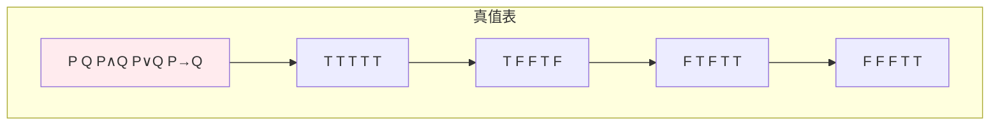
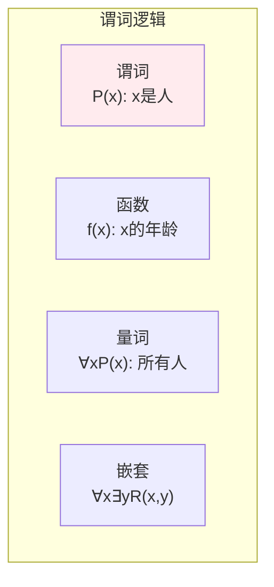
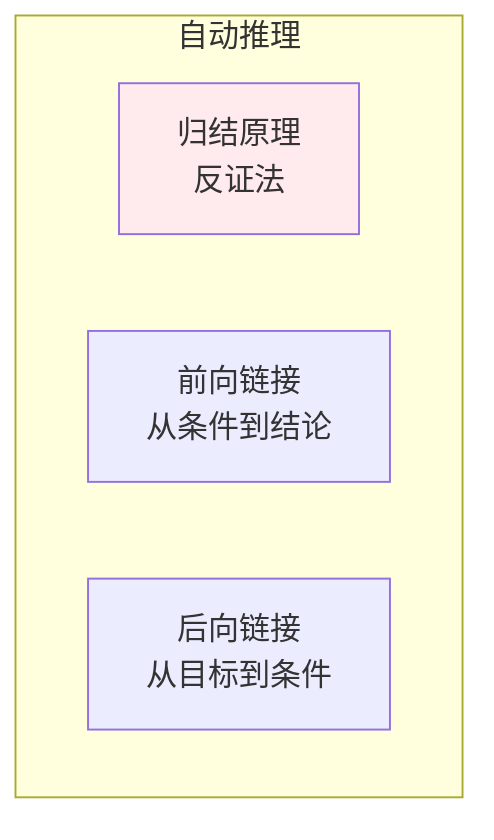

# 数理逻辑

> **核心观点**：数理逻辑是形式化推理的基础，是知识表示和自动推理的数学工具。

## 🎯 这 20% 能解决哪些问题

| 你遇到的困惑 | 本质原因 | 马上能改的动作 |
|---|---|---|
| `!(a && b)` 取反后条件写错，边界判断反复出问题 | 德摩根律不熟：`¬(A∧B) ≡ ¬A∨¬B` | 取反时同时改联结词，写单元测试覆盖三个边界值 |
| 需求里「所有用户都不能…」与「存在用户可以…」互相打架 | 全称/存在量词取反规则不清 | 记住 `¬∀x P ≡ ∃x ¬P`，把需求改写成可测的断言 |
| 「如果参数为 null 就返回空列表」这类代码审查争论 | 蕴含 `P→Q` 在 P 为假时恒为真 | 用逆否命题 `¬Q→¬P` 表述校验，避免「前提不成立」的歧义 |
| 复杂条件分支无法证明正确 | 只用自然语言推理，没有形式化 | 把条件写成真值表，逐行对照代码分支 |
| 规则引擎/权限判断出现矛盾结论 | 规则集不一致且未做冲突检测 | 先检查是否存在 `P` 与 `P→¬Q` 同时成立，归结出空子句即矛盾 |
| 循环不变量、递归正确性说不清 | 缺少归纳法思维 | 递归函数按「基础情形 + 归纳步骤」写注释与测试 |

---

## 📊 命题逻辑

### 命题与联结词

| 联结词 | 符号 | 含义 | 真值表 |
|--------|------|------|--------|
| 否定 | ¬P | 非 | 取反 |
| 合取 | P∧Q | 与 | 同真为真 |
| 析取 | P∨Q | 或 | 同假为假 |
| 蕴含 | P→Q | 如果...那么 | P假或Q真 |
| 等价 | P↔Q | 当且仅当 | 相同为真 |

### 真值表



### 逻辑等价

| 等价式 | 内容 |
|--------|------|
| 德摩根律 | ¬(P∧Q) ≡ ¬P∨¬Q |
| 蕴含等价 | P→Q ≡ ¬P∨Q |
| 双重否定 | ¬¬P ≡ P |

---

## 📈 谓词逻辑

### 量词

| 量词 | 符号 | 含义 | 例子 |
|------|------|------|------|
| 全称量词 | ∀ | 对所有 | ∀xP(x) |
| 存在量词 | ∃ | 存在 | ∃xP(x) |

### 量词取反（工程上最容易错的一步）

| 原命题 | 否定后等价形式 | 代码含义 |
|---|---|---|
| `¬∀x P(x)` | `∃x ¬P(x)` | 「不是所有人都合法」= 「至少一个非法」，find-first-violation 即证伪 |
| `¬∃x P(x)` | `∀x ¬P(x)` | 「不存在符合条件的」= 「全部都不符合」，不能用一个样本推断 |
| `∀x (P(x) → Q(x))` | `∃x (P(x) ∧ ¬Q(x))` | 要推翻「所有订单都能退款」，只需一个反例 |
| `P → Q` | `¬Q → ¬P`（逆否等价） | 校验写法：不满足结果就一定不满足前提，比堆 `if` 更少歧义 |

### 谓词逻辑公式



---

## 🔗 推理规则

### 基本推理规则

| 规则 | 形式 | 意义 |
|------|------|------|
| 假言推理 | P, P→Q ⊢ Q | Modus Ponens |
| 拒取式 | ¬Q, P→Q ⊢ ¬P | Modus Tollens |
| 三段论 | P→Q, Q→R ⊢ P→R | 假言三段论 |
| 合取引入 | P, Q ⊢ P∧Q | 合取 |
| 析取消去 | P∨Q, ¬P ⊢ Q | 析取三段论 |

### 形式证明


---

## 🧮 证明方法：三种可复用的推理套路

| 方法 | 适用 | 工程对应 |
|---|---|---|
| 穷举/真值表 | 命题变元少（n ≤ 5） | 条件分支测试用例设值，边界值分析 |
| 反证法 | 否定式结论、唯一性 | 假设存在非法数据，找出它就定位 bug；矛盾即证明 |
| 数学归纳法 | 与自然数相关的断言 | 递归函数正确性、循环不变量、分治算法复杂度 |
| 构造证明 | 存在性断言 | 给出一例即证明「可行」：写一个可运行的最小例子 |

**归纳法使用模板**：基础情形（n=1 成立）→ 归纳假设（n=k 成立）→ 归纳步骤（推出 n=k+1 成立）。递归代码的「终止条件 + 当前层处理 + 子问题」正好逐项对应，这就是为什么递归必须同时测试空输入和非空输入。

---

## 🤖 机器学习应用

### 知识表示

| 应用 | 内容 | 意义 |
|------|------|------|
| 本体 | 概念和关系 | 知识图谱 |
| 规则 | if-then规则 | 专家系统 |
| 约束 | 逻辑约束 | 逻辑编程 |

### 自动推理



---

## 🎯 核心结论

### 数理逻辑核心概念

1. **命题逻辑**：真值运算
2. **谓词逻辑**：量词约束
3. **推理规则**：有效推理
4. **形式证明**：严格推导
5. **应用**：知识表示、自动推理

### 学习路径

```
数理逻辑学习四步骤：
1. 命题逻辑：联结词、真值表
2. 谓词逻辑：量词、公式
3. 推理规则：假言推理、拒取式
4. 应用：知识表示、自动推理
```

---

## 🎓 实战场景（TIL）

- **场景**：需求写「只有满足 A 且 (B 或 C) 的用户才能领取」，代码漏括号后变成「满足 A 且 B，或满足 C」。**本质**：合取对析取的分配律被破坏。**要点**：把自然语言先译成公式 `A ∧ (B ∨ C)`，再用真值表写测试用例。
- **场景**：灰度开关关闭后，一部分旧逻辑仍在运行。**本质**：把 `P→Q` 当成 `Q→P` 用（原命题与逆命题不等价）。**要点**：约定开关语义只写一种方向，并在注释里给出逆否形式。
- **场景**：规则引擎同时命中「允许提现」与「金额>1000 禁止提现」，结论不确定。**本质**：规则集不一致（可同时推出 `Q` 与 `¬Q`）。**要点**：上线前做一致性检查（归结出空子句即矛盾），或显式定义规则优先级。

---

## 📋 一页速查

| 我要做 | 记住这条 |
|---|---|
| 取反带与/或的条件 | 德摩根：`¬(A∧B) ≡ ¬A∨¬B`，`¬(A∨B) ≡ ¬A∧¬B` |
| 取反带量词的断言 | `¬∀ ≡ ∃¬`，`¬∃ ≡ ∀¬` |
| 写校验条件 | 用逆否 `¬Q→¬P`，比堆 `if` 少歧义 |
| 判断推理是否有效 | 前提真而结论可能假 = 无效；常见谬误：肯定后件 `Q, P→Q ⊢ P` |
| 证明递归/循环正确 | 基础情形 + 归纳步骤（循环不变量） |
| 给条件分支设计测试 | 变元少到可穷举：n 个条件 → 至多 `2^n` 行真值表 |
| 检查分支覆盖 | 分支需互斥且完备，即 `P ∨ ¬P` 必真 |

---

## 🔗 相关链接

- 上级：[离散数学](index.md)
- 前置概念：[集合与关系](01-sets-and-relations.md) — 逻辑式子的语义载体
- 同域：[组合数学](03-combinatorics.md) — 真值表行数就是 `2^n`
- 同域：[图论](04-graph-theory.md) — 归结与依赖推理在图上展开
- 邻域：[算法与数据结构](../../computing/01-algorithms-data-structures.md) — 循环不变量的实际使用
- 邻域：[测试策略](../../software/07-testing-strategy.md) — 边界值与判定表来自命题逻辑

---

## 📚 参考文献

1. 《离散数学及其应用》- Kenneth Rosen
2. 《数理逻辑》- 汪芳庭
3. 《逻辑学导论》- Irving Copi
4. 《人工智能逻辑基础》
5. 《知识表示与推理》
6. 《自动推理》
7. 《逻辑与可计算性》
8. 《离散数学》- 屈婉玲