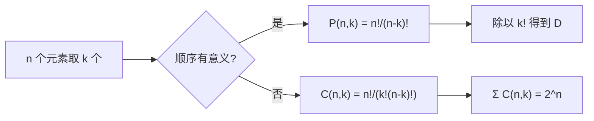

# 组合数学 — 先算清有多少种，再决定怎么算

> 一句话：工程上绝大多数「跑不动」和「撞号」都不是算法不够快，而是没先算出状态空间有多大——计数是决定方案可行性的第一道工序。

## 🎯 这 20% 能解决哪些问题

| 你遇到的困惑 | 本质原因 | 马上能改的动作 |
|---|---|---|
| 特征组合、测试用例、配置矩阵一多就爆炸 | 乘法原理导致指数增长 | 方案评审前先写出 `Π 各维度取值数`，超阈值就砍维度 |
| 6 位随机码做短链，线上开始撞号 | 空间容量 `62^6 ≈ 568 亿`，但生日界 `√N` 就到 50% 冲突 | 用生日界估算：想放 N 条记录至少需要 `N²` 量级空间 |
| 多个条件统计用户数，总数比实际大 | 集合重叠被重复计数 | 用容斥：`|A∪B| = |A|+|B|-|A∩B|`，或改 `COUNT(DISTINCT)` |
| 「从 20 个接口里选 3 个做压测」不知道该准备多少用例 | 分不清有序无序 | 不关心顺序用 `C(20,3)=1140`，关心顺序用 `P(20,3)=6840` |
| 哈希表负载因子为什么不能到 1 | 鸽笼原理：桶数不够必然冲突 | 桶数取预计元素数的 2–4 倍，冲突只谈概率不谈避免 |
| 分布式 ID 该分多少位给机器、多少位给序号 | 位分配就是基数分配 | 按 `2^bits` 反推每段容量与增长上限 |

---

## 一、两个基本原理：分类用加法，分步用乘法

| 原理 | 判据 | 例子 |
|---|---|---|
| 加法原理 | 完成事件的方式**互斥**（选一类就行）：OR | 走 A 路 3 种方式，走 B 路 2 种 → 5 种 |
| 乘法原理 | 完成事件要**依次**做完每一步：AND | 3 件上衣 × 2 条裤子 → 6 种搭配 |

**乘法的幂等形式**：每步选择数都是 k、共 n 步 → `k^n`。所有「枚举所有可能配置」的问题都是这个形状，也是最容易低估规模的地方。

---

## 二、排列与组合：唯一区别是「顺序算不算数」

| 对象 | 公式 | 直觉 |
|---|---|---|
| 排列 `P(n,k)` | `n! / (n-k)!` | 先选再排，前 k 个位置有次序 |
| 组合 `C(n,k)` | `n! / (k!(n-k)!)` | 只关心选了谁，除掉了 k! 种内部次序 |
| 恒等式 | `C(n,k) = C(n,n-k)` | 选出来 = 剩下的，取补更省事 |
| 全排列 | `n!` | 排序算法下界 `Ω(n log n)` 的对照物：`log(n!) = Θ(n log n)` |
| 二项系数和 | `Σₖ C(n,k) = 2^n` | 每个元素「选或不选」，乘法原理的直接结果 |

| 数量感觉（记住这几档） | 值 |
|---|---|
| `C(20,3)` | 1140 |
| `C(20,10)` | 184756 |
| `C(52,5)` | 2598960 |
| `10!` | 3628800 |
| `2^20` | 约 100 万 |
| `2^32` | 约 43 亿 |
| `62^6` | 约 568 亿（base62 短码空间） |

**工程用法**：任何「组合空间」先套上表估一档——超过千万级就别指望穷举，必须靠剪枝、贪心、近似或改变问题规模。

---

## 三、二项式定理：概率与算法分析里的系数来源

`(x + y)^n = Σₖ C(n,k) x^k y^(n-k)`

| 用途 | 出现形式 | 解释 |
|---|---|---|
| 伯努利试验 | `C(n,k) p^k (1-p)^(n-k)` | n 次里有 k 次成功：概率来自概率统计，**系数**来自组合 |
| 帕斯卡三角 | `C(n,k) = C(n-1,k-1) + C(n-1,k)` | 「第 k 个元素选/不选」分类相加 |
| 动态规划示例 | 组合数可用 `O(nk)` 递推填表 | 也是记忆化的一维实例 |
| 增长率 | 中间项最大：`C(n, n/2) ≈ 2^n / √n` | 组合数峰值接近 2^n，所以子集枚举是指数级 |

---

## 四、可重复的选择：隔板法与多重排列

| 情形 | 公式 | 工程例子 |
|---|---|---|
| 可重复地选 k 个（组合） | `C(n+k-1, k)` | 把 10 个相同配额分给 4 个租户；k 次随机命中 n 个桶 |
| 全排列但有重复元素 | `n! / (n₁! n₂! …)` | 单词字母重排；相同优先级任务的调度序列数 |
| 分配 n 个球入 m 个盒（任意） | `m^n` | n 条请求落到 m 个后端实例的所有可能分布 |
| 每盒至少一球（满射） | 容斥 / 斯特林数 `m!·S(n,m)` | 每台实例都必须被分配到流量 |

---

## 五、鸽笼原理与生日界：冲突是必然，问题是何时

- **鸽笼原理**：`n` 个元素放进 `m` 个桶，若 `n > m`，必有桶至少装 `⌈n/m⌉` 个 → 哈希冲突、端口复用、发号器回绕都是它。
- **生日界**：从 `N` 个等可能取值中随机抽 `k` 次，出现重复的概率约 `1 - e^(-k²/2N)`；**只要 `k ≈ 1.18√N` 就有 50% 概率撞**。

| 场景 | 空间 N | 撞号风险点 ≈ √N |
|---|---|---|
| 4 位数字验证码 | 10000 | 约 118 次尝试 |
| 6 位 base62 短码 | 568 亿 | 约 24 万条 |
| UUID v4 | 2^122 | 约 2^61，实践上可忽略 |
| 32 位随机 token | 2^32（43 亿） | 约 7.7 万，**做会话 ID 不够** |

**结论**：随机 ID 的长度要按 `N ≥ k²`（k 为期望总量）反推，而不是凭「随机就行」。碰撞防护靠唯一索引 + 重试，而不是靠"概率很低"。

---

## 六、容斥原理：多条件统计不去重的后果

`|A ∪ B| = |A| + |B| − |A∩B|`；三个集合时再加回三元交集。

| 症状 | 原因 | 修法 |
|---|---|---|
| 「活跃 + 付费 + 新客」总数超过总用户数 | 并集被简单相加 | 按容斥减去重叠，或直接 `DISTINCT` |
| 分面筛选（facet）计数各选一个都对、合起来不对 | 每个 facet 单独统计未去重 | 以并集口径重算，或预聚合物化视图 |
| 全量校验 `Σ 分类计数 ≠ 总数` | 分类未构成划分（有重叠或漏项） | 回到等价关系划分：互斥且完备 |

---

## 🎓 实战场景（TIL）

- **场景**：压测环境用 32 位随机 order_no，跑 10 万单就报唯一键冲突。**本质**：生日界 √(2^32) ≈ 7.7 万，远超预期。**要点**：唯一键的 ID 长度按 `N ≥ k²` 反推，或直接用时间戳 + 自增序列。
- **场景**：CI 矩阵 `3 个数据库 × 4 个 PHP 版本 × 2 个 OS × 3 个特性 = 72` 个 job，排队 40 分钟。**本质**：乘法原理。**要点**：用「pairwise 组合测试」把全交叉降到约 12 个用例，覆盖两两交互即可拦住大多数回归。
- **场景**：运营报表三张表分别统计 12 万 / 9 万 / 5 万，合计 26 万但用户只有 20 万。**本质**：未做容斥。**要点**：任何"多标签人数相加"前先问一句「标签之间是否互斥」。

---

## 📋 一页速查

| 我要算 | 用这个 |
|---|---|
| 分步完成，每步 m 种，共 n 步 | `m^n` |
| n 选 k，不看顺序 | `C(n,k)` |
| n 选 k，看顺序 | `P(n,k) = C(n,k)·k!` |
| 可重复地选 k 个 | `C(n+k-1, k)` |
| 全部子集个数 | `2^n` |
| 冲突概率 50% 需要的抽取次数 | `≈ 1.18√N` |
| 多条件并集大小 | 容斥：加奇数个交集、减偶数个交集 |
| 判断能否穷举 | 空间 > 10^8 就直接换剪枝/近似/降低维度 |

---

## 🔗 相关链接

- 上级：[离散数学](index.md)
- 前置概念：[集合与关系](01-sets-and-relations.md) — 基数、划分与幂集
- 同域：[数理逻辑](02-mathematical-logic.md) — 数学归纳法用于证明计数公式
- 同域：[图论](04-graph-theory.md) — 生成树/路径计数与组合爆炸的关系
- 邻域：[概率论基础](../probability-statistics/01-probability-basics.md) — 古典概型的分母就是组合数
- 邻域：[信息与熵](../information-theory/01-information-entropy.md) — `log₂ C(n,k)` 是「选了谁」所需的信息量
