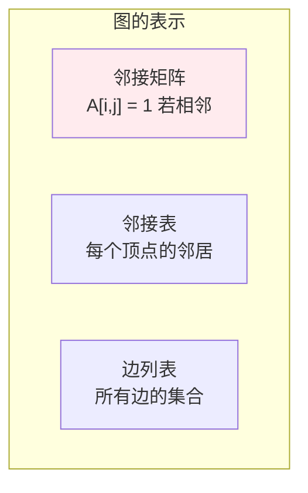
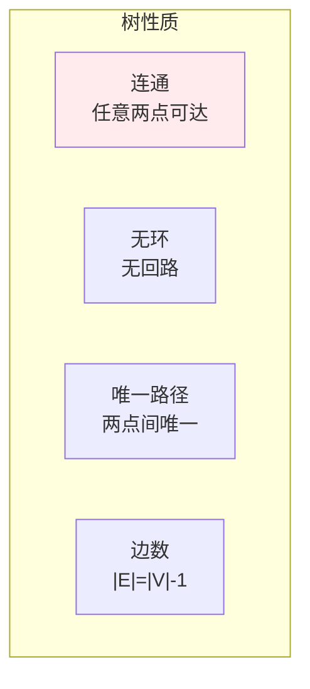
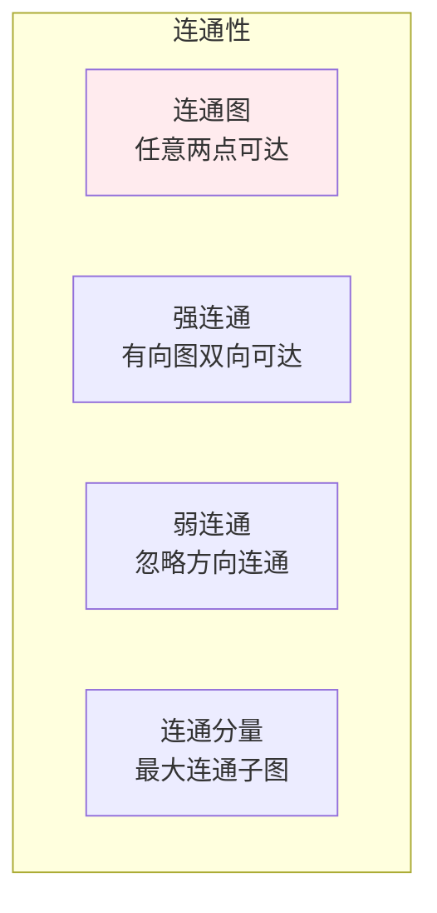
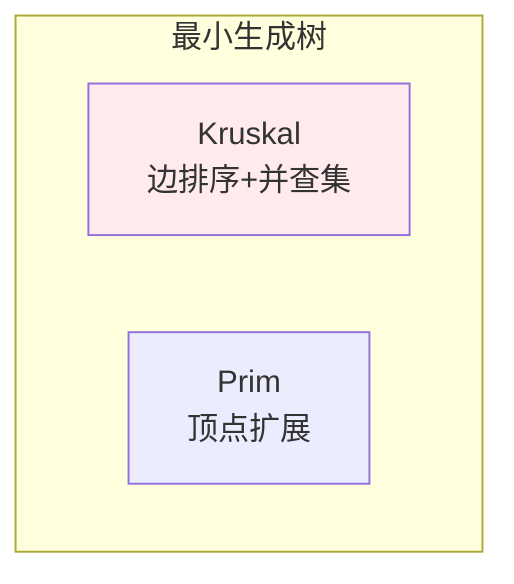
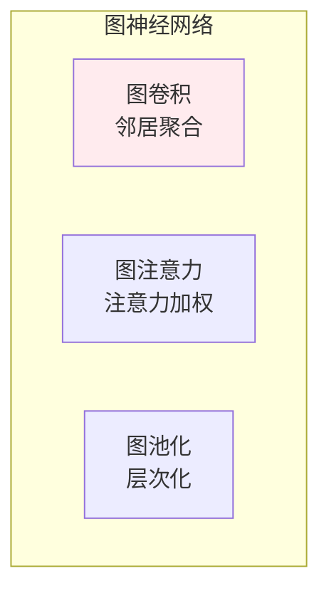

# 图论

> **核心观点**：图是描述对象间关系的数学模型，是网络分析和社交网络的理论基础。

## 🎯 这 20% 能解决哪些问题

| 你遇到的困惑 | 本质原因 | 马上能改的动作 |
|---|---|---|
| 依赖装了又拆，循环依赖警告不断 | 依赖图有环，不是 DAG | 用 DFS 找强连通分量，先拆 SCC 再解耦 |
| 上线/迁移/任务执行顺序总出错 | 没按拓扑序执行 | 把依赖写成图，拓扑分层，同层并行 |
| 微服务雪崩，一个下游挂全链路挂 | 调用图里的关键路径与入度高的节点无隔离 | 算出介数/入度最大的节点，优先加超时+熔断+降级 |
| 社交/组织/设备网络里找「一个点挂了一片」 | 求的是割点与连通分量 | 用并查集或 Tarjan 找割点/桥，加冗余边 |
| 最短路径、最低成本方案选型不确定 | 有权图算法选错 | 非负权用 Dijkstra，有负权/检测负环用 Bellman-Ford |
| 去重/关联查询越跑越慢 | 用嵌套循环判连通 | 改用并查集，`O(α(n))` 近似常数 |
| 缓存失效时一层层往下推不知道推到哪 | 缓存依赖是 DAG | 记录反向依赖图，按拓扑序逆推失效 |

---

## 📊 图的基本概念

### 图的定义

| 概念 | 定义 | 表示 |
|------|------|------|
| 图 | 顶点和边的集合 | G=(V,E) |
| 有向图 | 边有方向 | <u,v> |
| 无向图 | 边无方向 | {u,v} |
| 加权图 | 边有权重 | w(u,v) |

### 图的表示



---

## 📈 特殊图

### 特殊图类型

| 类型 | 定义 | 性质 |
|------|------|------|
| 完全图 | 所有顶点相连 | 边数=n(n-1)/2 |
| 二分图 | 顶点分为两组 | 可2-染色 |
| 平面图 | 可平面嵌入 | 边不相交 |
| 树 | 连通无环 | 边数=n-1 |

### 树的性质



---

## 🔢 图的性质

### 度与路径

| 概念 | 定义 | 意义 |
|------|------|------|
| 度 | 连接边数 | 节点重要性 |
| 入度 | 指向的边数 | 有向图 |
| 出度 | 发出的边数 | 有向图 |
| 路径 | 边的序列 | 连通性 |

### 连通性



---

## 🎯 图算法

### 遍历算法

| 算法 | 原理 | 应用 |
|------|------|------|
| BFS | 广度优先 | 最短路径 |
| DFS | 深度优先 | 拓扑排序 |

### 最短路径

| 算法 | 复杂度 | 特点 |
|------|--------|------|
| Dijkstra | O(V²) | 非负权 |
| Bellman-Ford | O(VE) | 负权边 |
| Floyd | O(V³) | 全源最短路径 |

### 最小生成树



---

## 🛠 工程中的图：六种最常见的用法

| 工程场景 | 图的形态 | 需要的算法 | 一句结论 |
|---|---|---|---|
| 包/模块依赖 | 有向图 | 环检测、拓扑排序 | 有环就不能分阶段构建，必须先拆 SCC |
| 任务调度/CI | 加权 DAG | 关键路径（最长路径） | 整体工期由关键路径决定，优化非关键任务无效 |
| 调用链/服务拓扑 | 有向图 + 统计 | 入度/出度、介数 | 入度高的服务是爆炸半径最大的点，优先隔离 |
| 网络路由 | 加权图 | Dijkstra / Bellman-Ford | 链路状态协议本质是跑最短路 |
| 账户/设备/标签归组 | 无向图 | 并查集（连通分量） | 只关心「是否同一堆」时用并查集，不建完整邻接表 |
| 状态机与迁移合法性 | 有向图 | 可达性、环 | 「不可达状态」要么删要么就是死代码 |
| 推荐/关系查询 | 稀疏图 | BFS 限定层数 | 好友的二度关系查询必须限制深度，否则 `O(度^层数)` 爆炸 |


**两个必记结论**：

- 树 = 连通无环图，边数 `n-1`；所以「n 个服务互相调用不形成环」时，最少要 `n-1` 条依赖边，加一条就成环。
- 握手定理：所有顶点的度之和 `= 2|E|` ⇒ 奇数度的顶点个数必为偶。用于校验数据（如关系表自连接统计是否漏行）。

---

## 🤖 机器学习应用

### 图神经网络



### 社交网络分析

| 应用 | 方法 | 意义 |
|------|------|------|
| 社区发现 | 图分割 | 群组识别 |
| 中心性分析 | 度/介数/接近中心性 | 影响力排序 |
| 链接预测 | 图特征 | 关系预测 |

---

## 🎯 核心结论

### 图论核心概念

1. **图**：对象和关系的数学模型
2. **度**：节点连接数
3. **路径**：边的序列
4. **连通性**：可达性
5. **算法**：遍历、最短路径、最小生成树

### 学习路径

```
图论学习四步骤：
1. 基本概念：顶点、边、度
2. 特殊图：树、完全图、二分图
3. 图算法：遍历、最短路径
4. 应用：图神经网络、社交网络
```

---

## 🎓 实战场景（TIL）

- **场景**：发布时 A 依赖 B 的新接口，B 又依赖 A 的新字段，两边都不敢先发。**本质**：依赖图有环。**要点**：环必须靠 expand-contract 拆成两个阶段（各自先兼容），而不是靠半夜协调顺序。
- **场景**：构建耗时 40 分钟，优化了三个小任务只降了 2 分钟。**本质**：优化的是非关键路径。**要点**：先算最长路径，只动关键路径上的任务。
- **场景**：好友关系二度查询在头部用户上超时。**本质**：社交图是幂律分布，存在入度极大的点，`O(度^2)` 爆炸。**要点**：先取前 N 个邻居再扩展，并按度数做缓存与限流。

---

## 📋 一页速查

| 我要做 | 选这个 |
|---|---|
| 判断依赖能否排序 | DFS 着色法检环；有环先缩强连通分量 |
| 求执行顺序 | 拓扑排序（入度为 0 先出队） |
| 求最短路径（非负权） | Dijkstra + 堆，`O(E log V)` |
| 有负权或要检负环 | Bellman-Ford，`O(VE)` |
| 全源最短路、V 小 | Floyd，`O(V^3)` |
| 只问「是否同一组」 | 并查集（路径压缩 + 按秩合并） |
| 找关键节点（割点/桥） | Tarjan 或边双连通分量 |
| 无权图最短跳数 | BFS（按层扩展，首次命中即最短） |
| 存储选择 | 稀疏图用邻接表；频繁问「两点是否直接相连」用邻接矩阵 |
| 关系查询防炸 | 限制遍历深度与每层邻居数，分页拉邻居 |

---

## 🔗 相关链接

- 上级：[离散数学](index.md)
- 前置概念：[集合与关系](01-sets-and-relations.md) — 图就是边的集合，偏序与拓扑序
- 同域：[数理逻辑](02-mathematical-logic.md) — 推理链本身是一张有向图
- 同域：[组合数学](03-combinatorics.md) — 路径计数与组合爆炸
- 邻域：[算法与数据结构](../../computing/01-algorithms-data-structures.md) — 图算法的实现与复杂度
- 邻域：[架构设计](../../software/04-architecture-design.md) — 依赖图与循环依赖的工程约束
- 邻域：[知识图谱](../../../applications/intelligent-systems/knowledge-graphs/01-essentials.md) — 图在 AI 侧的应用

---

## 📚 参考文献

1. 《图论及其算法》- Bondy
2. 《图论导引》- West
3. 《离散数学》- 屈婉玲
4. 《图神经网络》
5. 《社交网络分析》
6. 《网络科学》
7. 《图论》- 王树禾
8. 《算法导论》- 图算法部分