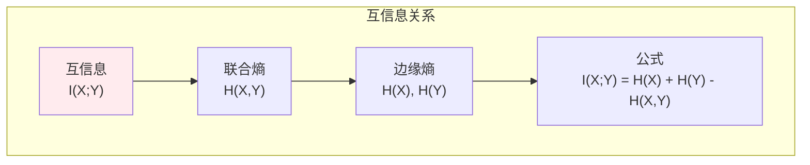
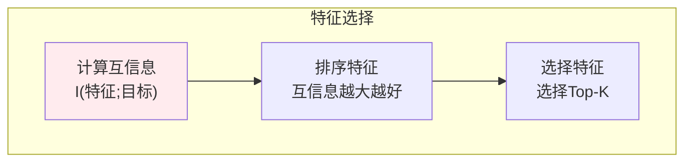
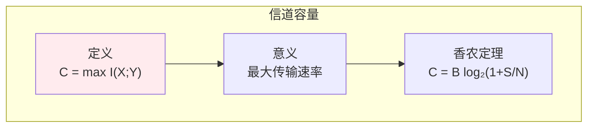

# 互信息

> **核心观点**：互信息度量两个变量间的共享信息量，是特征选择和聚类分析的重要工具。

## 🎯 这 20% 能解决哪些问题

| 你遇到的困惑 | 本质原因 | 马上能改的动作 |
|---|---|---|
| 两个字段相关系数近 0，业务上却明显有关 | 皮尔逊只测线性关系 | 改算互信息（连续值先分箱）或 Spearman，再决定是否建模 |
| 特征选了一堆，模型并不涨 | 只算特征-标签相关，没算特征-特征冗余 | 用 mRMR：对标签互信息高、特征间互信息低的才入列 |
| 聚类结果好坏说不清 | 需要不依赖标签尺度与簇数的指标 | 用归一化互信息 NMI 或调整互信息 AMI，避免随机分配也得高分 |
| 多模态检索对齐不准 | 不知道图文向量到底共多少信息 | 理解 InfoNCE：它是互信息的下界，对比学习就是在拉高 MI |
| 模型对某个输入特征完全无反应 | 该特征与标签 MI 接近 0 | 先量 MI 再训练，把 MI 近乎 0 的列直接剔除或合并 |

---

## 📊 互信息基本概念

### 定义

| 概念 | 公式 | 意义 |
|------|------|------|
| 互信息 | I(X;Y) = H(X) - H(X\|Y) | X和Y共享的信息量 |
| 对称性 | I(X;Y) = I(Y;X) | 方向无关 |
| 非负性 | I(X;Y) ≥ 0 | 始终非负 |

### 互信息与熵的关系



---

## 📈 互信息性质

### 基本性质

| 性质 | 内容 | 意义 |
|------|------|------|
| 非负性 | I(X;Y) ≥ 0 | 共享信息≥0 |
| 独立时为0 | I(X;Y) = 0 iff X,Y独立 | 无共享信息 |
| 不超过单变量熵 | I(X;Y) ≤ min(H(X), H(Y)) | 上界 |

### 归一化互信息

| 概念 | 公式 | 特点 |
|------|------|------|
| NMI | I(X;Y)/√(H(X)H(Y)) | 消除尺度影响 |
| 范围 | [0,1] | 便于比较 |

---

## 🤖 机器学习应用

### 特征选择



### 聚类评估

| 应用 | 方法 | 意义 |
|------|------|------|
| 聚类质量 | NMI(聚类;标签) | 与真实标签一致性 |
| 特征聚类 | I(特征1;特征2) | 特征相关性 |

### 信道容量



---

## 🎯 核心结论

### 互信息核心概念

1. **定义**：两个变量共享的信息量
2. **对称性**：方向无关
3. **非负性**：始终≥0
4. **独立时为0**：无共享信息
5. **应用**：特征选择、聚类评估

### 学习路径

```
互信息学习四步骤：
1. 基本概念：定义、性质
2. 与熵的关系：公式推导
3. 归一化互信息：消除尺度
4. 应用：特征选择、聚类评估
```

---

## 🎓 实战场景（TIL）

- **场景**：价格与下单率相关系数只有 0.05，被当作无效特征。**本质**：关系是 U 型，线性度量天然看不到。**要点**：先画分箱后的条件熵曲线，用互信息排序特征，再决定编码方式（分箱/多项式）。
- **场景**：新模型 AUC 只涨 0.001，特征却多了 30 个。**本质**：新特征与旧特征 MI 高，信息重复。**要点**：用条件互信息 `I(X;Y\|Z)` 判断增量，零增量就不入模型。
- **场景**：聚类评估在 K 不同时不可比。**本质**：原始 MI 随簇数增大而增大。**要点**：用 NMI（除以两端熵的几何/算术平均）或 AMI（扣除期望值）。
- **场景**：高维连续数据算出的 MI 大于实际可能。**本质**：估计器有偏，且受维度灾难影响。**要点**：用 KSG 类估计器或先降维；小样本时把 MI 估计的不确定度一并报告。

---

## 📋 一页速查

| 要什么 | 记这一行 |
|---|---|
| 定义（熵形式） | `I(X;Y) = H(X) − H(X\|Y) = H(X) + H(Y) − H(X,Y)` |
| 定义（KL 形式） | `I(X;Y) = KL(P(X,Y) ‖ P(X)P(Y))`：联合分布与独立假设的距离 |
| 基本性质 | 非负、对称；独立 ⇔ MI = 0（离散情形等价） |
| 单位 | 同熵：log₂ 为 bit，ln 为 nat |
| 归一化 | `NMI = I / √(H(X)H(Y))` 或 `I / ((H(X)+H(Y))/2)`；比较不同分区时用 AMI |
| 特征选择 | 单变量：按 `I(Xᵢ;Y)` 排序；去冗余：mRMR 最大化 `I(X;Y) − 均值 I(X;S)` |
| 估计方法 | 离散：频数表 + 拉普拉斯平滑；连续：KSG/kNN 估计；高维：先降维 |
| 常见陷阱 | MI 对样本量敏感；分箱粒度会直接改变结果，必须在报告中固定 |

---

## 🔗 相关链接

- 上级：[信息论](index.md)
- 同目录：[信息熵](01-information-entropy.md)、[KL 散度](03-kl-divergence.md)
- 前置：[多维随机变量（相关与独立）](../probability-statistics/03-multivariate-random-variables.md)
- 应用：[无监督学习 — 聚类](../../../applications/machine-learning/unsupervised/01-essentials.md)
- 应用：[文本处理与特征工程](../../../applications/nlp/text-processing/01-essentials.md)

---

## 📚 参考文献

1. 《信息论基础》- Thomas Cover
2. 《信息论与编码》- 傅祖芸
3. 《Elements of Information Theory》
4. 《互信息》
5. 《特征选择》
6. 《聚类分析》
7. 《信道容量》
8. 《信息论应用》