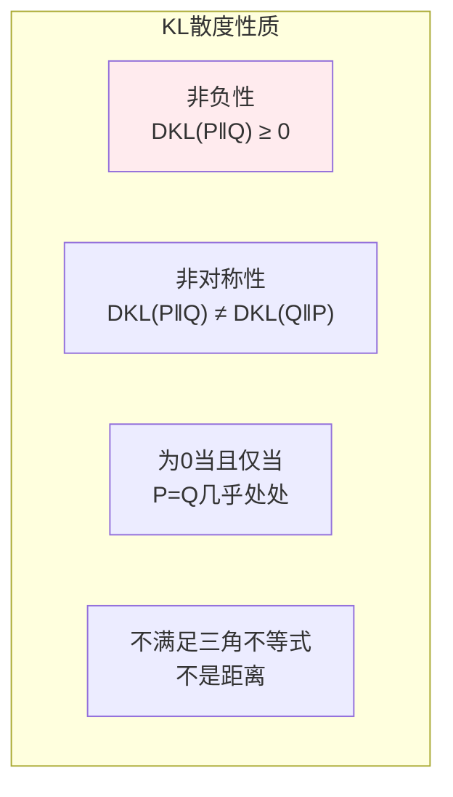
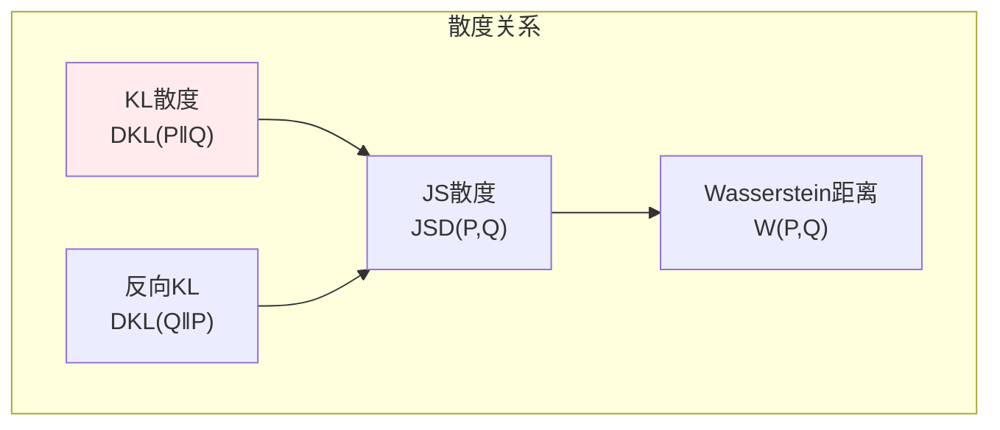
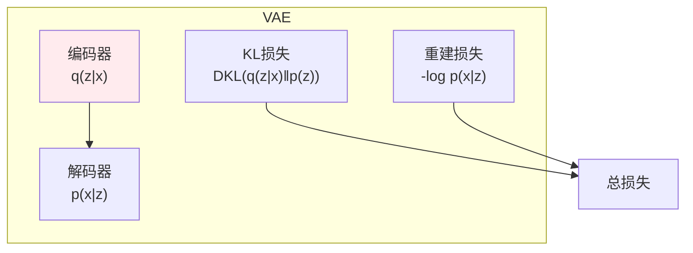

# KL散度

> **核心观点**：KL散度度量两个概率分布间的差异，是变分推断和知识蒸馏的核心工具。

## 🎯 这 20% 能解决哪些问题

| 你遇到的困惑 | 本质原因 | 马上能改的动作 |
|---|---|---|
| KL 不对称，该用哪个方向 | 前向 KL 保覆盖（mean-seeking），反向 KL 保模式（mode-seeking） | 多维/多峰目标要覆盖全部模式用前向；拟合单峰、宁可丢尾巴用反向 |
| 蒸馏损失越训越不确定 | 软标签与硬标签方向混用 | 蒸馏是 `KL(p_老师‖p_学生)`，带温度平方补偿；硬标签监督仍是交叉熵 |
| 两个分布不重叠时 JS 也顶到上限、梯度消失 | JS 在有界处饱和 | 用 Wasserstein 距离（EMD）；至少先把支撑集交集打开 |
| KL 算出来是负数或 NaN | 对零概率取 log，或把 KL 当成了距离 | 概率先夹 `eps`；归约方式用 `mean`；报告时注明不是度量（不满足三角不等式） |
| 上线后分布漂移怎么量化 | 没监控训练与线上分布的差异 | 按特征分桶算 PSI（本质是 KL 的对称变体），超 0.25 告警 |
| VAE 里那项到底在干什么 | 用反向 KL 把后验向先验压 | 记住 ELBO = 重建项 − `KL(q(z\|x)‖p(z))`，KL 越小越接近先验 |

---

## 📊 KL散度基本概念

### 定义

| 概念 | 公式 | 意义 |
|------|------|------|
| KL散度 | DKL(P‖Q) = ∑P(x)log[P(x)/Q(x)] | 分布P与Q的差异 |
| 非对称性 | DKL(P‖Q) ≠ DKL(Q‖P) | 方向依赖 |
| 非负性 | DKL(P‖Q) ≥ 0 | 始终非负 |

### KL散度性质



---

## 📈 常见KL散度

### 高斯分布KL散度

| 分布 | KL散度 |
|------|--------|
| 一元高斯 | ½[log(σ₂²/σ₁²) + (σ₁²+(μ₁-μ₂)²)/σ₂² - 1] |
| 多元高斯 | ½[log|Σ₂|/|Σ₁| + tr(Σ₂⁻¹Σ₁) + (μ₂-μ₁)ᵀΣ₂⁻¹(μ₂-μ₁) - n] |

### 伯努利分布KL散度

```
伯努利KL散度：
DKL(P‖Q) = p log(p/q) + (1-p) log((1-p)/(1-q))
```

---

## 🔗 与其他散度的关系

### 散度关系



| 散度 | 公式 | 特点 |
|------|------|------|
| KL散度 | ∑P log(P/Q) | 非对称 |
| JS散度 | ½DKL(P‖M) + ½DKL(Q‖M), M=(P+Q)/2 | 对称 |
| Wasserstein距离 | inf E[d(x,y)] | 度量空间 |

---

## 🤖 机器学习应用

### 变分自编码器（VAE）



### 知识蒸馏

| 应用 | 内容 | 意义 |
|------|------|------|
| 教师模型 | 大模型输出 | 软标签 |
| 学生模型 | 小模型输出 | 模仿教师 |
| KL损失 | DKL(学生‖教师) | 知识传递 |

### 强化学习

| 应用 | 方法 | 意义 |
|------|------|------|
| 策略优化 | DKL(新策略‖旧策略) | 约束策略变化 |
| TRPO | KL约束优化 | 稳定训练 |

---

## 🎯 核心结论

### KL散度核心概念

1. **定义**：分布间的差异度量
2. **非对称**：方向依赖
3. **非负**：最小值为0（分布相同时）
4. **不是距离**：不满足三角不等式
5. **应用**：VAE、知识蒸馏、强化学习

### 学习路径

```
KL散度学习四步骤：
1. 基本概念：定义、性质
2. 常见分布：高斯、伯努利
3. 散度关系：KL、JS、Wasserstein
4. 应用：VAE、知识蒸馏
```

---

## 🎓 实战场景（TIL）

- **场景**：分类模型在少数类上全预测为多数类。**本质**：反向 KL 容忍丢尾巴，损失里没体现。**要点**：改用前向 KL（交叉熵）并对少数类加权，或直接用代价敏感损失。
- **场景**：知识蒸馏后学生模型反而变差。**本质**：温度只调推理不调损失，KL 量级随温度变小。**要点**：蒸馏损失乘 `T²`，并固定老师输出使用 `log_softmax` 而非二次 softmax。
- **场景**：监控到 KL 从 0.02 涨到 0.15，却没定位到哪个特征变了。**本质**：只看联合指标。**要点**：逐特征分桶算 PSI，找出偏移最大的维度，再回溯上游数据源与口径变更。
- **场景**：策略优化里新旧策略 KL 突然变大。**本质**：单步更新过猛。**要点**：用 KL 约束或 clip（PPO/TRL 同思路），并设 KL 上限作为早停条件。

---

## 📋 一页速查

| 要什么 | 记这一行 |
|---|---|
| 定义 | `KL(p‖q) = ∑ p log(p/q) = E_p[log p − log q]`：用 q 代替 p 平均多付的比特数 |
| 与熵的关系 | `H(p,q) = H(p) + KL(p‖q)`：交叉熵 = 熵 + KL |
| 基本性质 | 非负（Gibbs 不等式）；`=0` 当且仅当同分布；不对称；不是距离 |
| 方向选择 | 前向 `KL(p‖q)` 覆盖所有模式；反向 `KL(q‖p)` 抓主模式、避开尾巴 |
| 高斯闭式 | `KL(N(μ₁,σ₁²)‖N(μ₂,σ₂²)) = log(σ₂/σ₁) + (σ₁²+(μ₁-μ₂)²)/(2σ₂²) - 1/2` |
| JS 散度 | `JS(p,q) = ½KL(p‖m) + ½KL(q‖m)`，`m=(p+q)/2`：对称、有界 |
| Wasserstein | 支撑不重叠仍有意义，代价是计算量与实现复杂度 |
| 实现陷阱 | 用 `log_softmax` + `kl_div(log_input, target, reduction='batchmean')`；先夹 eps 再取 log |
| 漂移监控 | PSI = `∑(q−p)ln(p/q)`，逐分桶累加；<0.1 正常，0.1~0.25 观察，>0.25 告警 |

---

## 🔗 相关链接

- 上级：[信息论](index.md)
- 同目录：[信息熵](01-information-entropy.md)、[互信息](02-mutual-information.md)（MI 就是 KL 特例）
- 前置：[多维随机变量](../probability-statistics/03-multivariate-random-variables.md)、[凸优化与对偶](../optimization/02-convex-optimization.md)
- 应用：[大模型原理与提示工程](../../../ai-core/theory/02-llm-prompt-engineering.md)（蒸馏与对齐）
- 应用：[模型评估与指标](../../../applications/machine-learning/model-evaluation/01-essentials.md)（分布漂移监控）

---

## 📚 参考文献

1. 《信息论基础》- Thomas Cover
2. 《深度学习》- Ian Goodfellow
3. 《变分推断》
4. 《知识蒸馏》
5. 《强化学习》
6. 《KL散度》
7. 《JS散度》
8. 《Wasserstein距离》