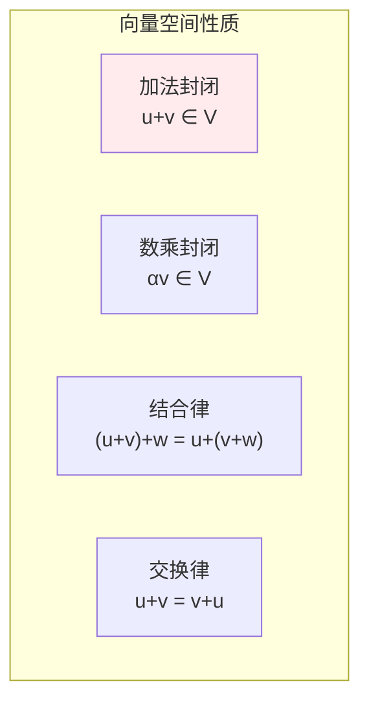
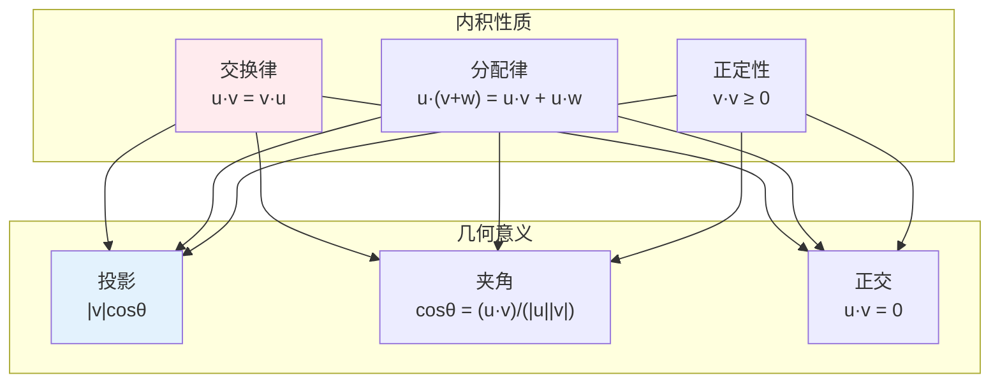
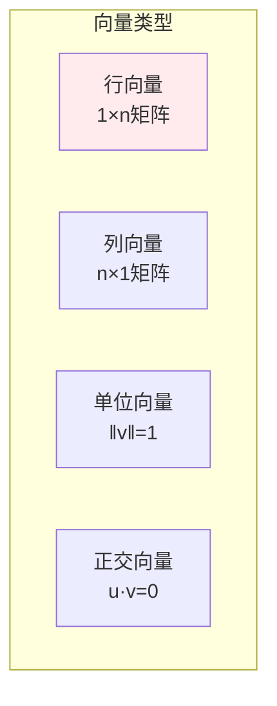
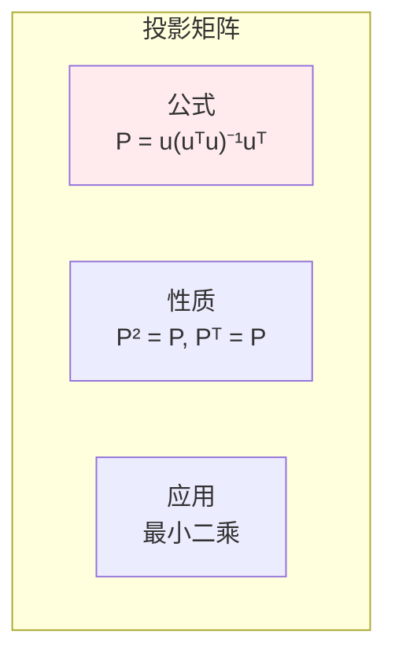
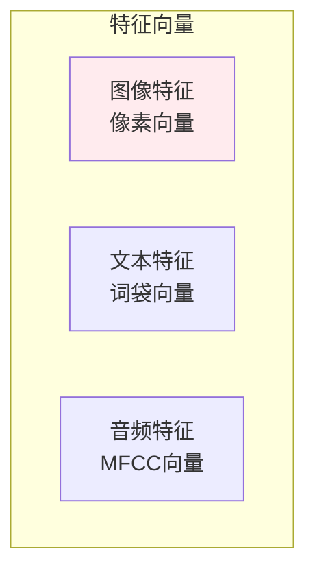

# 向量

> **核心观点**：向量是有大小和方向的量，是线性代数的基本对象，也是机器学习中数据表示的基础。

## 🎯 这 20% 能解决哪些问题

| 你遇到的困惑 | 本质原因 | 马上能改的动作 |
|---|---|---|
| 内积、余弦相似度、欧氏距离到底选哪个 | 三者关系由归一化决定：单位向量下内积 = 余弦 = 距离单调等价 | 向量先 L2 归一化，再用内积做检索（一次计算两个收益） |
| 特征量纲差异大时模型训练不稳 | 距离与梯度被大尺度特征主导 | 标准化/归一化，或改用不受尺度影响的度量 |
| 两个特征高度相关，回归系数符号乱变 | 向量组线性相关，设计矩阵秩亏 | 先去相关（删一个或正交化），再谈模型；用条件数量化 |
| L1 为什么能稀疏而 L2 不能 | 约束集合形状：菱形顶点在坐标轴上 | 特征选择场景用 L1，稳定拟合用 L2 |
| Embedding 空值归零后影响相似度 | 零向量方向不定，与任何向量余弦为 0 | 缺失单独标记或用默认嵌入，不一律归 0 |
| 数值算法在基向量多的时候不准 | 非正交基导致误差放大 | 用 Gram-Schmidt/QR 做正交化后再算 |

---

## 📊 向量基本概念

### 向量定义

| 概念 | 定义 | 表示 |
|------|------|------|
| 向量 | 有大小和方向的量 | **v** = [v₁, v₂, ..., vₙ] |
| 标量 | 只有大小的量 | a = 3 |
| 零向量 | 大小为0的向量 | **0** = [0, 0, ..., 0] |

### 向量空间



---

## 🔢 向量运算

### 基本运算

| 运算 | 定义 | 几何意义 |
|------|------|----------|
| 向量加法 | **u**+**v** = [u₁+v₁, ..., uₙ+vₙ] | 平行四边形法则 |
| 数乘 | α**v** = [αv₁, ..., αvₙ] | 缩放/反向 |
| 内积 | **u**·**v** = ∑uᵢvᵢ | 投影长度 |

### 内积详解



### 向量范数

| 范数类型 | 公式 | 特点 | 应用 |
|----------|------|------|------|
| L1范数 | ‖**v**‖₁ = ∑|vᵢ| | 产生稀疏 | 特征选择 |
| L2范数 | ‖**v**‖₂ = √(∑vᵢ²) | 欧氏距离 | 正则化 |
| L∞范数 | ‖**v**‖∞ = max|vᵢ| | 最大值 | 鲁棒优化 |

```
范数应用：
1. L1正则化：产生稀疏解（LASSO）
2. L2正则化：防止过拟合（Ridge）
3. 距离度量：相似性计算
4. 梯度裁剪：防止梯度爆炸
```

---

## 📐 向量类型

### 按维度分类

| 类型 | 维度 | 例子 |
|------|------|------|
| 2D向量 | 2 | [x, y] 图像坐标 |
| 3D向量 | 3 | [x, y, z] 空间坐标 |
| nD向量 | n | 特征向量 |

### 按性质分类



---

## 🎯 向量投影

### 向量投影公式

| 概念 | 公式 | 意义 |
|------|------|------|
| 投影 | proj_**u**(**v**) = (**v**·**u**/**u**·**u**)**u** | v在u方向的投影 |
| 正交分量 | **v** - proj_**u**(**v**) | 垂直于u的分量 |

### 投影矩阵



---

## 🤖 机器学习应用

### 特征表示



### 相似度计算

| 方法 | 公式 | 特点 |
|------|------|------|
| 余弦相似度 | cos(θ) = **u**·**v**/‖**u**‖‖**v**‖ | 方向相似性 |
| 欧氏距离 | ‖**u**-**v**‖₂ | 绝对距离 |
| 曼哈顿距离 | ‖**u**-**v**‖₁ | 城市街区距离 |

### 词向量

| 模型 | 原理 | 特点 |
|------|------|------|
| Word2Vec | 上下文预测 | 语义相似 |
| GloVe | 共现矩阵 | 全局统计 |
| FastText | 子词信息 | 处理OOV |

---

## 🎯 核心结论

### 向量核心概念

1. **大小与方向**：向量的两个属性
2. **内积**：度量相似性
3. **范数**：度量大小
4. **投影**：度量相关性
5. **正交**：独立性度量

### 学习路径

```
向量学习四步骤：
1. 基本概念：定义、表示
2. 运算方法：加法、内积、范数
3. 几何意义：投影、正交
4. 应用实践：相似度计算、特征表示
```

---

## 🎓 实战场景（TIL）

- **场景**：向量库检索用欧氏距离，结果与离线评估不一致。**本质**：训练时用余弦、检索时用欧氏，两者在未归一化时不等价。**要点**：入库前统一 L2 归一化，并只使用内积作为排序分数。
- **场景**：一个长文本向量主导了平均，导致用户画像偏离。**本质**：没按向量长度加权，方向信息被幅度掩盖。**要点**：聚合前先归一化，或按模长加权并解释权重来源。
- **场景**：特征从 50 个降到 30 个，效果反而变好。**本质**：原向量组接近线性相关，冗余维度只带来噪声。**要点**：用秩与条件数诊断冗余，而不是单看相关性矩阵。

---

## 📋 一页速查

| 我要用 | 记住这条 |
|---|---|
| 内积 | `a·b = \|a\|\|b\|cosθ`；几何意义是投影长度乘以模 |
| 夹角与相似度 | `cosθ = a·b/(\|a\|\|b\|)`，取值 [-1,1]；非负特征常在 [0,1] |
| 范数 | L1 绝对值和（稀疏）、L2 平方和开根（距离）、L∞ 最大分量（误差上限） |
| 余弦 vs 欧氏 | 单位向量下：`\|a-b\|² = 2 - 2cosθ`，排序完全一致 |
| 线性相关 | 存在不全为零的系数使组合为零；判据是矩阵秩 < 向量个数 |
| 正交/标准正交 | 内积为 0 / 内积为 1 且正交；标准正交基下长度与内积不变 |
| Gram-Schmidt/QR | 把任意可逆基正交化，数值上优先 QR 而非手算 |
| 不等式 | 柯西-希瓦尔兹 `\|a·b\| ≤ \|a\|\|b\|`；三角不等式（距离公理之一） |
| 常见导数 | `∇\|x\|² = 2x`，`∇(Ax) = Aᵀ`（对 x 求导的行列约定要固定） |

---

## 🔗 相关链接

- 上级：[线性代数](index.md)
- 同域下一步：[矩阵](02-matrices.md) — 向量集合上的线性变换
- 同域：[特征值分解](03-eigenvalue-decomposition.md) — 方向不变的向量
- 邻域：[概率基础](../probability-statistics/01-probability-basics.md) — 向量内积与期望同构
- 邻域：[深度学习](../../../applications/machine-learning/deep-learning/01-essentials.md) — 嵌入表示与相似度度量

---

## 📚 参考文献

1. 《线性代数及其应用》- Gilbert Strang
2. 《线性代数》- 同济大学
3. 《向量分析》- 吴崇试
4. 《机器学习中的线性代数》
5. 《深度学习》- 向量部分
6. 《Mathematics for Machine Learning》
7. 《线性代数应该这样学》- Sheldon Axler
8. 《3Blue1Brown线性代数的本质》