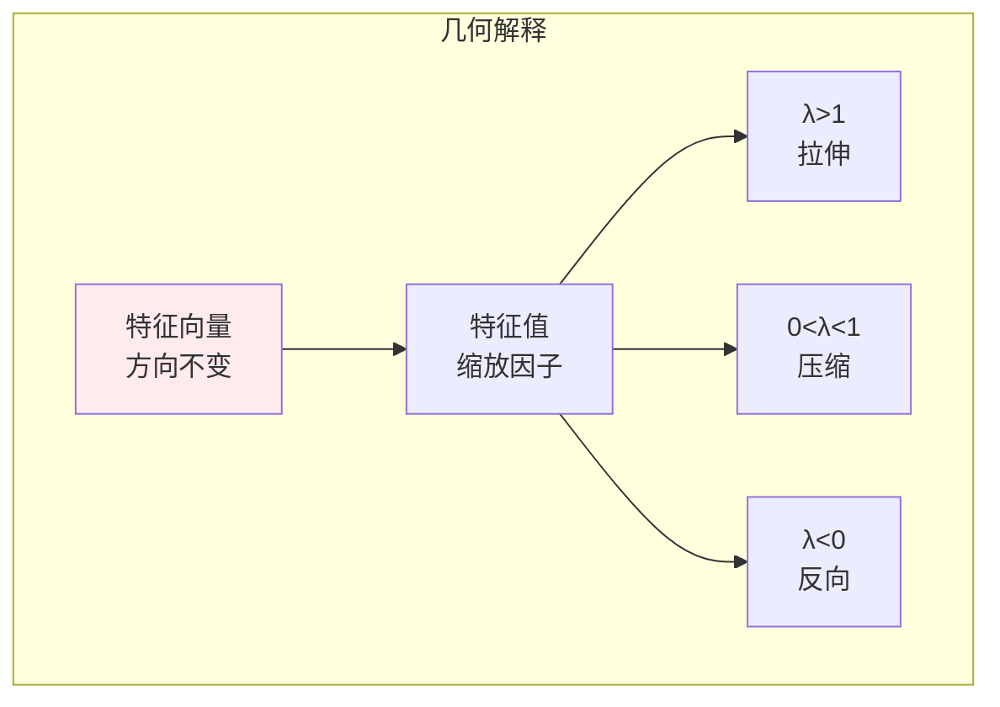
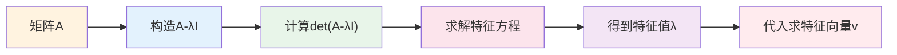
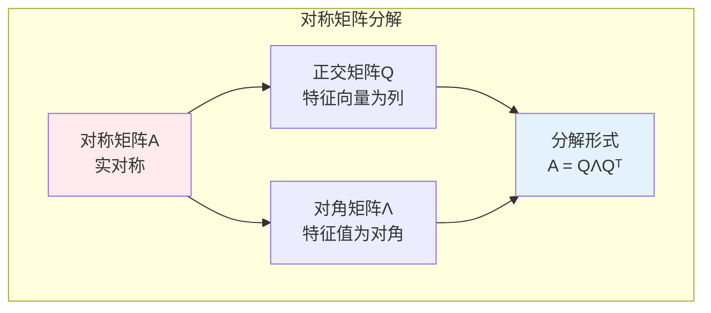
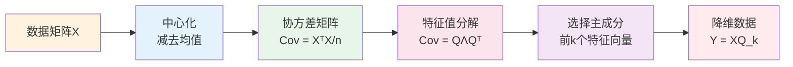
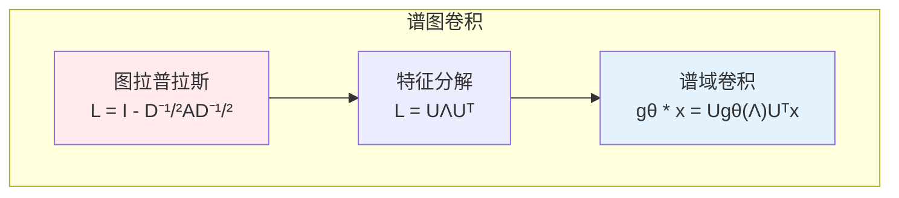

# 特征值分解

> **核心观点**：特征值分解揭示矩阵的内在结构，是主成分分析、谱聚类等机器学习方法的数学基础。

## 🎯 这 20% 能解决哪些问题

| 你遇到的困惑 | 本质原因 | 马上能改的动作 |
|---|---|---|
| PCA 到底在算什么 | 对协方差矩阵特征分解，按特征值从大到小取方向 | 先中心化再求协方差，按方差解释率定维度 |
| 降维后效果差很多 | 取的主成分不够，或量纲未归一 | 看累计方差曲线（如 95%），并标准化特征 |
| PageRank、马尔可夫链稳态怎么求 | 特征值 1 对应的特征向量 | 用幂迭代；收敛慢就检查谱隙 `|λ₂|` |
| 为什么对称矩阵好用 | 实特征值 + 可正交对角化，数值稳定 | 对非对称矩阵改用 SVD，不硬拆特征 |
| 迭代法收敛慢 | 收敛速度由 `|λ₂/λ₁|` 决定 | 预处理（平移/缩放/归一化）改变谱分布 |
| 稳定性分析看什么 | 微分方程线性化的特征值实部 | 实部全负 → 渐近稳定；靠近虚轴 → 收敛慢 |

---

## 📊 特征值基本概念

### 定义

| 概念 | 定义 | 意义 |
|------|------|------|
| 特征值 | Av = λv 中的 λ | 变换的缩放因子 |
| 特征向量 | Av = λv 中的 v | 变换的不变方向 |
| 特征空间 | (A-λI)v = 0 的解空间 | 不变子空间 |

### 几何意义



---

## 🔢 计算方法

### 特征方程

| 步骤 | 公式 | 说明 |
|------|------|------|
| 特征方程 | det(A-λI) = 0 | 求特征值 |
| 特征值 | λ₁, λ₂, ..., λₙ | n次方程的根 |
| 特征向量 | (A-λᵢI)v = 0 | 求解线性方程组 |

### 计算示例



---

## 📐 特征值分解

### 分解形式

| 矩阵 | 分解形式 | 条件 |
|------|----------|------|
| 对角化 | A = PDP⁻¹ | A有n个线性无关特征向量 |
| 对称矩阵 | A = QΛQᵀ | A对称，Q正交 |

### 对称矩阵特征分解



### 特征值性质

| 性质 | 公式 | 意义 |
|------|------|------|
| 迹 | tr(A) = ∑λᵢ | 特征值之和 |
| 行列式 | det(A) = ∏λᵢ | 特征值之积 |
| 秩 | rank(A) | 非零特征值个数 |

---

## 🤖 机器学习应用

### 主成分分析（PCA）



### 谱聚类

| 步骤 | 内容 | 作用 |
|------|------|------|
| 构建图 | 计算相似度矩阵 | 数据关系 |
| 拉普拉斯矩阵 | L = D - W | 图结构 |
| 特征分解 | 取前k个特征向量 | 降维 |
| 聚类 | 对特征向量K-means | 分组 |

### 图神经网络



---

## 🎯 核心结论

### 特征值分解核心概念

1. **特征值**：变换的缩放因子
2. **特征向量**：不变方向
3. **对角化**：矩阵的简化表示
4. **对称矩阵**：正交对角化
5. **应用**：降维、聚类、图分析

### 学习路径

```
特征值分解学习四步骤：
1. 基本概念：特征值、特征向量
2. 计算方法：特征方程、求解
3. 分解形式：对角化、正交对角化
4. 应用实践：PCA、谱聚类
```

---

## 🎓 实战场景（TIL）

- **场景**：同一数据集，PCA 后第一主成分完全跟业务无关。**本质**：未标准化，方差最大的方向被量纲主导。**要点**：先用相关矩阵（等价于标准化后协方差），再解释主成分。
- **场景**：幂迭代算排名特征向量，十万次仍未收敛。**本质**：主特征值与次主特征值几乎相等，谱隙接近 1。**要点**：检查转移矩阵是否可约/周期性，调整阻尼系数（如 PageRank 的 teleport）。
- **场景**：图拉普拉斯第二小特征值几乎为零。**本质**：图存在弱连接分量。**要点**：用 Fiedler 向量做切分，或先修边再聚类。

---

## 📋 一页速查

| 我要用 | 记住这条 |
|---|---|
| 定义 | `Av = λv`，`v ≠ 0`；特征多项式 `det(A-λI)=0` |
| 迹与行列式 | `tr(A)=Σλ`，`det(A)=Πλ`；可快速校核计算结果 |
| 对称矩阵 | 特征值全实、特征向量正交；协方差/核矩阵属于这类 |
| 对角化 | `A = PDP⁻¹`；仅当有完备特征向量组；`Aᵏ = PDᵏP⁻¹` |
| 幂迭代 | 反复乘矩阵并归一化，收敛到主特征向量，速度由谱隙决定 |
| 瑞利商 | `λ ≈ (xᵀAx)/(xᵀx)`，用任意向量估计特征值 |
| PCA 关系 | 主成分 = 协方差矩阵特征向量，方差 = 特征值，解释率 = λᵢ/Σλ |
| 稳定性 | 连续系统看特征值实部符号；离散系统看模是否小于 1 |

---

## 🔗 相关链接

- 上级：[线性代数](index.md)
- 前置概念：[矩阵](02-matrices.md) — 变换与行列式、迹
- 同域下一步：[奇异值分解](04-svd.md) — 非方阵的通用分解
- 邻域：[多维随机变量](../probability-statistics/03-multivariate-random-variables.md) — 协方差矩阵定义
- 邻域：[无监督学习](../../../applications/machine-learning/unsupervised/01-essentials.md) — PCA 与谱聚类的位置

---

## 📚 参考文献

1. 《线性代数及其应用》- Gilbert Strang
2. 《矩阵分析与应用》- Roger Horn
3. 《Pattern Recognition and Machine Learning》
4. 《机器学习中的特征值方法》
5. 《深度学习》- 降维部分
6. 《谱图理论》
7. 《主成分分析》
8. 《线性代数应该这样学》