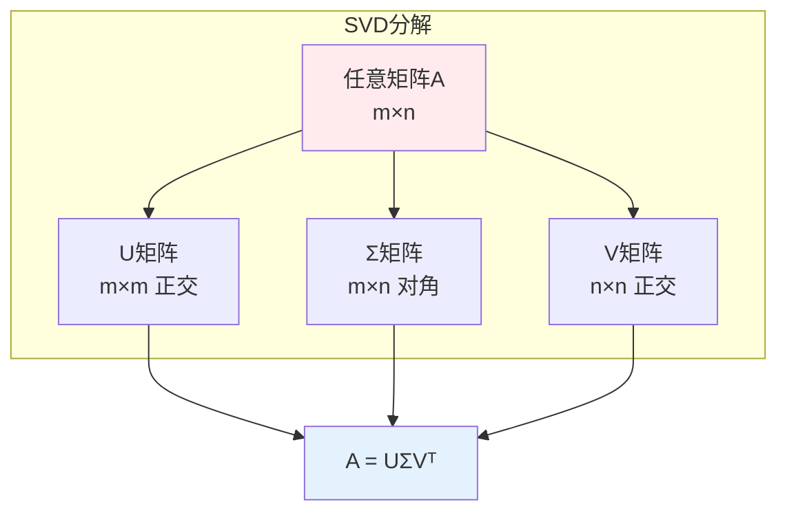
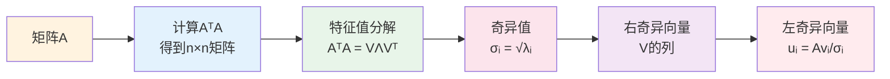
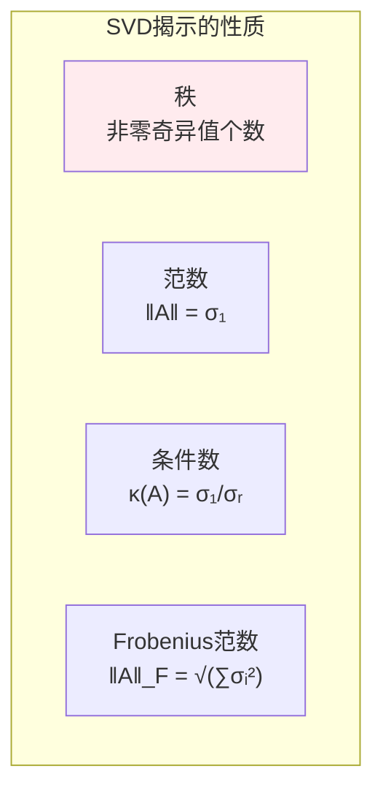
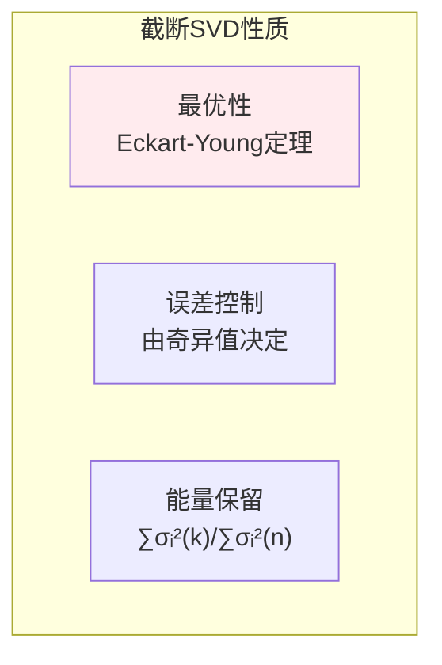
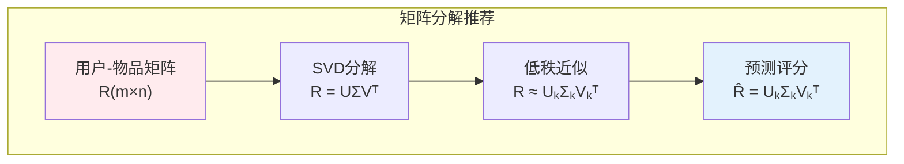
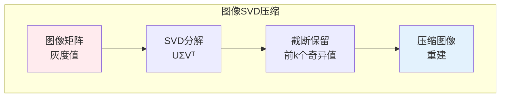

# 奇异值分解（SVD）

> **核心观点**：SVD是矩阵分解的通用方法，任何矩阵都可以分解为UΣVᵀ形式，是降维、推荐系统的核心技术。

## 🎯 这 20% 能解决哪些问题

| 你遇到的困惑 | 本质原因 | 马上能改的动作 |
|---|---|---|
| 不知道降维该保留几维 | 只看维度数量，不看能量占比 | 画出奇异值平方占比的累计曲线，取累计 ≥ 80%~90% 的最小 k |
| 矩阵求逆报错「singular」 | 存在为零或接近零的奇异值 | 用伪逆 `np.linalg.pinv`，并看 `rcond` 阈值判断有效秩 |
| 最小二乘结果巨不稳定 | 设计矩阵条件数 `σ₁/σᵣ` 过大 | 先做特征标准化/去共线，或加岭回归 `σᵢ²+λ` |
| 图片压缩后失真严重 | 截断太狠，丢掉了高频成分 | 用误差公式 `√(∑ᵢ>ₖσᵢ²)` 定量选 k，而不是凭感觉 |
| 推荐系统冷启动预测全 0 | 只补全了已知项，没做低秩近似 | 改成 `R ≈ UₖΣₖVₖᵀ`，用隐向量点乘预测缺失评分 |
| PCA 与 SVD 到底用哪个 | 两者等价，SVD 免去算协方差矩阵 | 数据量大、列数多时直接上经济型 SVD |

---

## 📊 SVD基本概念

### 定义

| 概念 | 定义 | 性质 |
|------|------|------|
| 奇异值 | Σ对角线上的值 | 非负、降序排列 |
| 左奇异向量 | U的列向量 | 正交、单位向量 |
| 右奇异向量 | V的列向量 | 正交、单位向量 |

### 分解形式



---

## 🔢 计算方法

### SVD计算步骤



### 经济SVD

| 类型 | 形状 | 说明 |
|------|------|------|
| 完整SVD | U(m×m), Σ(m×n), V(n×n) | 标准形式 |
| 经济SVD | U(m×n), Σ(n×n), V(n×n) | 去除零列 |
| 截断SVD | U(m×k), Σ(k×k), V(n×k) | 降维近似 |

---

## 📐 SVD性质

### 基本性质

| 性质 | 内容 | 意义 |
|------|------|------|
| 奇异值非负 | σᵢ ≥ 0 | 基本性质 |
| 降序排列 | σ₁ ≥ σ₂ ≥ ... ≥ σᵣ > 0 | 重要性排序 |
| 奇异值唯一 | σᵢ唯一确定 | 分解唯一 |
| 向量不唯一 | 符号可变 | 方向不唯一 |

### 矩阵性质



---

## 🎯 截断SVD

### 低秩近似

| 概念 | 公式 | 意义 |
|------|------|------|
| 截断SVD | A ≈ UₖΣₖVₖᵀ | 最优k秩近似 |
| 近似误差 | ‖A - Aₖ‖_F = √(∑ᵢ>kσᵢ²) | 奇异值衰减 |

### 低秩近似性质



---

## 🤖 机器学习应用

### 推荐系统



### 潜在语义分析（LSA）

| 步骤 | 内容 | 作用 |
|------|------|------|
| 构建词文档矩阵 | TF-IDF | 文本表示 |
| SVD分解 | A = UΣVᵀ | 降维 |
| 潜在语义 | 取前k维 | 语义空间 |

### 图像压缩



### 主成分分析

| 方法 | 实现 | 说明 |
|------|------|------|
| SVD实现PCA | X = UΣVᵀ | 避免协方差矩阵计算 |
| 经济SVD | X = UₖΣₖVₖᵀ | 直接得到主成分 |

---

## 🎯 核心结论

### SVD核心概念

1. **通用分解**：任何矩阵都可SVD
2. **最优近似**：截断SVD是最优低秩近似
3. **降维工具**：保留主要信息
4. **推荐系统**：矩阵分解的基础
5. **语义分析**：潜在语义空间

### 学习路径

```
SVD学习四步骤：
1. 基本概念：奇异值、奇异向量
2. 计算方法：特征值分解法
3. 截断SVD：低秩近似、误差控制
4. 应用实践：推荐系统、LSA、图像压缩
```

---

## 🎓 实战场景（TIL）

| 场景 | 现象 | 用 SVD 的哪一点 |
|---|---|---|
| 向量库降噪 | 1536 维 embedding 检索慢、误召回多 | 截断 SVD 压到 128~256 维，保留累计能量 90%，检索延迟大幅下降 |
| 共线性诊断 | 回归系数符号反复翻转 | 奇异值衰减缓慢（σ 接近 0 的很多）说明存在近似共线方向，删特征或加正则 |
| 图片去噪压缩 | 明暗渐变正常，但细纹理丢失 | 前若干奇异值承载整体结构，衰减快说明可以截断；误差由 `√(∑ᵢ>ₖσᵢ²)` 给出 |
| 稀疏评分矩阵补全 | 用户-物品评分稀疏度 99% | 低秩近似把「相似用户/相似物品」压进同一个 k 维隐空间，缺失项由隐向量点乘得出 |

---

## 📋 一页速查

| 要什么 | 记这一行 |
|---|---|
| 分解形式 | `A(m×n) = U(m×m) Σ(m×n) Vᵀ(n×n)`，U/V 正交，Σ 非负降序 |
| 奇异值来源 | `σᵢ = √λᵢ(AᵀA)`，右奇异向量是 `AᵀA` 的特征向量 |
| 秩 | 非零奇异值的个数 |
| 谱范数 / 条件数 | `‖A‖₂ = σ₁`；`κ(A) = σ₁/σᵣ`（>1000 就警惕数值不稳） |
| 有效秩判定 | `np.linalg.matrix_rank` 阈值：`σᵢ > σ₁ × 相对容差` |
| 最优低秩近似 | Eckart-Young：`Aₖ = UₖΣₖVₖᵀ` 是秩 k 里误差最小的 |
| 截断误差 | `‖A - Aₖ‖_F = √(∑ᵢ>ₖ σᵢ²)`；能量保留 `∑ᵢ≤ₖσᵢ² / ∑ᵢσᵢ²` |
| 伪逆 | `A⁺ = V Σ⁺ Uᵀ`（σ 取倒数，过小阈值内的直接置 0） |
| 计算规模 | 完整 SVD `O(mn·min(m,n))`；大稀疏矩阵用 `scipy.sparse.linalg.svds` |

---

## 🔗 相关链接

- 上级：[线性代数](index.md)
- 前置：[向量与向量空间](01-vectors.md)、[矩阵运算](02-matrices.md)
- 核心关联：[特征值与特征分解](03-eigenvalue-decomposition.md)（PCA 的另一条路）
- 应用：[无监督学习 — 降维](../../../applications/machine-learning/unsupervised/01-essentials.md)
- 应用：[推荐系统](../../../applications/intelligent-systems/recommender-systems/01-essentials.md)
- 相关：[信息熵与相似度](../information-theory/01-information-entropy.md)

---

## 📚 参考文献

1. 《线性代数及其应用》- Gilbert Strang
2. 《矩阵分析与应用》- Roger Horn
3. 《Pattern Recognition and Machine Learning》
4. 《矩阵分解与推荐系统》
5. 《潜在语义分析》
6. 《深度学习》- 降维部分
7. 《SVD与PCA》
8. 《矩阵计算》- Gene Golub