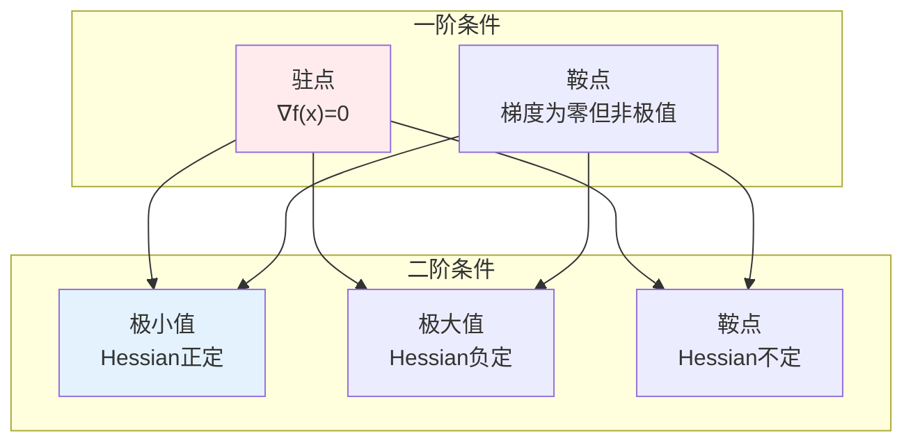
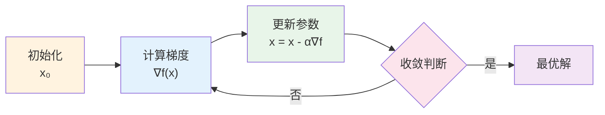
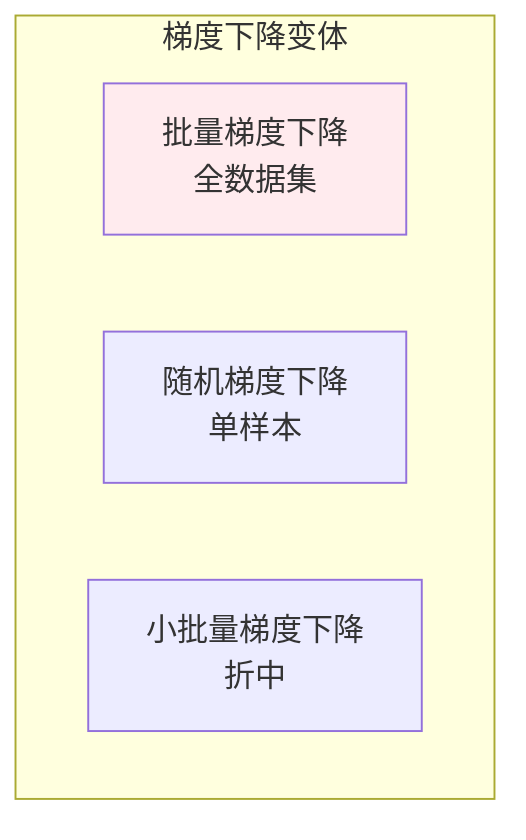
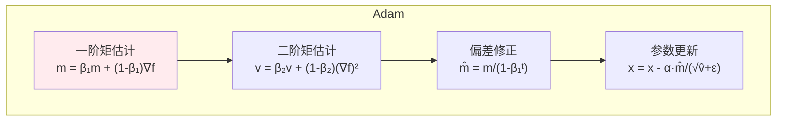
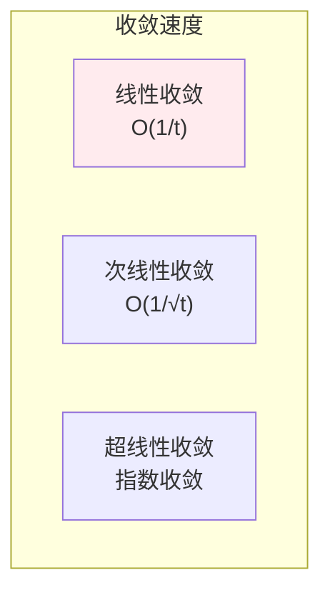

# 无约束优化

> **核心观点**：无约束优化研究如何在没有限制条件下最小化目标函数，是机器学习训练的核心。

## 🎯 这 20% 能解决哪些问题

| 你遇到的困惑 | 本质原因 | 马上能改的动作 |
|---|---|---|
| 学习率怎么调都调不对 | 稳定步长上限由 Lipschitz 常数（曲率）决定，不是拍数值 | 先做特征标准化降条件数；用线性扫描找可用区间，取峰值左侧一档 |
| loss 从第一步就 NaN | 溢出、log(0) 或步长过大 | 加梯度裁剪；用 `log_softmax`；先 warmup 再进入余弦衰减 |
| 曲线持续震荡不下降 | 学习率偏大或 batch 太小使梯度噪声方差 `σ²/B` 占主导 | 减小学习率或增大 batch（两者联动），改余弦/阶梯衰减 |
| 陷入鞍点出不来 | 高维里梯度小但 Hessian 有负方向 | 上动量/Nesterov，或先加大 batch 降低噪声，而不是死盯学习率 |
| Adam 前期快后期平台 | 自适应尺度抵消了真实梯度量级差异 | 平台期切 SGD+momentum，或降 Adam 学习率并加权重衰减 |
| 不知道什么时候停 | 没有收敛判据 | 同时看验证损失平台期（早停 patience）与参数更新幅度（`‖Δθ‖/‖θ‖`） |
| 小批训练结果波动大 | 评估指标是样本均值，标准误 `σ/√n` | 固定种子跑多次取均值±区间，再比较方案优劣 |

---

## 📊 优化基本概念

### 优化问题形式

| 概念 | 公式 | 意义 |
|------|------|------|
| 目标函数 | f(x) | 要最小化的函数 |
| 决策变量 | x | 要优化的变量 |
| 局部最优 | f(x*) ≤ f(x), ∀x∈N(x*) | 邻域内最优 |
| 全局最优 | f(x*) ≤ f(x), ∀x | 全局最小 |

### 最优性条件



---

## 📈 梯度下降法

### 算法流程



### 学习率策略

| 策略 | 公式 | 特点 |
|------|------|------|
| 固定学习率 | α | 简单但需调参 |
| 衰减学习率 | α/√t | 逐步减小 |
| 余弦退火 | α·cos(πt/T) | 周期性变化 |
| 自适应学习率 | Adam/RMSProp | 自动调整 |

---

## 🔄 梯度下降变体

### 变体比较



| 变体 | 优点 | 缺点 |
|------|------|------|
| 批量梯度下降 | 收敛稳定 | 内存大、速度慢 |
| 随机梯度下降 | 内存小、速度快 | 收敛不稳 |
| 小批量梯度下降 | 平衡效率 | 需调参 |

---

## 🚀 动量方法

### 动量原理

| 方法 | 公式 | 特点 |
|------|------|------|
| 动量 | v = γv + α∇f; x = x - v | 加速收敛 |
| Nesterov动量 | 先看一步再算梯度 | 更准确 |
| Adam | 动量+自适应学习率 | 鲁棒性强 |

### Adam优化器



---

## 🎯 收敛性分析

### 收敛条件

| 条件 | 内容 | 意义 |
|------|------|------|
| Lipschitz连续 | \|∇f(x)-∇f(y)\| ≤ L\|x-y\| | 梯度变化有界 |
| 强凸性 | f(y) ≥ f(x)+∇f(x)ᵀ(y-x)+μ/2\|y-x\|² | 曲率有下界 |

### 收敛速度



---

## 🤖 机器学习应用

### 神经网络训练

| 步骤 | 内容 | 优化方法 |
|------|------|----------|
| 前向传播 | 计算输出 | 函数复合 |
| 损失计算 | 比较预测与真实 | 损失函数 |
| 反向传播 | 计算梯度 | 链式法则 |
| 参数更新 | 梯度下降 | 优化器 |

### 超参数调优

| 方法 | 原理 | 优缺点 |
|------|------|--------|
| 网格搜索 | 穷举搜索 | 全面但耗时 |
| 随机搜索 | 随机采样 | 高效但不保证 |
| 贝叶斯优化 | 概率模型 | 智能但复杂 |

---

## 🎯 核心结论

### 无约束优化核心概念

1. **梯度**：最速下降方向
2. **学习率**：步长控制
3. **收敛性**：算法终止条件
4. **自适应方法**：自动调整学习率
5. **应用**：神经网络训练

### 学习路径

```
无约束优化学习四步骤：
1. 基本概念：目标函数、梯度
2. 梯度下降：基本算法、学习率
3. 变体方法：动量、Adam
4. 应用：神经网络训练
```

---

## 🎓 实战场景（TIL）

- **场景**：同一个模型，换一个 batch size 就要重调学习率。**本质**：梯度噪声方差≈`σ²/B`。**要点**：遵循线性缩放规则（B 乘几，学习率乘几，上限内），加 warmup 验证前几百步的 loss 曲线。
- **场景**：特征量纲差三个数量级，训练呈螺旋震荡。**本质**：条件数大，等高线拉成长椭圆。**要点**：先标准化再做优化，比调学习率有效得多。
- **场景**：自编 Adam 训不收敛。**本质**：缺 bias correction，初期二阶矩估计偏小使步长失真。**要点**：自己实现时先对照官方实现跑同一个 toy 问题（如 Rosenbrock）。
- **场景**：上线前发现验证集 loss 比训练集高很多。**本质**：把优化问题与泛化问题混了。**要点**：先确认已拟合训练集（欠拟合是优化问题），再用正则/early stop 处理过拟合。

---

## 📋 一页速查

| 要什么 | 记这一行 |
|---|---|
| 最优一阶/二阶条件 | `∇f(θ)=0`；且 Hessian 正定才是局部极小（高维常见的是鞍点） |
| 收敛步长 | 梯度法要求 `η ≤ 1/L`（L 为梯度 Lipschitz 常数），过大直接发散 |
| 条件数的影响 | `κ = λ_max/λ_min` 越大越慢，迭代次数量级约 `O(κ)`；标准化就是在降 κ |
| 梯度噪声 | 小批量梯度方差≈`σ²/B`：批量与学习率必须联动 |
| SGD+momentum | `v = βv − ηg`，`θ += v`；在病态曲率方向加速、噪声方向抵消 |
| Adam 与 AdaGrad | RMSProp 用指数衰减的梯度平方量做尺度；Adam = 动量 + 自适应步长 + bias correction；学习率常用 3e-4~1e-3 |
| 学习率调度 | 线性扫描找区间 → warmup → 余弦/阶梯衰减；平台期再降一档 |
| 早停与监控 | 验证指标 patience 轮不升即停；同时监控梯度范数与参数更新幅度 |
| NaN 排查顺序 | 先梯度裁剪 → 再降学习率 → 查 log/除法溢出 → 查标签与数据质量 |

---

## 🔗 相关链接

- 上级：[优化理论](index.md)
- 同目录：[凸优化](02-convex-optimization.md)（什么时候能保证全局最优）
- 前置：[导数与微分（链式法则与反向传播）](../calculus/02-derivatives.md)、[矩阵与条件数](../linear-algebra/02-matrices.md)
- 理论支撑：[大数定律与中心极限定理（SGD 噪声）](../probability-statistics/04-law-of-large-numbers.md)
- 应用：[深度学习](../../../applications/machine-learning/deep-learning/01-essentials.md)

---

## 📚 参考文献

1. 《最优化导论》- Edwin Chong
2. 《数值优化》- Jorge Nocedal
3. 《凸优化》- Stephen Boyd
4. 《深度学习优化》
5. 《机器学习中的优化》
6. 《梯度下降法》
7. 《Adam优化器》
8. 《优化方法》- 刘浩