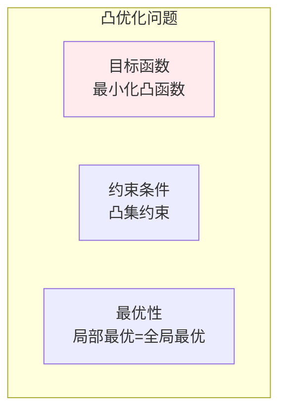
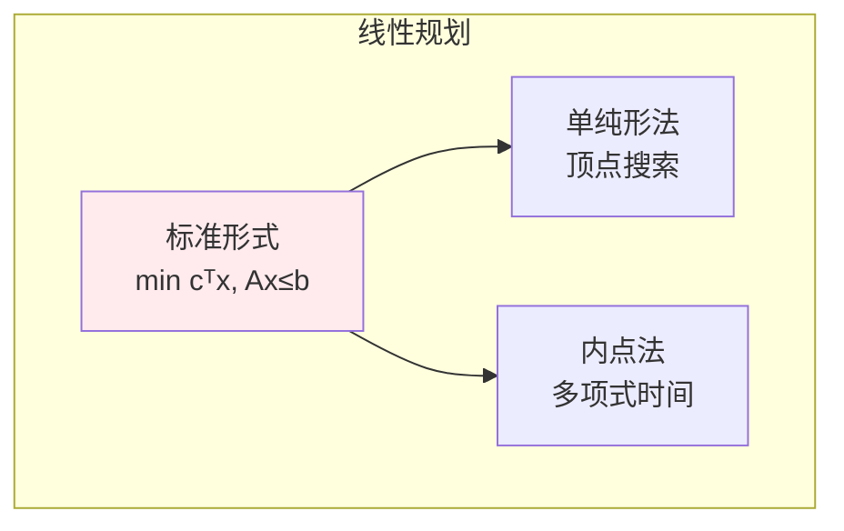
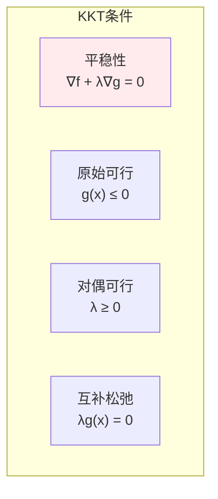
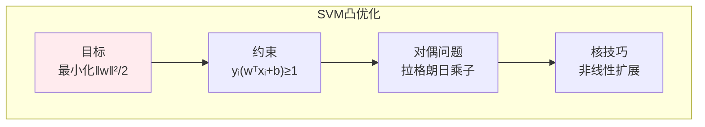

# 凸优化

> **核心观点**：凸优化问题具有全局最优保证，是机器学习中许多问题的理想形式。

## 🎯 这 20% 能解决哪些问题

| 你遇到的困惑 | 本质原因 | 马上能改的动作 |
|---|---|---|
| 不知道这个模型能不能训好 | 目标非凸时收敛无保证 | 先搭一个凸基线（线性回归/逻辑回归/SVM），能拟合再上复杂模型 |
| 加正则到底在干什么 | 正则项是凸约束的对偶形式 | 记住 L2 ⇔ 权重约束的对偶，L1 产生稀疏（推 0 到边界） |
| 容量增加 1 单位能多换多少收益 | 对偶变量就是影子价格 | 从求解器读出乘子，乘子大的约束就是真正的瓶颈 |
| 求解器报 infeasible 还是 unbounded | 没区分「约束矛盾」与「目标无下界」 | 先放松约束验证可行域非空，再给目标加下降方向/上界 |
| 非线性约束能不能丢 | 只有凸集 + 凸目标才保证全局最优 | 用闭包运算检查：凸集的交集仍凸，仿射复合仍凸；非凸部分先分段线性近似 |
| SVM 为什么只看几个样本 | KKT 互补松弛使非支持向量的乘子为 0 | 用乘子为 0 删样本；调 C 就是调对偶问题里的盒约束宽度 |

---

## 📊 凸优化基本概念

### 凸集与凸函数

| 概念 | 定义 | 性质 |
|------|------|------|
| 凸集 | 任意两点连线在集合内 | 无"凹陷" |
| 凸函数 | f(θx+(1-θ)y) ≤ θf(x)+(1-θ)f(y) | 弦在函数上方 |
| 严格凸 | f(θx+(1-θ)y) < θf(x)+(1-θ)f(y) | 唯一全局最优 |

### 凸优化问题



---

## 🔢 常见凸优化问题

### 问题类型

| 类型 | 形式 | 例子 |
|------|------|------|
| 线性规划 | min cᵀx, Ax≤b | 资源分配 |
| 二次规划 | min xᵀQx+cᵀx | SVM |
| 半正定规划 | min tr(CX), AX=B | 矩阵优化 |
| 二阶锥规划 | min cᵀx, ‖Ax+b‖≤cᵀx+d | 鲁棒优化 |

### 线性规划



---

## 📈 对偶理论

### 对偶问题

| 概念 | 内容 | 意义 |
|------|------|------|
| 原始问题 | min f(x), g(x)≤0 | 原始优化 |
| 对偶问题 | max θ(λ), λ≥0 | 对偶优化 |
| 强对偶 | 最优值相等 | 理想情况 |

### KKT条件



---

## 🤖 机器学习应用

### 支持向量机（SVM）



### 正则化

| 方法 | 形式 | 意义 |
|------|------|------|
| L1正则 | min f(x) + λ\|x\|₁ | 产生稀疏 |
| L2正则 | min f(x) + λ\|x\|² | 防止过拟合 |

---

## 🎯 核心结论

### 凸优化核心概念

1. **凸性**：全局最优保证
2. **对偶理论**：问题转化
3. **KKT条件**：最优性判据
4. **SVM**：凸优化经典应用
5. **正则化**：结构风险最小化

### 学习路径

```
凸优化学习四步骤：
1. 凸集与凸函数：定义、性质
2. 凸优化问题：线性规划、二次规划
3. 对偶理论：KKT条件
4. 应用：SVM、正则化
```

---

## 🎓 实战场景（TIL）

- **场景**：新模型训练结果每次不一样，怀疑实现有 bug。**本质**：问题本身非凸，陷入不同局部解。**要点**：先拿逻辑回归这个凸基线定上限，差距大才说明特征或数据有问题。
- **场景**：资源排产模型里，一个手工约束一旦收紧全局目标就跳水。**本质**：该约束的对偶乘子最大，它就是瓶颈。**要点**：用影子价格向业务方报价：放宽这一约束的单价收益最清楚。
- **场景**：加了 L1 正则后大量特征系数变 0，业务方说不可解释。**本质**：L1 的尖峰几何使最优解落在坐标轴上。**要点**：先把被筛除的特征列成清单交给业务确认，再上弹性网络（L1+L2）兼顾成组选择。
- **场景**：模型上线后 P99 变差，怀疑求解器。**本质**：QP/LP 在约束删改后变为不可行，求解器静默返回近似解。**要点**：每次求解都检查状态码与约束违反量，不把 `optimal` 以外的结果写进下游。

---

## 📋 一页速查

| 要什么 | 记这一行 |
|---|---|
| 凸函数判定 | 定义式 `f(λx+(1−λ)y) ≤ λf(x)+(1−λ)f(y)`；二阶可导时看 Hessian 半正定 |
| 凸优化标准形 | min 凸函数 f(x)，s.t. 凸不等式 `gᵢ(x)≤0`、仿射等式 `Ax=b`（只有仿射等式安全） |
| 常见凸损失 | 线性模型 + MSE/绝对值/铰链损失/逻辑回归的负对似然；softmax 交叉熵对线性层凸 |
| 弱/强对偶 | 对偶值永远是原问题下界；Slater 条件（存在严格可行点）⇒ 强对偶，间隙为 0 |
| KKT 四条件 | 稳定性、原始可行、对偶可行（λ≥0）、互补松弛 `λᵢgᵢ(x)=0` |
| 对偶的用途 | 问题变小/变易解、给出最优下界、乘子即敏感性、核方法由对偶引出 |
| 影子价格 | `λᵢ = ∂p*/∂bᵢ`：约束右端放宽 1 单位对最优目标的影响 |
| 正则与对偶 | L2 与 L1 都是对偶形式下约束半径的拉格朗日乘子；调 λ 就是调约束紧度 |
| 失败信号 | infeasible（约束矛盾）、unbounded（目标无下界）、大对偶间隙（非凸或未满足 Slater） |

---

## 🔗 相关链接

- 上级：[优化理论](index.md)
- 同目录：[无约束优化](01-unconstrained-optimization.md)（非凸世界里的局部方法）
- 前置：[矩阵与二次型](../linear-algebra/02-matrices.md)、[特征值与半正定](../linear-algebra/03-eigenvalue-decomposition.md)
- 前置：[导数与微分（局部线性化）](../calculus/02-derivatives.md)、[统计推断（似然与损失）](../probability-statistics/05-statistical-inference.md)
- 相关：[KL 散度](../information-theory/03-kl-divergence.md)（变分下界就是凸优化常客）
- 应用：[监督学习 — 线性模型与 SVM](../../../applications/machine-learning/supervised/01-essentials.md)

---

## 📚 参考文献

1. 《凸优化》- Stephen Boyd
2. 《最优化导论》- Edwin Chong
3. 《凸优化基础》
4. 《支持向量机》
5. 《机器学习中的凸优化》
6. 《线性规划》
7. 《非线性规划》- Dimitri Bertsekas
8. 《优化方法》