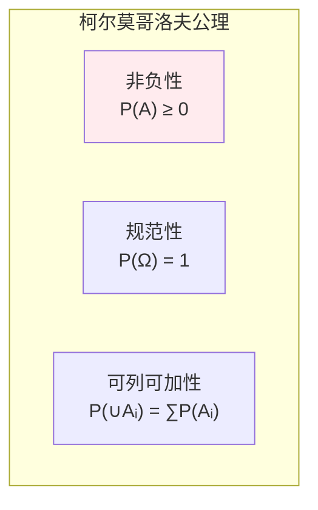
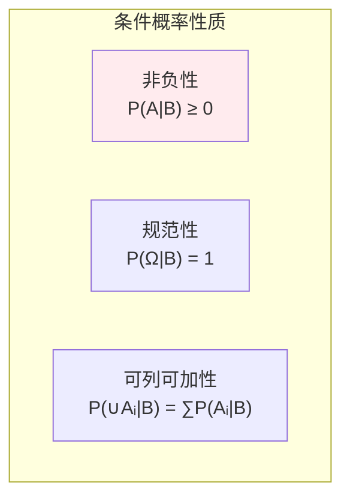
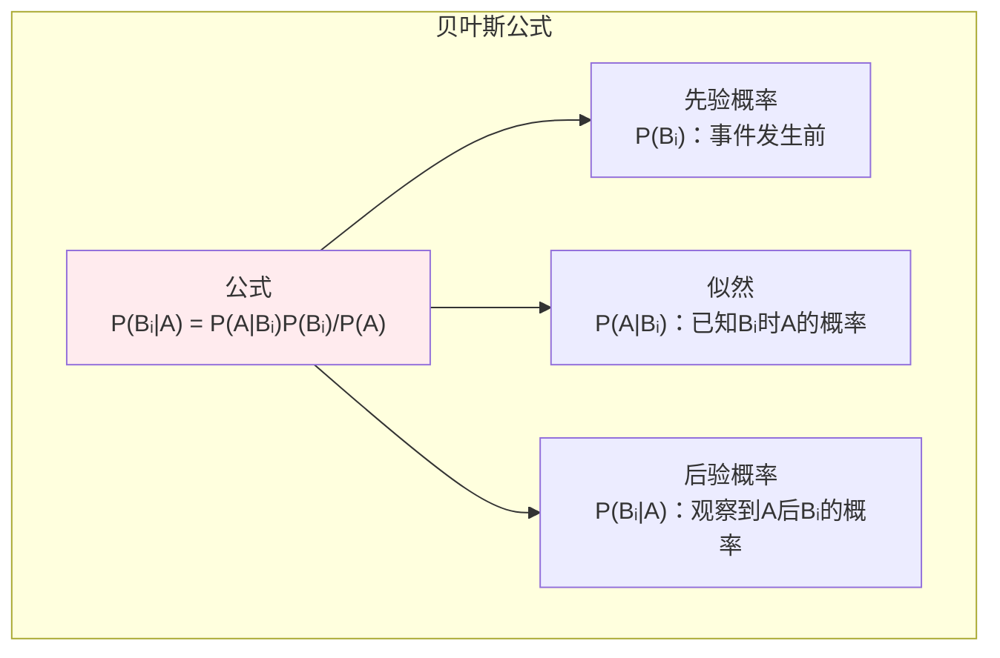
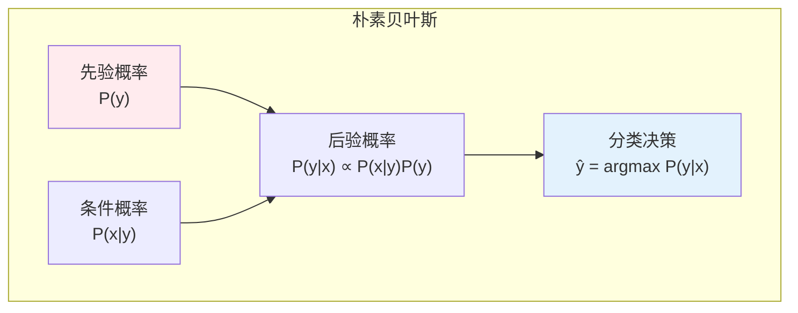

# 概率基础

> **核心观点**：概率是度量不确定性的数学工具，是统计推断和机器学习的理论基础。

## 🎯 这 20% 能解决哪些问题

| 你遇到的困惑 | 本质原因 | 马上能改的动作 |
|---|---|---|
| 风控模型准确率 99%，上线却没人买账 | 事件基率极低，误报绝对数仍很大 | 用贝叶斯重算阳性预测值，同时报精确率/召回率，别只看准确率 |
| 告警一多就全部屏蔽 | 没把「发生频率」和「影响面」分开 | 先定 P(告警\|真故障) 与 P(告警\|正常)，再按基率算误报成本 |
| 三个条件都满足，为何联合概率不对 | 默认了独立性 | 只有确认独立才能相乘；否则用链式法则 `P(ABC)=P(A)P(B\|A)P(C\|AB)` |
| 「不是 A 就是 B」算漏情况 | 集合运算不熟 | 用德摩根律把 `¬(A∧B)` 改成 `¬A∨¬B`，并用补集算「至少一个」 |
| 模型输出的概率不像概率 | 把相似度当成概率 | softmax 后才是分布；判断阈值应由代价函数定，不拍 0.5 |

---

## 📊 概率基本概念

### 概率定义

| 定义方式 | 内涵 | 适用场景 |
|----------|------|----------|
| 古典定义 | 等可能性事件的比例 | 有限样本空间 |
| 频率定义 | 频率的极限 | 大量重复试验 |
| 主观定义 | 个人信念程度 | 未知事件 |

### 概率公理



---

## 🎲 事件运算

### 事件类型

| 类型 | 定义 | 符号 |
|------|------|------|
| 必然事件 | 一定会发生 | Ω |
| 不可能事件 | 一定不发生 | ∅ |
| 对立事件 | 不发生 | A' 或 Aᶜ |
| 互斥事件 | 不能同时发生 | A∩B = ∅ |

### 事件运算

| 运算 | 定义 | 性质 |
|------|------|------|
| 并集 | A∪B = {x∈A或x∈B} | 交换律、结合律 |
| 交集 | A∩B = {x∈A且x∈B} | 交换律、结合律 |
| 差集 | A-B = {x∈A且x∉B} | 非交换 |
| 补集 | A' = {x∉A} | 对合律 |

### 德摩根律

```
德摩根律：
(A∪B)' = A'∩B'
(A∩B)' = A'∪B'

推广：
(∪Aᵢ)' = ∩Aᵢ'
(∩Aᵢ)' = ∪Aᵢ'
```

---

## 📐 条件概率

### 条件概率定义

| 概念 | 公式 | 意义 |
|------|------|------|
| 条件概率 | P(A\|B) = P(AB)/P(B) | B发生时A的概率 |
| 乘法公式 | P(AB) = P(A\|B)P(B) | 联合概率 |

### 条件概率性质



---

## 🔗 全概率公式与贝叶斯公式

### 全概率公式

| 公式 | 形式 | 意义 |
|------|------|------|
| 全概率 | P(A) = ∑P(A\|Bᵢ)P(Bᵢ) | 分解复杂事件 |
| 条件 | {Bᵢ}是样本空间划分 | 互斥且完备 |

### 贝叶斯公式



### 贝叶斯推断

| 步骤 | 内容 | 公式 |
|------|------|------|
| 1. 建立先验 | 对参数的初始信念 | P(θ) |
| 2. 收集数据 | 观察到的证据 | P(D\|θ) |
| 3. 更新后验 | 结合先验和数据 | P(θ\|D) ∝ P(D\|θ)P(θ) |

---

## 🤖 机器学习应用

### 朴素贝叶斯分类器



### 贝叶斯优化

| 应用 | 内容 | 优势 |
|------|------|------|
| 超参数优化 | 建模目标函数 | 减少评估次数 |
| 主动学习 | 选择最有价值样本 | 标注效率高 |

---

## 🎯 核心结论

### 概率基础核心概念

1. **概率**：不确定性的度量
2. **条件概率**：信息更新的基础
3. **全概率公式**：分解复杂问题
4. **贝叶斯公式**：信念更新的数学表达
5. **先验与后验**：从假设到证据的推理

### 学习路径

```
概率基础学习四步骤：
1. 概率公理：非负性、规范性、可加性
2. 事件运算：并、交、补、德摩根律
3. 条件概率：定义、乘法公式
4. 贝叶斯公式：全概率、后验概率
```

---

## 🎓 实战场景（TIL）

| 场景 | 现象 | 用概率的哪一点 |
|---|---|---|
| 薅羊毛检测 | 规则命中里 90% 是误判 | 基率陷阱：事件越稀有，同样特异度下阳性预测值越低，需叠加独立特征而非叠加同源指标 |
| 健康检查抖动 | 单点 99% 可用看似很高 | 10 个串行依赖相乘：`0.99¹⁰ ≈ 0.904`，所以链路要解耦、加缓存与降级 |
| 日志里「至少一个报错」 | 直接 1−(1−p)¹ⁿ 估不准 | 补集 + 独立性假设；不独立时改用容斥或模拟 |
| 垃圾邮件分类 | 单词频次爆炸无法建模 | 朴素贝叶斯假设特征条件独立，把 `P(x\|y)` 拆成连乘，拉普拉斯平滑防 0 |
| A/B 样本量估算 | 实验总跑不出显著 | 本质是检验功效问题，转到假设检验与大数定律篇查公式 |

---

## 📋 一页速查

| 要什么 | 记这一行 |
|---|---|
| 三条公理 | `P(A) ≥ 0`；`P(Ω) = 1`；互斥事件可加 |
| 对立与差 | `P(Aᶜ) = 1 − P(A)`；`P(A−B) = P(A) − P(AB)` |
| 容斥（加法） | `P(A∪B) = P(A) + P(B) − P(AB)` |
| 乘法 | `P(AB) = P(A\|B)P(B) = P(B)P(A\|B)` |
| 独立判定 | `P(AB) = P(A)P(B)` ⇔ 条件概率不变 |
| 全概率 | `P(A) = ∑ᵢ P(A\|Bᵢ)P(Bᵢ)`，{Bᵢ} 互斥且完备 |
| 贝叶斯 | `P(Bᵢ\|A) = P(A\|Bᵢ)P(Bᵢ) / P(A)`；后验 ∝ 似然 × 先验 |
| 链式法则 | `P(X₁…Xₙ) = ∏ P(Xᵢ \| X₁…Xᵢ₋₁)`（语言模型就靠这条） |
| 常用估计 | 基率 = P(事件)；特异度 = P(负\|无问题)；阳性预测值 = P(问题\|报阳) |

---

## 🔗 相关链接

- 上级：[概率与统计](index.md)
- 下一篇：[随机变量及其分布](02-random-variables.md)
- 进阶：[多维随机变量](03-multivariate-random-variables.md)、[大数定律与中心极限定理](04-law-of-large-numbers.md)
- 应用：[监督学习 — 分类](../../../applications/machine-learning/supervised/01-essentials.md)
- 相关：[信息熵与交叉熵](../information-theory/01-information-entropy.md)

---

## 📚 参考文献

1. 《概率论与数理统计》- 浙江大学
2. 《概率论基础教程》- Sheldon Ross
3. 《统计学习方法》- 李航
4. 《Pattern Recognition and Machine Learning》- Bishop
5. 《概率统计》- 陈希孺
6. 《All of Statistics》- Larry Wasserman
7. 《贝叶斯方法》- Tim Head
8. 《深入理解贝叶斯推断》