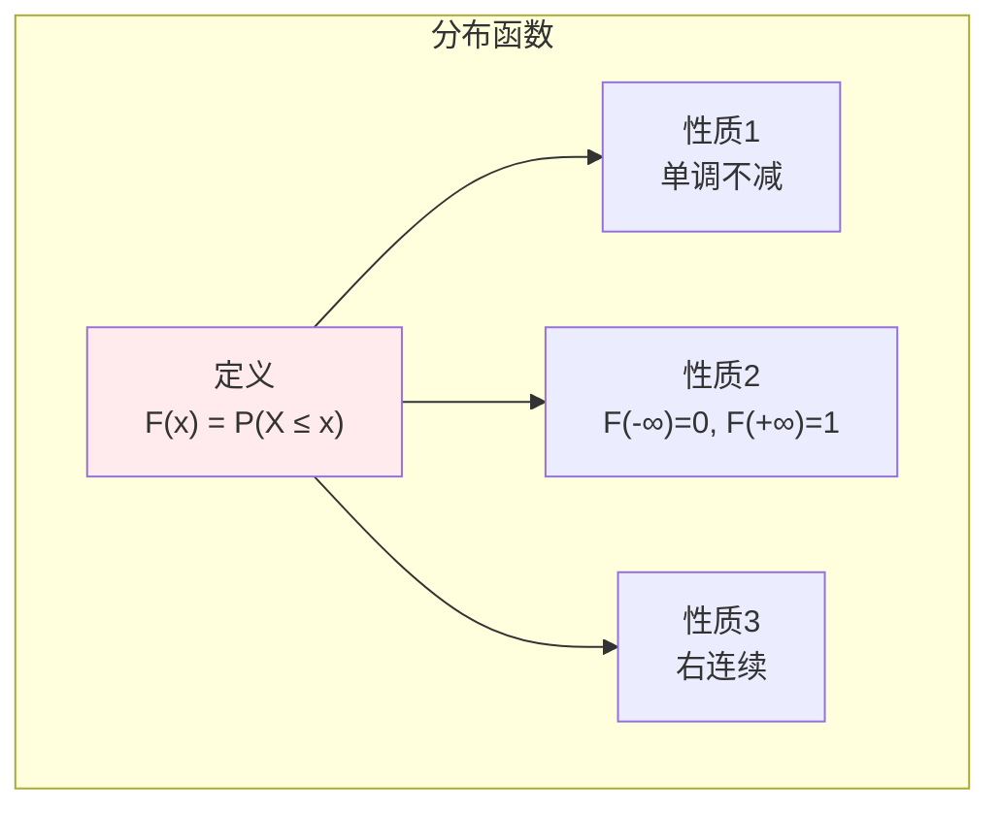
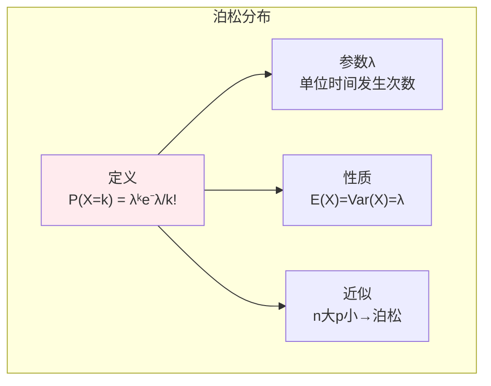
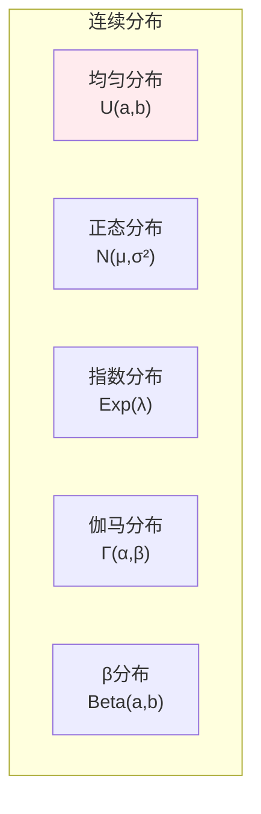
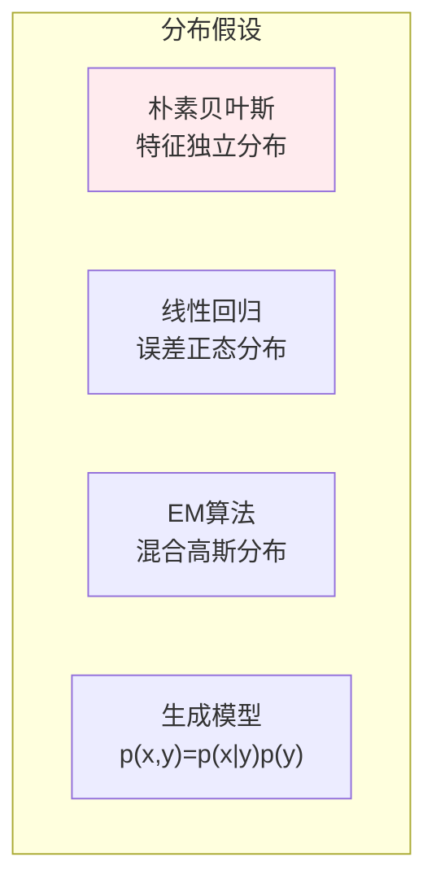

# 随机变量

> **核心观点**：随机变量是将随机事件结果映射到实数的函数，是概率论从定性到定量的关键桥梁。

## 🎯 这 20% 能解决哪些问题

| 你遇到的困惑 | 本质原因 | 马上能改的动作 |
|---|---|---|
| 平均延迟好看，用户却纷纷反馈慢 | 只看均值不看方差与尾部 | 同时报 P50/P90/P99 与标准差；重尾分布用分位数不用均值 |
| 排期总是低估 | 把独立事件期望直接相加 | 记 `Var(∑X)=∑Var(X)`（独立时）：十个 3±2 天的任务加起来不是 30±0 天 |
| 接口调用次数、每分钟报错量不知如何建模 | 计数型且事件稀疏独立 | 用泊松 `P(λ)`；均值=方差=λ，λ 就是单位时间平均发生次数 |
| 排队等待时间、故障间隔估计不准 | 默认了正态，实际是有偏长尾 | 事件间隔用指数分布（无记忆），总时长取均值后靠中心极限定理转正态 |
| 转换数据后统计量变了 | 混淆了线性变换对 E/Var 的影响 | 记住 `E(aX+b)=aE(X)+b`、`Var(aX+b)=a²Var(X)`：平移不改方差，缩放平方改方差 |
| 标准化到底做了什么 | 把 `X` 映到 `Z=(X-μ)/σ ~ N(0,1)` | 先减均值再除标准差，让不同量纲特征可比，后续距离计算才有意义 |

---

## 📊 随机变量基本概念

### 定义

| 概念 | 定义 | 例子 |
|------|------|------|
| 随机变量 | 样本空间到实数的映射 X: Ω → ℝ | 投掷骰子的结果 |
| 离散型 | 取值有限或可列 | 掷骰子、抛硬币 |
| 连续型 | 取值不可列 | 身高、温度 |

### 分布函数



---

## 📈 离散型随机变量

### 常见分布

| 分布 | 概率函数 | 均值 | 方差 |
|------|----------|------|------|
| 伯努利(0-1) | P(X=1)=p | p | p(1-p) |
| 二项 B(n,p) | C(n,k)pᵏ(1-p)ⁿ⁻ᵏ | np | np(1-p) |
| 泊松 P(λ) | λᵏe⁻λ/k! | λ | λ |
| 几何 | (1-p)ᵏ⁻¹p | 1/p | (1-p)/p² |
| 负二项 | C(r+k-1,k)(1-p)ᵏpʳ | r/p | r(1-p)/p² |

### 泊松分布详解



---

## 📊 连续型随机变量

### 概率密度函数

| 概念 | 定义 | 性质 |
|------|------|------|
| 密度函数 | P(a≤X≤b) = ∫ₐᵇf(x)dx | f(x)≥0, ∫f(x)dx=1 |
| 分布函数 | F(x) = ∫₋∞ˣf(t)dt | F'(x)=f(x) |

### 常见分布



### 正态分布详解

| 性质 | 内容 | 意义 |
|------|------|------|
| 密度函数 | f(x) = (1/√(2πσ²))e^(-(x-μ)²/(2σ²)) | 钟形曲线 |
| 标准化 | Z = (X-μ)/σ ~ N(0,1) | 统一处理 |
| 68-95-99.7法则 | μ±kσ包含的面积 | 经验法则 |

### 指数分布详解

```
指数分布性质：
- 无记忆性：P(X>s+t|X>s) = P(X>t)
- 密度函数：f(x) = λe^(-λx), x≥0
- 均值：E(X) = 1/λ
- 方差：Var(X) = 1/λ²
```

---

## 📐 数字特征

### 期望

| 类型 | 公式 | 性质 |
|------|------|------|
| 离散型 | E(X) = ∑xᵢpᵢ | 线性性 |
| 连续型 | E(X) = ∫xf(x)dx | 线性性 |

### 方差

| 概念 | 公式 | 意义 |
|------|------|------|
| 方差 | Var(X) = E[(X-μ)²] | 离散程度 |
| 标准差 | σ = √Var(X) | 与X同单位 |

```
方差性质：
Var(X) = E(X²) - [E(X)]²
Var(aX+b) = a²Var(X)
```

### 协方差与相关系数

| 概念 | 公式 | 意义 |
|------|------|------|
| 协方差 | Cov(X,Y) = E[(X-μₓ)(Y-μᵧ)] | 线性相关方向 |
| 相关系数 | ρ = Cov(X,Y)/(σₓσᵧ) | 标准化协方差 |

---

## 🤖 机器学习应用

### 数据建模



### 损失函数与分布

| 损失函数 | 对应分布 | 应用 |
|----------|----------|------|
| 0-1损失 | 伯努利 | 分类 |
| 平方损失 | 正态 | 回归 |
| 交叉熵 | 伯努利/多项 | 分类 |

---

## 🎯 核心结论

### 随机变量核心概念

1. **随机变量**：随机结果的数值化
2. **分布函数**：完整描述随机变量
3. **数字特征**：期望、方差、协方差
4. **常见分布**：正态、泊松、指数
5. **机器学习**：建模假设与损失函数

### 学习路径

```
随机变量学习四步骤：
1. 基本概念：随机变量、分布函数
2. 离散分布：伯努利、二项、泊松
3. 连续分布：正态、指数、伽马
4. 数字特征：期望、方差、协方差
```

---

## 🎓 实战场景（TIL）

| 场景 | 现象 | 用随机变量的哪一点 |
|---|---|---|
| 容量规划 | 按均值 QPS 扩容，高峰仍崩 | 流量计数近似泊松：`P(X > λ + k√λ)`，安全水位按 `λ + 3σ` 而非 λ 算 |
| 重试与退避 | 固定间隔重试把下游打死 | 指数分布无记忆性 ⇒ 失败不降低下次成功概率，必须加随机抖动与指数退避 |
| A/B 转化率 | 转化率波动大，看不出差异 | 伯努利变量方差 `p(1-p)`，样本量 `n ∝ p(1-p)/δ²`，同等绝对差下 p 越接近 0.5 越费样本 |
| 特征工程 | 模型对大数值特征过敏 | 平方损失对应正态假设；重尾特征先取 log 再用 z-score，否则标准化无意义 |
| 损失函数选型 | 分类任务用了 MSE 收敛慢 | 伯努利似然推出交叉熵，正态似然推出 MSE；选损失就是选分布假设 |

---

## 📋 一页速查

| 要什么 | 记这一行 |
|---|---|
| 分布函数 | `F(x) = P(X ≤ x)`，单调不减、右连续、`F(-∞)=0`、`F(+∞)=1` |
| 密度与概率 | 连续型单点概率为 0，`P(a≤X≤b) = ∫ₐᵇ f(x)dx = F(b)-F(a)` |
| 离散三兄弟 | 伯努利 `p, p(1-p)`；二项 `np, np(1-p)`；泊松 `λ, λ` |
| 几何分布 | 首次成功所需次数：`E = 1/p`，`Var = (1-p)/p²`（重试次数预估就靠它） |
| 连续三兄弟 | 均匀 `(a+b)/2`；正态 `N(μ,σ²)`；指数 `1/λ, 1/λ²` |
| 68-95-99.7 | `±1σ` 68.3%、`±2σ` 95.4%、`±3σ` 99.7%（异常检测常用 3σ） |
| 期望与方差 | `E(aX+b)=aE(X)+b`；`Var(aX+b)=a²Var(X)`；`Var(X)=E(X²)-[E(X)]²` |
| 无记忆性 | `P(X>s+t \| X>s) = P(X>t)`，只有几何/指数有 |
| 分布选择直觉 | 计数→泊松；间隔→指数；极端值→广义极值；比率→Beta |

---

## 🔗 相关链接

- 上级：[概率与统计](index.md)
- 前置：[概率基础](01-probability-basics.md)
- 下一篇：[多维随机变量](03-multivariate-random-variables.md)、[大数定律与中心极限定理](04-law-of-large-numbers.md)
- 应用：[模型评估与指标](../../../applications/machine-learning/model-evaluation/01-essentials.md)

---

## 📚 参考文献

1. 《概率论与数理统计》- 浙江大学
2. 《概率论基础教程》- Sheldon Ross
3. 《统计学习方法》- 李航
4. 《概率统计》- 陈希孺
5. 《Pattern Recognition and Machine Learning》- Bishop
6. 《All of Statistics》- Larry Wasserman
7. 《概率论》- 汪仁官
8. 《随机过程》- 方兆本