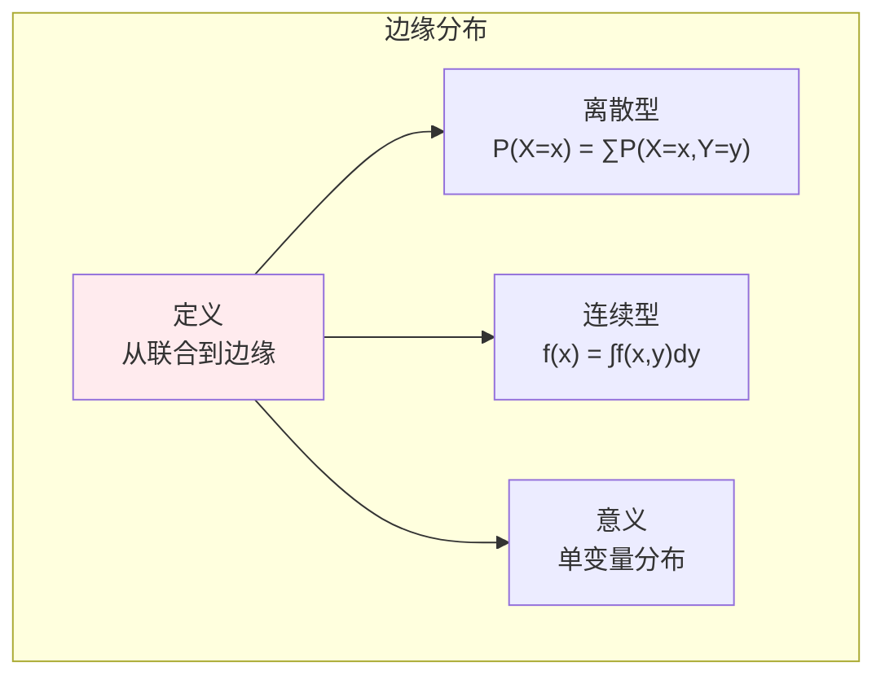
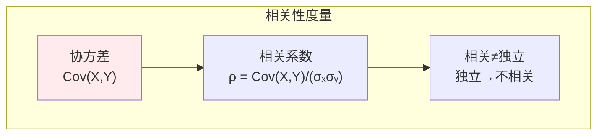
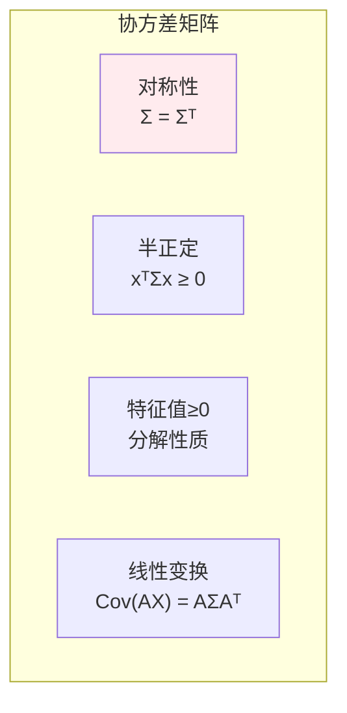
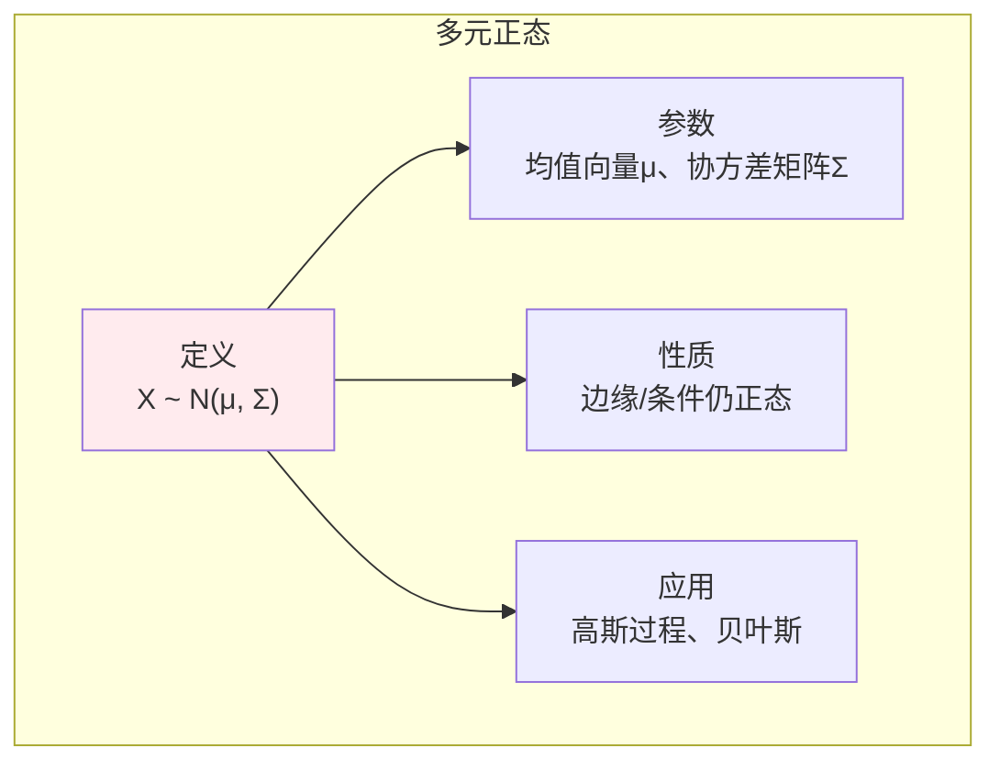

# 多维随机变量

> **核心观点**：多维随机变量描述多个随机现象的联合行为，是理解变量间关系的数学工具。

## 🎯 这 20% 能解决哪些问题

| 你遇到的困惑 | 本质原因 | 马上能改的动作 |
|---|---|---|
| 两个指标高度相关，上线后互预测失效 | 相关的只是线性部分，且可能受第三变量驱动 | 除皮尔逊系数外补 Spearman/互信息；决策前先问「有没有共同混杂变量」 |
| 相关特征被成批删除后模型变差 | 把相关当冗余，把独立当安全 | 看协方差矩阵特征值：小特征方向才是真冗余，大特征方向不能删 |
| 多表 JOIN 后样本量不对劲 | 边缘分布与联合分布混淆 | 先确认联合粒度：`P(X)=∑_Y P(X,Y)`，边缘是对另一个变量求和/积分，不是简单平均 |
| 用户分层报告自相矛盾 | 辛普森悖论（条件与边缘方向相反） | 分层看条件分布，聚合看边缘分布，两边都报；组权重失衡时用加权平均 |
| PCA / whitening 到底在做什么 | 对角化协方差矩阵 | `Cov(AX) = AΣAᵀ`，选 A 为特征向量矩阵即把协方差变成对角 |
| 标准化后仍觉得距离不准 | 特征间有相关性，各向尺度不同 | 先按协方差矩阵做 whitening（或直接用马氏距离），再算欧氏距离 |

---

## 📊 多维随机变量基本概念

### 联合分布

| 概念 | 定义 | 意义 |
|------|------|------|
| 联合分布函数 | F(x,y) = P(X≤x, Y≤y) | 两变量同时取值 |
| 联合概率 | P(X=x, Y=y) | 离散型 |
| 联合密度 | f(x,y) = ∂²F/∂x∂y | 连续型 |

### 边缘分布



---

## 📈 条件分布

### 条件分布定义

| 类型 | 公式 | 意义 |
|------|------|------|
| 离散型 | P(X=x\|Y=y) = P(X=x,Y=y)/P(Y=y) | 给定Y时X的分布 |
| 连续型 | f(x\|y) = f(x,y)/f(y) | 给定Y时X的密度 |

### 条件分布性质

```
条件分布性质：
1. 非负性：f(x|y) ≥ 0
2. 归一化：∫f(x|y)dx = 1
3. 贝叶斯：f(x|y) = f(x,y)/f(y)
```

---

## 🔗 独立性与相关性

### 独立性

| 概念 | 定义 | 等价条件 |
|------|------|----------|
| 独立 | P(X≤x, Y≤y) = P(X≤x)P(Y≤y) | 联合=边缘乘积 |
| 密度独立 | f(x,y) = f(x)f(y) | 密度可分离 |

### 相关性



### 独立与不相关

| 关系 | 条件 | 说明 |
|------|------|------|
| 独立→不相关 | 独立一定不相关 | 充分条件 |
| 不相关↛独立 | 不相关不一定独立 | 除非联合正态 |

---

## 📐 协方差矩阵

### 协方差矩阵定义

| 概念 | 公式 | 性质 |
|------|------|------|
| 协方差矩阵 | Σᵢⱼ = Cov(Xᵢ, Xⱼ) | 对称、半正定 |
| 对角线 | Var(Xᵢ) | 各变量方差 |
| 非对角线 | Cov(Xᵢ, Xⱼ) | 变量间协方差 |

### 协方差矩阵性质



---

## 🤖 机器学习应用

### 多元正态分布



### 高斯混合模型（GMM）

| 概念 | 内容 | 意义 |
|------|------|------|
| 混合分布 | p(x) = ∑πₖN(x\|μₖ, Σₖ) | 多个高斯叠加 |
| EM算法 | E步计算后验，M步更新参数 | 参数估计 |

---

## 🎯 核心结论

### 多维随机变量核心概念

1. **联合分布**：多变量同时取值
2. **边缘分布**：单变量分布
3. **条件分布**：给定条件的分布
4. **独立性**：联合=边缘乘积
5. **协方差矩阵**：变量间关系

### 学习路径

```
多维随机变量学习四步骤：
1. 联合分布：定义、计算
2. 边缘分布：从联合到边缘
3. 条件分布：条件概率推广
4. 独立与相关：区别与联系
```

---

## 🎓 实战场景（TIL）

| 场景 | 现象 | 用多维随机变量的哪一点 |
|---|---|---|
| 推荐特征去重 | 新特征上线 AUC 不涨 | 与已有特征强相关（\|ρ\|>0.9）则信息重复；看协方差小特征方向才能判真冗余 |
| 异常检测 | 单指标都不超阈值，组合却异常 | 用马氏距离 `(x-μ)ᵀΣ⁻¹(x-μ)`，它考虑了相关结构，单变量 3σ 做不到 |
| 漏斗分析 | 总体转化率 B 高于 A，分段却都低 | 辛普森悖论：边缘分布权重不同，先平衡各组样本量再对比 |
| 用户行为建模 | 多维埋点无法直接建模 | GMM：`p(x)=∑πₖN(x\|μₖ,Σₖ)`，用 EM 估参，把多峰分布拆成若干高斯 |
| 向量相似度 | 同一组 embedding，换度量结果不同 | 相关系数就是中心化后向量的余弦；不相关≠独立，非线性关系靠互信息 |

---

## 📋 一页速查

| 要什么 | 记这一行 |
|---|---|
| 三个分布 | 联合 `f(x,y)`；边缘 `f(x)=∫f(x,y)dy`；条件 `f(x\|y)=f(x,y)/f(y)` |
| 链式关系 | `f(x,y) = f(x\|y)f(y) = f(y\|x)f(x)` —— 全概率与贝叶斯的多维版 |
| 独立性 | `f(x,y)=f(x)f(y)` 对所有 x,y 成立；独立 ⇒ 不相关，反之不然（除非联合正态） |
| 协方差与相关 | `Cov(X,Y)=E[(X-μₓ)(Y-μᵧ)]`；`ρ = Cov/(σₓσᵧ) ∈ [-1,1]` |
| 方差加法 | `Var(X±Y) = Var(X)+Var(Y) ± 2Cov(X,Y)`，协方差非零时不能直接相加 |
| 协方差矩阵 | 对称半正定；对角是方差，非对角是协方差；特征值即各主方向方差 |
| 线性变换 | `Cov(AX+b) = AΣAᵀ`（PCA/whitening 的全部推导就这一行） |
| 多元正态 | 边缘仍正态、条件仍正态、线性组合仍正态；完全由 μ、Σ 决定 |
| 相关系数边界 | ρ=0 只说无线性关系；非线性、异方差、离群点都能把 ρ 骗过 |

---

## 🔗 相关链接

- 上级：[概率与统计](index.md)
- 前置：[概率基础](01-probability-basics.md)、[随机变量](02-random-variables.md)
- 下一篇：[大数定律与中心极限定理](04-law-of-large-numbers.md)、[统计推断](05-statistical-inference.md)
- 核心关联：[协方差与特征分解](../linear-algebra/03-eigenvalue-decomposition.md)、[SVD 与降维](../linear-algebra/04-svd.md)
- 应用：[无监督学习 — 聚类与混合模型](../../../applications/machine-learning/unsupervised/01-essentials.md)

---

## 📚 参考文献

1. 《概率论与数理统计》- 浙江大学
2. 《概率论基础教程》- Sheldon Ross
3. 《多元统计分析》- 何晓群
4. 《Pattern Recognition and Machine Learning》- Bishop
5. 《统计学习方法》- 李航
6. 《概率统计》- 陈希孺
7. 《多元正态分布》
8. 《协方差矩阵分析》