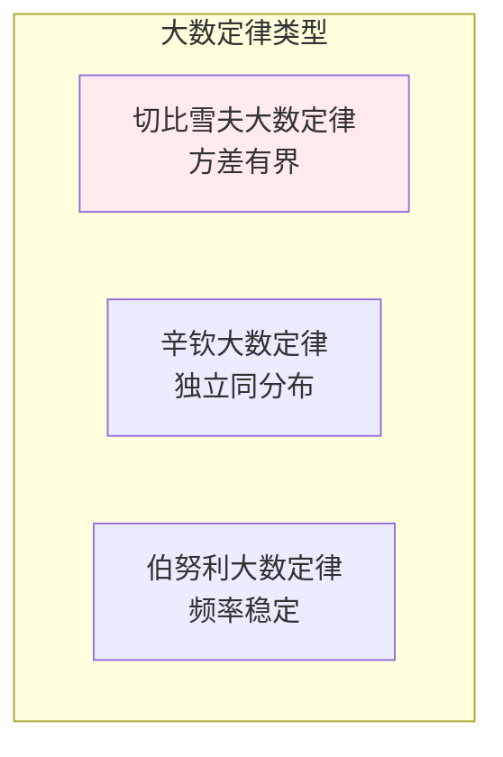
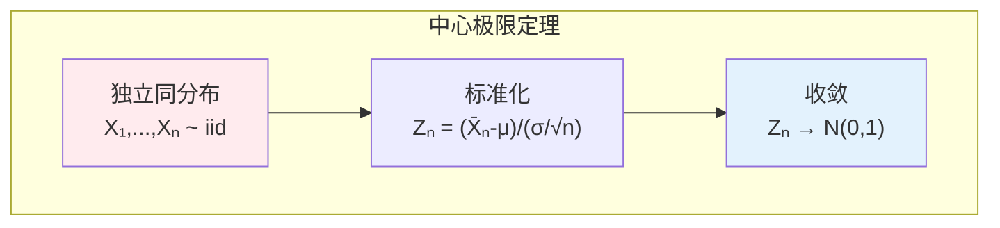
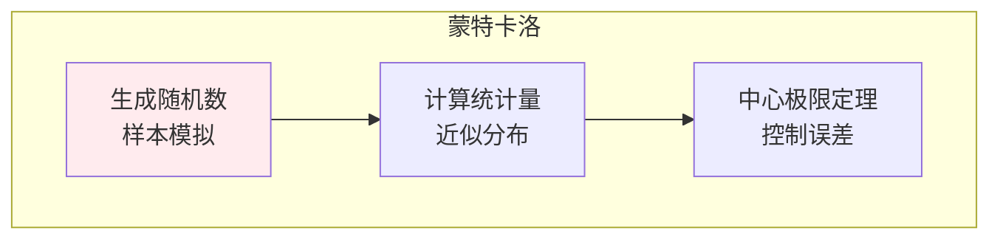

# 大数定律与中心极限定理

> **核心观点**：大数定律说明频率的稳定性，中心极限定理说明正态分布的普遍性，是统计推断的理论基石。

## 🎯 这 20% 能解决哪些问题

| 你遇到的困惑 | 本质原因 | 马上能改的动作 |
|---|---|---|
| 埋点刚上线数据一直变，不敢下结论 | 样本量不够，估计量波动大 | 记 `误差 ∝ σ/√n`：想把精度提高一倍，样本量要变四倍 |
| 指标不呈正态，能不能用 t 检验 | 混淆了个体分布与均值分布 | 只要 n 够大，均值就近似正态（CLT）；重尾数据先把 n 拉大或改用分位数/Bootstrap |
| 5% 误差要多少样本？只能拍脑袋 | 没把误差要求翻译成公式 | `n ≈ (z·σ/E)²`；比例型用 `p(1-p)` 代 σ²，保守取 p=0.5 |
| batch size 改了训练变飘 | 小批量梯度是全量梯度的均值估计 | 梯度噪声方差≈`σ²/B`，B 减半则噪声翻倍，学习率相应下调 |
| 随机跑了 100 次仿真，结果可信度说不清 | 只看均值不看标准误 | 报 `均值 ± 1.96·s/√N`；蒙特卡洛收敛速度只有 `O(1/√N)`，要提精度得平方倍样本 |
| 小概率事件偶尔发生，怀疑随机错了 | 大数定律是极限，不是保证 | 区分「依概率收敛」与「几乎必然收敛」；短期偏离正常，用控制图监控偏离幅度 |

---

## 📊 大数定律

### 定义

| 定律 | 内涵 | 意义 |
|------|------|------|
| 弱大数定律 | X̄ₙ 依概率收敛于 μ | 频率稳定 |
| 强大数定律 | X̄ₙ 几乎必然收敛于 μ | 频率几乎必然稳定 |

### 常见大数定律



### 切比雪夫不等式

| 公式 | 内容 | 应用 |
|------|------|------|
| P(\|X-μ\|≥ε) ≤ σ²/ε² | 偏离均值的概率上界 | 证明大数定律 |

---

## 📈 中心极限定理

### 定义



### 常见中心极限定理

| 定理 | 条件 | 结论 |
|------|------|------|
| 林德伯格-莱维 | 独立同分布 | 和趋于正态 |
| 李雅普诺夫 | 独立不同分布 | 和趋于正态 |
| 棣莫弗-拉普拉斯 | 二项分布 | 近似正态 |

---

## 🎯 应用

### 参数估计

| 应用 | 原理 | 说明 |
|------|------|------|
| 置信区间 | X̄ ± zₐ/₂σ/√n | 均值区间估计 |
| 假设检验 | 构造统计量 | 判断假设真伪 |

### 蒙特卡洛模拟



---

## 🤖 机器学习应用

### 随机近似

| 方法 | 原理 | 应用 |
|------|------|------|
| SGD | 小批量梯度近似全批量 | 大规模训练 |
| 随机森林 | 随机采样近似集成 | 集成学习 |
| 蒙特卡洛Dropout | 采样近似贝叶斯推断 | 不确定性估计 |

---

## 🎯 核心结论

### 极限定理核心概念

1. **大数定律**：频率趋近概率
2. **中心极限定理**：和趋于正态
3. **正态分布**：自然界最普遍的分布
4. **统计推断**：基于极限理论
5. **机器学习**：随机近似方法

### 学习路径

```
极限理论学习四步骤：
1. 大数定律：弱/强大数定律
2. 中心极限定理：收敛到正态
3. 应用：置信区间、假设检验
4. 机器学习：SGD、蒙特卡洛
```

---

## 🎓 实战场景（TIL）

| 场景 | 现象 | 用极限定理的哪一点 |
|---|---|---|
| A/B 实验定样本量 | 实验提前下线，结论抽风 | 均值标准误 `σ/√n`；先估基线方差，再按可容忍误差反推 n，不达量不下结论 |
| 告警阈值设定 | 固定阈值要么不报要么刷屏 | 切比雪夫不等式 `P(|X-μ|≥ε) ≤ σ²/ε²`：不需分布假设也能给出保守上界 |
| 日志采样统计 | 采 1% 日志算 P99 偏差大 | 均值类指标可靠 CLT，分位数不行；尾部指标要么全量要么用重要性采样 |
| 模型评估波动 | 换一个随机种子结论就变 | 评估指标是样本均值，报 `±1.96·s/√k`（k 次折）而不是单次得分 |
| 误差降低不上 | 样本从 1 万加到 2 万，感觉没变好 | `1/√n` 的必然：2 万相对 1 万只降 29% 误差，要降一半得 4 万 |

---

## 📋 一页速查

| 要什么 | 记这一行 |
|---|---|
| 均值分布 | `E(X̄)=μ`；`Var(X̄)=σ²/n`；标准误 `SE = σ/√n` |
| 大数定律 | `X̄ₙ →ᵖ μ`（弱）；`P(X̄ₙ → μ)=1`（强）；要求独立 + 方差有界 |
| 切比雪夫 | `P(|X-μ| ≥ ε) ≤ σ²/ε²`；不依赖分布，给保守上界 |
| 中心极限定理 | `Zₙ = (X̄ₙ-μ)/(σ/√n) → N(0,1)`， iid 且方差有限（经验 n ≥ 30） |
| 二项近似 | `B(n,p)` 当 `np ≥ 5` 且 `n(1-p) ≥ 5` 时可近似 `N(np, np(1-p))` |
| 样本量公式 | 均值：`n = (z·σ/E)²`；比例：`n = z²·p(1-p)/E²`（保守 p=0.5） |
| 蒙特卡洛误差 | `ε ≈ σ/√N`：要把精度提高 10 倍需 100 倍样本 |
| SGD 噪声 | 小批量梯度均值无偏，方差 ≈ `σ²/B`，批量与学习率联动调整 |

---

## 🔗 相关链接

- 上级：[概率与统计](index.md)
- 前置：[随机变量](02-random-variables.md)、[多维随机变量](03-multivariate-random-variables.md)
- 下一篇：[统计推断](05-statistical-inference.md)（把 CLT 变成置信区间与样本量公式）
- 相关：[积分与数值近似](../calculus/03-integral-calculus.md)（蒙特卡洛误差的同一条 `O(1/√N)`）
- 应用：[模型评估与指标](../../../applications/machine-learning/model-evaluation/01-essentials.md)

---

## 📚 参考文献

1. 《概率论与数理统计》- 浙江大学
2. 《概率论基础教程》- Sheldon Ross
3. 《统计学习方法》- 李航
4. 《Probability and Statistics》- DeGroot
5. 《蒙特卡洛方法》
6. 《随机过程》- 方兆本
7. 《中心极限定理》
8. 《大数定律与中心极限定理》