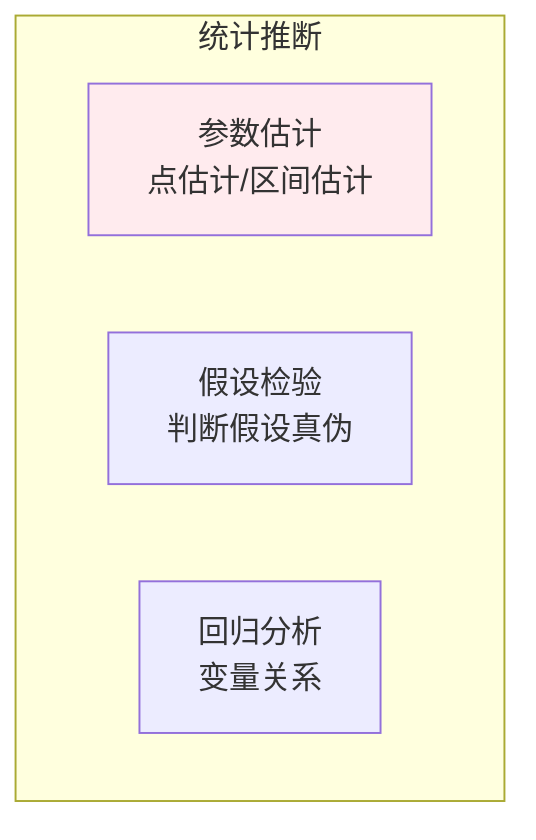
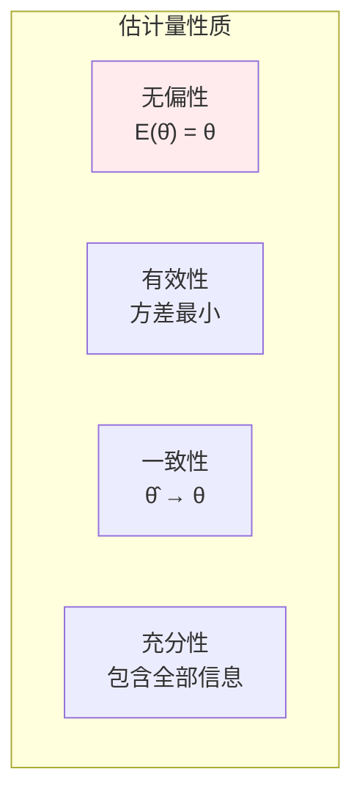
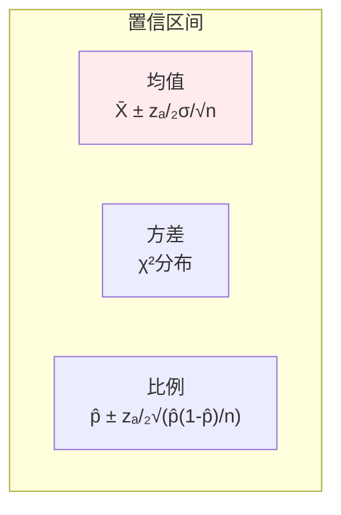
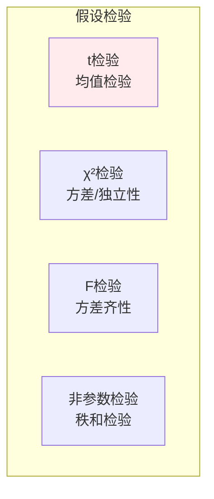
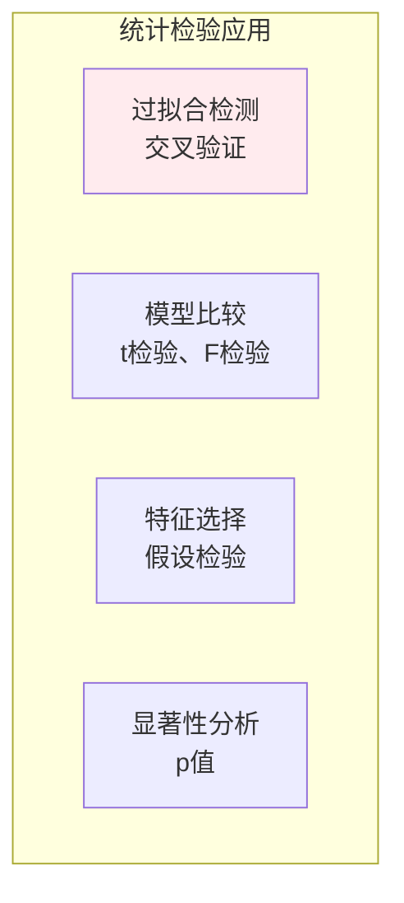

# 统计推断

> **核心观点**：统计推断是从样本数据推断总体特征的方法，是数据分析和机器学习的核心。

## 🎯 这 20% 能解决哪些问题

| 你遇到的困惑 | 本质原因 | 马上能改的动作 |
|---|---|---|
| p=0.049 就宣布胜利，复现又失败 | 把 p 值当效应大小，且踩了多重比较 | 报效应量 + 置信区间；跑多个指标时用 Bonferroni/BH 校正，并预留验证集 |
| 实验不显著就结论「没差别」 | 不拒绝 H₀ ≠ 接受 H₀ | 先看检验功效 1-β；样本不够时「不显著」只能读作「未测出」 |
| 转化率报了点估计没区间 | 只看 MLE，不看标准误 | 所有指标都带 95% CI：`p̂ ± 1.96√(p̂(1-p̂)/n)`，区间宽度就是结论强度 |
| 交叉验证各折分数不一致 | 小样本方差不稳 | 均值用 t 区间（`s/√n`，自由度 n-1）；方差比较用 χ²/F，非正态用 Bootstrap |
| 损失函数为何选交叉熵或 MSE | 不知道损失函数的统计身份 | 记住：最小化交叉熵 = 最大化似然 = 最小化 KL；正则项 = 先验（L2 ⇔ 高斯先验） |
| 指标看起来好了但不敢确定 | 没有控制第一类错误 | 先定 α 与停止规则再开实验，禁止「看到显著就停」（偷看会把假阳率顶上去） |
| A/B 分流不均衡导致结论作废 | 分组非独立同分布 | 检查 SRM（样本比例失配）：用卡方检验对比预期分流比，不平先修链路再看效果 |

---

## 📊 统计推断框架



---

## 🎯 点估计

### 点估计方法

| 方法 | 原理 | 优缺点 |
|------|------|--------|
| 矩估计 | 样本矩=总体矩 | 简单但不一定最优 |
| 最大似然估计 | 使似然函数最大 | 最优但计算复杂 |
| 贝叶斯估计 | 后验众数/均值 | 融合先验信息 |

### 估计量性质



### 最大似然估计

| 步骤 | 内容 | 公式 |
|------|------|------|
| 1. 构造似然函数 | 所有样本联合概率 | L(θ) = ∏P(xᵢ\|θ) |
| 2. 对数似然 | 取对数简化计算 | l(θ) = ∑logP(xᵢ\|θ) |
| 3. 求导最大化 | 令导数为0 | ∂l/∂θ = 0 |

---

## 📐 区间估计

### 置信区间

| 概念 | 公式 | 意义 |
|------|------|------|
| 置信区间 | [θ̂₋, θ̂₊] | 参数可能范围 |
| 置信水平 | 1-α | 包含真值的概率 |

### 常用置信区间



---

## 🧪 假设检验

### 检验步骤

| 步骤 | 内容 | 说明 |
|------|------|------|
| 1. 建立假设 | H₀ vs H₁ | 原假设/备择假设 |
| 2. 选择统计量 | 检验统计量 | t检验、χ²检验 |
| 3. 确定拒绝域 | 临界值 | 显著性水平α |
| 4. 做出决策 | 拒绝/不拒绝 | p值判断 |

### 常见检验



### 第一类与第二类错误

| 错误类型 | 定义 | 概率 |
|----------|------|------|
| 第一类错误 | 拒绝真H₀ | α（显著性水平） |
| 第二类错误 | 接受假H₀ | β |
| 检验功效 | 1-β | 正确拒绝H₀的概率 |

---

## 🤖 机器学习应用

### 模型选择



### A/B测试

| 步骤 | 内容 | 方法 |
|------|------|------|
| 设计 | 随机分组 | 实验设计 |
| 采集 | 收集数据 | 样本量 |
| 分析 | 假设检验 | t检验、卡方检验 |
| 决策 | 是否显著 | p值<α |

---

## 🎯 核心结论

### 统计推断核心概念

1. **点估计**：给出参数的单一估计值
2. **区间估计**：给出参数的可能范围
3. **假设检验**：判断假设的真伪
4. **p值**：观察到的结果至少如实际极端的概率
5. **置信水平**：重复实验中包含真值的比例

### 学习路径

```
统计推断学习四步骤：
1. 点估计：矩估计、MLE
2. 区间估计：置信区间
3. 假设检验：t检验、χ²检验
4. 应用：A/B测试、模型选择
```

---

## 🎓 实战场景（TIL）

| 场景 | 现象 | 用统计推断的哪一点 |
|---|---|---|
| 看板指标可信度 | 小流量分组涨跌剧烈被当成趋势 | 比例型置信区间：基数小的组区间宽，图上必须带误差条或用经验贝叶斯平滑 |
| 多指标同时看 | 20 个指标里总有 1 个 p<0.05 | 多重比较：α 需除以比较次数（Bonferroni）或用 FDR（BH）控制 |
| 样本量不够的实验 | 只能测出 10% 以上的差异 | 功效分析：`n ∝ σ²/(δ²)`，想测出 1% 相对提升比测 10% 多 100 倍样本 |
| 模型选型 | A 模型在测试集高 0.2% 就换 | 配对比较：同批数据用配对 t 检验或 McNemar，看差值区间是否跨过 0 |
| 超参搜索 | 最优配置是噪声里选出来的 | 胜者诅咒：挑最大值天然高估，需用独立验证集重测候选 Top-K |
| 流失率估计 | 小样本比例算出来偏差大 | 用 Wilson 区间代替 Wald 区间（`p̂ ± z√(p̂(1-p̂)/n)`），小样本/极端比例下更稳 |

---

## 📋 一页速查

| 要什么 | 记这一行 |
|---|---|
| 置信区间（均值） | `X̄ ± z_{α/2}·σ/√n`；σ 未知用 t：`X̄ ± t_{α/2,n-1}·s/√n` |
| 置信区间（比例） | `p̂ ± z_{α/2}√(p̂(1-p̂)/n)`；小样本用 Wilson |
| 95% 的真解释 | 重复抽样时区间覆盖真值的比例；不是「真值落在此区间的概率」 |
| p 值定义 | H₀ 为真时，观察到至少如此极端结果的概率；小 ⇒ 与 H₀ 不相容，不代表效应大 |
| 两类错误 | 假阳 α（拒真 H₀）；假阴 β（采假 H₀）；功效 = 1-β；α↓ 则 β↑ |
| 检验选型 | 单均值：t；两均值：配对/独立 t；比例差：z；计数独立性：χ²；方差齐性：F；非正态小样本：Bootstrap/秩和 |
| MLE 三步 | 似然 `L(θ)=∏P(xᵢ\|θ)` → 取对数变求和 → 求导置零（或数值优化） |
| 损失与分布 | MSE ⇔ 高斯噪声 MLE；交叉熵 ⇔ 伯努利/多项 MLE；L2 ⇔ 高斯先验 MAP；L1 ⇔ 拉普拉斯先验 |
| 样本量估算 | `n ≈ (z_{α/2}+z_β)²·σ²/δ²`；比例型代 `σ² = p(1-p)` |

---

## 🔗 相关链接

- 上级：[概率与统计](index.md)
- 前置：[大数定律与中心极限定理](04-law-of-large-numbers.md)（置信区间的理论来源）
- 相关：[多维随机变量](03-multivariate-random-variables.md)、[互信息](../information-theory/02-mutual-information.md)、[KL 散度](../information-theory/03-kl-divergence.md)
- 应用：[模型评估与指标](../../../applications/machine-learning/model-evaluation/01-essentials.md)
- 工程侧：[测试策略](../../software/07-testing-strategy.md)、[可观测性](../../software/10-observability-monitoring.md)

---

## 📚 参考文献

1. 《概率论与数理统计》- 浙江大学
2. 《统计学习方法》- 李航
3. 《统计学》- 贾俊平
4. 《统计推断》- Casella
5. 《All of Statistics》- Larry Wasserman
6. 《Introduction to the Practice of Statistics》
7. 《统计学方法》
8. 《假设检验》