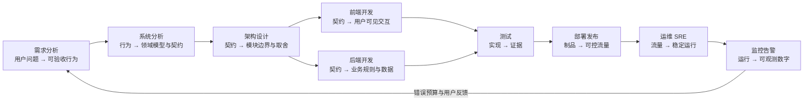

# 软件工程全生命周期 — 八道关卡一条主线

> 一句话：软件工程不是八个阶段的流水线，而是「把一句模糊的话，变成一条可监控的数字」的八次翻译；每一次翻译都要留下可验收的产物。

## 🎯 这 20% 能解决哪些问题

| 你遇到的困惑 | 本质原因 | 马上能改的动作 |
|---|---|---|
| 需求改了又改，代码白写 | 需求阶段只收了「功能」，没收「验收标准」 | 每个需求补一行 Given/When/Then，写不出来就不排期 |
| 上线才发现性能撑不住 | 非功能需求没量化，架构阶段没做容量估算 | 在需求文档里写死 P99 延迟与峰值 QPS 两个数 |
| 测试越写越慢，线上还是出问题 | 测试集中在 E2E，单元测试缺失 | 按 70/20/10 分配测试量，先补核心业务规则的单元测试 |
| 发布像拆炸弹，回滚靠手抖 | 没有不可变制品与回滚预案 | 每次发布前写好「3 分钟回滚三步」，并演练一次 |
| 出事只能等用户投诉 | 只有日志没有指标与告警 | 先给核心链路埋 4 个黄金信号，再配 1 条症状告警 |
| 架构评审变成画图比赛 | 没有决策记录，没有约束条件 | 每个架构决定写一页 ADR：背景 / 选项 / 结论 / 失效条件 |

---

## 一、一条主线：八次翻译

**主线只有一句**：每一站的产出，必须是下一站能直接消费的东西。翻译断了，问题就会在最后一站（线上）以最贵的方式暴露。

---

## 二、八道关卡：每站只回答一个问题

| 阶段 | 只回答一个问题 | 核心产出（可验收） | 典型失败模式 | 去哪看 |
|---|---|---|---|---|
| 需求分析 | 不做会怎样？怎么算做完？ | 一页 PRD + 验收标准 + 非功能指标 | 需求是功能清单，没有边界 | [需求分析](02-requirements-analysis.md) |
| 系统分析 | 系统内部靠什么结构撑住这些行为？ | 领域模型 + 状态机 + 接口契约 | 只画流程图，不定义状态与异常 | [系统分析](03-system-analysis.md) |
| 架构设计 | 哪些必须拆开，哪些必须放一起？ | 模块边界 + ADR + 容量估算 | 为未来拆分，为现在埋坑 | [架构设计](04-architecture-design.md) |
| 前端开发 | 用户在什么状态下看到什么？ | 组件 + 状态机 + 性能预算 | 只做正常态，空/错/慢态缺失 | [前端工程化](05-frontend-engineering.md) |
| 后端开发 | 同一条业务规则，在哪个唯一位置实现？ | 分层代码 + 事务边界 + 幂等设计 | 业务逻辑散落在 Controller | [后端工程化](06-backend-engineering.md) |
| 测试 | 我凭什么相信它能工作？ | 分层测试 + 门禁阈值 | 覆盖率当目标，断言当摆设 | [测试策略](07-testing-strategy.md) |
| 部署发布 | 出问题多久能退回去？ | 不可变制品 + 回滚预案 | 手工改服务器，环境不一致 | [部署与发布](08-deployment-release.md) |
| 运维 SRE | 稳定性用什么数字衡量？ | SLI/SLO + 错误预算 + 应急预案 | 靠英雄主义救火 | [运维与 SRE](09-operations-sre.md) |
| 监控告警 | 用户还没投诉时，我怎么知道坏了？ | 黄金信号 + 症状告警 + 看板 | 告警风暴，指标无人看 | [可观测性](10-observability-monitoring.md) |

> 注意：上表是九行，因为「监控告警」与「运维 SRE」是同一根链条上的两只手——SRE 定目标与流程，监控提供证据。

---

## 三、三个成本杠杆（决定你 80% 的收益）

### 3.1 缺陷成本随阶段指数上升

| 缺陷发现阶段 | 相对修复成本 | 为什么 |
|---|---|---|
| 需求评审 | 1× | 改一句话 |
| 设计评审 | 5× | 改模型与契约 |
| 编码/单测 | 10× | 改代码与测试 |
| 集成测试 | 50× | 改接口、联调、回归 |
| 上线后 | 100×+ | 修数据、赔信任、写复盘 |

**动作**：把评审时间花在前两站——需求评审 1 小时，抵得上线上 2 天。

### 3.2 变更成本决定架构好坏

好的架构只有一个特征：**做一次典型需求变更，需要改动的文件数与团队数最少**。评估架构时不要问「先不先进」，要问「加一个字段要动几层」。

### 3.3 质量必须内建，不能外挂

| 外挂式（贵） | 内建式（便宜） |
|---|---|
| 上线前集中人肉回归 | 提交即跑单测 + 契约测试 |
| 靠测试同学找边界 | 需求阶段写清边界与异常 |
| 靠运维盯监控 | 代码里埋指标与结构化日志 |
| 靠复盘防再犯 | 把复盘结论变成自动化检查 |

---

## 四、质量门禁：每站一张通行证

| 门禁 | 通过标准（可直接照做） |
|---|---|
| 需求 → 设计 | 每条需求有验收标准；非功能有数字；范围有 in/out 清单 |
| 设计 → 编码 | 核心实体与状态迁移有表；接口契约已定稿；异常码已定义 |
| 编码 → 测试 | 单测覆盖核心规则；Lint 与静态分析零错误 |
| 测试 → 发布 | 冒烟全绿；性能压测达标；回滚脚本演练过 |
| 发布 → 全量 | 灰度期错误率与延迟不高于基线；关键业务指标无异常 |
| 线上 → 复盘 | 有 SLO 数据；有改进项负责人与截止时间 |

---

## 五、按阶段裁剪：不同规模只做不同的 20%

| 场景 | 必须做 | 可以省 |
|---|---|---|
| 个人项目 / MVP | 验收标准、接口契约、回滚脚本 | 正式架构文档、SLO 体系 |
| 3–10 人团队 | 上述 + 分层测试、CI 门禁、症状告警 | 灰度平台、专职 SRE |
| 多团队 / 核心业务 | 全量八站 + ADR、错误预算、契约测试 | 无（只压缩文档厚度） |

---

## 六、最小可行工程实践（12 条，照着做就能超过多数团队）

1. 每个需求一行验收标准，写不出来就不排期。
2. 接口先定契约（OpenAPI/JSON Schema），前后端并行开发。
3. 数据库变更走「先加后用再删」三步，不直接改字段。
4. 业务规则只在一个层实现，Controller 只做参数校验与编排。
5. 核心规则必须有单元测试，测试名写清业务语义。
6. 提交即跑 Lint + 单测，红灯不合入。
7. 制品一次构建、多环境晋级，禁止在服务器上改代码。
8. 发布前写好回滚三步，并在预发演练。
9. 每个服务至少 4 个黄金信号：延迟、流量、错误、饱和度。
10. 告警只报「用户能感知的症状」，不报单点原因。
11. 事故按「止血 → 定位 → 修复 → 复盘」四段走，止血优先。
12. 复盘结论必须变成自动化检查或模板，否则一定会重犯。

---

## 🎓 实战场景（TIL）

- **场景**：流程文档齐全，交付却越来越慢。**本质**：门禁设在后期（上线前集中评审），返工成本已经付完。**要点**：把检查前移（需求验收标准、CI 门禁、预发布冒烟），靠短周期而非重审批保质量。
- **场景**：需求交得很快，线上事故反倒变多。**本质**：只考核交付速度，不考核变更失败率与恢复时长。**要点**：用四个关键指标（交付频次、前置时间、变更失败率、恢复时长）一起看，避免单指标优化。
- **场景**：出了问题没人能拼出全貌。**本质**：按岗位分段负责，无人对端到端结果负责。**要点**：每条主链路指定一个负责人与一页全景图（依赖、数据流向、监控入口），定期用故障或演练验证。

---

## 📋 一页速查

| 我要判断 | 先看什么 | 判定标准 |
|---|---|---|
| 需求能不能开工 | 验收标准 | 写不出 Given/When/Then → 不开工 |
| 设计够不够 | 状态机 + 契约 | 有状态字段却没有迁移表 → 打回 |
| 架构能不能扛变更 | 变更影响面 | 加一个字段要改 3 个以上模块 → 边界错了 |
| 代码能不能上线 | 单测 + 静态分析 | 核心规则无测试 → 不合入 |
| 发布能不能做 | 回滚预案 | 说不出 3 步回滚 → 不发 |
| 系统稳不稳 | SLO 达成率 | 错误预算耗尽 → 停止加功能，先还债 |
| 监控有没有用 | 告警有效率 | 超过一半告警无需动作 → 重写告警 |
| 团队成熟度 | 门禁执行率 | 门禁可被口头跳过 → 等于没有 |

---

## 🔗 相关链接

- 上级：[软件工程](index.md)
- 同域：[需求分析](02-requirements-analysis.md)、[系统分析](03-system-analysis.md)、[架构设计](04-architecture-design.md)
- 邻域：[AI 辅助软件开发](../../ai-core/engineering/03-ai-assisted-software-development.md) — 把 AI 放进这条主线的具体位置
- 邻域：[网络协议栈与 DNS](../../network-fundamentals/01-network-protocol-stack.md) — 每一次请求在链路中的位置
- 邻域：[HTTP 与 Web 通信](../../network-fundamentals/02-http-basics.md) — 接口契约的协议基础
