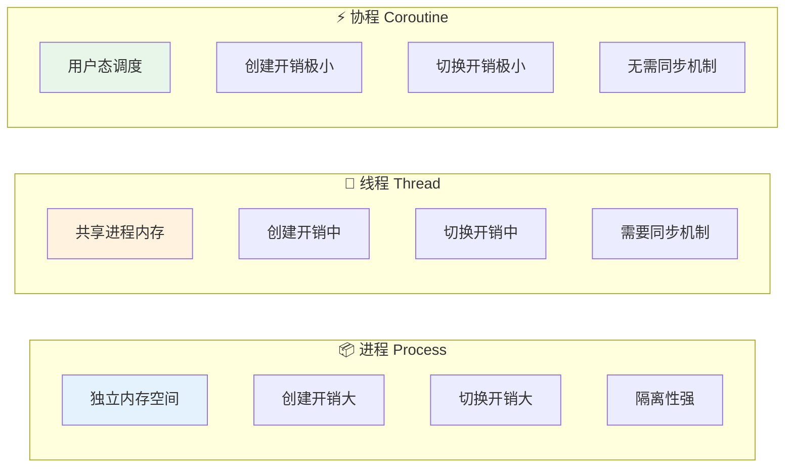
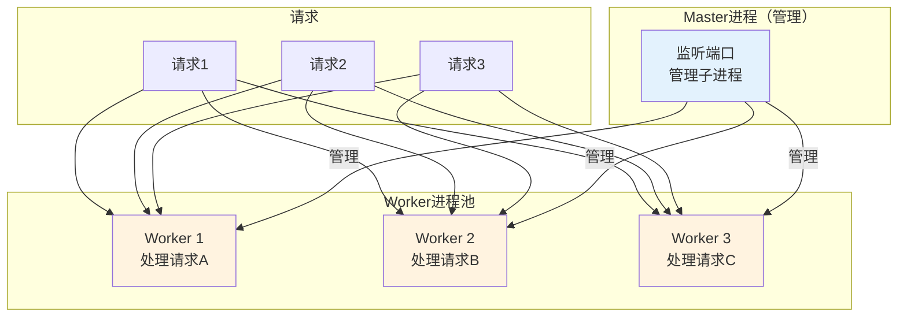
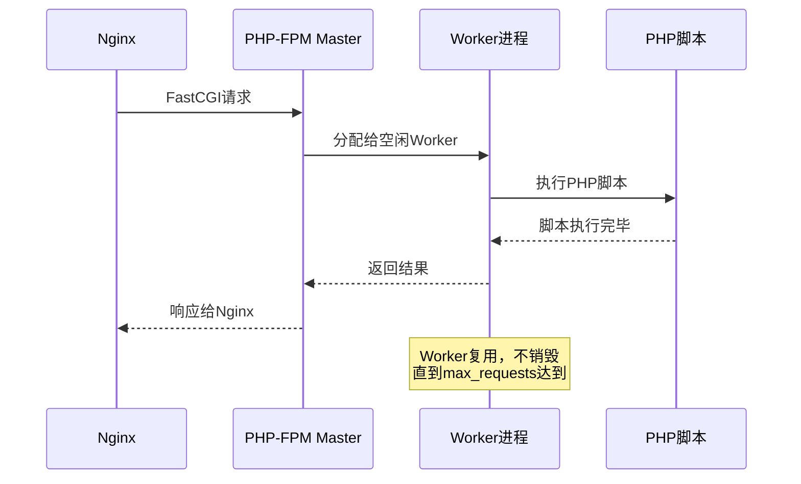
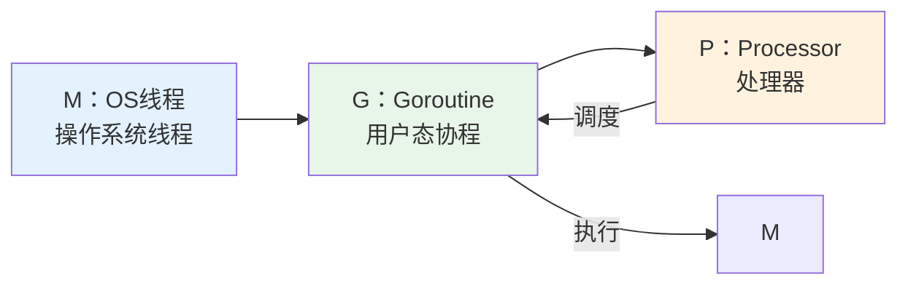
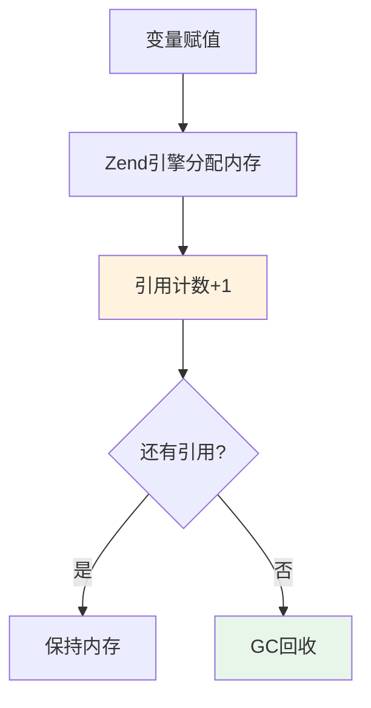
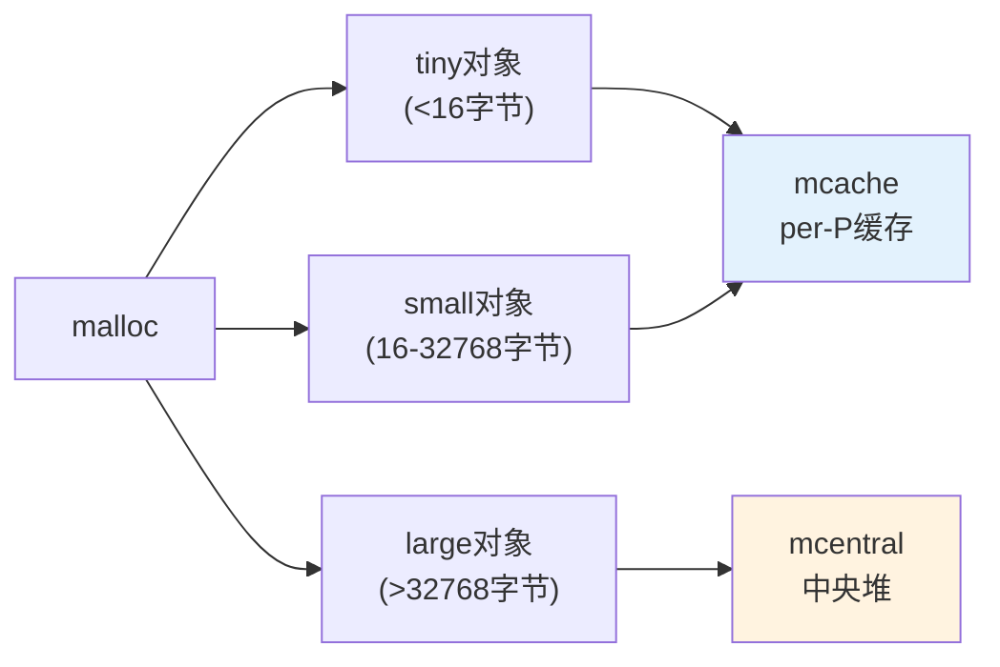

# 操作系统与进程模型 — 用隔离换稳定，用共享换效率

> 一句话：进程用「隔离」换稳定，线程与协程用「共享」换效率；线上绝大多数并发故障，都是共享没管好。

## 🎯 这 20% 能解决哪些问题

| 你遇到的困惑 | 本质原因 | 马上能改的动作 |
|---|---|---|
| PHP-FPM 进程数越调越卡 | 进程数超过内存与 CPU 的承载能力 | 取「内存上限 ÷ 单进程内存」与「核数 × 2~4」的较小值，再压测确认 |
| 服务内存一路涨到 OOM | 长生命周期进程里对象不断累积 | 设 `max_requests` 定期回收，并排查全局缓存与静态集合 |
| Go 服务协程数暴涨 | 无限制 `go func()` 且没有退出条件 | 每个协程加 context 超时，出口并发设上限 |
| 高并发下数据错乱 | 多线程/协程共享可变状态 | 用 channel 传递所有权，或加锁并缩小临界区 |
| 分不清该看进程还是线程指标 | 混淆了隔离与共享的资源归属 | 先看进程级 RSS/CPU，再看线程/协程数与阻塞时长 |
| 容器被 OOMKilled，但 `free` 显示还有内存 | 看的是 cgroup 限额，不是整机空闲 | 查 cgroup 的 `memory.events` 与 `memory.max`，区分限额 OOM 与整机 OOM |
| `df` 说满了，`du` 却找不到大文件 | 被删除的文件仍被进程持有 | `lsof +L1` 找持有者，重启或让它重新打开文件（日志切割后未 reopen 最常见） |
| 写日志后偶发 10ms 尖峰 | 脏页回写与块层调度合并 | 异步缓冲 + 控制写频率，区分 `fsync` 与批量落盘的使用场景 |
| 上万并发连接时 CPU 全在系统态 | 每连接一线程、轮询扫描开销大 | 改事件驱动（epoll）或协程池，避免线性扫描 fd |

---

## 一、核心规律

### 1.1 进程 vs 线程 vs 协程



### 1.2 关键对比

| 特性 | 进程 | 线程 | 协程 |
|------|------|------|------|
| **内存** | 独立 | 共享 | 共享 |
| **创建开销** | 大 | 中 | 极小 |
| **切换开销** | 大（内核态） | 中 | 极小（用户态） |
| **并发数** | 几十个 | 几百个 | 几十万+ |
| **同步** | 不需要 | 需要锁 | 不需要 |
| **PHP-FPM** | ✅ 使用 | — | — |
| **Go** | — | — | ✅ 使用 |

> **核心规律：协程 = 线程的轻量化。Go用协程实现高并发，PHP用多进程实现隔离。**

---

## 二、虚拟内存：进程看到的地址都是假的


| 概念 | 必须记住的 | 工程表现 |
|---|---|---|
| 页（page） | 常见 4 KB，大页 2 MB/1 GB | 大页减少 TLB 未命中，数据库常开；但小文件服务反而浪费内存 |
| 按需分页 | 地址空间≠已用内存 | `VSZ` 很大不等于真占用，看 `RSS`/`PSS` |
| 写时复制 COW | `fork` 后共享只读页 | 大内存服务 `fork`/快照瞬间写多会放大内存使用（Redis bgsave 抖动原因） |
| mmap | 文件映射、匿名共享、大对象分配三条路 | 映射文件被外部截断会收到 `SIGBUS`；共享内存是最快的 IPC |
| Overcommit | 承诺总量可超物理内存 | 真正分配时才失败；关 overcommit 会让大 `VSZ` 进程直接申请失败 |
| swap / 回写 | 冷页下沉、脏页回流 | 开 swap 时 P99 会因换页跳变；容器与实时服务常调低 `vm.swappiness` |
| cgroup 内存限额 | 超限先回收再 OOM kill | 容器 `OOMKilled` 是限额问题，不是宿主机容量问题 |

| 指标 | 含义 | 怎么看 |
|---|---|---|
| VSZ | 虚拟地址空间大小 | `ps -o vsz`；大不等于吃内存 |
| RSS | 常驻物理内存（含共享） | `ps`/`top`；多进程会重复计算共享页 |
| PSS | 共享页按比例分摊 | `smem -k -c pss`；评估真实占用用它 |
| 脏页 | 已改未落盘 | `/proc/meminfo` 的 `Dirty`；持续高说明 IO 跟不上 |

**OOM 排查顺序**：先看是整机 OOM 还是 cgroup 限额（`memory.events` 的 `oom_kill`）→ 看是泄漏还是缓存回收不足（`inactive_anon`/`active_file`）→ 看 `oom_score_adj` 是否把关键进程排除了保护 → 最后才调大限额。

---

## 三、文件系统与页缓存：多数「磁盘慢」其实慢在缓存


| 概念 | 一句话 | 常见坑 |
|---|---|---|
| inode | 存元数据与数据块指针，不含文件名 | `df -i` 耗尽：海量小文件能把 inode 用完而空间还剩很多 |
| dentry | 目录项缓存，名字→inode | 路径递归解析比读数据更贵，热路径少用深层目录 |
| fd 表 | 每进程有限、每系统有限 | `too many open files` 先改 `ulimit -n`/`file-max`，再查泄漏 |
| 硬链接 vs 软链接 | 硬链接同一 inode，软链接存路径 | 硬链接不能跳文件系统、一般不能指目录；发布时更推荐 rename |
| `rename` 原子性 | 同文件系统内改名原子 | 跨设备 `rename` 失败；「先写临时文件再 rename」是安全发布范式 |
| 日志（journal） | 元数据一致性优先 | `data=ordered/writeback` 决定崩溃后是否可能读到旧数据 |
| `noatime` | 不每次读都写元数据 | 高读场景加上，能显著减少写放大 |

| 落盘语义 | 保证什么 | 代价 |
|---|---|---|
| 无 `fsync` | 只保证进了页缓存，进程崩不丢，机器崩会丢 | 最快 |
| `fdatasync` | 数据 + 必要元数据 | 比 `fsync` 少一次元数据刷 |
| `fsync` | 数据 + 元数据 + 设备缓存刷 | 有 volatile 写缓存的盘上可能很慢 |
| `O_DIRECT` | 绕过页缓存直写 | 必须对齐，失去读预取；数据库自管缓存才用 |

**故障对应命令**：`df` 与 `du` 不一致 → `lsof +L1`；目录统计慢 → `du -sh --max-depth=1` 配合 `-x` 不跳文件系统；谁在写盘 → `pidstat -d 1`、iotop；读写顺序不对 → `strace -e trace=file`。

---

## 四、I/O 模型与调度：高并发的本质是少等待

| 模型 | 机制 | 并发上限 | 典型使用方 |
|---|---|---|---|
| 阻塞 I/O | 一次调用睡一次 | 连接数 = 线程数 | PHP-FPM、传统 CGI |
| 非阻塞轮询 | 循环试，失败重试 | CPU 浪费 | 简单重试逻辑 |
| I/O 多路复用 | `select`/`poll`/`epoll` 等就绪 | 万级到百万级 | nginx、Redis、Go runtime |
| 信号驱动 | 就绪发信号 | 高 | 少见，处理复杂 |
| 真正异步 | `io_uring`/AIO，提交后不等 | 高 | 高性能存储、新内核服务 |

| 对比 | select | poll | epoll |
|---|---|---|---|
| fd 上限 | 1024（`FD_SETSIZE`） | 受文件上限 | 受内存 |
| 每次开销 | 拷贝全量集合 + 线性扫描 | 同上但无硬上限 | 注册一次，回调就绪列表 |
| 复杂度 | `O(n)` | `O(n)` | `O(就绪数)` |
| 模式 | — | — | 水平触发（LT）默认；边缘触发（ET）需读完数据 |

| 块层调度器 | 适合 | 选择理由 |
|---|---|---|
| `none` | NVMe/多队列 SSD | 硬件已并行，排序只是浪费 CPU |
| `mq-deadline` | 混合负载 | 兼顾读延迟与写不饿死 |
| `bfq` | 桌面/混用机械盘 | 公平性好，交互延迟低 |
| `kyber` | 多队列设备求低延迟 | 目标延迟驱动 |

**零拷贝阶梯**（减少的是内核↔用户空间的往返）：`read+write` → `mmap+write` → `sendfile` → `sendfile + DMA scatter-gather`。文件服务、消息队列类软件的性能差异主要来自这里。

**IO 与 CPU 瓶颈判读**：`iostat -x 1` 的 `await` 高但 `%util` 低 → 单请求慢、并发不够（典型 QD=1）；`%util` 接近 100%（SSD 上不准）→ 看设备队列深度；`vmstat 1` 的 `cs` 与 `in` 突增 → 上下文切换风暴（线程池过大或中断过多）。

---

## 五、PHP-FPM 进程模型

### 5.1 架构原理



### 5.2 生命周期



### 5.3 关键配置

```ini
; pool.conf
pm = dynamic              ; 进程管理方式：static/dynamic/on-demand
pm.max_children = 50      ; 最大子进程数（CPU核数×2~4）
pm.start_servers = 5      ; 启动时进程数
pm.min_spare_servers = 2  ; 最小空闲进程
pm.max_spare_servers = 10 ; 最大空闲进程
pm.max_requests = 500     ; 单进程最大请求数（防内存泄漏）
```

> **配置规律：** `max_children ≈ CPU核数 × 2~4`，`max_requests`防止内存泄漏累积

---

## 六、Go 协程模型

### 6.1 Goroutine 原理



**M : G : P = 1 : N : M 模型**
- **M (Machine)**：OS线程，真正的执行者
- **G (Goroutine)**：用户态协程，轻量级任务
- **P (Processor)**：处理器，绑定M和G

### 6.2 Channel 通信

```go
// 无缓冲channel：发送阻塞直到接收
ch := make(chan int)
go func() { ch <- 42 }()
val := <-ch  // 阻塞等待

// 缓冲channel：缓冲区满才阻塞
ch2 := make(chan int, 10)
ch2 <- 42   // 不阻塞（缓冲区有空位）
val2 := <-ch2
```

> **核心规律：Channel = 协程间的管道。不要通过共享内存通信，要通过通信共享内存。**

### 6.3 并发模式

| 模式 | 代码示例 | 适用场景 |
|------|---------|---------|
| **Fan-out** | 多个goroutine并行处理 | 批量任务 |
| **Fan-in** | 合并多个channel结果 | 结果聚合 |
| **Worker Pool** | 固定数量worker处理任务队列 | 限流/资源控制 |
| **Pipeline** | 多阶段串联处理 | 数据处理流水线 |

---

## 七、语言运行时内存（与内核虚拟内存的关系）

### 7.1 PHP 内存管理



**PHP引用计数机制：**
- 每个变量有`refcount`，赋值时+1，析构时-1
- refcount=0时，内存被回收
- PHP 7+ 引入GC处理循环引用

### 7.2 Go 内存管理



> **Go内存优化技巧：** 复用对象（sync.Pool）、避免大对象、使用指针传递大结构体

---

## 八、实战要点

### 8.1 PHP-FPM 调优 checklist

```
□ max_children = CPU核数 × 2~4
□ pm.max_requests = 500~1000（防内存泄漏）
□ opcache.enable = 1（ bytecode缓存）
□ opcache.jit = 1255（PHP 8 JIT）
□ 监控 worker 进程数，避免过多/过少
```

### 8.2 Go 并发调优 checklist

```
□ 使用 sync.WaitGroup 等待多个goroutine
□ 使用 context 传递取消信号
□ 避免 goroutine 泄漏（channel未关闭）
□ 使用 sync.Pool 复用对象
□ 使用 pprof 分析 CPU/内存/协程
```

### 8.3 内核资源 checklist

```
□ 容器内存限额结合应用实际 RSS 峰值，预留 20–30% 给缓存
□ 关键进程设 oom_score_adj，避免被优先 kill
□ ulimit -n 与连接池上限对齐，并监控 fd 数量增长
□ 日志盘与数据盘分离，高写盘服务监控 Dirty 与 await
□ 机械盘选 mq-deadline/bfq，NVMe 用 none；改动后重测 P99
□ 安全发布用「写临时文件 + rename」，不直接截断已有文件
```

---

## 九、本章总结

> **核心规律：进程是隔离的，线程是共享的，协程是轻量的。PHP用多进程保证稳定，Go用协程追求并发。**

### 关键记忆点
- ✅ 进程隔离内存，线程共享内存
- ✅ PHP-FPM是多进程模型，max_requests防内存泄漏
- ✅ Go协程是用户态，创建开销极小
- ✅ Channel是协程通信的方式，不是共享内存
- ✅ 虚拟内存让 `VSZ` 不再代表占用，评估用 `PSS`
- ✅ `write()` 只到页缓存，可靠落盘靠 `fsync` 与日志顺序
- ✅ 高并发靠事件驱动（epoll）而不是更多线程

---

## 🎓 实战场景（TIL）

- **场景**：日志切割脚本每晚执行，磁盘越用越满。 **本质**：切割时直接删除了正被进程打开的日志文件，inode 仍被持有。 **要点**：先 `rename` 再 `kill -USR1` 让服务重新打开文件，用 `lsof +L1` 验证。
- **场景**：压测时 CPU 只有 40%，吞吐却上不去了。 **本质**：`iostat -x` 显示 `await` 高且队列深度接近 1，典型单线程同步写。 **要点**：要么批量异步写，要么多连接并行，而不是加 CPU。
- **场景**：容器频繁 `OOMKilled`，应用日志里却什么都没写。 **本质**：内核在分配时直接 kill，进程来不及报错。 **要点**：看 `memory.events` 与 `dmesg` 确认是限额还是泄漏，同批对比 `PSS` 曲线定位增长源。

---

## 📋 一页速查

| 我要判断 | 照着做 |
|---|---|
| PHP-FPM 进程数 | 取「内存上限 ÷ 单进程内存」与「核数 × 2~4」的较小值，压测确认 |
| 进程内存持续上涨 | 设 `max_requests` 500–1000 让进程定期回收，并查全局缓存 |
| 协程数量失控 | 每个 `go` 加 context 超时，出口并发不超过下游承载的一半 |
| CPU 高但吞吐低 | 查锁竞争与 GC 压力，减少共享可变状态 |
| CPU 低但延迟高 | 查 IO 阻塞与连接池耗尽，看队列长度和阻塞时间 |
| 该用进程还是协程 | 需要强隔离（扩展不稳定）用进程；高并发 IO 用协程 |
| 内存到底占了多少 | 多进程服务用 `PSS`，单进程看 `RSS`；`VSZ` 只作参考 |
| 容器还是整机 OOM | 看 cgroup `memory.events` 与 `dmesg`，再看限额是否低于峰值 |
| 写入是否真落盘 | `write()` 只进页缓存；需要可靠性才用 `fsync`，自管缓存才用 `O_DIRECT` |
| `df`/`du` 不一致 | `lsof +L1` 找被删除但仍打开的文件 |
| 空间没满但写失败 | `df -i` 看 inode 耗尽（海量小文件） |
| 连接数上不去 | 先查 `ulimit -n` 与 fd 使用量，再看模型是否为阻塞 IO |
| 磁盘慢还是 CPU 慢 | `iostat -x`（await/%util）+ `vmstat 1`（cs/in）交叉判断 |

---

## 🔗 相关链接

- 上级：[软件工程](index.md)
- 下层硬件：[总线与 IO](../../hardware/computer-architecture/02-bus-and-io.md) — 块层以下的带宽与中断成本
- 下层硬件：[体系结构核心 20%](../../hardware/computer-architecture/01-essentials.md) — 页表之下的缓存层次
- 同类专题：[嵌入式实时操作系统](../../hardware/embedded-systems/03-rtos-and-realtime.md) — 无 MMU 环境下的调度与并发
- 网络视角：[网络协议栈与 HTTP](../../network-fundamentals/02-http-basics.md) — HTTP 请求在进程模型中的生命周期
- 邻域：[PHP 深度解析](../computing/02-php-deep-dive.md) — PHP-FPM 进程模型深入
- 邻域：[Go 语言与高并发](../computing/03-go-concurrency.md) — Goroutine 深入
- 邻域：[性能优化](13-performance-optimization.md) — 从系统指标到优化动作
