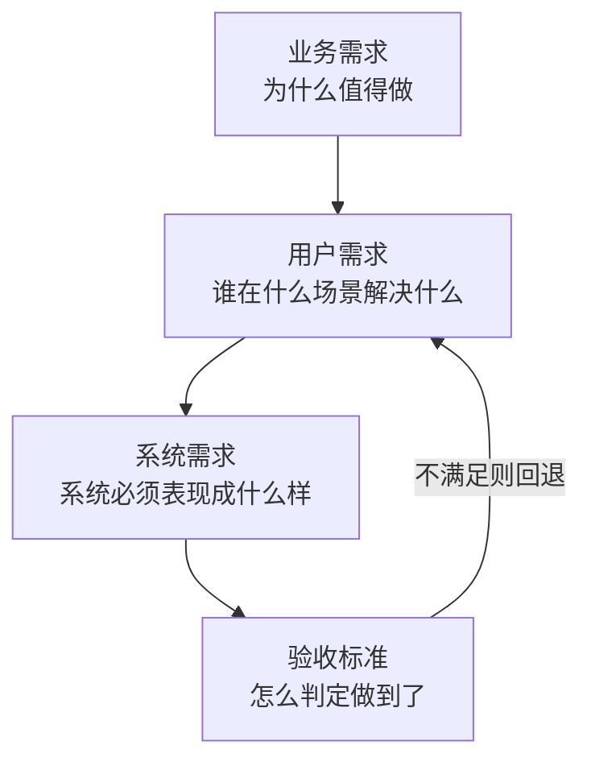

# 需求分析 — 把「我想要」翻译成「可验收」

> 一句话：需求分析不是记录用户想要什么，而是把一句模糊的愿望，压缩成一条**能被机器和人都判定真假**的验收条件。

## 🎯 这 20% 能解决哪些问题

| 你遇到的困惑 | 本质原因 | 马上能改的动作 |
|---|---|---|
| 功能做完了，用户说「不是这个意思」 | 只记了功能名，没记使用场景与判定标准 | 每需求补一句「谁在什么场景下，看到什么结果就算成功」 |
| 需求一直加，工期一直拖 | 没有范围边界，也没有变更成本 | 需求文档写清「本次不做」清单，新增需求必须换掉一条旧的 |
| 开发和测试对不上 | 验收标准写在脑子里，不在文档里 | 用 Given/When/Then 写 3–5 条，评审时逐条过 |
| 上线后性能崩、并发崩 | 非功能需求没人提，等于不存在 | 需求阶段写死 P99 延迟与峰值 QPS 两个数字 |
| 评审会开成讲故事大会 | 没有统一检查表 | 用本文第六节 10 个问题逐条问，答不上就挂起 |

---

## 一、三层需求：先分清你在讨论哪一层



| 层级 | 典型问句 | 产出 | 谁负责 |
|---|---|---|---|
| 业务需求 | 不做会损失什么？ | 目标 + 衡量指标 | 业务方 / 产品 |
| 用户需求 | 谁、在什么场景、现在怎么忍的？ | 用户故事 + 场景 | 产品 |
| 系统需求 | 系统要给出什么行为与约束？ | 功能清单 + 非功能指标 | 产品 + 技术 |
| 验收标准 | 怎么证明做到了？ | Given/When/Then | 产品 + 测试 |

**核心规律**：越往下越可验证。任何一层缺失，都会在下一站（设计或测试）以返工的形式补票。

---

## 二、五问澄清：一次对话问完 80% 的坑

| 问题 | 要挖出的东西 | 反面信号 |
|---|---|---|
| 谁会用？ | 角色与权限边界 | 「所有人」= 没想清 |
| 什么场景下用？多久一次？ | 频次决定性能与优先级 | 说不出频次 = 低频需求，别过度设计 |
| 现在怎么解决的？ | 真实痛点与替代成本 | 「现在没有」= 可能不是真需求 |
| 不做会怎样？ | 价值与优先级 | 「顺便做一下」= 排最后 |
| 怎么算成功？ | 可度量指标 | 「好用一点」= 不可验收 |

补充两问（技术侧必问）：

- **数据从哪来、到哪去？** 谁产生、谁修改、谁消费、保留多久。
- **出错了谁负责？** 异常路径与兜底策略（重试、补偿、人工介入）。

---

## 三、用户故事 + 验收标准：一张纸写完

### 3.1 故事格式

```text
作为 <角色>，我想要 <能力>，以便 <价值>。
```

### 3.2 验收标准格式（Given/When/Then）

```text
场景：余额不足时下单
Given 用户余额 10 元，商品价格 20 元
When  用户点击「立即购买」
Then  订单不创建，提示「余额不足」，余额仍为 10 元
```

**硬要求**：

- 每个需求 3–5 条，覆盖**正常路径 + 边界 + 异常 + 权限**四类。
- 每条必须能被测试直接翻译成一个用例；翻译不出来说明还太模糊。
- 数字写具体：「快速响应」→「P99 < 300ms」。

### 3.3 好需求 vs 坏需求

| 维度 | 坏需求 | 好需求 |
|---|---|---|
| 主体 | 「系统要支持导出」 | 「运营每天 9 点导出昨日订单 CSV，≤10 万行，3 分钟内完成」 |
| 边界 | 「支持大文件」 | 「单文件 ≤50MB，超过则拒绝并提示上限」 |
| 异常 | 未提及 | 「导出失败可重试 3 次，仍失败则站内信通知运营」 |
| 权限 | 未提及 | 「仅运营角色可导出，导出记录留痕 180 天」 |

---

## 四、非功能需求：四个必须写数字的地方

| 类别 | 写什么数字 | 参考起点（按业务调） | 不写的后果 |
|---|---|---|---|
| 性能 | P99 延迟、峰值 QPS | 查询 P99 < 300ms；写 < 500ms | 上线后被一次活动打穿 |
| 容量 | 日增数据量、保留时长 | 按 12 个月增长估算存储 | 半年后加磁盘、改分表 |
| 可用性 | 月度可用率、RTO/RPO | 核心 99.9%；RPO ≤ 5 分钟 | 出事说不清多久能恢复 |
| 安全合规 | 敏感字段、留存期限、审计 | 手机号脱敏、操作留痕 | 返工改表结构、过不了审查 |

> 估算方法（数量级足够）：`峰值 QPS ≈ DAU × 人均请求数 ÷ 86400 × 峰值系数(3~5)`。算出 10 与 10000 是两种完全不同的架构。

---

## 五、范围管理：让「加需求」有价格

### 5.1 优先级方法：MoSCoW

| 级别 | 含义 | 处理方式 |
|---|---|---|
| Must | 没有就不能上线 | 本期必做 |
| Should | 重要但有替代方案 | 本期尽量，可降级 |
| Could | 锦上添花 | 排入下期 |
| Won't | 本期明确不做 | 写进文档，避免反复讨论 |

### 5.2 MVP 的判定标准

三条同时满足才算 MVP：**能独立跑通一条完整业务闭环**、**能收集到验证假设的数据**、**不依赖未完成的功能**。

### 5.3 变更控制

| 变更类型 | 处理规则 |
|---|---|
| 澄清原有需求 | 直接记录，不改范围 |
| 新增小需求（<1 人日） | 与等量工作置换，不加总工期 |
| 新增中大型需求 | 重新评估，进入下个迭代 |
| 需求冻结后变更 | 必须书面确认影响（工期/成本/质量） |

---

## 六、需求评审：10 个杀手问题

1. 这条需求的验收标准在哪一行？
2. 谁没有权限做这件事？
3. 数据为空、为超长、为重复时分别怎样？
4. 并发两人同时操作会怎样？
5. 失败后用户看到什么？能否重试？
6. 这条需求的峰值量级是多少？
7. 涉及哪些历史数据？要不要迁移？
8. 有没有更简单的替代方案（不改代码就能满足）？
9. 上线后用什么指标判断成功？
10. 如果砍掉它，谁会真的受伤？

> 任何一问答不上来，就标记「待澄清」，不进入排期。这是最省钱的一道门禁。

---

## 🎓 实战场景（TIL）

- **场景**：开发两周，验收时说「不是这个意思」。**本质**：需求只有一句话描述，没有可判真的验收标准。**要点**：每条需求写成 Given/When/Then，验收标准少于两条就当作没写完。
- **场景**：上线后首个大促直接雪崩。**本质**：只接了功能需求，并发量、数据规模、响应时限没人写。**要点**：非功能指标（峰值 QPS、P99、数据量、可用性目标）当成需求条目进需求表，不进就不开工。
- **场景**：需求每周变更，排期一拖再拖。**本质**：变更没有入口与成本评估，口头需求直接进迭代。**要点**：变更走单一入口，每次评估「影响面 + 多花的人时」，用变更预算挤掉同等工作量的旧需求。
- **场景**：需求列表拉不出优先级。**本质**：都标成「重要紧急」。**要点**：按「不做会损失什么」排序，并用 MoSCoW 或固定比例（首迭代只做 Must）强制分层。

---

## 📋 一页速查

| 我要做 | 照着做 |
|---|---|
| 判断需求是否可开工 | 有角色、场景、验收标准、非功能数字、不做清单 → 才开工 |
| 写验收标准 | 正常 + 边界 + 异常 + 权限，各至少一条，全部给定具体数字 |
| 定优先级 | 先问「不做会损失什么」，能用钱或时间衡量的排前面 |
| 拒绝含糊表述 | 把「快速/大量/友好/尽量」全部替换成数字或可观察现象 |
| 控范围 | 本期「不做清单」与「做清单」同页呈现 |
| 评估变更 | 先算影响面（人日 + 回归范围），再决定置换还是延期 |

---

## 🔗 相关链接

- 上级：[软件工程](index.md)
- 主线：[软件工程全生命周期](00-software-engineering-overview.md)
- 下一站：[系统分析](03-system-analysis.md) — 需求确定「做什么」，系统分析确定「内部怎么撑住」
- 邻域：[AI 辅助软件开发](../../ai-core/engineering/03-ai-assisted-software-development.md) — 用 AI 做需求澄清与用例补全
