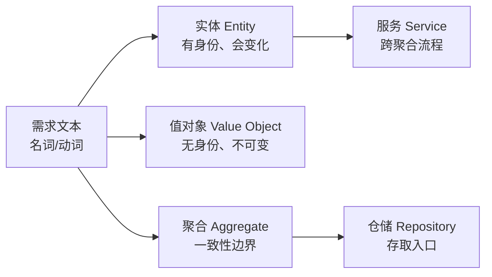
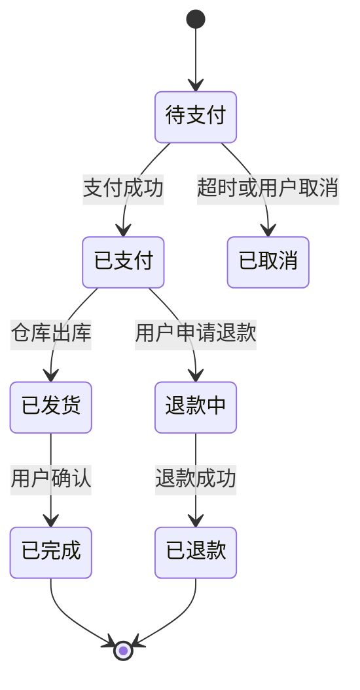
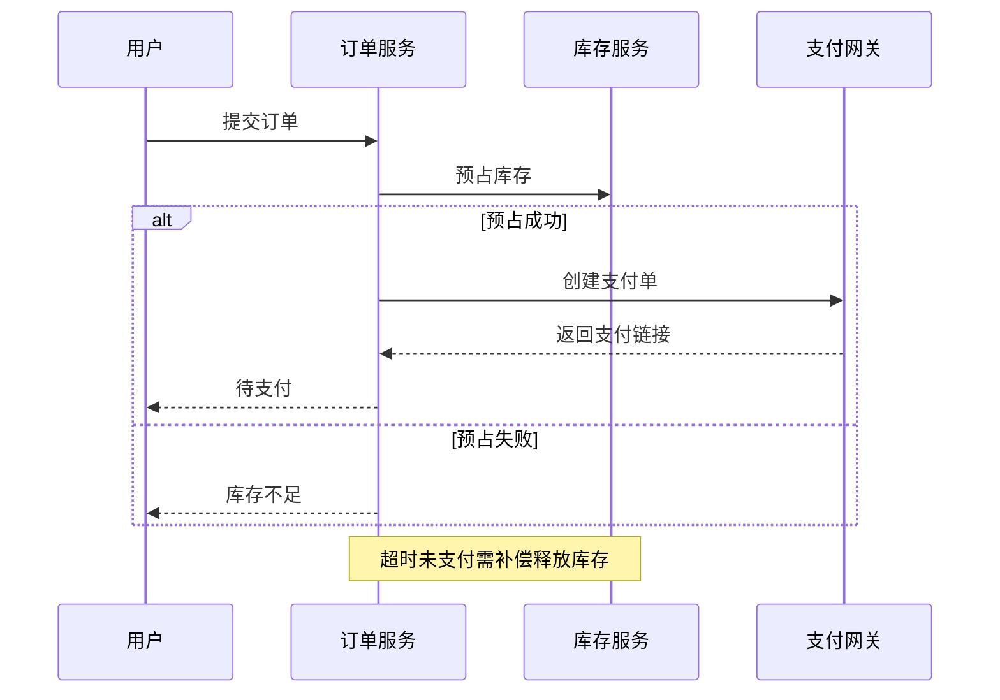

# 系统分析 — 让系统先在纸上跑一遍

> 一句话：系统分析就是在写代码之前，用四张图（模型、状态、契约、时序）把系统跑一遍，把「没想到」提前变成「写下来」。

## 🎯 这 20% 能解决哪些问题

| 你遇到的困惑 | 本质原因 | 马上能改的动作 |
|---|---|---|
| 联调时接口字段对不上 | 契约在代码里，不在文档里 | 先定 OpenAPI，前后端按同一份 schema 生成/校验 |
| 订单状态越来越乱，谁都能改 | 没有状态机，业务代码随手更新 status | 列出状态迁移表，未登记的迁移一律拒绝 |
| 一个功能改十个地方 | 领域概念没建模，逻辑散在 Controller | 先找名词建实体，再让每个实体自己管自己的规则 |
| 事务边界说不清，数据对不上 | 没分析「哪几步必须一起成功」 | 每个用例标出事务范围与补偿动作 |
| 需求评审过了，设计评审还在改需求 | 系统分析缺失，把设计问题带回需求 | 用状态机与异常分支反推需求漏洞 |

---

## 一、分工：需求说「做什么」，系统分析说「靠什么撑住」

| 维度 | 需求分析 | 系统分析 |
|---|---|---|
| 输出问题 | 用户看到什么 | 系统内部怎么组织 |
| 核心产物 | 验收标准、非功能指标 | 领域模型、状态机、接口契约、事务边界 |
| 判定标准 | 可验收 | 可编码、可测试、可演进 |
| 典型残留风险 | 需求遗漏 | 边界模糊、异常未定义、并发未考虑 |

**判据**：如果开发看完文档还要问「这个字段谁维护」「失败算哪一步」，说明系统分析没做完。

---

## 二、领域建模：名词找实体，动词找行为



### 2.1 四个判断标准

| 概念 | 判断标准 | 例子 |
|---|---|---|
| 实体 | 换一个属性仍是「同一个东西」 | 订单（有订单号） |
| 值对象 | 属性全等就算同一个 | 金额、地址、时间段 |
| 聚合 | 必须同时一致的一组对象，只有一个入口 | 订单 + 订单项 |
| 领域服务 | 逻辑跨多个聚合，放谁身上都不合适 | 下单扣库存 + 生成支付单 |

### 2.2 建模时最常漏的三件事

1. **谁拥有这个字段**：一个字段只能有一个写入方，其他方通过接口改。
2. **历史与快照**：价格、地址这类会变的字段，业务单据要存快照，否则对账必错。
3. **软删除与唯一约束的冲突**：删除后同一手机号能否再注册，必须明确。

---

## 三、状态机：任何 `status` 字段都必须配迁移表



**迁移表模板（必须四列）**：

| 从 → 到 | 谁能触发 | 前置条件 | 副作用（必须可补偿） |
|---|---|---|---|
| 待支付 → 已支付 | 支付回调 | 金额一致、未超时 | 扣库存、发通知、记流水 |
| 待支付 → 已取消 | 定时任务/用户 | 超过 30 分钟未支付 | 释放库存 |
| 已支付 → 退款中 | 用户 | 未发货 | 冻结结算 |

**三条铁律**：

- 未在迁移表里出现的状态变化，代码层直接拒绝（用枚举 + 断言，不要散落 `if`）。
- 有副作用的迁移必须幂等：同一回调重复到达只生效一次（用业务唯一键）。
- 不可逆迁移（已退款、已完成）不允许代码回改，只能新增逆向单据。

---

## 四、接口契约：先定 schema，再写实现

| 契约要素 | 必须写明 | 常见坑 |
|---|---|---|
| 路径与动作 | 资源用名词，动作靠 HTTP 方法 | URL 里塞动词 `getUser` |
| 入参 | 类型、必填、长度、格式、默认值 | 只写字段名不写约束 |
| 出参 | 字段含义、单位、时区、精度 | 金额用浮点、时间无时区 |
| 错误 | 统一结构 + 业务错误码表 | 全部返回 500 或只返回字符串 |
| 幂等 | 是否支持重复提交、靠什么键 | 支付/下单无幂等键 |
| 版本 | 破坏性变更如何升级 | 直接改字段含义 |

```text
统一响应：{ "code": 0, "message": "ok", "data": {...}, "trace_id": "..." }
业务错误：{ "code": 40301, "message": "库存不足", "data": null }
```

**判据**：把 OpenAPI 文件直接交给前端与测试，双方不读实现代码就能开工——契约才算成立。

---

## 五、时序与事务边界：把失败路径画出来



| 要标出的东西 | 为什么 |
|---|---|
| 每一步的超时时间 | 没有超时就没有确定的失败 |
| 失败后的补偿动作 | 分布式下无法回滚，只能补偿 |
| 幂等键 | 重试与回调重复是常态 |
| 事务范围 | 一次事务只包一个聚合，跨聚合用最终一致 |

**核心规律**：能用「本地事务 + 状态机 + 补偿任务」解决的，不要上分布式事务。

---

## 六、容量与关键路径估算

| 估算项 | 公式 / 方法 | 用途 |
|---|---|---|
| 峰值 QPS | DAU × 人均请求 ÷ 86400 × 峰值系数 3~5 | 决定实例数与缓存 |
| 单请求数据量 | 平均响应体 + 图片等静态资源 | 决定带宽 |
| 日增存储 | 日订单数 × 单条大小 × 副本数 | 决定磁盘与归档策略 |
| 热数据比例 | 近 7 天访问量 ÷ 总量 | 决定缓存命中率目标 |
| 关键路径长度 | 一次请求串行调用数 | 超过 5 段就要并行或合并 |

---

## 七、系统分析交付物清单

| 产物 | 最小要求 | 谁看 |
|---|---|---|
| 领域模型图 | 5–15 个核心实体 + 聚合边界 | 开发 |
| 状态迁移表 | 每个状态字段一张 | 开发 + 测试 |
| 接口契约 | OpenAPI/JSON Schema + 错误码表 | 前端 + 测试 |
| 关键时序图 | 只画跨系统 / 跨服务的 3–5 条主链路 | 全体 |
| 数据模型 | 表 + 关键索引 + 保留策略 | 开发 + 运维 |
| 容量估算 | 峰值 QPS、日增存储两个数 | 架构 + 运维 |

---

## 🎓 实战场景（TIL）

- **场景**：上线后发现「已退款又变成已完成」的脏数据。**本质**：状态迁移只写了主干，没列全「哪个状态能到哪个状态」。**要点**：先画状态机表（当前态 × 事 → 次态），非法组合统一报错，并将表直接变成代码里的守卫断言。
- **场景**：前后端联调天天改字段。**本质**：接口只有口头约定，没有契约与版本。**要点**：先交 OpenAPI/类型定义再开工，字段变更走版本或新增字段，禁止改语义。
- **场景**：一个请求里发了三个远程调用，偶发一半成功。**本质**：事务边界把外部调用包进了本地事务。**要点**：事务只保护本地数据；远程动作改成「提交后事件 + 可重试任务」并保证幂等。

---

## 📋 一页速查

| 我要检查 | 通过标准 |
|---|---|
| 领域模型 | 每个核心名词都有归属实体；每个聚合只有一个写入口 |
| 状态机 | 有迁移表；未登记迁移被拒绝；副作用可补偿 |
| 接口契约 | 字段有类型与约束；错误码成表；幂等键明确 |
| 事务边界 | 一事务一聚合；跨聚合有补偿任务与重试上限 |
| 异常路径 | 超时、重复、乱序三种情况都有明确结果 |
| 数据保留 | 每个表有增长估算与归档/清理策略 |
| 评审可开工 | 前端能只凭契约开工；测试能只凭状态表写用例 |

---

## 🔗 相关链接

- 上级：[软件工程](index.md)
- 上一站：[需求分析](02-requirements-analysis.md)
- 下一站：[架构设计](04-architecture-design.md) — 把模型切成模块，并记录取舍
- 邻域：[数据库设计](../../data-fundamentals/01-database-design.md) — 表结构与索引的深入细节
- 邻域：[HTTP 与 Web 通信](../../network-fundamentals/02-http-basics.md) — 契约落地时的协议细节
