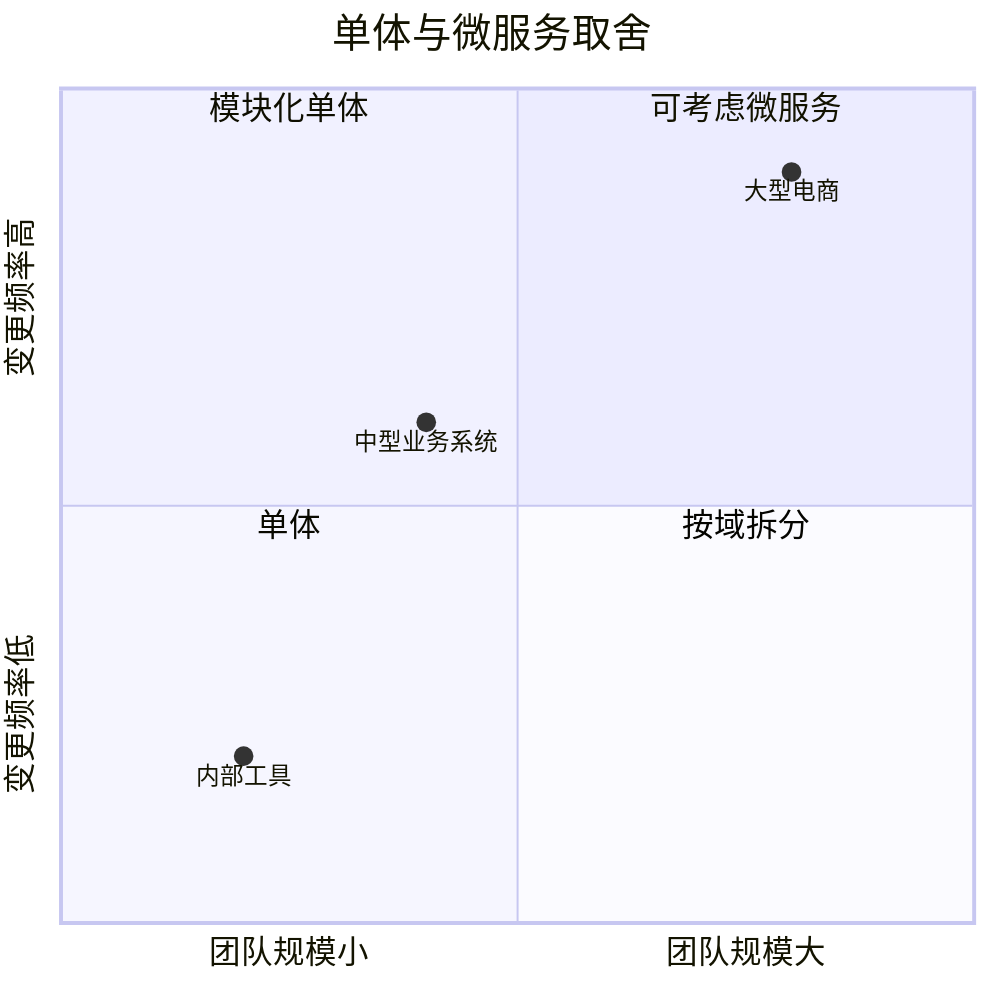
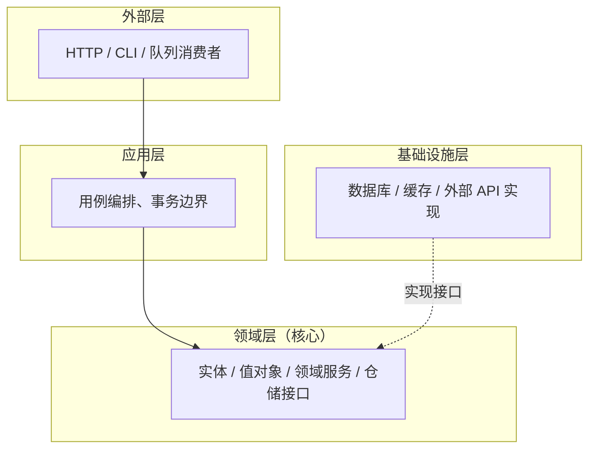

# 架构设计 — 让下一次变更只改一处

> 一句话：架构不是画得漂亮的分层图，而是**做一次典型需求变更时，你需要改几个模块、开几次会**；这个数字越小，架构越好。

## 🎯 这 20% 能解决哪些问题

| 你遇到的困惑 | 本质原因 | 马上能改的动作 |
|---|---|---|
| 加个字段要改五六个地方 | 边界按技术分层切，没按业务能力切 | 把「同一业务概念」的代码收进一个模块，只留一个入口 |
| 业务逻辑全在 Controller | 依赖方向错了，框架层承担了领域职责 | 领域逻辑下沉，Controller 只做校验与编排 |
| 评审时人人有道理，落地后没人负责 | 决策没有记录取舍与失效条件 | 每个关键决定写一页 ADR，附「什么情况下要重评」 |
| 拆了微服务，反而更慢更乱 | 拆的是部署单元，不是业务边界 | 先确认能独立演进的数据与团队，再拆服务 |
| 一上量就撑不住 | 设计阶段没做容量估算 | 用峰值 QPS 与日增存储两个数校验方案 |

---

## 一、先问三个问题，再画图

| 问题 | 要得到的答案 | 影响 |
|---|---|---|
| 变化点在哪？ | 哪部分会频繁变，哪部分稳定 | 把变化隔离在一个模块内 |
| 谁维护？几个团队？ | 团队边界与沟通成本 | 康威定律：系统结构会复制组织结构 |
| 最坏情况是什么？ | 峰值流量、数据量、故障域 | 决定是否需要拆分与冗余 |

**核心规律**：架构的产出不是图，是**边界 + 依赖方向 + 取舍理由**。图只是这三者的副作用。

---

## 二、演进路径：复杂度只会转移，不会消失


| 阶段 | 适合规模 | 主要成本 | 别做的前提 |
|---|---|---|---|
| 单体 | 1 个团队、日活 < 10 万 | 耦合 | 别提前拆 |
| 模块化单体 | 2–3 个团队 | 需要纪律约束边界 | 别让模块互相直连数据库 |
| 微服务 | 多团队、独立扩容诉求明确 | 网络、部署、观测、数据一致性 | 没有平台与可观测性别拆 |
| 网格/平台 | 数十服务 | 学习与运维成本 | 别为简历上技术 |

### 2.1 什么时候才该拆



四个信号同时出现才拆：**独立扩容需求 + 独立发布节奏 + 清晰数据边界 + 有平台支撑**。缺一条，先做模块化。

---

## 三、依赖方向：分层架构的唯一铁律



| 层 | 只做 | 绝不做 |
|---|---|---|
| 外部层 | 协议转换、参数校验、鉴权 | 业务规则 |
| 应用层 | 编排用例、开事务、发事件 | 具体算法与 SQL |
| 领域层 | 业务规则、状态迁移、不变量 | 依赖框架、读写数据库 |
| 基础设施 | 实现仓储与外部调用 | 反向调用领域逻辑 |

**判据**：把数据库换成另一个存储，领域层代码不用改——依赖方向才是对的。

---

## 四、SOLID：五条判据，不是五个名词

| 原则 | 判据（怎么检查） | 违反时的症状 |
|---|---|---|
| 单一职责 SRP | 这个类被修改的理由只有一个吗？ | 一个类常年被不同需求同时改 |
| 开闭 OCP | 新增一种类型要不要改老代码？ | 每加一种支付方式就改 `switch` |
| 里氏替换 LSP | 子类能否完全替代父类？ | 子类抛父类不会抛的异常 |
| 接口隔离 ISP | 实现类有没有被迫写空方法？ | 大接口里一半方法抛「不支持」 |
| 依赖倒置 DIP | 高层是否依赖抽象？ | `new` 具体实现、难以替换测试 |

```php
// ❌ 一个类承担三件事，任何一件变化都会改它
class OrderService {
    public function create(array $data) { /* ... */ }
    public function sendEmail() { /* ... */ }
    public function calculateTax() { /* ... */ }
}

// ✅ 按变化原因拆分，各自独立演进
class OrderService { public function create(array $data): Order { /* ... */ } }
class OrderNotifier { public function notify(Order $order): void { /* ... */ } }
class TaxCalculator { public function calculate(Order $order): float { /* ... */ } }
```

---

## 五、模块边界：高内聚低耦合的可判定标准

| 检查项 | 合格 | 不合格 |
|---|---|---|
| 跨模块调用 | 只通过公开接口/事件 | 直接查对方数据库表 |
| 数据归属 | 每张表只有一个写入方 | 两个服务都能写同一张表 |
| 依赖数量 | 单个模块依赖 ≤5 个其他模块 | 依赖成网状，改一处动全身 |
| 循环依赖 | 无 | A 调 B，B 又调 A |
| 变更影响 | 一次典型需求只改 1–2 个模块 | 改 3 个以上模块 |

**核心规律**：耦合不是「有没有调用」，而是「对方变了你要不要跟着变」。共享数据库是最强的耦合。

---

## 六、ADR：把取舍写下来，比画图重要

```text
# ADR-007 订单与库存的边界
背景：大促期间库存扣减与订单创建互相阻塞
选项：A 同一事务（简单但锁竞争） B 预占+异步确认（复杂但解耦） C 上分布式事务（重）
结论：选 B，预占库存 + 超时补偿
代价：需处理补偿失败与对账
失效条件：日订单量 < 1 万 或 库存服务不可独立部署时，退回 A
```

**一份 ADR 只记四件事**：背景与约束、备选方案、结论与代价、什么情况下要重评。

---

## 七、四类高频反模式

| 反模式 | 表现 | 后果 | 改法 |
|---|---|---|---|
| 分布式单体 | 服务拆了，但每次发布必须一起发 | 部署复杂度上升，收益为零 | 合并回模块化单体，或真正切数据边界 |
| 共享数据库 | 多个服务读写同一批表 | 表结构改动引发连锁故障 | 每服务独立 schema，跨服务走接口 |
| 贫血模型 | 实体只有 getter/setter，逻辑全在 Service | 规则分散、无法复用、易漏 | 把不变量与状态迁移放进实体 |
| 过度设计 | 为「未来可能」抽象三层接口 | 现在难改、难读 | YAGNI：第二次重复时再抽象 |

---

## 八、架构评审：六个必答问题

1. 一次典型需求变更，需要改几个模块、几个团队？
2. 哪个模块挂了会导致全站不可用？故障域是否可接受？
3. 峰值 QPS 与日增数据量是多少？方案在哪一层先饱和？
4. 数据一致性的边界在哪？允许最终一致的业务有哪些？
5. 新增一个同类功能（如新支付渠道）要改多少处？
6. 这个决定在什么条件下需要重评？谁负责重评？

---

## 🎓 实战场景（TIL）

- **场景**：拆了微服务后，一次下单要追四个服务才能看清全貌。**本质**：按人员/系统拆分而非按依赖方向拆，边界与事务边界不一致。**要点**：先保证「一个业务变更只改一个模块」，能拆出独立数据拥有者再上服务。
- **场景**：底层工具类反向依赖业务配置，单测跑不起来。**本质**：依赖方向不统一，抽象被细节污染。**要点**：定下依赖规则（入口 → 应用 → 领域，基础设施实现接口）并放进 CI 门禁。
- **场景**：架构评审会上各说各话，三周没结论。**本质**：方案写在聊天记录里，没有可比维度与决策记录。**要点**：用 ADR 写「背景-选项-决定-代价」，代价必须可观测（延迟/运维成本/团队熟悉度）。

---

## 📋 一页速查

| 我要判断 | 结论 |
|---|---|
| 该不该拆微服务 | 四个信号缺一不可；缺就先模块化单体 |
| 分层是否健康 | 领域层不依赖框架与数据库 → 健康 |
| 耦合是否过高 | 一次需求改 3 个以上模块 → 边界错了 |
| 是否存在共享数据 | 同一张表有两个写入方 → 必须拆 |
| 抽象是否过度 | 只有一个实现且无替换计划 → 删掉抽象 |
| 评审是否充分 | 六问答不全 → 不进入编码 |
| 决策是否可追溯 | 无 ADR、无失效条件 → 等于没决策 |

---

## 🔗 相关链接

- 上级：[软件工程](index.md)
- 主线：[软件工程全生命周期](00-software-engineering-overview.md)
- 上游：[系统分析](03-system-analysis.md) — 领域模型是架构的输入
- 实现：[设计模式](11-oop-design-patterns.md) — 架构落地时的具体手法
- 下游：[后端工程化](06-backend-engineering.md) — 分层在框架中的落地
