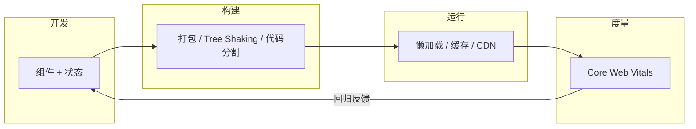
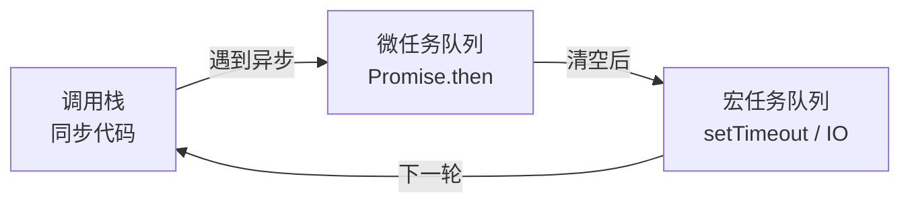

# 前端开发 — 用户看到的是状态，不是组件

> 一句话：前端不是「把设计稿写成组件」，而是**为每个数据状态设计一个确定的画面**——加载中、有数据、空、出错、无权限，五个状态都写了，页面才算完成。

## 🎯 这 20% 能解决哪些问题

| 你遇到的困惑 | 本质原因 | 马上能改的动作 |
|---|---|---|
| 页面只在有数据时好看 | 只实现了「成功态」 | 每个列表/详情补齐加载、空、错误、无权限四个状态 |
| 状态越传越乱，改一处崩三处 | 状态归属没定，本地与全局混用 | 只把「跨页面共享」的状态放全局，其余留在组件内 |
| 首屏慢，SEO 也差 | 渲染模式选错，全站 CSR | 内容型页面用 SSR/SSG，后台系统才用 CSR |
| 上线后偶发白屏 | 没做错误边界与兜底 | 加全局错误捕获 + 骨架屏 + 重试入口 |
| 接口一改就全站报错 | 没有契约校验，字段裸用 | 用 OpenAPI 生成类型，访问前做空值兜底 |

---

## 一、先选渲染模式，再谈框架

| 模式 | 首屏 | SEO | 适用 | 代价 |
|---|---|---|---|---|
| CSR 客户端渲染 | 慢（等 JS） | 差 | 后台管理、强交互应用 | 首屏白屏、包体积大 |
| SSR 服务端渲染 | 快 | 好 | 内容 + 交互混合（电商详情） | 需要 Node 服务、缓存策略 |
| SSG 静态生成 | 最快（CDN） | 好 | 博客、文档、营销页 | 内容更新需重新构建 |
| ISR 增量静态 | 快 | 好 | 大量内容页、定时更新 | 有 stale 窗口 |

**判据**：页面内容是否需要被搜索引擎收录、是否首屏即关键？两个都是 → 不要纯 CSR。

### 1.1 工程化全景



---

## 二、组件与状态：三条边界

| 边界 | 规则 | 违反症状 |
|---|---|---|
| 展示 vs 容器 | 展示组件只收 props 不取数据；容器组件负责取数与错误处理 | 组件里到处 `fetch`，无法复用与测试 |
| 本地 vs 全局 | 只被一个页面用的状态留在本地 | 全局 store 变成垃圾场 |
| 服务端 vs 客户端 | 服务端数据用请求库缓存管理，不复制进全局 store | 手动同步两份数据，必然不一致 |

### 2.1 组件设计的四个约定

1. **单一入口**：一个组件只暴露必要的 props，其余内部处理。
2. **受控优先**：表单类组件值由外部控制，便于校验与回填。
3. **状态外置**：加载/错误状态由容器管理，展示组件保持纯净。
4. **可测**：不依赖真实网络与路由即可渲染出四种状态。

---

## 三、JavaScript：只需吃透执行机制



| 概念 | 一句话 | 常见坑 |
|---|---|---|
| 事件循环 | 同步执行完 → 清空微任务 → 取一个宏任务 | 以为 `setTimeout(fn, 0)` 会先于 Promise |
| 闭包 | 函数记住定义时的作用域 | 循环里用 `var` 捕获同一个变量 |
| 原型链 | 属性查找沿原型向上 | 用原型链做业务继承，越继承越僵 |
| this | 由调用方式决定 | 回调里丢失 this，用箭头函数或绑定 |

---

## 四、CSS：布局只需两套

| 方案 | 用于 | 关键点 |
|---|---|---|
| Flexbox | 一维排列、对齐、均分 | `flex: 1` 需要 `min-width: 0` 才能正确收缩 |
| Grid | 二维网格、卡片墙 | `repeat(auto-fill, minmax(240px, 1fr))` 自适应 |
| Position | 悬浮、吸顶、遮罩 | `sticky` 需要父级无 `overflow: hidden` |

**盒模型**：全局 `box-sizing: border-box`，让「宽度包含内边距与边框」，避免算宽度算到崩溃。

---

## 五、框架：理解响应式，不必背生命周期


| 关注点 | 要点 |
|---|---|
| 响应式 | Vue3 用 Proxy（可监听新增属性），Vue2 用 defineProperty（需 `$set`） |
| 生命周期 | 只需记四个时点：数据可用、DOM 可用、更新后、销毁前 |
| 清理 | 定时器、事件监听、订阅必须在销毁时移除 |
| 列表渲染 | 稳定唯一 key，禁用数组下标 |

---

## 六、性能预算：先定数字，再谈优化

| 指标 | 含义 | 健康值 |
|---|---|---|
| LCP | 最大内容绘制 | < 2.5s |
| INP | 交互到下次绘制 | < 200ms |
| CLS | 累积布局偏移 | < 0.1 |
| 首屏 JS | 首屏必需脚本体积 | < 200KB（gzip） |

| 优化手段 | 解决什么 | 一句话做法 |
|---|---|---|
| 路由级代码分割 | 首包过大 | 按路由 `import()` 懒加载 |
| 图片优化 | LCP 慢 | WebP/AVIF + 明确宽高 + 懒加载 |
| 虚拟列表 | 长列表卡顿 | 只渲染可视区域 |
| 缓存策略 | 二次访问慢 | 静态资源内容哈希 + 长缓存 |
| 预加载关键资源 | 关键请求排队 | `preload` 首屏字体与主图 |

---

## 七、安全与可访问性：两条不能破的底线

| 风险 | 防线 |
|---|---|
| XSS | 不把用户输入当 HTML；必须渲染时用白名单净化；设置 CSP |
| CSRF | 写操作带 CSRF Token 或使用 `SameSite` Cookie |
| 敏感数据 | 不在前端存 token 于 localStorage（优先 HttpOnly Cookie） |
| 越权 | 前端隐藏按钮不算权限，后端必须校验 |

| 可访问性 | 最低要求 |
|---|---|
| 语义化 | 用 `button`/`nav`/`label`，不用一堆 `div` 加点击 |
| 键盘 | 所有交互可 Tab 到达，可 Enter/Space 触发 |
| 对比度 | 正文对比度 ≥ 4.5:1 |
| 图片 | 有意义图片写 `alt`，装饰图 `alt=""` |

---

## 八、前后端协作：契约先行

```text
RESTful 要点：
├── 资源用名词，动作靠方法：GET /orders/123
├── 版本：/api/v1/...
├── 统一响应：{ code, message, data, trace_id }
└── 分页：?page=1&per_page=20，返回 total
```

| 协作问题 | 解决方式 |
|---|---|
| 接口未就绪 | 按 OpenAPI 生成 Mock，前端并行开发 |
| 跨域 | 生产用 CORS 白名单，开发用反向代理 |
| 字段含义不一致 | 契约里写清单位、时区、精度 |
| 错误提示 | 后端给错误码，前端负责文案映射 |

---

## 🎓 实战场景（TIL）

- **场景**：页面白屏 3 秒，后台接口却很快。**本质**：首屏阻塞在包体积与串行请求，不是后端。**要点**：先量再优化（LCP/打包分析），路由懒加载 + 关键接口并发 + 资源预加载，把性能预算写进 CI 门禁。
- **场景**：组件间互相改全局状态，出现数据对不上。**本质**：状态归属不清，多处写同一份数据。**要点**：按「服务端数据/客户端状态/UI 局部态」分家；服务端数据交给请求库缓存，不手工同步。
- **场景**：接口失败时页面什么都不显示。**本质**：只写了成功态。**要点**：每个数据组件强制五态（加载/空/错/无权限/成功），错误态带重试入口。
- **场景**：长列表滚动发热。**本质**：一次性渲染全量 DOM。**要点**：虚拟滚动或分页，优先减少单帧工作量，而不是先上 Web Worker。

---

## 📋 一页速查

| 我要做 | 照着做 |
|---|---|
| 判断页面是否完成 | 加载 / 有数据 / 空 / 错误 / 无权限，五态齐全 |
| 选渲染模式 | 要 SEO 或首屏关键 → SSR/SSG；后台系统 → CSR |
| 放状态 | 跨页面共享才进全局；服务端数据交给请求缓存层 |
| 做性能 | 先定 LCP<2.5s、INP<200ms、首屏 JS<200KB，再优化 |
| 防 XSS | 不渲染裸 HTML；富文本走白名单净化；加 CSP |
| 做权限 | 前端只做展示控制，后端必须校验 |
| 前后端联调 | OpenAPI 契约 + Mock，不靠口头约定 |

---

## 🔗 相关链接

- 上级：[软件工程](index.md)
- 主线：[软件工程全生命周期](00-software-engineering-overview.md)
- 上游：[系统分析](03-system-analysis.md) — 接口契约是前后端协作的底座
- 后端：[后端工程化](06-backend-engineering.md) — 接口实现与错误码约定
- 邻域：[性能优化](13-performance-optimization.md) — 从指标到根因的排查方法
