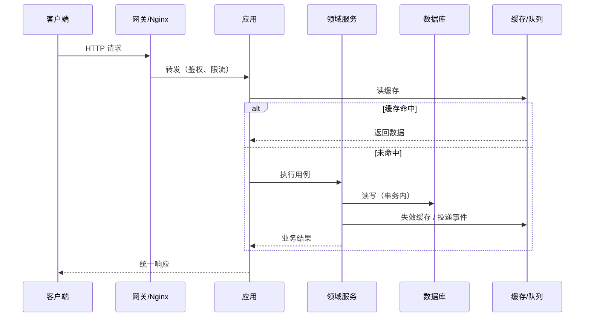

# 后端开发 — 一条业务规则只有一个家

> 一句话：后端的复杂度不在代码量，而在**同一条规则被写了几遍**；把它收敛到一个唯一的、可测试的位置，系统才开始可控。

## 🎯 这 20% 能解决哪些问题

| 你遇到的困惑 | 本质原因 | 马上能改的动作 |
|---|---|---|
| 同一个校验在三个接口里各写一遍 | 业务规则散落在 Controller | 规则下沉到实体/领域服务，Controller 只调用 |
| 重复提交造成重复扣款 | 没有幂等键，写操作不幂等 | 建业务唯一键 + 唯一索引，重复请求返回首次结果 |
| 缓存和数据库不一致 | 更新顺序错、没有失效策略 | 先更新库再删缓存；对强一致场景直接读库 |
| 大事务锁表，接口超时 | 事务里做了 RPC、发消息、写日志 | 事务只包数据库写，副作用移出事务 |
| 流量高峰服务被打挂 | 没有限流与降级 | 入口限流 + 非核心功能可关闭 |
| 列表接口越用越慢 | N+1 查询与缺索引 | 预加载关联，按查询条件建复合索引 |

---

## 一、一次请求的完整链路



| 环节 | 只做 | 高频错误 |
|---|---|---|
| 网关 | 鉴权、限流、路由、TLS | 把业务判断放网关 |
| 应用层 | 参数校验、用例编排、事务边界 | 写业务算法 |
| 领域层 | 规则、状态迁移、不变量 | 直接拼 SQL |
| 数据层 | 持久化、查询、缓存读写 | 在 Repository 里写业务分支 |

---

## 二、事务边界：只包数据库写

| 原则 | 做法 | 原因 |
|---|---|---|
| 短事务 | 事务内只做必要的 SQL | 长事务锁行、拖慢连接池 |
| 不在事务里做 RPC | 调用外部接口放到事务外 | 外部超时会拖死本地事务 |
| 不在事务里发消息 | 用本地事件表 / outbox，事务提交后再投递 | 提交失败会导致消息与数据不一致 |
| 一次事务一个聚合 | 跨聚合用状态机 + 补偿 | 分布式事务成本远高于补偿 |

```text
下单流程：事务内（写订单 + 扣减库存）→ 提交 → 事务外（发通知、投递队列、清缓存）
```

---

## 三、幂等：所有写接口的默认要求

| 场景 | 幂等方式 | 要点 |
|---|---|---|
| 创建订单 | 客户端生成 `request_id`，服务端唯一索引 | 重复请求返回首次结果，不报错 |
| 支付回调 | 以支付单号 + 状态机判定 | 只允许「未支付 → 已支付」迁移一次 |
| 消息消费 | 消费记录表（消息 ID 唯一） | 消费失败可重试，重试不重复生效 |
| 定时任务 | 分布式锁 + 任务执行记录 | 多实例部署时必须加锁 |

**判据**：任何写接口，问一句「同一请求发两次会怎样」，答不上来就是隐患。

---

## 四、缓存：三个问题与三条策略

| 问题 | 现象 | 解法 |
|---|---|---|
| 穿透 | 查不存在的数据，全部打到数据库 | 缓存空值（短 TTL）+ 参数校验 |
| 击穿 | 热点 key 过期瞬间大量请求打库 | 逻辑过期 / 互斥重建（只放一个请求回源） |
| 雪崩 | 大量 key 同时过期 | TTL 加随机抖动 + 多级缓存 |

| 策略 | 顺序 | 适用 |
|---|---|---|
| Cache-Aside | 读：先缓存后库；写：先更新库再删缓存 | 绝大多数业务 |
| Write-Through | 写时同时更新缓存与库 | 缓存与库强一致要求高 |
| Write-Behind | 先写缓存，异步落库 | 写入量大、可容忍短暂丢失 |

**核心规律**：缓存是「可丢失的加速层」。凡是不能丢的数据，缓存只做读加速，不做唯一存储。

---

## 五、异步与队列：把「必须现在做」变成「可以稍后做」

| 该异步 | 不该异步 |
|---|---|
| 发短信/邮件、生成报表、图片处理、跨系统同步 | 扣款、扣库存等需要即时结果的核心写 |

| 要点 | 做法 |
|---|---|
| 可靠投递 | 业务数据与消息同事务写入 outbox 表，再由投递器发送 |
| 幂等消费 | 消费前查消息 ID，处理成功才标记 |
| 重试 | 指数退避 + 最大次数，超限进死信队列并告警 |
| 积压 | 监控队列长度与消费延迟，超阈值扩容消费者 |
| 顺序 | 需要顺序时按业务键分区，不要依赖全局顺序 |

---

## 六、接口防护：四道闸门

| 闸门 | 做什么 | 关键点 |
|---|---|---|
| 认证 | 你是谁 | Token/Session 校验，令牌有有效期与刷新机制 |
| 授权 | 你能做什么 | 每个接口校验资源归属，不能只校验登录 |
| 限流 | 你能来多快 | 按用户/接口/IP 限流，超限返回 429 |
| 降级 | 坏了怎么办 | 非核心功能可关闭，返回兜底数据而非报错 |

**越权是最高频的安全漏洞**：`GET /orders/123` 必须校验 123 是否属于当前用户，而不是只校验已登录。

---

## 七、Laravel 落地要点


```php
// 依赖注入：面向接口，便于替换与测试
$app->bind(OrderRepository::class, EloquentOrderRepository::class);

// 薄控制器：只做校验与编排
class OrderController {
    public function store(CreateOrderRequest $request, OrderService $service) {
        return response()->json($service->create($request->validated()), 201);
    }
}

// 避免 N+1：预加载 + 分块处理
$orders = Order::with('items.product')->paginate(20);
Order::where('status', 'paid')->chunkById(500, fn ($rows) => /* ... */);
```

| 反模式 | 症状 | 改法 |
|---|---|---|
| 贫血模型 | 实体只有属性，规则全在 Service | 把状态迁移与不变量放回实体 |
| God Controller | 一个方法几十行，验证+业务+通知 | 拆 Request 校验 + Service + 事件 |
| N+1 查询 | 列表页 SQL 数量随行数增长 | `with()` 预加载，检查查询日志 |
| 大事务 | 事务里发消息、调外部接口 | 缩小事务范围，副作用移出 |
| 魔法数字 | 代码里散落 `0/1/2` 状态值 | 用枚举与常量，配合状态机校验 |

---

## 八、可测试性：后端设计的隐形验收标准

| 特征 | 说明 |
|---|---|
| 无隐藏依赖 | 依赖通过构造函数传入，不在方法内 `new` |
| 时间可控 | 用注入的时钟替代 `now()`，便于测试边界 |
| 副作用可观测 | 发消息、写文件通过接口，测试可替换 |
| 用例可独立运行 | 不依赖执行顺序与共享全局状态 |

---

## 🎓 实战场景（TIL）

- **场景**：一个依赖服务变慢，自己的服务也跟着堆满线程。**本质**：超时比调用方长、没并发上限，故障沿调用链放大。**要点**：超时逐层递减，每个外部依赖单独连接池 + 熔断，失败快速返回而不是排队。
- **场景**：缓存集中失效（雪崩）瞬间数据库 CPU 100%。**本质**：热 key 同一时刻过期，大量请求直接落库。**要点**：过期时间加随机抖动，热点 key 用互斥重建或常驻更新，并保留降级读旧值。
- **场景**：重试造成重复扣款。**本质**：重试与并发下，接口不幂等。**要点**：以业务单号做唯一约束 + 状态机守卫，先查后写，写操作返回上一次结果而非重复执行。
- **场景**：后台一个报表查询把线上主库拖垮。**本质**：分析型 SQL 与交易共用资源。**要点**：读写分离或走副本，限制单次扫描行数，长查询加超时与分页，禁止无索引字段过滤。

---

## 📋 一页速查

| 我要做 | 照着做 |
|---|---|
| 放业务规则 | 规则进实体/领域服务；Controller 只校验与编排 |
| 开事务 | 只包数据库写；RPC、消息、日志全部移出 |
| 写接口幂等 | 建业务唯一键 + 唯一索引；重复请求返回首次结果 |
| 用缓存 | 读多写少才缓存；先更新库再删缓存；空值也缓存 |
| 决定异步 | 非即时必需 → 队列；核心扣减 → 同步 |
| 防越权 | 每个资源操作校验归属，不只校验登录态 |
| 看性能 | 查 SQL 数量（防 N+1）与慢查询日志，而非凭感觉 |
| 判断分层好坏 | 换掉数据库/框架，领域层不用改 → 分层成立 |

---

## 🔗 相关链接

- 上级：[软件工程](index.md)
- 主线：[软件工程全生命周期](00-software-engineering-overview.md)
- 架构：[架构设计](04-architecture-design.md) — 分层与边界的上层决策
- 前端：[前端工程化](05-frontend-engineering.md) — 接口契约的消费方
- 邻域：[缓存系统设计](../../data-fundamentals/02-cache-system-design.md) — 缓存策略的深入细节
- 邻域：[数据库设计](../../data-fundamentals/01-database-design.md) — 索引与事务的底层机制
