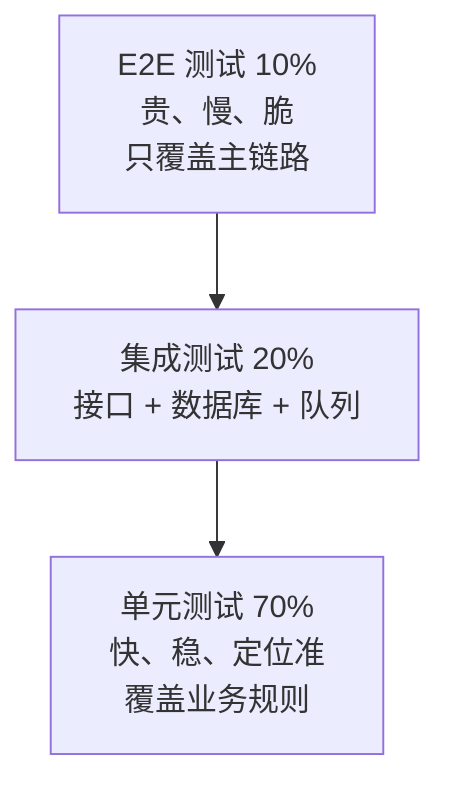

# 测试策略 — 用最少的用例买最大的信心

> 一句话：测试不是证明代码没错，而是用最低成本买到「这次改动不会弄坏已有行为」的信心；信心的单位是**用例，不是覆盖率**。

## 🎯 这 20% 能解决哪些问题

| 你遇到的困惑 | 本质原因 | 马上能改的动作 |
|---|---|---|
| 测试写了一大堆，线上还是炸 | 只测了正常路径，异常与边界没人写 | 每个用例设计时强制补「空、超长、重复、无权限」四类 |
| 改一行代码，跑半小时测试 | 大量 E2E 承担了本该单元测试干的活 | 把业务规则判定下沉为单元测试，E2E 只留 3–5 条主链路 |
| 覆盖率 80%，还是不敢发 | 覆盖率衡量「执行过」，不衡量「断言对」 | 改为检查核心模块的分支覆盖 + 断言质量 |
| 测试经常莫名其妙红 | 用例互相依赖、共享数据库状态 | 每个用例自建数据、自清理，禁止依赖执行顺序 |
| 压测通过，上线仍卡 | 只压了平均，没压峰值与慢查询 | 压测看 P99 与错误率，按峰值 QPS 的 1.5 倍打 |

---

## 一、分层：钱花在哪一层最值



| 层级 | 测什么 | 不测什么 | 速度 | 失败时定位 |
|---|---|---|---|---|
| 单元 | 单个函数/类的规则与边界 | 框架、网络、数据库 | 毫秒 | 精确到行 |
| 集成 | 接口契约、SQL、事务、队列消费 | UI 交互 | 百毫秒~秒 | 精确到模块 |
| E2E | 用户主链路能否走通 | 所有分支细节 | 秒~分钟 | 只能定位到链路 |

**核心规律**：越靠近业务规则的测试越值钱。把「满 300 减 50」这类规则放在单元测试，把「能不能登录」放在 E2E。

---

## 二、用例设计：四种技法覆盖 80% 的分支

| 技法 | 什么时候用 | 做法 | 例子 |
|---|---|---|---|
| 等价类 | 输入范围连续 | 每类取一个代表值 | 年龄合法 18–60：取 30、10、70 |
| 边界值 | 有上下限 | 取 min-1、min、max、max+1 | 数量 1–99：取 0、1、99、100 |
| 判定表 | 多个条件组合决定结果 | 列条件组合，逐行给期望 | 会员 + 优惠券 + 库存 三条件组合 |
| 状态迁移 | 有 status 字段 | 每条合法迁移 + 每条非法迁移各一例 | 待支付直接发货必须被拒绝 |

### 2.1 每个功能至少写这几条

| 类型 | 数量 | 举例 |
|---|---|---|
| 正常路径 | 1–2 | 余额充足下单成功 |
| 边界 | 2–4 | 金额 0、刚好等于余额、超出 0.01 |
| 异常 | 2–3 | 支付超时、重复提交、库存扣减失败 |
| 权限 | 1–2 | 普通用户访问管理接口返回 403 |
| 并发 | 0–1 | 同一优惠券被两个请求同时使用只成功一次 |

---

## 三、好测试的五个特征

1. **一个测试一个行为**：测试名能当规格读，如 `余额不足时不允许下单`。
2. **自洽**：自带数据准备与清理，任意顺序执行都通过。
3. **确定**：不依赖当前时间、随机数、外部网络；用固定时钟与假数据。
4. **快**：单元测试整体 10 秒内跑完，才能做到提交即跑。
5. **断言具体**：断言业务结果（状态、金额、错误码），不只断言「没抛异常」。

```text
Arrange（准备数据）→ Act（执行一次动作）→ Assert（断言结果）→ 可选 Teardown
```

---

## 四、Mock 的边界：别把自己骗过去

| 可以 Mock | 不要 Mock | 原因 |
|---|---|---|
| 第三方支付、短信、对象存储 | 被测类自身的逻辑 | Mock 掉被测逻辑等于没测 |
| 时间、随机数、UUID | 数据库（集成测试里） | 数据库行为差异是主要 bug 来源 |
| 跨团队未就绪的服务 | 自己的 ORM 查询 | 查询写错只能在真库暴露 |

**判据**：Mock 越多，测试越像「测 Mock」。集成测试里优先用真实数据库 + 事务回滚隔离。

---

## 五、覆盖率：正确用法与三个陷阱

| 看什么 | 不看什么 |
|---|---|
| 核心业务模块的分支覆盖 | 全项目总行数覆盖率 |
| 新增代码的覆盖率（diff coverage） | 历史遗留代码的绝对值 |
| 未被覆盖的关键路径清单 | 覆盖率高就等于质量好 |

**陷阱**：

1. 覆盖率可以靠「只调用不断言」刷上去，毫无意义。
2. 生成代码、getter/setter、配置类拉高分母，掩盖真实缺口。
3. 追求 100% 会诱导写「为覆盖而覆盖」的测试，维护成本反超收益。

**建议门槛**：核心模块分支覆盖 ≥ 70%，新增代码 ≥ 80%，其余不设硬指标。

---

## 六、契约测试：前后端/微服务之间最便宜的保险

| 场景 | 做法 | 收益 |
|---|---|---|
| 前后端 | 以 OpenAPI 为准，双向校验字段与类型 | 联调时不再「字段对不上」 |
| 服务间 | 消费方定义期望，提供方 CI 里验证 | 提供方改字段前就被拦下 |
| 第三方 | 录制真实响应做回放 | 外部变更可快速定位 |

**判据**：契约测试能在不启动完整环境的情况下，拦住 80% 的「接口改坏了」。

---

## 七、性能测试：只认四个数字

| 指标 | 含义 | 通过标准（按业务调） |
|---|---|---|
| 吞吐 | 每秒成功请求数 | ≥ 峰值 QPS × 1.5 |
| 延迟分位 | P95 / P99 | P99 ≤ 需求约定值，且不随压测时长恶化 |
| 错误率 | 非 2xx / 超时占比 | < 0.1% |
| 饱和度 | CPU / 内存 / 连接池使用率 | 压测峰值下 < 80% |

**核心规律**：压测要「阶梯加压 + 保持 10 分钟」，只看平均值会漏掉慢请求与内存泄漏。

---

## 八、缺陷分级：决定先修谁

| 级别 | 判定 | 处理时限 |
|---|---|---|
| P0 阻断 | 核心链路不可用、数据错乱、安全漏洞 | 立即，停止发布 |
| P1 严重 | 主流程有绕不过的错，无替代方案 | 当个迭代内 |
| P2 一般 | 有替代路径，影响局部 | 排期修复 |
| P3 轻微 | 文案、样式、体验 | 批量处理 |

---

## 🎓 实战场景（TIL）

- **场景**：覆盖率 80% 却漏了越权与金额计算错误。**本质**：用例按代码行堆，没按风险设计。**要点**：用等价类 + 边界值 + 错误推测补齐关键路径，金额/权限/并发三类场景必须有用例。
- **场景**：E2E 测试一跑 40 分钟，团队开始绕过它。**本质**：用 E2E 测了本该用单测覆盖的逻辑，金字塔倒置。**要点**：同一行为只在最低可行层级测一次；E2E 只跑 5~10 条主流程。
- **场景**：测试时好时坏，最后加了 `sleep 3`。**本质**：不稳定测试（命中时间/随机数据/共享状态）。**要点**：时间、随机、外部依赖都可注入（固定时钟、固定种子、mock），禁止用等待掩盖竞态。
- **场景**：不敢重构，一改就红。**本质**：遗留代码没有安全网。**要点**：先补特征测试钉住现有行为（包括错误行为），再谈拆分解；重构时一次只改断言或只改代码（两步规则）。

---

## 📋 一页速查

| 我要做 | 照着做 |
|---|---|
| 分配测试量 | 单元 70% / 集成 20% / E2E 10%，E2E 只留主链路 |
| 设计用例 | 正常 1–2、边界 2–4、异常 2–3、权限 1–2、并发 0–1 |
| 判断测试好不好 | 能当规格读、可任意顺序跑、10 秒内跑完、断言业务结果 |
| 设覆盖率门槛 | 核心分支 ≥70%，新增代码 ≥80%，不看全项目总行数 |
| 决定 Mock 什么 | 只 Mock 外部依赖与时间，不 Mock 被测逻辑与数据库 |
| 压测通过标准 | 峰值 ×1.5 吞吐、P99 达标、错误率 <0.1%、资源 <80% |
| CI 门禁 | Lint + 单元测试 + 契约校验必过；集成测试按需；E2E 发布前跑 |

---

## 🔗 相关链接

- 上级：[软件工程](index.md)
- 主线：[软件工程全生命周期](00-software-engineering-overview.md)
- 上游：[系统分析](03-system-analysis.md) — 状态迁移表直接变成测试用例
- 下游：[部署与发布](08-deployment-release.md) — 测试门禁是发布的准入条件
- 邻域：[性能优化](13-performance-optimization.md) — 压测之后的调优手段
