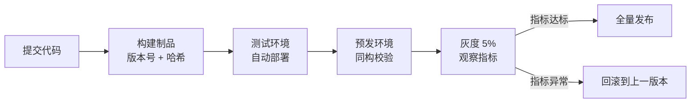

# 部署与发布 — 让上线变成一次可撤销的操作

> 一句话：部署是把同一个制品搬进环境，发布是决定让多少用户看到它；把这两件事分开，上线就从「事件」变成了「动作」。

## 🎯 这 20% 能解决哪些问题

| 你遇到的困惑 | 本质原因 | 马上能改的动作 |
|---|---|---|
| 测试环境好好的，线上就崩 | 环境与配置靠手工维护，不一致 | 同一制品晋级，配置从环境变量/配置中心注入 |
| 上线时间总在深夜，还要全员盯着 | 没有灰度能力，只能一把梭 | 先做金丝雀 5% 流量观察 30 分钟 |
| 数据库改字段导致代码报错 | 代码与表结构同时上线，互相不兼容 | 用「先加 → 双写 → 读新 → 删旧」四步迁移 |
| 出问题回滚要重装环境 | 制品不可回溯，部署脚本幂等性差 | 每次构建留不可变版本号，回滚 = 切回上一个版本 |
| 一个功能想先给内部用 | 只能用分支或注释代码控制 | 用 Feature Flag 控制开关，不靠改代码 |

---

## 一、三个概念先分清

| 概念 | 是什么 | 关键要求 |
|---|---|---|
| 构建 Build | 把源码变成制品（镜像/包） | 一次构建，处处运行；带版本号与提交哈希 |
| 部署 Deploy | 把制品放进某个环境并启动 | 幂等、可重复、不依赖人工步骤 |
| 发布 Release | 把流量切给新版本 | 可分批、可暂停、可回退 |



**核心规律**：制品一旦构建就不再修改；环境之间只搬同一个制品，不允许「在服务器上改一行」。

---

## 二、配置与密钥：代码里一个都不能有

| 内容 | 放哪 | 禁止 |
|---|---|---|
| 环境差异（域名、端口、第三方地址） | 环境变量 / 配置中心 | 写进代码分支判断 |
| 密钥、证书、Token | 密钥管理服务 / CI 变量 | 提交到仓库，或放在镜像里 |
| 业务开关与阈值 | Feature Flag / 配置中心 | 改代码重新发版 |
| 日志级别、采样率 | 环境变量，支持热更新 | 硬编码 |

**判据**：把仓库公开也不该泄露任何可用凭据；切换环境只需要换一份变量文件。

---

## 三、数据库变更：唯一不能回滚的地方

### 3.1 expand-contract 四步法


| 步骤 | 动作 | 可回滚性 |
|---|---|---|
| Expand | 只加字段/表，不改不删 | 完全可回滚 |
| Dual Write | 代码双写，新字段可为空 | 可回滚 |
| Migrate | 后台任务分批回填，可重入 | 可回滚 |
| Read New | 读切新字段，观察一轮 | 可回滚（切回读旧） |
| Contract | 删除旧字段 | **不可回滚，必须最后做** |

**三条铁律**：

1. 任何一次发布，代码必须兼容**上一个版本的表结构**（滚动更新期间新旧代码并存）。
2. 大表加索引、改类型必须评估锁表时间，走在线变更工具或低峰执行。
3. 删除操作永远单独一次发布，且提前备份。

---

## 四、发布策略：按风险选，不按潮流选

| 策略 | 怎么切流量 | 回滚速度 | 资源成本 | 适用 |
|---|---|---|---|---|
| 重建（停机） | 停旧起新 | 慢 | 低 | 内部工具、可停机系统 |
| 滚动更新 | 逐批替换实例 | 中（再滚一次） | 低 | 无状态服务默认选择 |
| 蓝绿 | 整组切换 | 秒级（切回旧组） | 高（双份资源） | 核心服务、需秒级回退 |
| 金丝雀 | 按比例放量 1%→5%→50%→100% | 秒级（摘流量） | 低 | 用户量大、影响面敏感 |

### 4.1 灰度判定：看这四个指标

| 指标 | 达标线（相对基线） | 不达标动作 |
|---|---|---|
| 错误率 | 不高于基线 +0.1%，且绝对值 <0.5% | 立即回滚 |
| P99 延迟 | 不高于基线 20% | 暂停放量，排查 |
| 资源饱和度 | CPU/内存 <80% | 暂停放量 |
| 业务指标 | 下单/支付成功率不下降 | 立即回滚 |

**核心规律**：灰度不是等时间，是等指标。指标不达标，5 分钟就退。

---

## 五、回滚预案：发布前必须写好的三行

```text
1. 回滚动作：把流量切回上一版本 <版本号>（命令/按钮在哪）
2. 数据影响：本次是否含不可逆变更（迁移/删字段）→ 有则先做备份
3. 判定人：谁在什么指标下有权按下回滚（不需要开会）
```

| 项 | 要求 |
|---|---|
| 触发条件 | 提前写死阈值，不靠现场感觉 |
| 执行人 | 值班人能独立执行，不需要作者在线 |
| 演练 | 预发环境至少演练一次，记录耗时 |
| 目标时长 | 3 分钟内完成回滚 |

---

## 六、Feature Flag：把「发布」和「上线」再拆一层

| 用途 | 好处 | 注意 |
|---|---|---|
| 未完成功能隐藏 | 代码可以持续合并，不用长命分支 | 开关必须有到期日 |
| 灰度放量 | 按用户/租户/地区开启 | 开关组合要有默认值 |
| 快速止血 | 关开关比回滚更快 | 关键路径不能依赖远程配置可用性 |
| 实验对比 | A/B 测试同一份代码 | 避免开关嵌套地狱 |

**规范**：每个开关有负责人、默认值、清理时间；超过 3 个月未清理的开关视为技术债。

---

## 七、版本与发布节奏

| 项 | 规则 |
|---|---|
| 版本号 | 语义化 `主.次.补丁`：破坏性变更升主，新增功能升次，修复升补丁 |
| 发布窗口 | 避开业务高峰与人员稀少时段；核心系统避免周五晚发布 |
| 发布记录 | 每次记录：版本、变更项、影响范围、回滚版本、操作人 |
| 变更审批 | 高风险变更（数据/权限/支付）需第二人复核 |
| 发布后观察 | 至少 30 分钟盯四个指标，再离场 |

---

## 🎓 实战场景（TIL）

- **场景**：发布回滚后错误依旧。**本质**：代码可回滚，但数据库迁移与配置不可回滚。**要点**：迁移只加不删（扩展-收缩两步），旧代码必须能跟新表共存，回滚先退流量再退制品。
- **场景**：上线那一分钟集中大量 5xx。**本质**：全量切换，新实例未预热（连接池、缓存、JIT）就接流。**要点**：金丝雀 + 小比例引流先验证错误率与 P99，健康检查通过后再逐步放开。
- **场景**：同一制品在测试环境正常、生产报错。**本质**：环境不一致（配置、依赖版本、镜像基底）。**要点**：制品一次构建处处运行，差异全进环境变量；发布前跑一次环境 diff 检查。

---

## 📋 一页速查

| 我要做 | 照着做 |
|---|---|
| 判断能否发布 | 制品有版本号、测试门禁通过、回滚三步写好、数据变更有备份 |
| 选发布策略 | 无状态默认滚动；核心服务蓝绿；用户量大用金丝雀 |
| 做数据库变更 | expand → dual write → migrate → read new → contract，删字段单独发 |
| 判断灰度是否继续 | 错误率、P99、饱和度、业务成功率四项全达标才放量 |
| 回滚 | 切流量到上一版本，目标 3 分钟内；不可逆数据变更先备份 |
| 管开关 | 每个 Flag 有负责人 + 默认值 + 清理日期 |
| 发布后 | 观察 30 分钟四个指标，记录发布日志 |

---

## 🔗 相关链接

- 上级：[软件工程](index.md)
- 主线：[软件工程全生命周期](00-software-engineering-overview.md)
- 上游：[测试策略](07-testing-strategy.md) — 测试门禁决定能不能进发布
- 下游：[运维与 SRE](09-operations-sre.md) — 发布之后的稳定性责任
- 基础设施：[容器化与 CI/CD](14-containerization-cicd.md) — Docker/K8s 与流水线实现
