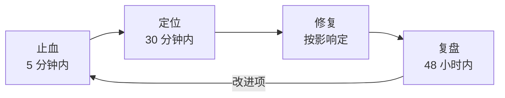

# 运维与 SRE — 用错误预算换发布速度

> 一句话：SRE 不是「把系统守到不出事」，而是把稳定性换算成一个可花费的预算——预算够，就大胆发；预算花光，就停下来还债。

## 🎯 这 20% 能解决哪些问题

| 你遇到的困惑 | 本质原因 | 马上能改的动作 |
|---|---|---|
| 开发和运维互相甩锅 | 没有共同的稳定性目标 | 给每个核心服务定一个 SLO，双方共同认账 |
| 「系统稳不稳」全靠感觉 | 没有 SLI 数据，只有主观判断 | 先选 1 个可用性 + 1 个延迟指标，连续测两周 |
| 出故障时没人敢决策 | 没有值班授权与升级链 | 明确「谁在什么条件下可以直接回滚/降级」 |
| 备份做了，从没恢复过 | 备份不等于可恢复 | 每季度做一次真实恢复演练并记录耗时 |
| 复盘写完就忘 | 行动项没有负责人和截止时间 | 每个行动项必须写成「谁 + 何时 + 验收标准」 |
| 服务器越加越多，账单失控 | 没有容量水位与成本归属 | 按服务打标签，每月看单位请求成本 |

---

## 一、三个词先分清

| 概念 | 定义 | 例子 | 谁关心 |
|---|---|---|---|
| SLI（指标） | 实际测量到的服务质量 | 近 30 天成功请求占比 99.95% | 工程 |
| SLO（目标） | 对 SLI 的内部目标 | 可用性 ≥ 99.9% / 月 | 工程 + 业务 |
| SLA（协议） | 对外承诺，违约赔偿 | 可用性 < 99.5% 赔付 | 商务 + 法务 |

**核心规律**：SLO 必须比 SLA 更严格，留出缓冲；对外只承诺能赔得起、能量出来的数。

### 1.1 错误预算怎么算

```text
月度错误预算 = (1 - SLO) × 总请求数
99.9% 的 30 天 → 允许 43 分 12 秒完全不可用（或等比例的失败请求）
```

| 预算消耗 | 该做什么 |
|---|---|
| < 50% | 正常发布，可适度冒险 |
| 50%–100% | 谨慎发布，只上必要变更 |
| 已耗尽 | 冻结功能发布，只做稳定性改进 |
| 连续两月耗尽 | 降低发布频率，重排优先级 |

---

## 二、SLI 怎么选：四个够用

| 类型 | 指标定义 | 采集方式 | 常见错误 |
|---|---|---|---|
| 可用性 | 成功响应数 ÷ 总请求数 | 网关/服务端指标 | 用 5xx 统计却漏掉超时 |
| 延迟 | P95/P99 在阈值内的请求占比 | 直方图指标 | 用平均值，掩盖长尾 |
| 正确性 | 业务成功（如下单成功）÷ 尝试 | 业务埋点 | 只看 HTTP 200，不看业务失败 |
| 新鲜度 | 数据延迟（同步/报表） | 队列积压、同步时间 | 只监控进程存活 |

**选指标的一句话**：选**用户能感知**的、**能自动采集**的、**团队能影响**的，最多 3–4 个。

---

## 三、容量与弹性：看水位，不看感觉

| 水位 | 含义 | 动作 |
|---|---|---|
| < 50% | 富余 | 可缩容或接更多流量 |
| 50%–70% | 健康 | 保持 |
| 70%–80% | 预警 | 提前扩容，排查增长来源 |
| > 80% | 危险 | 立即扩容 + 限流保护 |
| > 90% | 崩溃边缘 | 降级非核心功能 |

**扩容三种手段**：

1. **垂直**：加 CPU/内存——最快，但有上限，重启有风险。
2. **水平**：加实例——无状态服务首选，需先确认无本地状态。
3. **削峰**：队列缓冲 + 限流——最省钱，但用户会等。

**核心规律**：弹性伸缩只对无状态服务有效；有状态服务（数据库）靠读写分离、分片和预留容量。

---

## 四、应急响应：四段法，时间盒管理



| 阶段 | 目标 | 具体动作 | 禁止 |
|---|---|---|---|
| 止血 | 先让用户可用 | 回滚、切流量、降级、限流、关开关 | 一边止血一边查根因 |
| 定位 | 找到变化点 | 看最近变更、看四个黄金信号、看依赖 | 无目的重启 |
| 修复 | 消除根因 | 小步修复，修完立刻验证指标 | 顺手重构 |
| 复盘 | 防再犯 | 时间线 + 5Why + 行动项 | 追责个人 |

**止血优先级口诀**：**回滚 > 降级 > 限流 > 扩容 > 修代码**。能在 5 分钟内回滚的，绝不在线上调试。

---

## 五、值班与升级：让决策不需要开会

| 级别 | 响应时限 | 谁 | 权限 |
|---|---|---|---|
| L1 值班 | 5 分钟响应 | 当班工程师 | 回滚、重启、扩缩容、关开关 |
| L2 负责人 | 15 分钟介入 | 服务 owner | 降级范围、数据修复 |
| L3 决策 | 30 分钟介入 | 技术负责人 | 对外公告、停服、赔付 |

**值班规则**：

- 一人一周，交接必须写清：未闭环告警、临时变更、风险点。
- 告警必须能叫醒人，否则不叫告警，叫噪音。
- 同一类问题连续两周半夜叫人 → 必须排期自动化或修根因（否则人会离职）。

---

## 六、备份与恢复：备份不算数，恢复才算

| 指标 | 含义 | 设定方法 |
|---|---|---|
| RPO | 能容忍丢多少数据 | 按业务定：订单 0，日志可 1 小时 |
| RTO | 能容忍停多久 | 核心 30 分钟，内部系统 4 小时 |
| 保留策略 | 留多久、几份、放哪里 | 3-2-1：3 份、2 种介质、1 份异地 |

**恢复演练清单**：

1. 从备份还原到独立环境（不覆盖生产）。
2. 记录实际耗时，与 RTO 对比。
3. 校验数据完整性（行数、关键业务对账）。
4. 把演练脚本化，避免依赖某个人的记忆。

---

## 七、变更管理：事故的第一大来源

| 变更类型 | 管控要求 |
|---|---|
| 常规发布 | 走 CI/CD，有回滚方案 |
| 数据库变更 | 单独窗口、提前备份、双人复核 |
| 配置修改 | 走配置中心留痕，禁止直接改服务器 |
| 紧急变更 | 允许先做后补，但 24 小时内补记录 |
| 冻结期 | 大促/节假日只允许修复类变更 |

**核心规律**：80% 的线上故障来自变更。把变更变得可追溯、可回滚，比事后加强监控更有效。

---

## 八、例行巡检：每周 20 分钟

| 检查项 | 判据 | 不达标动作 |
|---|---|---|
| 错误预算余额 | 消耗曲线是否异常加速 | 冻结发布，排查 |
| 容量水位 | 是否有节点 >70% | 扩容或清理 |
| 慢查询 Top10 | 是否有新进入者 | 加索引或改 SQL |
| 队列积压 | 积压是否持续增长 | 扩消费者或限流生产 |
| 备份成功率 | 是否 100% | 当天修复 |
| 证书/域名/额度 | 30 天内到期 | 立即续期 |
| 告警噪声 | 无效告警占比 | 重写或删除告警规则 |

---

## 🎓 实战场景（TIL）

- **场景**：SLO 定 99.99%，一个月就把全年错误预算烧完。**本质**：指标定的是理想值，不是用户可接受值。**要点**：先按历史表现定可达目标（如 99.9%），用错误预算控制发布节奏，而不是追零故障。
- **场景**：告警一屏都是红，没人看。**本质**：只报异常不分级，多数无法行动。**要点**：每条告警附「处置动作」；分为叫醒人（烧预算）与工单（待观察）两档，消不掉的告警就降级为看板。
- **场景**：备份任务天天成功，恢复时才发现备份集不可用。**本质**：只监控备份作业状态，从不验证可恢复性。**要点**：定期做恢复演练（抽一个备份拉到临时环境跑一致性检查），把恢复时长与数据丢失量写进展报。
- **场景**：故障时只有原作者能重启服务。**本质**：处置知识在人脑里，没成手册。**要点**：每次故障收尾产出一页 runbook（现象→判定→处置→回滚），下一次只按手册执行也能完成。

---

## 📋 一页速查

| 我要做 | 照着做 |
|---|---|
| 定稳定性目标 | 1 个可用性 + 1 个延迟 SLI；SLO 比 SLA 严一档 |
| 看还能不能发 | 错误预算 >50% 正常发；耗尽则只做稳定性 |
| 判断扩容 | CPU/内存 >70% 预警，>80% 立即扩，>90% 降级 |
| 故障先做什么 | 5 分钟内止血：回滚 > 降级 > 限流 > 扩容 |
| 定 RPO/RTO | 订单类 RPO=0；核心 RTO ≤30 分钟；每季度演练 |
| 管变更 | 全部走流水线留痕；数据库变更双人复核 + 备份 |
| 做复盘 | 48 小时内出时间线 + 5Why + 行动项（人/时间/验收） |
| 巡检频率 | 每周一次，7 项固定检查，20 分钟完成 |

---

## 🔗 相关链接

- 上级：[软件工程](index.md)
- 主线：[软件工程全生命周期](00-software-engineering-overview.md)
- 上游：[部署与发布](08-deployment-release.md) — 变更管理是稳定性的第一道闸
- 配套：[可观测性](10-observability-monitoring.md) — 没有指标就没有 SLO
- 邻域：[性能优化](13-performance-optimization.md) — 容量问题的根因分析
