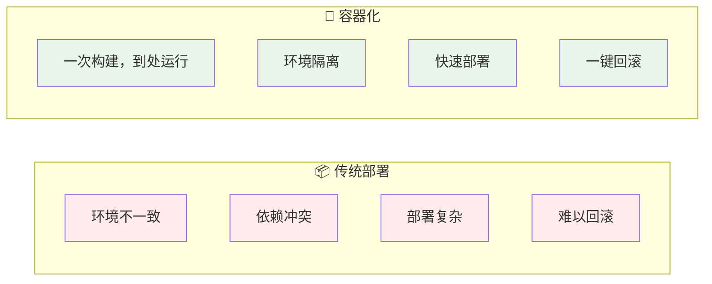
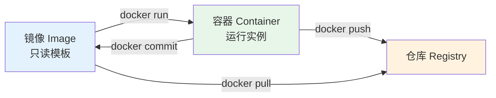
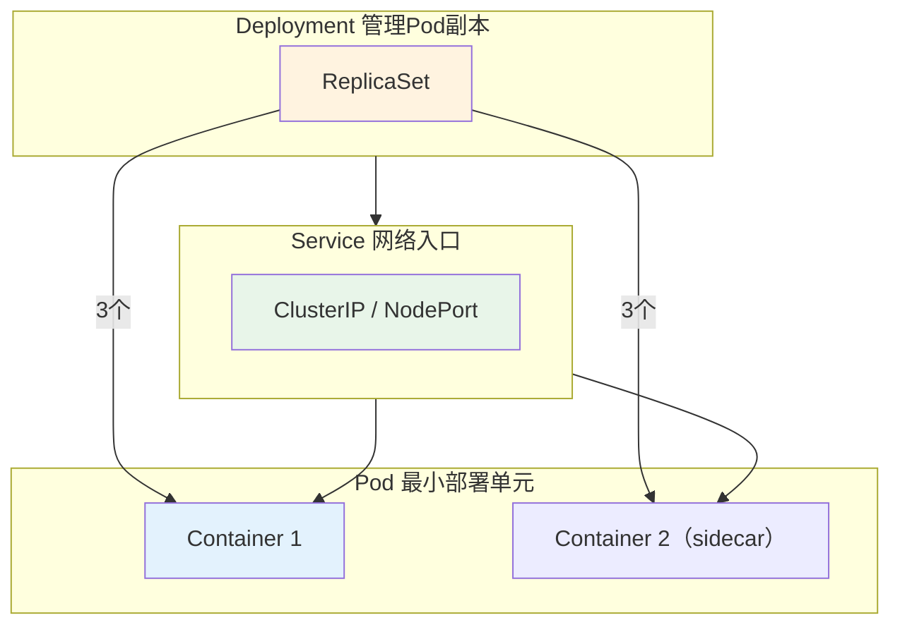
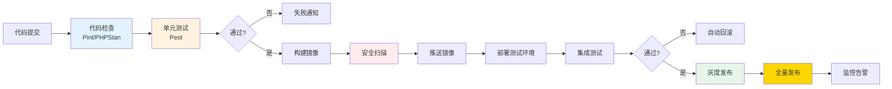

# 容器化与 CI/CD — 可重复才可靠

> 一句话：容器解决「跑在哪都一样」，流水线解决「谁来做都一样」；两者合起来，部署才从手工活变成可重复动作。

## 🎯 这 20% 能解决哪些问题

| 你遇到的困惑 | 本质原因 | 马上能改的动作 |
|---|---|---|
| 本地能跑，服务器不行 | 依赖与环境靠人工安装 | 用同一镜像跑所有环境，依赖写进 Dockerfile |
| 镜像动辄 1GB+ | 单阶段构建，编译工具与源码都在镜像里 | 多阶段构建，运行阶段只留运行时与产物 |
| 构建一次要十几分钟 | 依赖层没缓存，顺序错 | 先拷依赖文件装依赖，再拷源码 |
| 发布靠登录服务器敲命令 | 没有流水线，步骤无记录 | 提交→测试→构建→部署全部编进 CI |
| 出问题不知道回滚到哪个版本 | 镜像用 latest 标签 | 用提交哈希/版本号做不可变 tag |

---

## 一、核心规律

### 1.1 容器化价值



### 1.2 CI/CD核心价值

```
CI（持续集成）：
├── 自动构建 + 自动测试
├── 快速发现缺陷
└── 提高代码质量

CD（持续部署）：
├── 自动化部署流程
├── 减少人为错误
└── 快速交付价值
```

---

## 二、Docker核心

### 2.1 核心概念



### 2.2 Dockerfile最佳实践

```dockerfile
# 使用官方基础镜像
FROM php:8.2-fpm-alpine

# 合并RUN指令，减少层数
RUN apt-get update && apt-get install -y \
    libpng-dev \
    libjpeg-dev \
    && docker-php-ext-configure gd --with-jpeg \
    && docker-php-ext-install gd pdo_mysql

# 复制依赖文件，利用缓存
COPY composer.* /app/
RUN composer install --no-dev --optimize-autoloader

# 复制应用代码
COPY . /app
RUN chown -R www-data:www-data /app/storage

EXPOSE 9000
CMD ["php-fpm"]
```

### 2.3 Docker Compose

```yaml
version: '3.8'
services:
  app:
    build: .
    volumes:
      - .:/app
    depends_on:
      - mysql
      - redis
    environment:
      - DB_HOST=mysql
      - REDIS_HOST=redis

  mysql:
    image: mysql:8.0
    volumes:
      - mysql_data:/var/lib/mysql
    environment:
      MYSQL_ROOT_PASSWORD: secret

  redis:
    image: redis:7-alpine

volumes:
  mysql_data:
```

---

## 三、Kubernetes核心

### 3.1 核心概念



### 3.2 常用资源对象

| 资源 | 用途 | 示例 |
|------|------|------|
| **Pod** | 最小运行单元 | 单个容器 |
| **Deployment** | 无状态服务部署 | Web应用 |
| **StatefulSet** | 有状态服务部署 | MySQL集群 |
| **Service** | 网络暴露 | ClusterIP/NodePort |
| **Ingress** | 七层路由 | 域名→Service |
| **HPA** | 自动扩缩容 | CPU>80%扩容 |

---

## 四、CI/CD流水线设计

### 4.1 标准流水线



### 4.2 GitHub Actions示例

```yaml
name: CI/CD
on: [push, pull_request]

jobs:
  test:
    runs-on: ubuntu-latest
    steps:
      - uses: actions/checkout@v4
      - run: composer install --no-dev
      - run: ./vendor/bin/pint --test
      - run: ./vendor/bin/phpstan analyse
      - run: ./vendor/bin/pest --compact

  deploy:
    needs: test
    if: github.ref == 'refs/heads/main'
    runs-on: ubuntu-latest
    steps:
      - name: Deploy to K8s
        run: kubectl rollout restart deployment/app
```

---

## 五、发布环节只做三件事

容器化只解决「怎么打包与怎么跑」。蓝绿/滚动/金丝雀的选型、灰度判定、数据迁移与回滚预案，统一写在 [部署与发布](08-deployment-release.md)，此处不重复。

容器侧只需保证三件事：

1. 镜像用不可变 tag（提交哈希或语义版），禁用 `latest`。
2. 保留最近 3 个可回滚版本的镜像与部署清单。
3. 回滚命令提前写好并演练：`kubectl rollout undo` 或切回旧 ReplicaSet。

---

## 六、本章总结

> **核心规律：自动化是DevOps的核心。凡是重复三次以上的操作，都应该自动化。可重复的部署才是可靠的部署。**

### 关键记忆点
- ✅ Docker = 标准化交付单元，解决环境一致性问题
- ✅ K8s = 容器编排平台，解决规模化部署问题
- ✅ CI/CD = 自动化流水线，解决人工错误问题
- ✅ 灰度发布 = 风险控制最佳实践

---

## 🎓 实战场景（TIL）

- **场景**：镜像 1.2GB，一次发布拉取要三分钟。**本质**：构建阶段与运行阶段共用基底，编译工具全带进了生产。**要点**：多阶段构建只拷产物，基础镜像选 slim/alpine，缓存依赖层先拷清单再装包。
- **场景**：CI 红灯但本地全绿。**本质**：流水线依赖外部环境（服务、网络、随机数据）。**要点**：依赖用容器服务编排固定版本，测试可注入时钟与种子；不稳定的用例单独隔离修复，不靠重试掩盖。
- **场景**：容器被 OOMKilled，宿主却还有内存。**本质**：没设 requests/limits，或应用读不到 cgroup 限额。**要点**：显式设内存上下限，让运行时感知限额（如 `GOMEMLIMIT`、PHP 进程数按容器上限算）。
- **场景**：密钥进了镜像，删不干净。**本质**：凭证写在构建上下文或环境变量默认值里。**要点**：构建忽略清单收紧，运行时从密钥服务挂载，仓库只留 example；一旦泄露按轮换而非删除处理。

---

## 📋 一页速查

| 我要做 | 照着做 |
|---|---|
| 写 Dockerfile | 多阶段构建 + 非 root 用户 + 固定基础镜像版本 |
| 控制镜像体积 | 应用镜像 <300MB；异常先查构建缓存与多余依赖 |
| 加快构建 | 依赖层前置、利用缓存、阶段并行 |
| 设计流水线 | 提交→Lint→单测→构建→镜像扫描→部署预发→灰度→生产 |
| 设门禁 | Lint/单测/镜像高危漏洞 → 直接阻断 |
| 管密钥 | 走 CI 变量或密钥管理服务，禁止写入镜像与仓库 |
| 定版本 | 不可变 tag（提交哈希或语义化版本），禁用 latest |
| K8s 最低要求 | 资源 requests/limits + 存活/就绪探针 + 滚动更新策略 |

---

## 🔗 相关链接
- [部署与发布](08-deployment-release.md) — 发布策略与回滚预案
- [运维与 SRE](09-operations-sre.md) — 上线之后的稳定性
