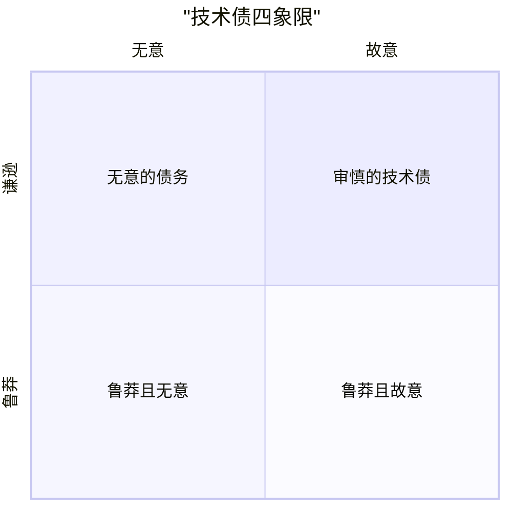

# 软件开发的艺术 — 代码为读而写，债为还而计

> 一句话：代码被读的次数远多于被改的次数，所以先为「下一个人 5 秒看懂」而写；技术债不是脏代码，而是**每次改动都要多付的利息**，能量化才谈得上还。

## 🎯 这 20% 能解决哪些问题

| 你遇到的困惑 | 本质原因 | 马上能改的动作 |
|---|---|---|
| 看懂一段代码要 20 分钟，改它更久 | 抽象层级混乱：一个函数同时讲策略与细节 | 每个函数只做同一层级的事；把细节抽成命名清楚的子函数 |
| 改一个 bug 要在 5 处做同样的修改 | 霰弹式修改：同一知识散落多处 | 先收敛到一处（移动函数/引入参数对象），再改行为 |
| 巨型类、巨型函数不敢动 | 缺少测试安全网，任何改动都可能出问题 | 先补特征测试（characterization test）钉住当前行为，再重构 |
| 「重构」永远排不上期 | 债务按美观度量，不是按利息度量 | 算一次「每次改动多花的时间 × 人数 × 周数」，用利息说话 |
| PR 里为命名和写法反复争论 | 没有把规则交给工具 | 格式化与静态检查进 CI；评审只谈语义与设计 |
| 老系统与新系统并存半年 | 一次性重写，没有渐进替换路径 | 绞杀者模式：按功能切片迁移，边界用防腐层隔离 |
| 「屎山」越修越乱，加了 20 层 `if` | 用条件叠加代替多态与数据驱动 | 分支超过 3 个就考虑策略表/多态/配置驱动 |

---

## 一、可读性：判据是「多久能看懂」

| 手法 | 反例 | 正例 |
|---|---|---|
| 名字说出意图 | `d = 30` | `retention_days = 30` |
| 用早返回代替嵌套 | 四层 `if` 包住主逻辑 | 校验不通过立即 `return`，主逻辑留在最外层 |
| 给条件表达式起名 | `if (a > 0 and b.status == 2 and not c.expired)` | `if is_refundable(order)` |
| 函数只做一层抽象 | 一个函数里既有 HTTP 处理又有金额换算 | 编排函数调若干同级子函数 |
| 参数少于三个 | `create(u, a, b, c, d, e)` | 合并为 `CreateOrderInput` 值对象 |
| 用数据代替控制流 | 长 `switch` 按类型分派 | 查表 / 策略字典 / 多态 |
| 注释解释为什么 | `// i++` | `// 补偿上一版本漏算的退款手续费，2026-03 起生效` |
| 删除死代码 | 保留「以后可能用到」的注释块 | 交给版本控制，代码只留当前事实 |

**5 秒判据**：任意一段代码，如果新同事 5 秒内说不出「它做什么」，就需要改名、拆分或加解释；如果 5 分钟还说不清，就是设计问题，不是排版问题。

---

## 二、坏味道 → 重构动作对照表

| 坏味道 | 识别信号 | 首选手法 |
|---|---|---|
| 重复代码 | 同一段逻辑出现在 ≥2 处 | 提取函数/类；参数化差异部分 |
| 过长函数 | 需要滚动才能看完 | 连续「提取函数」，直到每层只讲一件事 |
| 过大类/过大模块 | 字段分组互不相干 | 提取类；按变更原因拆分 |
| 数据泥团 | 几个参数总是一起出现 | 引入值对象/参数对象 |
| 基本类型偏执 | 到处传 `string status` | 给状态建类型（枚举/值对象） |
| 发散式变化 | 一个模块因多种原因被改 | 按变更原因拆分模块 |
| 霰弹式修改 | 一个需求要改多个模块 | 合并职责到一处 |
| 特性依恋 | 函数大量使用别类的数据 | 把函数移到它所依恋的数据旁 |
| 过深条件嵌套 | 布尔表达式一长串 | 分解条件、引入守卫子句 |
| 分支膨胀 | `switch`/`if` 链越加越长 | 以多态或策略表替换条件 |
| 循环收集 | 长 `for` 里边遍历边拼装 | 改为 map/filter/reduce 或显式两阶段 |
| 注释当遮羞布 | 注释解释混乱代码而非意图 | 用改名和提取消除「需要解释」的部分 |

**顺序建议**：先做**机械、零风险**的（改名、提取函数、删死代码、格式化），再动**语义**的（搬移职责、替换条件、拆类）。两类改动分开提交，评审才看得清。

---

## 三、安全网：怎么改才不会出事

| 手段 | 什么时候用 | 要点 |
|---|---|---|
| 特征测试 | 老代码无测试、行为不明 | 断言「现在输出的就是这个」，不判定对错；先钉住再动 |
| 黄金法则 | 所有重构 | 一次重构不改变可观察行为；改行为与改结构绝不混在同一提交 |
| 小步 + 常绿 | 大型机械改动 | 每步都能编译、测试通过、随时可停；宁可拆十次提交 |
| 绞杀者模式 | 替换旧模块 | 新实现接管一片功能，边界处转发；旧代码逐步失去入口后删除 |
| 防腐层 | 接外部/遗留系统 | 在自己的模型与外部模型间加转换层，阻止旧概念渗入 |
| 特性开关 | 新旧逻辑并存上线 | 开关只保护「切换」，不作为长期分支；过期即清理 |
| 影子对比 | 关键计算改写 | 新旧同时跑，只出旧结果，比对差异达标再切 |
| 静态检查 + CI 门禁 | 团队协作 | 把风格问题交给工具，评审聚焦设计与正确性 |

**回归判定标准**：重构前后测试集合完全一致地通过，且没有新增被禁用的用例。若为了「让它通过」而改了断言，那已经不是重构。

---

## 四、技术债：分类与计量



| 类型 | 例子 | 正确处理 |
|---|---|---|
| 故意且审慎 | 为赶大促上线，明确知道缺测试、缺幂等 | 记账：写明代价、还债时点、临时兜底措施 |
| 故意且鲁莽 | 「先跑通再说」，把临时方案放成永久 | 禁止无主的临时代码；要么转正要么删除 |
| 无意且谦逊 | 团队后来才明白的正确抽象 | 补文档、沉淀规范、加检查项 |
| 无意且鲁莽 | 不懂设计而写出的耦合 | 通过重构消除，靠评审与工具防止复发 |

**利息怎么算**：

| 指标 | 取法 | 用途 |
|---|---|---|
| 改动成本 | 同类需求近三次耗时趋势 | 判断模块是否在恶化 |
| 缺陷逃逸率 | 该模块线上事故数 / 变更数 | 说明风险，不是说明代码丑 |
| 交付前置时间 | 提交到上线的时长 | 债务常表现为等待与排队 |
| 构建/测试时长 | CI 平均耗时 | 慢反馈会放大所有其他债务 |
| 知识单点 | 能安全修改该模块的人数 | 人数 ≤1 就是高息债务 |

**登记方式**：债务要有条目（位置、代价、影响范围、还债动作、触发条件），并且和 TODO 标记绑定到同一个 issue 上；没有条目的债务等于没有管理。

---

## 五、争取还债时间：把「我想重构」翻译成决策

| 决策者关心 | 你要给出的数字 |
|---|---|
| 值不值得投 | 每次改动多花 X 小时 × 团队人数 × 每周改动次数 → 月成本 |
| 风险多大 | 该模块近半年事故数、影响面、是否有单点知识 |
| 要多久 | 拆成 2–3 天可见效的小块，而不是一次性两个月的大计划 |
| 怎么验收 | 前置时间下降、构建时长下降、同类需求耗时下降、缺陷逃逸下降 |
| 会不会失控 | 约定容量比例（常规 15–20% 用于还债与工具改进），并设红线清单 |

**红线清单**（触线即优先处理）：关键路径无自动化测试、依赖已到 EOL 且无补丁、单点知识模块、无法回滚的发布、无法观测的异步链路。

---

## 六、日常落地清单

```
□ 写代码前先问：这段将来谁读？名字能不能表达意图？
□ 函数超过 40 行或参数超过 3 个 → 停下想想是否混了抽象层级
□ 条件分支第 4 次增加 → 换成数据驱动或多态
□ 改动任何无测试的老函数前 → 先补一条特征测试
□ 提交拆分：格式化 / 机械重构 / 语义改动 各自独立提交
□ 每个临时方案登记债务条目，写明还债触发条件
□ 每次上线后回顾：本次有没有留下「无主临时代码」
```

---

## 🎓 实战场景（TIL）

- **场景**：一个 500 行的下单函数，谁改谁出错。**本质**：编排、校验、计算、持久化四种抽象层级混在一起，且无测试。**要点**：先补边界用例钉住现状，再把四类拆成同级子函数，机械拆分与行为修改分两次提交。
- **场景**：同一折扣规则散在 4 个模块，改价需求做了两周。**本质**：霰弹式修改，规则没有单一归属。**要点**：把规则收敛为独立的策略对象（含测试），其余位置只调用；先做归属，再谈抽象。
- **场景**：重构计划两次被砍。**本质**：用「代码太乱」作为理由，没有可核对的代价。**要点**：换成「同类需求平均耗时从 3 天涨到 9 天，季度多花 120 人时」，并把目标拆成 2 天可见效的三块。

---

## 📋 一页速查

| 我要做 | 记住这条 |
|---|---|
| 判断代码好不好 | 不看行数看时间：新同事能否 5 秒说出它做什么 |
| 决定要不要拆函数 | 函数里出现了不同抽象层级的内容就该拆 |
| 决定要不要用多态 | 同一处 `switch` 第三次被修改时 |
| 安全重构的第一步 | 先加测试，不动行为；小步、常绿、可停 |
| 提交怎么切 | 格式化、机械重构、语义改动分三次提交 |
| 技术债的度量 | 用利息（多花的时间与事故率），不用行数与覆盖率 |
| 争取还债时间 | 换算成人时成本 + 分块计划 + 可验证指标 |
| 替换遗留模块 | 绞杀者 + 防腐层 + 影子对比，绝不大爆炸重写 |
| 注释该写什么 | 只写「为什么」与约束，代码自己说明「做什么」 |

---

## 🔗 相关链接

- 上级：[软件工程](index.md)
- 同域：[代码规范](12-code-standards.md) — 把风格问题交给工具与 CI
- 同域：[设计模式](11-oop-design-patterns.md) — 重构后常见的目标结构
- 同域：[测试策略](07-testing-strategy.md) — 特征测试与回归安全网
- 同域：[架构设计](04-architecture-design.md) — 边界与依赖方向决定重构半径
- 同域：[持续学习](16-continuous-learning.md) — 复盘把个人经验变成团队规范
- 邻域：[AI 辅助软件开发](../../ai-core/engineering/03-ai-assisted-software-development.md) — 机械重构交给模型的边界与验收
