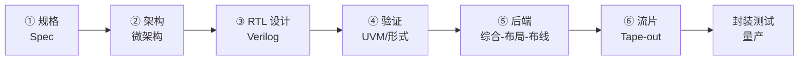

# 芯片设计核心 20% — 先搞清"谁在什么阶段做什么"

> **一句话**：芯片项目 80% 的延期不是设计不出来，而是**验证没做完就流片**。记住全流程六阶段、PPA 三角、验证占 60–70% 工时，就抓住了这个行业的常识骨架。

---

## 🎯 这 20% 能解决哪些问题

| 常见困惑 | 本质 | 本页答案 |
|----------|------|----------|
| 前端和后端到底分工是什么 | 不懂抽象层级 | 见「全流程六阶段」 |
| 为什么芯片要做三年 | 每轮流片都是数月与千万成本 | 见「为什么慢」 |
| PPA 能不能都要 | 三者互相挤压 | 见「PPA 三角」 |
| 验证为什么比设计人还多 | 出错代价极高 | 见「验证占大头」 |
| 流片失败的常见原因 | 多是边角场景与工艺角 | 见「Tape-out 清单」 |

---

## 一、全流程六阶段

| 阶段 | 产物 | 谁做 | 关键问题 |
|------|------|------|----------|
| 规格 | 功能/性能/功耗/成本目标 | 系统与产品 | 做什么、不做什么 |
| 架构 | 微架构图、模块划分 | 架构师 | 怎么拆、怎么算 |
| RTL | 可综合的寄存器传输级代码 | 前端设计 | 时序与面积是否达标 |
| 验证 | 测试平台、覆盖率报告 | 验证工程师 | 有没有漏场景 |
| 后端 | 网表、版图、GDSII | 后端/物理设计 | 时序收敛了吗 |
| 流片 | 掩膜、晶圆 | 代工厂 | 工艺角是否覆盖 |

> **一句话分工**：前端负责"逻辑对不对"，后端负责"物理上能不能造出来"。

---

## 二、为什么慢：一次流片 = 数月 + 千万级成本

| 环节 | 典型周期 |
|------|----------|
| RTL 设计 | 3–9 个月 |
| 验证 | 6–12 个月（可与设计并行） |
| 综合与布局布线 | 2–6 周（多次迭代） |
| 掩膜制作 | 2–8 周 |
| 流片与封装测试 | 2–4 个月 |

**代价结构**：先进工艺掩膜成本可达数千万美元。所以行业铁律是**先仿真再流片**，能软件验证就绝不用硅验证。

---

## 三、PPA 三角

| 维度 | 衡量 | 优化手段 | 反向代价 |
|------|------|----------|----------|
| Performance | 频率、吞吐 | 流水线加深、并行 | 面积↑、功耗↑ |
| Power | 动态 + 静态功耗 | 时钟门控、多电压域、降频 | 性能↓ |
| Area | 面积/成本 | 资源共享、串行化 | 性能↓、延迟↑ |

**动态功耗公式**：\(P = \alpha C V^2 f\)。降电压最有效（平方关系），这也是为什么低功耗设计优先调电压而不是调频率。

---

## 四、验证占大头

| 手段 | 作用 | 局限 |
|------|------|------|
| 定向测试 | 覆盖明确功能点 | 无法穷举 |
| 随机约束测试（UVM） | 自动生成大量场景 | 需要好的约束与检查器 |
| 形式验证 | 数学证明等价/性质成立 | 状态空间爆炸 |
| 断言（SVA） | 实时检查协议规则 | 断言写得好才有用 |

**覆盖率三兄弟**：代码覆盖率、功能覆盖率、断言覆盖率。**功能覆盖率 100% 不等于没 bug**，只等于"你想到的都测了"。

---

## 五、后端关键概念

| 概念 | 一句话 |
|------|--------|
| 综合 | RTL → 门级网表，含时序约束（SDC） |
| 布局布线 | 决定物理位置与连线，主导时序 |
| 时序收敛 | 建立/保持时间全部满足，含工艺角（SS/TT/FF） |
| 物理验证 | DRC（设计规则）、LVS（版图与网表一致） |
| 时钟树综合 | 让时钟偏差可控，否则建立时间难收敛 |

---

## 六、Tape-out 前清单

| # | 检查项 |
|---|--------|
| 1 | 所有功能覆盖率目标达成，未覆盖项已评审 |
| 2 | 跨时钟域（CDC）全部通过检查 |
| 3 | 复位与上电时序仿真通过 |
| 4 | 所有工艺角 + 电压/温度组合下时序收敛 |
| 5 | DRC / LVS / 天线效应检查通过 |
| 6 | 功耗估算与封装散热匹配 |
| 7 | 可测性设计（DFT/扫描链）覆盖率达标 |
| 8 | 硅后调试通路（JTAG、观测点）预留 |

---

## 七、新手常见误解

| 误解 | 纠正 |
|------|------|
| 设计完就流片 | 验证与后端往往占一半以上时间 |
| 频率越高越好 | 受功耗与散热限制 |
| 仿真通过就没问题 | 未覆盖场景才是主要 bug 来源 |
| 后端只是"自动跑工具" | 时序收敛是反复手工权衡 |
| 用最先进工艺一定划算 | 掩膜成本与良率决定性价比 |

---

## 🎓 实战场景（TIL）

- **场景**：拿供应商跑分 PPT 选型，量产后实际频率与功耗都达不到宣传值。**本质**：跑分用的是峰值频率与小模型，真实负载受 PPA 三角约束。**要点**：用自己的工作负载在同一工艺/同一封装上实测能效比（性能/瓦），并把降频场景一并测。
- **场景**：代码覆盖率 100%，流片后仍有 bug。**本质**：代码被执行过不等于功能场景被验证过。**要点**：用功能覆盖率（断言 + covergroup + 随机约束）定验收标准，迭代到边界/异常/并发场景真跑到。
- **场景**：FPGA 原型上跑得好，ASIC 一到高频就时序不收敛。**本质**：FPGA 布线延迟分布与标准细单元库不同，关键路径假设失效。**要点**：原型只验逻辑与协议，时序结论以 STA 为准；高频路径在 RTL 阶段就预留流水线寄存器。
- **场景**：封装完成才发现没留测试接口。**本质**：DFT（扫描链/边界扫描）在综合后才考虑，面积与时序都改不了。**要点**：把可测试性需求写进前端规格评审清单，而不是当成后端事项。

---

## 📋 一页速查

| 问题 | 答案 |
|------|------|
| 全流程 | 规格→架构→RTL→验证→后端→流片 |
| 验证占比 | 约 60–70% 工时 |
| PPA | 性能、功耗、面积 |
| 动态功耗公式 | P = αCV²f |
| 流片后能改吗 | 基本不能，成本极高 |
| 最容易漏的检查 | CDC、工艺角、复位时序 |

---

## 🔗 相关链接

| 主题 | 链接 |
|------|------|
| 硬件基础概览 | [硬件基础](../index.md) |
| 计算机体系结构 | [计算机体系结构核心 20%](../computer-architecture/01-essentials.md) |
| GPU 并行计算 | [GPU 并行计算核心 20%](../gpu-parallel/01-essentials.md) |
| 量子计算 | [量子计算核心 20%](../quantum-computing/01-essentials.md) |
