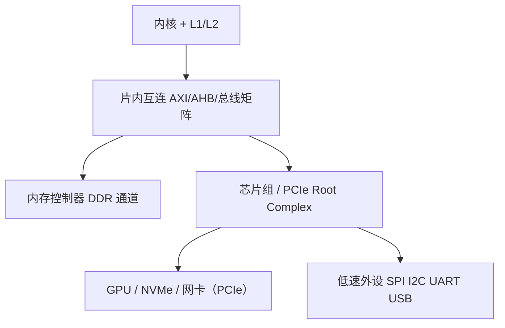

# 总线与 IO — 数据怎么在芯片之间流动

> 一句话：系统性能瓶颈几乎不在算力而在搬运——带宽（每秒能搬多少）与延迟（一次要等多久）由总线层次和 IO 方式决定，算清这两件事再谈优化。

## 🎯 这 20% 能解决哪些问题

| 你遇到的困惑 | 本质原因 | 马上能改的动作 |
|---|---|---|
| 加了两块高速 NVMe，吞吐没翻倍 | 瓶颈在 PCIe 通道数或 DMI/芯片组上行链路 | 查设备实际协商到的 `gen × lane`，别只看厂商标称 |
| 内存插满反而降频 | 通道数与每通道 rank 数互相制约，DIMM 越多频率越低 | 优先插满通道数而不是插满插槽；按主板支持表选型 |
| 高并发网络下 CPU 全耗在中断上 | 硬中断 + 软中断 + 上下文切换的开销叠加 | 开网卡多队列 + RSS、中断聚合（coalescing），必要时下沉到 DPDK/io_uring |
| 磁盘顺序读写很快，4K 随机很慢 | 队列深度与 IOPS 上限；机械盘还有寻道延迟 | 压测要同时测顺序带宽与随机 IOPS，两者不可互相推断 |
| 传感器每秒中断上万次，系统卡顿 | 每次中断有入栈/出栈与缓存冲刷代价 | 改为 DMA + 批量完成中断，或降采样率 |
| 外设数据「读到了但总是慢一步」 | 走了程序查询或未做缓存维护 | 用 DMA 并在接收后 invalidate，或映射为不可缓存区 |
| 数据库 `fsync` 偶发几十毫秒 | 刷盘语义 + 写缓存 + 调度合并 | 区分 `fdatasync`/`fsync`/`O_DIRECT`，测 P99 而不是均值 |

---

## 一、总线的三组信号与带宽计算

| 信号组 | 作用 | 决定什么 |
|---|---|---|
| 地址总线 | 指明访问哪个位置 | 可寻址空间 = `2^地址位宽` |
| 数据总线 | 搬运数据 | 一次能搬多少位 |
| 控制总线 | 读/写/中断就绪/仲裁 | 时序、能否突发传输（burst） |

\[
带宽 = 时钟频率 \times 位宽 \times 每周期传输次数 \times 通道数
\]

| 例子 | 计算 | 结果 |
|---|---|---|
| DDR4-3200 双通道 | `3200 MT/s × 8 B × 2`（编号即每秒传输次数，每通道 8 字节宽） | 约 51.2 GB/s |
| PCIe 4.0 ×4 | `约 2 GB/s × 4 lane`（每 lane 每方向） | 约 8 GB/s 单向 |
| 32 位 72MHz 老式外设总线 | `72M × 4 B` | 约 288 MB/s |
| 10Gbps 网卡 | `10 Gb ÷ 8` | 约 1.25 GB/s（还要扣协议开销） |

**易错点**：PCIe 每 lane 双工（各方向独立），带宽要按方向计；DDR 的「MT/s」与「MHz 时钟」不是一回事；标称带宽是理论峰值，实测 70–85% 才正常。

---

## 二、总线层次：从片内到机箱外

| 层次 | 典型协议 | 数量级 | 关注点 |
|---|---|---|---|
| 内核与缓存 | 内部总线、MESI 探测 | 纳秒内 | 命中率、伪共享 |
| 片内互连 | AXI（ARM）、AHB/APB 挂低速外设 | 几十 ns | 突发长度、仲裁、并发主设备 |
| 内存总线 | DDR4/DDR5 | 约 100 ns | 通道数、rank、页命中 |
| 扩展总线 | PCIe Gen3/4/5 | 微秒级 | lane 数、TLP 开销、DMA |
| 外部互连 | USB/以太/SATA/NVMe-oF | 数十微秒起 | 协议栈开销、拥塞 |

**判据**：任何「换硬件没变快」的问题，先定位瓶颈在哪一层——只有最窄那一层的带宽提升才有意义。

---

## 三、DMA：把搬运从 CPU 手里拿走

| IO 方式 | 流程 | CPU 代价 | 适用 |
|---|---|---|---|
| 程序查询（轮询） | CPU 反复读状态寄存器 | 100% 占用，无法处理别的事 | 极短事务、启动早期、裸机简单场景 |
| 中断驱动 | 每字节/每包打断 CPU | 每次中断约 1–2µs 系统开销 | 事件稀疏（按键、串口命令） |
| DMA | 外设/内存批量搬运，传完一次中断 | 只在开始与结束介入 | 大块数据：网卡、磁盘、ADC 采样、显示刷屏 |
| 内核旁路（DPDK/io_uring/RDMA） | 用户态直接收发，轮询或批量提交 | 减少中断与拷贝、系统调用 | 高 PPS 网络、高 IOPS 存储、超低延迟 |

**DMA 的三件必修事**：

1. **缓冲区生命周期**：传输期间内存不能被释放/复用，通常要加锁或双缓冲。
2. **Cache 一致性**：带 D-Cache 的系统必须发送前 clean、接收后 invalidate，或用不可缓存区。
3. **地址约束**：32 位 DMA 控制器看不到超过 4GB 的地址；跨页/分散-聚集需要 scatter-gather 描述符链。

---

## 四、中断在 IO 路径上的成本

| 阶段 | 做的事 | 成本点 |
|---|---|---|
| 硬中断 | 确认设备、读状态、收数据入队 | 尽量极短，不做协议处理 |
| 软中断 / tasklet / 工作队列 | 协议解析、上送 | 可被高负载挤压，注意延迟上限 |
| 唤醒线程 | 通知等待的处理任务 | 上下文切换 + 缓存冷启动 |
| 中断聚合 | N 次事件合并为 1 次中断 | 延迟换吞吐，实时场景要设上限 |

| 技术 | 解决什么 | 注意 |
|---|---|---|
| MSI/MSI-X | 线中断改为内存写消息，支持多向量 | 依赖 PCIe 与内核支持 |
| 多队列 + RSS | 按流哈希把包分到不同 CPU 核 | 单流仍受单核限制，别指望多核加速一条 TCP |
| NAPI / 轮询混合 | 高压时收中断、低压回中断模式 | 空闲时延迟略增，用 `gro_flush_timeout` 类参数调节 |
| CPU 亲和与隔离 | 把中断固定到指定核 | 与 RT 任务的优先级设计要一起规划 |

**一句结论**：中断风暴的本质是「用高成本路径处理高频事件」。要么批量（聚合/DMA），要么绕过（轮询/旁路）。

---

## 五、存储 IO：带宽与 IOPS 是两条独立曲线

| 介质 | 顺序带宽 | 4K 随机 IOPS | 延迟量级 | 关键限制 |
|---|---|---|---|---|
| HDD（7200rpm） | 150–250 MB/s | 约 100–200 | 约 10 ms | 寻道 + 旋转 |
| SATA SSD | 约 550 MB/s | 数万 | 约 100µs | SATA 队列与协议 |
| NVMe Gen4 ×4 | 约 7 GB/s | 数十万至百万 | 约 10–100µs | PCIe 带宽 + 闪存页大小 |
| 内存（DRAM） | 数十 GB/s | — | 约 100 ns | 通道与页命中 |

| 概念 | 含义 | 工程影响 |
|---|---|---|
| 队列深度（QD） | 同时在途的请求数 | QD=1 只能测出单请求延迟对应的吞吐，必须并发压测 |
| 页/擦除块 | SSD 以页写、以块擦 | 写放大明显；随机写性能与剩余空间强相关 |
| 写放大 | 实际写入闪存量 / 主机写入量 | 影响寿命与稳态性能，稳态比瞬时差很多 |
| 合并与调度 | 内核把相邻请求合并 | 顺序写能跑满带宽的原因之一 |
| `fsync` 语义 | 数据 + 元数据落盘（含设备缓存刷） | 有 volatile 写缓存的盘上 `fsync` 可能很慢 |
| 预读 | 顺序读时多读若干页 | 随机读场景预读反而浪费带宽，可用 `posix_fadvise` 关闭 |

---

## 六、把总线与 IO 用于容量规划

| 我要估 | 估算式 | 例子 |
|---|---|---|
| 网络能否跑满 | `PPS × 平均包字节 × 8` | 14.88 Mpps @64B 就是万兆满载，小包先撞 PPS 而非带宽 |
| 磁盘够不够 | `QPS × 平均读块大小` 与 `随机 IOPS` 分别核算 | 数据库 5k QPS × 16KB ≈ 80MB/s，但随机读要看 IOPS |
| 采集/日志能否跟上 | 单次 IO 大小 × 频率 × 设备数 | 4kHz × 12ch × 4B ≈ 192 KB/s，远低于任何总线，问题多半在 CPU 侧 |
| 显存/内存够不够 | 张量元素数 × 字节数 + 激活 + 梯度 | 大模型推理常受带宽约束：`时间 ≈ 参数字节 ÷ 内存带宽` |

**统一方法**：先算「每秒要搬多少字节」和「每次搬运等多久」，再和上表各层的真实能力对比——瓶颈立刻显形。

---

## 🎓 实战场景（TIL）

- **场景**：给视频剪辑机换了两块 Gen4 NVMe，吞吐只涨 20%。**本质**：主板 PCIe 通道经芯片组共享，实际协商为 Gen3 ×2。**要点**：用 `lspci -vv` 查 `LNKSTA` 的实测速率与宽度，再看 CPU 直连通道预算。
- **场景**：网关设备开启网卡多队列后 P99 反而变差。**本质**：包被分到不同核，单流被打乱顺序且跨核同步增加。**要点**：按流哈希保证同流同核；关注连接数而非核数是否够用。
- **场景**：单片机 SPI 接 Flash 写入正常、读取偶发校验失败。**本质**：读操作走轮询且未做 CS 建立时间，高速时采样沿偏移。**要点**：先用逻辑分析仪确认 CPOL/CPHA 与时序裕量，再提频；大块传输改 DMA。

---

## 📋 一页速查

| 我要判断 | 照着做 |
|---|---|
| 峰值带宽 | `频率 × 位宽 × 通道数`，实测按 70–85% 折算 |
| PCIe 实际能力 | `lspci -vv` 看 LNKSTA 协商到的 `gen × lane` |
| 内存带宽 | 通道数 × 每通道带宽；插满通道优先于插满插槽 |
| 小包网络瓶颈 | 先算 PPS（`线速 ÷ (包长+帧开销)`），再看字节带宽 |
| 该用哪种 IO | 大块 → DMA；稀疏事件 → 中断；超高 PPS → 聚合或旁路 |
| 中断太多次 | 批量/聚合优先，其次降频，最后换 DMA 描述符链 |
| DMA 数据不对 | 检查 cache 维护、缓冲区生命周期、地址是否越界 |
| 磁盘压测可信吗 | 同时测顺序带宽与 4K 随机 IOPS，并发跑够队列深度，看稳态 |
| 刷盘语义 | `fsync`（数据+元数据）vs `fdatasync`（必要元数据）vs `O_DIRECT`（绕过页缓存） |

---

## 🔗 相关链接

| 主题 | 链接 |
|------|------|
| 上级 Hub | [计算机体系结构](index.md) |
| 同域上一课 | [体系结构核心 20%](01-essentials.md) — 性能公式、存储层次与流水线 |
| 同域参考 | [嵌入式与单片机](../embedded-systems/index.md) — 总线与 IO 在 MCU 外设上的形态 |
| 操作系统 | [操作系统与进程模型](../../fundamentals/software/01-operating-systems.md) — 页缓存、IO 调度与中断处理 |
| 性能优化 | [性能优化](../../fundamentals/software/13-performance-optimization.md) — 把带宽与延迟用于容量规划 |
| 消息队列 | [消息队列](../../data-fundamentals/03-message-queues.md) — 批量与背压的同构问题 |
