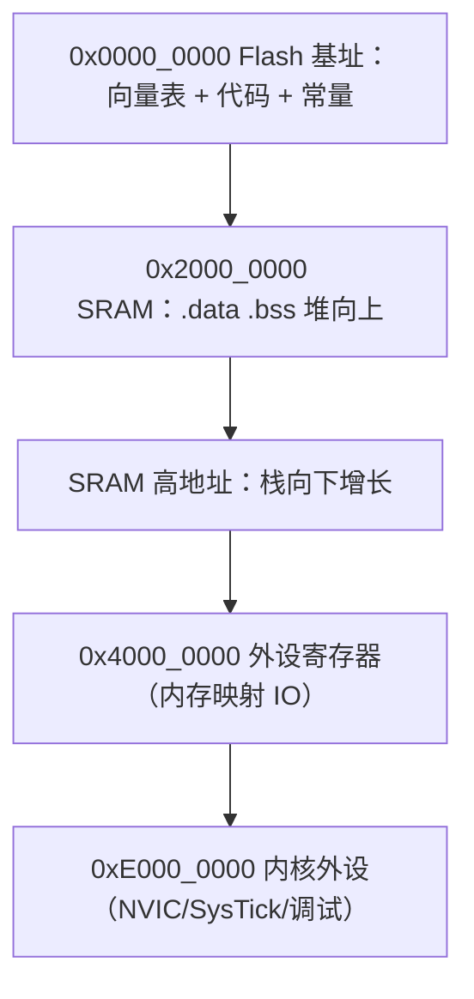

# 微控制器架构 — 代码跑在什么样的物理机上

> 一句话：单片机上的诡异 bug（随机复位、偶发死机、"接上调试器就正常"）几乎都能追溯到四件事之一：栈越界、时钟没配、上电时序不满足、访存没加 `volatile`。

## 🎯 这 20% 能解决哪些问题

| 你遇到的困惑 | 本质原因 | 马上能改的动作 |
|---|---|---|
| 开发板正常，量产批次偶发死机 | 上电时序/复位延时不满足，或电源去耦不足 | 检查 VDD 上升时间、复位脚 RC 延时、每个电源脚就近 100nF 去耦 |
| 程序跑着跑着乱飞、随机复位 | 栈溢出把 `.bss` 或返回地址覆盖了 | 静态估算最深调用链 + 开 MSP 水位检测，加看门狗兜底 |
| `while (flag == 0);` 永远出不来 | 编译器把轮询变量提到寄存器 | 共享变量加 `volatile`，硬件寄存器同理 |
| 全局变量初值不生效 | 启动代码没拷贝 `.data` / 清零 `.bss` | 确认启动文件已跑完再进 `main`，别在链接脚本改动后漏配 |
| 主频提高了反而更慢、随机出错 | Flash 等待周期（wait state）与电压不匹配 | 先设 Flash 预取/等待周期，再切时钟源，最后提频 |
| 休眠电流降不下来 | 外设时钟未关、引脚悬空漏电、外部设备反灌 | 时钟门控关未用外设，未用引脚配模拟输入或拉定 |
| 代码体积暴涨/优化后行为变了 | `-O2` + 未定义行为暴露 | 打开 `-Wall -Wextra`、UBSan（主机侧）先修根因，别只调优化级别 |

---

## 一、CPU 与指令执行：MCU 的性能从哪来

| 概念 | 必须记住的数 | 工程含义 |
|---|---|---|
| 取指-译码-执行 | Cortex-M0+ 2 级、M3/M4 3 级流水 | 分支/中断响应有流水冲刷代价，热循环里少放分支 |
| 哈佛结构 | 指令总线与数据总线分开 | 取指令不占数据带宽，所以 Flash 主频限制更敏感 |
| 数据宽度 | 32 位内核一次访问 4 字节 | 对 8/16 位外设寄存器读写要做宽度转换，易踩半字访问 |
| CCI/单周期 IO | GPIO 翻转可达数十 MHz | 「1kHz 采样绰绰有余」的说法要靠实测，不靠直觉 |
| 中断响应延迟 | M4 约 12 个周期入栈 + 若干周期出栈 | 微秒级事件必须走中断/DMA，别靠轮询 |

**性能评估口诀**：MCU 上「主频相同但性能差很多」通常是 Flash 等待周期、缓存/预取、总线仲裁三件事之一。先查 `SYSCLK → HCLK → PCLK` 的实际分频比。

---

## 二、存储器映射：谁住在哪个地址，栈往哪长

| 区段 | 内容 | 常见坑 |
|---|---|---|
| 向量表 | 初始 SP + 各异常入口地址 | 偏移未设置导致 bootloader 跳转后中断全乱（`VTOR`） |
| `.text` | 代码 | 放到非 0 地址需同步改 `VTOR` |
| `.rodata` | 字符串常量、查找表 | 大表放 Flash 省 RAM，注意对齐访问速度 |
| `.data` | 有初值的全局/静态 | 启动代码负责从 Flash 拷贝，未跑完就用值是 0 |
| `.bss` | 零初值全局/静态 | 启动代码负责清零，占 RAM 但不占 Flash |
| 堆 | `malloc` 新对象 | 与栈对长，中间剩多少没人管，碎片会让系统突然失败 |
| 栈 | 局部变量、调用帧、中断帧 | 高地址向下生长，最深调用链 + 中断嵌套帧要预留 |
| 外设寄存器 | 内存映射 IO | 必须 `volatile`；读-改-写非原子需要临界区或位带 |

**估栈的实操做法**：最深函数链的帧大小之和 + 最大中断嵌套层数 × 上下文帧（M4 约 32–52 字节）+ 25% 余量；不确定就用填 `0xA5` 后测高水位的办法实测。

---

## 三、启动流程：为什么必须先配时钟再谈别的

| 步骤 | 做的事 | 出错表现 |
|---|---|---|
| 1. 硬件复位 | 引脚复位/上电复位/看门狗复位，PC 从向量表首项取 SP | 复位源未记录，问题无法归因 |
| 2. Reset_Handler | 设置栈指针 → 拷贝 `.data` → 清零 `.bss` | 全局变量初值不对、数组莫名变 0 |
| 3. 系统初始化 | 配时钟（Flash 等待周期 → PLL → 分频）、装 `VTOR` | 提频后随机出错、中断不响应 |
| 4. 调用 C 运行时 | 构造函数/静态初始化、`__libc_init` | 栈不够直接 HardFault |
| 5. `main()` | 配 GPIO/外设 → 使能中断 → 进主循环或调度器 | 外设还没就绪就开中断，进 ISR 即崩 |

**关键规则**：任何外设时钟没使能就访问其寄存器，在部分系列上会直接总线错误 HardFault；`RCC`/时钟配置永远在业务初始化之前完成。Bootloader 跳应用时必须重新设 `VTOR` 并关掉 bootloader 遗留的中断。

---

## 四、时钟树与功耗：频率就是电量

| 时钟源 | 典型精度 | 用途 | 注意 |
|---|---|---|---|
| HSI/内部 RC | ±1%（温漂更大） | 启动默认、低成本 | UART 波特率误差易超标 |
| HSE/外部晶振 | ±20ppm–50ppm | 通信、时间基准 | 起振需延时，负载电容要匹配 |
| LSE 32.768kHz | ±20ppm | RTC、低功耗唤醒 | 起振慢、易受布局噪声影响 |
| PLL | 跟随输入 | 升频 | 切源前必须等锁定标志 |

| 低功耗模式 | 关停什么 | 唤醒方式 | 典型电流 |
|---|---|---|---|
| Sleep | CPU 停，外设与 SRAM 保持 | 任意中断 | 数百 µA |
| Stop/Deep Sleep | 主时钟停，SRAM 保持 | 指定 wakeup 引脚/RTC | 数十 µA |
| Standby/Shutdown | 域断电，SRAM 丢失 | 复位类事件 | 1–5 µA |

**漏电杀手排查顺序**：未使用引脚悬空 → 外部电路上拉在休眠时被反灌 → 传感器待机未真正断电（用 IO 保持电路） → 调试接口未拔。**每一路外接设备都要量休眠电流，别只测芯片**。

---

## 五、最小系统与上电可靠性

| 项 | 常见做法 | 不做会怎样 |
|---|---|---|
| 去耦电容 | 每个 VDD 引脚 100nF 就近 + bulk 10µF | 主频升高后随机复位、ADC 抖动 |
| 复位电路 | 内部 POR + 外部 RC（或专用复位芯片） | 上电慢/电压跌到时行为不确定 |
| Brown-out 检测 | 开 BOD/BOR 并设合理阈值 | 电机启动拉低电压导致跑飞 |
| 看门狗 | 独立看门狗（独立时钟源）+ 窗口看门狗 | 死循环后不能自恢复 |
| 晶振布局 | 靠芯片、包地、下方不走信号线 | 起振失败、温漂、EMI |
| 上电延时 | 电源稳定后再初始化外设（传感器需 ms 级） | 首帧数据无效、初始化返回错误 |

**独立看门狗用内部独立 RC**，即使主晶振停振也能复位——这是「跑飞后能自己恢复」的最后一道保险。

---

## 六、调试通道与故障定位

| 手段 | 适用 | 局限 |
|---|---|---|
| SWD/JTAG | 断点、单步、内存查看 | 占用调试引脚；接上调试器会改变供电与时序（"接上就好"陷阱） |
| 串口日志 | 现场可观测，量产可留 | 波特率与耗时影响实时性，禁止在中断里阻塞发送 |
| GPIO 打点 + 逻辑分析仪 | 测中断延迟、任务执行时间 | 需预留调试引脚 |
| HardFault 分析 | 崩溃归因 | 必须保存栈帧（PC/LR/x0-x3）才能定位行号 |
| 静态分析 + 编译告警 | 未初始化、越界、MISRA 违规 | 无法覆盖硬件时序问题 |

**HardFault 定位最小闭环**：在故障处理里压栈保存 `PSP/MSP` 与 `HFSR/CFSR/BFAR`，串口打印十六进制值，再用 map/ELF 反查地址对应的符号。没有这套信息，「偶发死机」永远修不完。

---

## 🎓 实战场景（TIL）

- **场景**：加入 `printf` 后 UART 通信偶发丢帧。**本质**：格式化输出阻塞主循环数十毫秒，接收靠轮询未及时读 FIFO。**要点**：中断收 + 环形缓冲，发送走 DMA 或队列，日志在低优先级任务里做。
- **场景**：同一固件在 A 批次全部正常，B 批次一半以上无法开机。**本质**：B 批用了不同负载电容的晶振，起振裕量不足。**要点**：晶振参数进关键件清单，量产测起振时间并把起振失败计入老化测试。
- **场景**：OTA 升级后设备变砖。**本质**：bootloader 与应用的向量表偏移/中断状态没约定清楚，跳转时旧中断仍在生效。**要点**：跳转前关全部中断、清 pending、设 `VTOR`、切主栈指针，并在应用侧记录复位源做统计。

---

## 📋 一页速查

| 我要判断 | 照着做 |
|---|---|
| 变量要不要 `volatile` | 中断/外设/DMA 会改它 → 必须加；纯本地计算不加 |
| 栈给多大 | 最深链帧和 + 最大中断嵌套帧 × 层数 + 25%，再用填充法实测 |
| 提频失败/随机出错 | 顺序：Flash 等待周期 → 供电电压 → PLL 锁定 → 外设分频 |
| 休眠电流超标 | 未用引脚 → 外部反灌 → 外设时钟门控 → 调试器是否连着 |
| 全局初值不生效 | 检查启动文件 `.data` 拷贝与 `.bss` 清零是否已执行 |
| Bootloader 跳转 | 关中断 → 清 pending → 设 `VTOR` → 设 MSP → 跳 Reset 向量 |
| 崩溃归因 | 记录复位源 + HardFault 栈帧打印，先看地址再看代码 |
| 外设初始化顺序 | 时钟 → 引脚复用/上下拉 → 外设参数 → 中断优先级 → 使能 |

---

## 🔗 相关链接

- 上级：[嵌入式与单片机](index.md)
- 同域下一步：[中断系统与外设](02-interrupts-and-peripherals.md) — 硬件事件如何打断主流程
- 同域下一步：[实时操作系统](03-rtos-and-realtime.md) — 多任务与实时性约束
- 邻域：[计算机体系结构 essentials](../computer-architecture/01-essentials.md) — 缓存层次与流水线的通用原理
- 邻域：[操作系统与进程模型](../../fundamentals/software/01-operating-systems.md) — 从 MCU 视角上升到通用 OS
- 邻域：[网络协议栈与 DNS](../../network-fundamentals/01-network-protocol-stack.md) — 联网模组的分层排查思路
