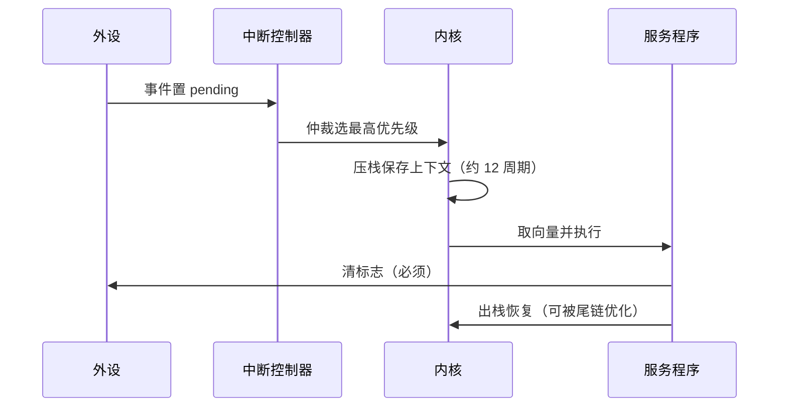

# 中断系统与外设 — 并发只发生在硬件事件上

> 一句话：中断就是「硬件触发的函数调用」，它会随时打断你正在做的读-改-写；所以外设代码的 80% 可靠性问题，最终都归结为「共享状态有没有被保护」和「ISR 有没有足够短」。

## 🎯 这 20% 能解决哪些问题

| 你遇到的困惑 | 本质原因 | 马上能改的动作 |
|---|---|---|
| 中断一进不停、程序卡死 | 标志位没清 / 边沿与电平触发配错 | 进 ISR 第一件事清标志（或读寄存器自动清），确认触发方式 |
| 加了 `volatile` 还是丢数据 | 读-改-写非原子，被中断打断 | 临界区保护（关中断/信号量），或改用位带与原子寄存器 |
| 按键一次触发多次 | 机械抖动 5–20ms | 硬件 RC + 施密特，或软件定时采样消抖，别用中断直接计数 |
| ADC 数值乱跳 | 参考源不稳、采样时间过短、源阻抗高 | 延长采样时间、加跟随器、多次采样取中位/均值 |
| UART 高速丢字节 | 轮询读、FIFO 溢出、波特率累计误差 >2% | 改中断/DMA 接收 + 环形缓冲，用 HSI 时降波特率或换晶振 |
| I2C 挂死后不再通信 | 从机拉低 SDA 未释放，主机等不到 ACK | 主机发 9 个 SCL 脉冲复位总线 + 超时重试 + 上拉阻值检查 |
| SPI 读回全 0 或全乱码 | CPOL/CPHA 模式与从机不符、MOSI/MISO 接反 | 对照从机手册的四种模式表，用逻辑分析仪看第一个字节 |
| DMA 传完数据仍是旧的 | Cache 未清理/失效（带 D-Cache 的系列） | 发送前 clean、接收后 invalidate，或用非缓存区 |

---

## 一、中断响应全过程：延迟是设计出来的

| 阶段 | 决定因素 | 优化手段 |
|---|---|---|
| pending → 响应 | 当前指令剩余周期、关中断区长度 | 缩短临界区，别让业务长循环关着中断 |
| 入栈 | 内核架构、是否用 FPU 惰性压栈 | 热路径 ISR 避免浮点 |
| 执行 | ISR 代码本身 | 「置标志 + 搬数据」，重活交给任务/主循环 |
| 出栈/尾链 | 是否有更高优先级 pending | 优先级分层，避免深层嵌套 |

**判据**：如果事件间隔小于 ISR 执行时间的 2 倍，就已经在丢事件了——这时不是提频，而是改用 DMA 或降低触发频率。

---

## 二、优先级与嵌套：谁打断谁

| 概念 | 规则 | 工程注意 |
|---|---|---|
| 抢占优先级 | 高优先级可打断低优先级 ISR | 数字越小越优先的系列容易写反，统一封装宏 |
| 子优先级 | 同抢占级时不嵌套，按顺序响应 | 别指望子优先级能打断 |
| 中断嵌套 | 每层多占一帧栈 | 栈预算必须按最大嵌套层数算 |
| 优先级反转 | 高优先级等低优先级释放资源 | RTOS 里用互斥量的优先级继承解决 |
| 尾链 tail-chaining | 连续中断免二次出入栈 | 高频中断场景实测延迟再下结论 |

**布局原则**：时间关键（控制回路、通信帧头）给高优先级；吞吐型（UART 收）中优先级；调试类（日志、按键扫描）低优先级。**优先级不是按重要性排，而是按截止期排**。

---

## 三、写好 ISR 的四条铁律

| 铁律 | 反例后果 | 正确做法 |
|---|---|---|
| 短：只做必要动作 | 高优先级 ISR 拖慢一切 | 搬数据/置标志，处理放到任务里 |
| 清标志 | 中断风暴、卡死 | 退出前清；读 DR 类自动清的寄存器要看手册 |
| 不阻塞 | 死锁（中断里等信号量永远不会释放） | 只用 `...FromISR` 系列 API |
| 保护共享状态 | 偶发数据撕裂 | `volatile` 保证可见性 + 临界区保证原子性 |

**单字节共享的正确形态**：环形缓冲的头尾指针，写者只改 head、读者只改 tail，配合 `volatile` 就无需关中断；两个方向都改就必须加保护。这是 ISR 与主循环共享数据最省心的写法。

---

## 四、GPIO、按键与定时器

| 主题 | 关键参数 | 常见坑 |
|---|---|---|
| 输入模式 | 上拉/下拉/悬空/模拟 | 悬空输入读数乱跳；未用引脚配模拟输入最省电 |
| 输出驱动 | 推挽 vs 开漏 | 开漏必须外接上拉；总线类场景才用开漏 |
| 按键消抖 | 抖动 5–20ms | 用 10ms 周期采样两次一致才认，别在 ISR 里累加计数 |
| 外部中断 | 边沿 vs 电平 | 抖动产生多个边沿；电平触发要确保能解除 |
| 定时器时基 | `周期 = (ARR+1)(PSC+1)/Tclk` | 算错预分频导致 PWM 频率差 10 倍 |
| PWM | 频率决定平滑度，占空比决定输出 | 死区时间互补驱动必须加，否则上下管直通炸管 |
| 输入捕获 | 测频/测脉宽 | 溢出中断要与捕获值一起算，否则大于 1 个周期的量程丢失 |
| 看门狗 | 独立时钟源，喂狗放不同任务 | 把喂狗放进定时器中断 = 逻辑跑飞也照样喂，失去保护 |

---

## 五、ADC 与 DAC：把物理量搬进数字域

| 参数 | 含义 | 实用值 |
|---|---|---|
| 分辨率 | 位数决定量化步长 | 12 位 + 3.3V 参考 ≈ 0.8mV/LSB |
| 采样时间 | 电容充电到目标精度所需 | 高阻抗分压必须加长采样或加跟随器 |
| 奈奎斯特 | 采样率 ≥ 2× 信号最高频率 | 实际工程按 10× 以上，配合抗混叠 RC |
| 参考源 | 精度与噪声的决定项 | 用外部基准或内部基准，别用不稳定的 LDO 当参考 |
| 过采样 | 多倍采样平均换取有效位数 | 4× 过采样约 +1 位，代价是速率 |
| 通道串扰 | 多路复用时的电荷残留 | 关键通道重复采样或加切换间隔 |

**排查顺序**：读数漂移 → 先看参考与地弹，再看采样时间，最后看软件滤波。

---

## 六、串行总线三件套：选哪个、怎么查

| 特性 | UART | I2C | SPI |
|---|---|---|---|
| 线数 | TX/RX 两根 | SDA/SCL 两根（+上拉） | SCLK/MOSI/MISO/CS 四根起 |
| 通信方式 | 异步，靠波特率约定 | 同步，地址寻址 | 同步，片选选中 |
| 速率典型 | 115200–2M | 100k/400k/1M | 数 MHz–数十 MHz |
| 多主/多从 | 点到点为主 | 一主多从（可扩展多主） | 一主多从（每从一根 CS） |
| 典型故障 | 丢字节、波特率误差、地线差 | 总线卡死、上拉不足、时钟拉伸 | 模式配错、CS 时序、MISO 悬空 |
| 首查手段 | 逻辑分析仪看起始位对齐 | 看 SDA 是否被永久拉低 | 看第一个字节是否 MSB/LSB 反了 |

**通用调试套路**：先量「空闲电平对不对」，再看「时序边沿采样对不对」，最后看「协议字段对不对」。八成问题在前两步，不要一上来就怀疑协议栈。

---

## 七、DMA：让搬运不占 CPU

| 模式 | 用法 | 注意点 |
|---|---|---|
| 内存 → 外设 | 连续 PWM/波形输出、SPI 高速发送 | 缓冲区地址必须稳定（非局部变量） |
| 外设 → 内存 | ADC 批量采样、UART 接收 | 循环模式 + 半满/全满中断做双缓冲 |
| 外设 → 外设 | I2S、ADC 触发 | 通道优先级与请求源要配对应 |
| 与 Cache | 带 D-Cache 的系列 | 发送前 clean、接收后 invalidate，否则读到旧数据 |

**判据**：CPU 占用高但数据量小 → 说明中断次数太多，正是 DMA + 批处理的收益点。

---

## 🎓 实战场景（TIL）

- **场景**：ADC 中断优先级最高，导致 UART 大量丢字节。**本质**：10kHz 中断每次执行 80µs，吃掉大半 CPU 且不断打断低优先级 ISR。**要点**：改用 DMA 批量搬运 + 完成后一次中断，把高频 ISR 变成低频批处理。
- **场景**：现场设备每运行几小时就通信异常一次，重启恢复。**本质**：I2C 从机异常时永久拉低 SDA，主机无超时机制一直等。**要点**：所有总线访问带超时，失败后执行「9 脉冲 + STOP」总线恢复，必要时电源级复位传感器。
- **场景**：温度读数偶发跳变十几度。**本质**：多路复用切换后立刻转换，采样电容未充满。**要点**：切换通道后插入额外采样时间或丢弃首帧，再做滤波。

---

## 📋 一页速查

| 我要做 | 记住这条 |
|---|---|
| 写任何 ISR | 清标志、尽量短、不阻塞、只用 `FromISR` API |
| 共享一个变量 | `volatile` 管可见性，临界区管原子性，两者不可互相替代 |
| 定优先级 | 按截止期排，不按业务重要性排 |
| 估中断延迟 | 关中断区长度 + 入栈周期 + ISR 时长，实测用 GPIO 打点 |
| 按键 | 10ms 采样消抖，不用外部中断计数 |
| PWM 频率 | `(ARR+1)(PSC+1)/Tclk`，先算再配 |
| ADC 抖动 | 参考 → 采样时间 → 源阻抗 → 滤波，按顺序查 |
| UART 丢数 | 中断/DMA 收 + 环形缓冲，先量空闲电平 |
| I2C 卡死 | 9 个 SCL 脉冲 + STOP 恢复，检查上拉与地址冲突 |
| SPI 无数据 | 先确认 CPOL/CPHA 与 MSB 顺序，再看 CS 时序 |
| DMA 数据旧 | Cache 维护没做，或缓冲区被编译器优化/复用了 |

---

## 🔗 相关链接

- 上级：[嵌入式与单片机](index.md)
- 前置概念：[微控制器架构](01-microcontroller-architecture.md) — 向量表、栈与存储器映射
- 同域下一步：[实时操作系统](03-rtos-and-realtime.md) — 把 ISR 之外的活交给任务
- 邻域：[计算机体系结构 essentials](../computer-architecture/01-essentials.md) — 中断与流水线、Cache 的关系
- 邻域：[操作系统与进程模型](../../fundamentals/software/01-operating-systems.md) — 通用 OS 里的中断与 IO 处理
- 邻域：[缓存系统设计](../../data-fundamentals/02-cache-system-design.md) — 环形缓冲与批量处理同构思路
