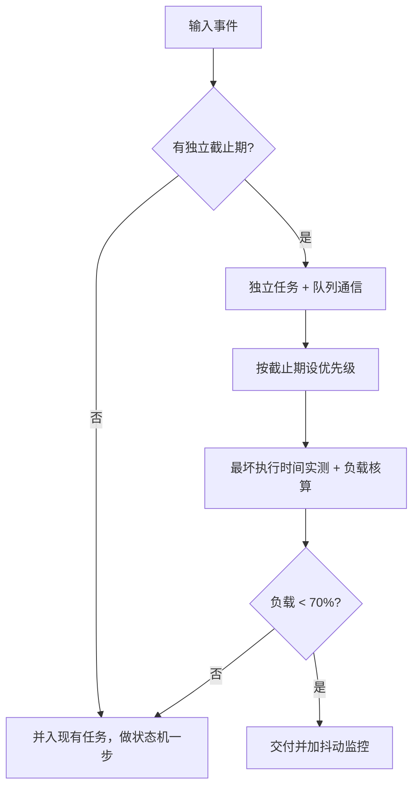

# 实时操作系统与可靠性 — 可预测比更快重要

> 一句话：实时系统的目标不是「跑得快」，而是「在最坏情况下也不迟到」；所以设计时算的是最坏执行时间与截止期，验收时看的是抖动，而不是平均吞吐。

## 🎯 这 20% 能解决哪些问题

| 你遇到的困惑 | 本质原因 | 马上能改的动作 |
|---|---|---|
| `while(1)` 里一个模块卡住，全部失灵 | 超级循环把耦合塞进同一执行流 | 拆任务 + 队列通信，或用状态机把每步做到微秒级 |
| 加了 RTOS 后某个功能偶发不响应 | 优先级设计不当，高优先级任务把 CPU 占满 | 按截止期而非重要性排优先级，给每个任务算占用率 |
| 任务栈莫名溢出、随机 HardFault | 栈太小或中断嵌套叠加 | 用高水位实测 + 余量 50%，深调用链与浮点单独加预算 |
| 数据偶尔被写坏、两个任务同时改 | 共享全局变量无保护 | 消灭共享：改走队列/消息；必须共享就用互斥量 |
| 高优先级任务被低优先级拖住 | 优先级反转 | 用带优先级继承的互斥量，而不是二值信号量 |
| 系统偶尔死锁，只能重启 | 加锁顺序不固定，形成循环等待 | 规定全局加锁顺序，或改用一次只持一把锁的设计 |
| 中断里调用阻塞 API 后系统卡住 | ISR 上下文不允许等待 | 只用 `...FromISR` API；把等待放回任务 |
| 偶发重启后查不到原因 | 复位源与故障信息没落盘 | 掉电非易失区记录复位源、错误码与运行时间戳 |

---

## 一、什么叫实时：截止期、抖动、可预测

| 类别 | 违约后果 | 例子 | 设计目标 |
|---|---|---|---|
| 硬实时 | 灾难性失效 | 电机换相、气囊点火、刹车 | 最坏情况必须满足截止期，需 WCET 分析 |
| 软实时 | 性能可接受地下降 | 音频播放、屏刷新 | 保证 99.9% 及时，允许偶发迟到 |
| 非实时 | 只要求最终完成 | 日志上传、参数配置 | 吞吐与功耗优先 |

| 指标 | 含义 | 怎么测 |
|---|---|---|
| 响应延迟 | 事件发生到任务开始执行 | GPIO 打点 + 逻辑分析仪 |
| 抖动 | 周期的最大偏差 | 连续采样一个周期的起止时间 |
| 最坏执行时间 | 最长路径耗时 | 关中断区 + 边界输入实测，不靠平均 |
| CPU 负载 | 各任务占用之和 | 空闲任务计数法；控制类留 30% 余量 |

**结论**：「平均 2ms 处理完」在实时系统里不是答案，「最坏 8ms 且截止期 10ms」才是。

---

## 二、任务与调度：把功能切成可预测的执行单元

| 设计问题 | 判据 | 反面做法 |
|---|---|---|
| 要不要拆成任务 | 有独立周期或独立截止期才拆 | 每个 `.c` 文件建一个任务，最后全在等锁 |
| 周期怎么定 | 由最快需要响应的输入决定 | 拍脑袋 1ms 全表扫描，把 CPU 吃光 |
| 优先级怎么定 | 截止期紧 + 频率高者优先 | 按「功能重要性」排，导致控制回路被日志压住 |
| 栈给多大 | 局部变量 + 最深调用 + 中断帧 + 50% | 全用默认 128 字节，跑飞后才查 |
| 任务粒度 | 单任务只做一件事，超时能被看门狗察觉 | 一个任务串完全部业务，卡死也照样喂狗 |

**抢占式 + 时间片**：同优先级任务轮转（FreeRTOS 需 `configUSE_TIME_SLICING`）；跨优先级永远抢占。需要「都按顺序执行」时，把相关逻辑放进同一任务，比调优先级更稳。

---

## 三、同步与通信原语：选错比写错更常见

| 原语 | 语义 | 适合 | 陷阱 |
|---|---|---|---|
| 二值信号量 | 通知「发生了」 | ISR → 任务的事件通知 | 当锁用会优先级反转，可被多次 give 计满 |
| 计数信号量 | 资源计数 | 有限资源池、缓冲块 | 忘记 take 配平导致永久阻塞 |
| 互斥量 | 占有式锁 + 优先级继承 | 保护共享数据 | 必须在同一任务里 release；不能在中断用 |
| 队列 | 拷贝传值，可阻塞 | 任务间数据流（推荐默认） | 传指针等于又引入共享，需所有权约定 |
| 事件组 | 多条件与/或等待 | 等多个就绪标志 | 组合条件复杂时说明任务拆分错了 |
| 任务通知 | 单目标轻量唤醒 | 替代一对信号量 | 只能一个接收者 |

**优先策略**：默认用**队列传所有权**（谁拿到数据谁负责释放），把「共享 + 锁」降级为「消息 + 拷贝」。小内存系统里用静态队列/静态任务创建，避免堆碎片导致运行时失败。

---

## 四、优先级反转、死锁与饿死

| 问题 | 成因 | 解法 |
|---|---|---|
| 优先级反转 | 中优先级任务抢占持锁的低优先级任务，高优先级只能等 | 优先级继承互斥量；缩短持锁时间；禁止持锁做 IO |
| 死锁四条件 | 互斥 + 持有并等待 + 不可剥夺 + 循环等待 | 破坏循环等待：全局固定加锁顺序；或带超时获取 |
| 优先级饿死 | 高优先级任务过载 | 核算 CPU 占用；把高优先级任务做得更短更稀疏 |
| 中断风暴压垮任务 | ISR 太长/太密 | ISR 改批处理（DMA + 完成中断），限频与背压 |
| 数据撕裂 | 多字节读写被中断 | 临界区或双缓冲 + 序号校验 |

**持锁时间上限**要写进代码注释与 review 清单——嵌入式里「拿着锁去发 UART」是最常见的整系统卡顿原因。

---

## 五、资源约束下的工程习惯

| 约束 | 做法 | 收益 |
|---|---|---|
| RAM 小 | 静态分配优先，对象池替代 `malloc` | 消除碎片与运行时分配失败 |
| Flash 紧张 | 关未用的库特性、`-Os`、日志分级编译期裁剪 | 版本可控，现场留诊断空间 |
| 无 MMU 保护 | 关键缓冲区加长度校验与 magic 头 | 越界能被早期发现 |
| 时间基准 | Tick 溢出处理（`uint32_t` 约 49.7 天 @1ms） | 长期运行不死机 |
| 参数保存 | 双副本 + CRC + 写入计数 | 掉电写坏可回退上一份 |
| 升级 | A/B 分区 + 启动失败回滚 + 镜像签名 | 变砖可自恢复 |

---

## 六、可靠性：把「重启」变成设计的一部分

| 机制 | 正确用法 | 错误用法 |
|---|---|---|
| 独立看门狗 | 各关键任务各自置标志，由低优先级任务集中喂 | 在定时器中断里无条件喂狗 |
| 窗口看门狗 | 捕获「跑得太快/顺序错」的异常 | 只当普通看门狗用 |
| 心跳与状态上报 | 周期上报运行状态、复位源、错误计数 | 只上报成功，问题不可见 |
| 故障降级 | 传感器失效 → 用安全默认值并标记不可信 | 直接死循环或复位隐藏根因 |
| 复位源记录 | 掉电非易失区累计各类复位次数 | 复位后什么都不留，现场无从判断 |

**判据**：看门狗只能救「卡住」，救不了「算错」。控制类产品要同时有输出侧安全机制（限幅、超时停驱动、独立硬件保护）。

---

## 七、选型：裸机、RTOS 还是 Linux

| 形态 | 适合 | 不适合 | 典型栈 |
|---|---|---|---|
| 裸机超级循环 | 单一职责、微秒级确定性、成本极敏感 | 多外设多协议并发 | 无 / 自写状态机 |
| 裸机 + 协作式调度 | 中等复杂度，需要轻量定时任务 | 有硬截止期的并发 | 定时器驱动的状态机 |
| RTOS | 多任务并发、ms 级截止期、资源 KB 级 | 需要文件系统/网络栈/驱动的复杂交互 | FreeRTOS、RT-Thread、Zephyr |
| 嵌入式 Linux | 需要富交互、网络协议栈、生态与算力 | 硬实时（需 PREEMPT_RT 或协处理器） | Buildroot/Yocto + POSIX 线程 |

**混合形态最常见**：Linux 做业务与联网，MCU 做实时控制，两者用串口/SPI + 明确协议连接；实时性归 MCU，可观测性归 Linux。

---

## 🎓 实战场景（TIL）

- **场景**：设备运行 40 余天后调度逐渐紊乱。**本质**：`tick` 计数 32 位溢出，`(now - last) < period` 判断反转。**要点**：所有时间比较统一用差值形式并测过翻转点，长期老化测试要覆盖溢出边界。
- **场景**：加了日志任务后电机控制抖动变大。**本质**：日志任务与控制任务同优先级轮转，日志单条耗时上毫秒。**要点**：日志降到低优先级 + 缓冲批量输出，控制任务保持微秒级。
- **场景**：OTA 后现场大量设备启动失败。**本质**：新固件超出分区大小并被截断，且无回滚机制。**要点**：镜像带长度与 CRC 校验，启动失败三次自动回滚旧分区。

---

## 📋 一页速查

| 我要做 | 记住这条 |
|---|---|
| 定优先级 | 按截止期，不按业务重要性 |
| 任务间传数据 | 队列传所有权，别共享全局变量 |
| 保护共享资源 | 互斥量（带继承）而不是二值信号量；持锁不做 IO |
| ISR 里能做什么 | 只做搬数据/置标志，调用 `...FromISR` API |
| 估栈 | 高水位实测 + 50% 余量；浮点与深递归另加 |
| 算负载 | 各任务最坏执行 × 频率 < 70%，留余量给突发 |
| 看门狗 | 各关键路径置标志，集中喂；绝不在中断里无脑喂 |
| 时间比较 | 用减法形式，处理 `tick` 回绕（1ms 下约 49.7 天） |
| 现场排障 | 记录复位源 + 错误码 + 运行时长，量产也留串口 |
| 选型 | KB 级并发用 RTOS；要文件系统和网络生态用 Linux；硬实时留在 MCU |

---

## 🔗 相关链接

- 上级：[嵌入式与单片机](index.md)
- 前置概念：[微控制器架构](01-microcontroller-architecture.md) — 栈、存储器映射与启动流程
- 前置概念：[中断系统与外设](02-interrupts-and-peripherals.md) — ISR 与任务分工
- 邻域：[操作系统与进程模型](../../fundamentals/software/01-operating-systems.md) — 通用调度、并发原语的完整版
- 邻域：[机器人系统 essentials](../../applications/intelligent-systems/robotics/01-essentials.md) — 实时控制在机器人里的形态
- 邻域：[运维与 SRE](../../fundamentals/software/09-operations-sre.md) — 设备侧可观测性与 SLO 的对应思路
