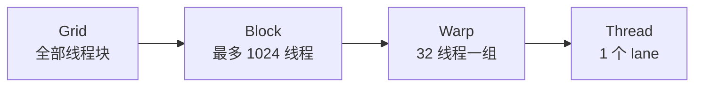

# GPU 并行计算核心 20% — 先判断你是算力受限还是带宽受限

> **一句话**：GPU 优化只有两个问题——**这一步是算得多还是搬得多**（Roofline 判断），**线程有没有被调度起来**（占用率与并发度）。回答完这两个，80% 的性能问题就有了方向。

---

## 🎯 这 20% 能解决哪些问题

| 常见困惑 | 本质 | 本页答案 |
|----------|------|----------|
| 为什么 GPU 核数上千倍却快不了百倍 | 受带宽与串行部分限制 | 见「Roofline：先算清楚瓶颈」 |
| 加更多线程反而更慢 | 占用率与资源竞争 | 见「占用率三约束」 |
| 同样的算法在 CPU 上是常数时间，GPU 上很慢 | 启动开销与并行度不足 | 见「什么时候不该上 GPU」 |
| if 分支让性能掉一半 | warp 内部分化 | 见「分支发散」 |
| 内存访问加个转置快几倍 | 合并访存 | 见「访存合并」 |

---

## 一、执行模型：从线程到 warp



| 层级 | 关键规则 | 实践含义 |
|------|----------|----------|
| Thread | 各自有寄存器 | 寄存器多 → 并发线程少 |
| Warp | 32 线程**同进同退** | 分支不一致会串行化 |
| Block | 可共享 shared memory | 块大小影响占用率 |
| Grid | 块之间无共享 | 跨块通信必须回全局内存 |

> **记住 32 这个数**：块大小用 128/256/512（32 的倍数），否则最后一个 warp 会空转。

---

## 二、Roofline：先算清楚瓶颈

\[
\text{可达性能} = \min(\text{峰值算力},\ \text{带宽} \times \text{算术强度})
\]

| 算子 | 算术强度（FLOP/Byte） | 瓶颈 |
|------|----------------------|------|
| 逐元素加法 | 约 0.17 | 带宽 |
| Softmax | 约 0.5 | 带宽 |
| GEMM（1024³） | 约 40+ | 算力 |
| 卷积（大 kernel） | 高 | 算力 |

**判断方法**：算术强度 < 机器平衡点（A100 约 150 FLOP/B，消费级 GPU 约 30）→ **带宽受限**，优化访存；否则 **算力受限**，优化指令与张量核心。

> 大模型的 Decode 阶段几乎全是"搬权重"——所以它带宽受限，这就是为什么 KV Cache、量化、算子融合有效。

---

## 三、占用率三约束

| 资源 | 限制方式 | 优化手段 |
|------|----------|----------|
| 寄存器 | 每线程寄存器数 × 线程数 ≤ 寄存器文件 | 减少局部变量、避免大数组 |
| 共享内存 | 每块共享内存 ≤ 上限 | 复用、分块 |
| 线程/块上限 | 每 SM 最多有限个块与线程 | 调整块大小 |

**常见误区**：占用率不是越高越好。达到 50% 以上后，继续提高收益很小；**有时候降低占用率换取更多寄存器反而更快**。

---

## 四、访存合并

| 模式 | 效果 |
|------|------|
| 连续线程访问连续地址 | 一条请求覆盖 32 个连续元素，最优 |
| 跨步访问（stride = 32） | 32 条请求，浪费 32 倍带宽 |
| 二维数组按列访问 | 同上，需转置或分块 |

**三种实用优化**：

1. **合并访存**：让 `threadIdx.x` 映射到最内层连续维度。
2. **向量化**：`float4` 一次读 16 字节，减少指令数。
3. **shared memory 分块**：矩阵乘按 tile 载入，复用提升数十倍。

---

## 五、分支发散

```cuda
// 差：warp 内一半走 if，一半走 else，两条路径都执行
if (idx % 2 == 0) a = f(x); else a = g(x);

// 好：按 warp 对齐分区，或改写为无分支的 select
```

| 情况 | 影响 |
|------|------|
| 分支条件 warp 内一致 | 无损失 |
| 分支条件 warp 内不一致 | 路径串行，代价 ≈ 路径数 |
| 循环次数不一致 | 同上，取最长 |

---

## 六、什么时候不该用 GPU

| 场景 | 原因 |
|------|------|
| 数据量很小（< 十万级元素） | 启动开销（5–20 μs）吃掉收益 |
| 高度串行、依赖链长 | 并行度不足 |
| 大量随机小内存访问 | 带宽利用率极低 |
| 频繁主机—设备拷贝 | PCIe 带宽远低于显存 |

**经验法则**：一次 kernel 至少处理十万级元素，且尽量减少 H2D/D2H 次数（合并传输、用 pinned memory）。

---

## 七、多卡与并行策略

| 策略 | 切分对象 | 适用 |
|------|----------|------|
| 数据并行 | 切 batch | 模型能放进单卡 |
| 张量并行 | 切单层权重 | 单层就放不下 |
| 流水并行 | 切层 | 超深模型 |
| 序列并行 | 切序列长度 | 长上下文 |

**通信原语**：AllReduce（数据并行梯度同步）、AllGather / ReduceScatter（张量并行）。通信与计算能否重叠，决定扩展效率。

---

## 🎓 实战场景（TIL）

- **场景**：把逐元素运算搬上 GPU 后反而比 CPU 慢。**本质**：算数强度极低，时间全花在主机-设备数据搬运上。**要点**：先比「计算量 ÷ 搬运量」与 Roofline 拐点，不划算就留在 CPU，或把多个小算子融合成一次搬运。
- **场景**：同样的网格尺寸，改了一个内存访问顺序快 6 倍。**本质**：warp 内没合并访存，一次请求拆成多次事务。**要点**：让相邻线程读相邻地址（数组按 x 维连续），或用 shared memory / `__ldg` 做中转。
- **场景**：profiler 显示 SM 占用率只有 20%。**本质**：寄存器或 shared memory 把每块可用线程数卡住了。**要点**：用 `--maxrregcount`/`launch_bounds` 控制寄存器，先拉高并发度再谈指令优化。
- **场景**：一个 `if` 写在内核里，性能掉一半。**本质**：warp 内分支发散，两条路径串行执行。**要点**：按分支一致性排序输入，或改成无分支写法（先算两路再 `select`）。
- **场景**：多卡训练上 8 卡只快 3 倍。**本质**：瓶颈在梯度同步带宽而非计算。**要点**：用梯度累积/通信压缩、把通信与计算重叠，并先测互联带宽（而不是先改模型）。

---

## 📋 一页速查

| 问题 | 答案 |
|------|------|
| 第一步判断什么 | 带宽受限还是算力受限（Roofline） |
| warp 多大 | 32 线程 |
| 块大小怎么选 | 128/256/512，32 的倍数 |
| 占用率越高越好吗 | 不是，50% 以上收益递减 |
| 最有效的访存优化 | 合并访问 + 向量化 |
| 小数据该上 GPU 吗 | 不该，启动开销吃掉收益 |

---

## 🔗 相关链接

| 主题 | 链接 |
|------|------|
| 硬件基础概览 | [硬件基础](../index.md) |
| 计算机体系结构 | [计算机体系结构核心 20%](../computer-architecture/01-essentials.md) |
| 芯片设计 | [芯片设计核心 20%](../chip-design/01-essentials.md) |
| 深度学习 | [深度学习](../../applications/machine-learning/deep-learning/index.md) |
| AI 基础 | [AI 基础](../../ai-core/theory/01-ai-fundamentals.md) |
