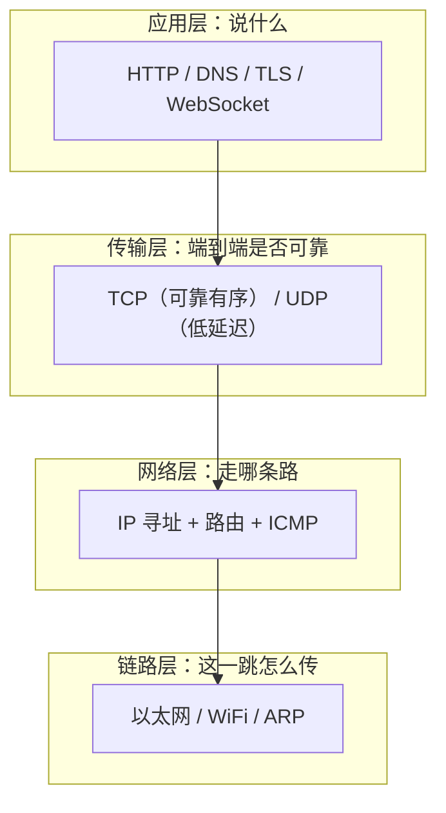
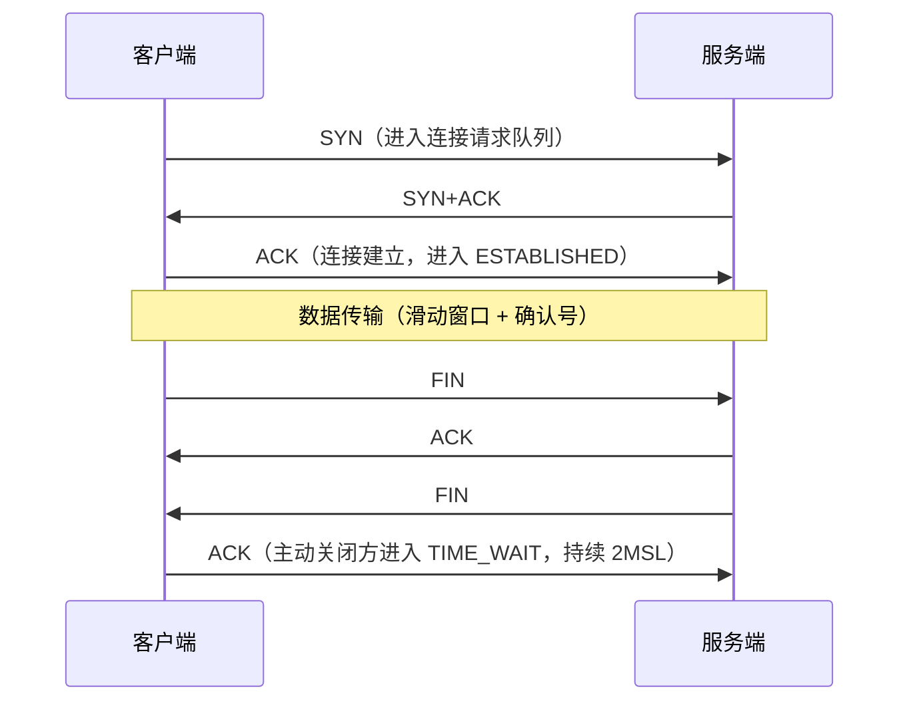
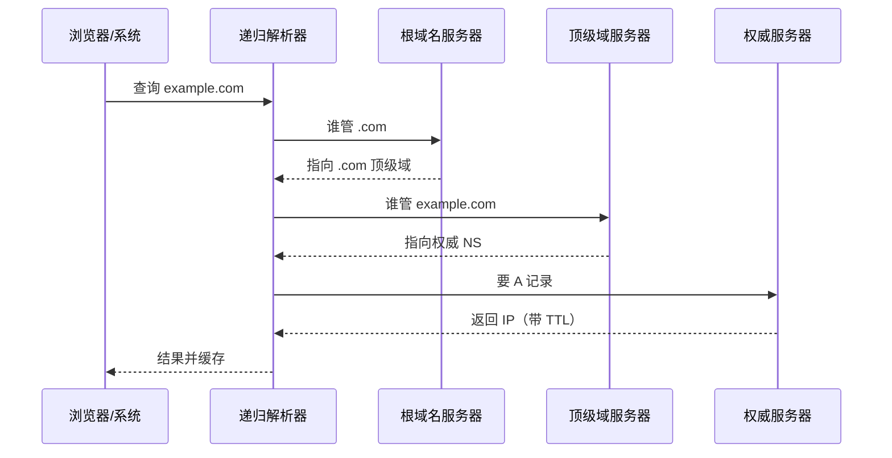
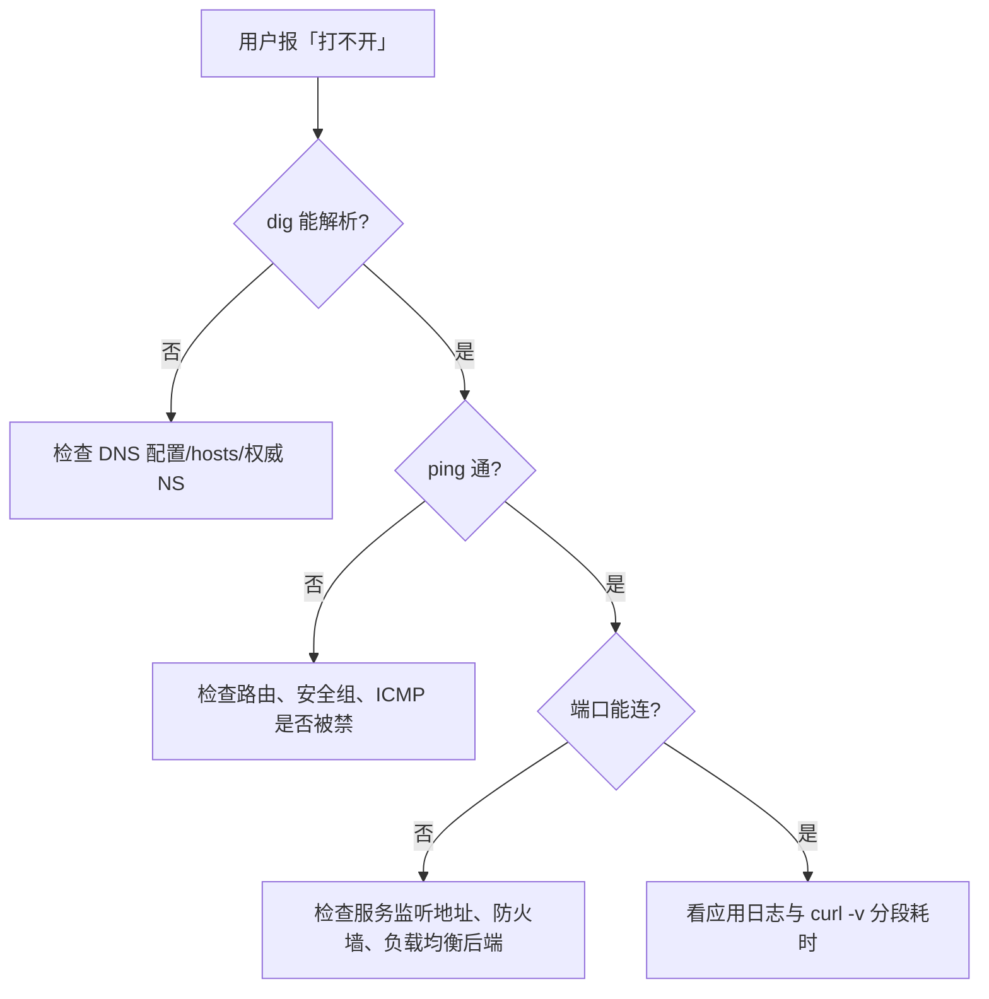

# 网络协议栈与 DNS — 分层定位，一次只查一层

> 一句话：网络故障的定位永远是「分层二分」——先确认能不能到（网络层），再确认端口通不通（传输层），最后才看应用逻辑（应用层）；跨层猜原因只会浪费时间。

## 🎯 这 20% 能解决哪些问题

| 你遇到的困惑 | 本质原因 | 马上能改的动作 |
|---|---|---|
| 网页打不开，不知道从哪查起 | 没有分层排查思路 | 按 `dig → ping → telnet/curl → 服务端日志` 四步走 |
| 服务器大量 TIME_WAIT，端口耗尽 | 短连接频繁开关 | 改长连接/连接池，或开启 `tcp_tw_reuse` 并加端口范围 |
| 接口偶发超时，重试就好 | 重传与拥塞控制在起作用，或链路丢包 | 看 `retrans` 指标与 RTT，而不是只加超时时间 |
| 域名改了记录，部分用户还是老地址 | 各级 DNS 缓存与 TTL | 提前把 TTL 降到 60s，改完查 `dig +trace` |
| 内网两台机器互相不通 | 安全组/路由/防火墙，而不是应用 | 先确认同网段与路由表，再查安全组规则 |
| WebSocket/音视频卡、延迟敏感 | 用 TCP 扛丢包，队头阻塞 | 明确 UDP/QUIC 场景，别用 TCP 传实时流 |

---

## 一、四层模型：每层只解决一个问题

| 层 | 关键标识 | 排查看什么 | 典型故障 |
|---|---|---|---|
| 应用层 | 域名、URL、状态码 | 响应头、证书、日志 | 502、证书过期、重定向环 |
| 传输层 | IP + 端口 | 连接数、重传、队列 | 端口未监听、SYN 被丢、连接耗尽 |
| 网络层 | IP 地址 | 路由表、安全组、MTU | 跨网段不通、分片被丢 |
| 链路层 | MAC | ARP、交换机、无线信号 | 同段不通、DNS 解析慢 |

**核心规律**：数据只能「一层层包起来，一层层剥开」。任何一层的地址缺失或规则拦截，表现都是「连不上」，但原因完全不同。

---

## 二、TCP：可靠性由四个机制撑起

### 2.1 连接生命周期

| 状态/现象 | 含义 | 处置 |
|---|---|---|
| 大量 `SYN_RECV` | 半连接队列被打满，疑似 SYN 洪泛 | 开 SYN cookie、限流、加队列 |
| 大量 `TIME_WAIT` | 本端主动关闭且连接频繁 | 用长连接/连接池，扩大 `ip_local_port_range` |
| 大量 `CLOSE_WAIT` | 对端已关，本端没 `close()` | **代码 bug**：检查连接/流是否释放 |
| `RST` | 端口没监听或被中间设备拒绝 | 检查监听地址、安全组、负载均衡健康检查 |

### 2.2 四个机制

| 机制 | 解决什么 | 实用结论 |
|---|---|---|
| 序列号 + 确认 | 乱序与丢失 | 「可靠」不等于「不丢包」，丢包靠重传补 |
| 滑动窗口 | 快慢匹配，不压垮慢端 | 窗口为 0 表示接收端处理不过来，问题在应用 |
| 拥塞控制 | 不挤爆共享链路 | 慢启动→拥塞避免→丢包后回退，解释了「越丢越慢」 |
| 超时重传 | 黑洞链路 | RTO 动态估算；一次超时会让延迟跳变 |

**带宽 × 延迟**决定吞吐上限：`理论吞吐 ≈ 窗口大小 ÷ RTT`。跨洋高延迟链路想跑满带宽，必须放大窗口（`tcp_window_scaling`）。

---

## 三、UDP 与 QUIC：什么时候不要可靠传输

| 传输 | 特点 | 适用 | 代价 |
|---|---|---|---|
| TCP | 有序、可靠、阻塞式 | 网页、API、文件、数据库 | 队头阻塞；丢包重传增加尾延迟 |
| UDP | 无连接、不保证到达 | 直播、语音、DNS 查询、游戏状态 | 应用自己做序号与丢包容错 |
| QUIC (HTTP/3) | UDP 之上做可靠 + 每流独立 + 0-RTT | 弱网、移动端、多路复用 | CPU 开销更高，运维观测门槛高 |

**判据**：能容忍丢包但不能容忍等待 → UDP/QUIC；一条都不能错 → TCP。

---

## 四、IP、子网、NAT 与路由

| 概念 | 必须记住的 | 
|---|---|
| 私网段 | 10.0.0.0/8、172.16.0.0/12、192.168.0.0/16；其余为公网 |
| CIDR | `/24` = 256 个地址（可用 254），`/16` = 65536 |
| 网关 | 同网段直接 ARP 找 MAC；跨网段交给默认网关 |
| 路由选择 | 最长前缀匹配：更具体的路由优先于 `0.0.0.0/0` |
| NAT | 私网访问公网时改写源地址与端口；**NAT 之后的机器不可被主动连入** |
| 安全组/防火墙 | 默认拒绝入站；出站规则常被忽略，是隐蔽故障源 |

---

## 五、DNS：解析链与真实生效时间

| 记录类型 | 用途 | 常见坑 |
|---|---|---|
| A / AAAA | 域名 → IPv4 / IPv6 | 只配 A 忘配 AAAA 会变慢 |
| CNAME | 别名 → 规范名 | 不能与 A 记录共存于同一名字；无法用于根域 |
| MX / TXT | 邮件 / 验证与 SPF | TXT 长度限制 |
| NS | 谁权威 | 迁移时 NS 未切，改记录无效 |

**排查要点**：`dig +trace` 看解析链路；`dig @8.8.8.8` 绕过本地缓存验证权威结果； hosts 文件优先级高于 DNS，是「本地正常别人不正常」的常见原因。

---

## 六、MTU 与分片：被丢的大包

| 值 | 说明 |
|---|---|
| 1500 B | 以太网标准 MTU |
| 1400–1460 B | PPPoE/VPN 封装后可用载荷，常见「小请求正常、大请求卡住」的原因 |
| ICMP「需要分片」被拦 | Path MTU 发现失败，表现为特定域名打不开 |

**处置**：VPN/容器网络出现「握手成功但数据不通」，先把 MSS  clamp 到 1360–1400 验证是否是 MTU 问题。

---

## 七、排查工具链：按层选择

| 症状 | 命令 | 看什么 |
|---|---|---|
| 域名解析对不对 | `dig example.com +noall +answer` | 返回 IP 与 TTL 是否符合预期 |
| 网络层是否可达 | `ping -c 5 host` | 丢包率与 RTT 稳定性（不是快慢） |
| 卡在哪一跳 | `traceroute -T -p 443 host` | 用 TCP 探测，避免 ICMP 被限速误判 |
| 端口是否监听 | `ss -lntp` / `telnet host 6379` | LISTEN 地址是否 `0.0.0.0` 而非 `127.0.0.1` |
| 连接状态堆积 | `ss -s`、`ss -ant state time-wait` | TIME_WAIT/CLOSE_WAIT 数量含义见 2.1 |
| 完整 HTTP 过程 | `curl -v -w '%{time_total}\n'` | DNS/连接/TLS/首字节各段耗时 |
| 抓包定责 | `tcpdump -i any -nn port 443` | 有无 SYN、有无 RST、是否重传 |

---

## 🎓 实战场景（TIL）

- **场景**：服务间 99% 请求很快，偶发 200ms 尖峰。**本质**：DNS 缓存过期后的解析往返，或 TCP 慢启动（新连接从头窗口开始）。**要点**：长连接 + 连接池复用，客户端侧保留 DNS 缓存，把尖峰对齐到「新建连接」这一事件上验证。
- **场景**：本地正常、容器集群里偶尔卡住。**本质**：overlay 网络额外头部让实际 MTU 小于 1500，大包被丢但 ICMP 又被屏蔽（PMTUD 黑洞）。**要点**：用 `ping -s 1472` 逐尺寸试探可用 MTU，调容器网络 MTU，不要只靠内核自动发现。
- **场景**：`netstat` 里几万条 TIME_WAIT，运维想调内核参数。**本质**：本端主动关闭的正常状态，它保护的是旧连接的重复分段。**要点**：先用长连接减少新建频率，再考虑 `tcp_tw_reuse` + 时间戳；乱改参数会牺牲正确性。
- **场景**：跨可用区一次请求多 30ms。**本质**：RTT 是物理距离决定的，重传至少多等一个 RTT。**要点**：区分「带宽不够」与「延迟高」：前者靠并行流，后者只能靠近用户部署或减少往返次数。

---

## 📋 一页速查

| 我要判断 | 照着做 |
|---|---|
| 故障在哪一层 | `dig` → `ping` → 端口连通 → `curl -v` 分段，逐层二分 |
| 该用 TCP 还是 UDP | 不能丢 → TCP；不能等 → UDP/QUIC |
| TIME_WAIT 多 | 正常（本端主动关闭）；长连接 + 扩端口范围缓解 |
| CLOSE_WAIT 多 | 代码漏 `close()`，必须修 |
| 跨洋吞吐低 | 带宽 × 延迟：`吞吐 ≈ 窗口 ÷ RTT`，放大窗口或加并发 |
| 改 DNS 何时生效 | 看旧记录 TTL，各级缓存过期后才会更新 |
| 小请求正常大请求失败 | 怀疑 MTU/MSS，VPN 与容器网络尤其常见 |
| 内网互访不通 | 先查安全组入站规则与路由表，再查应用 |

---

## 🔗 相关链接

- 上级：[网络基础](index.md)
- 应用层：[HTTP 与 Web 通信](02-http-basics.md) — 请求-响应、缓存与状态管理
- 安全层：[系统安全设计](03-system-security-design.md) — TLS、认证与常见漏洞
- 邻域：[操作系统与进程模型](../fundamentals/software/01-operating-systems.md) — socket 与网络 IO 的进程视角
- 邻域：[后端开发](../fundamentals/software/06-backend-engineering.md) — 连接池、超时与重试的工程实现
