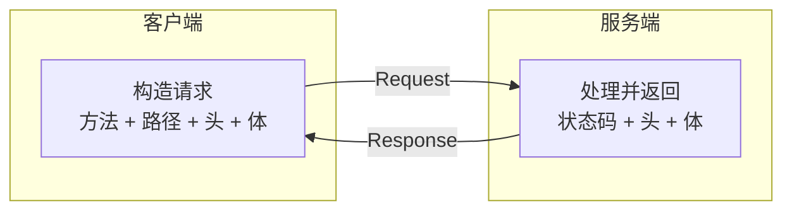
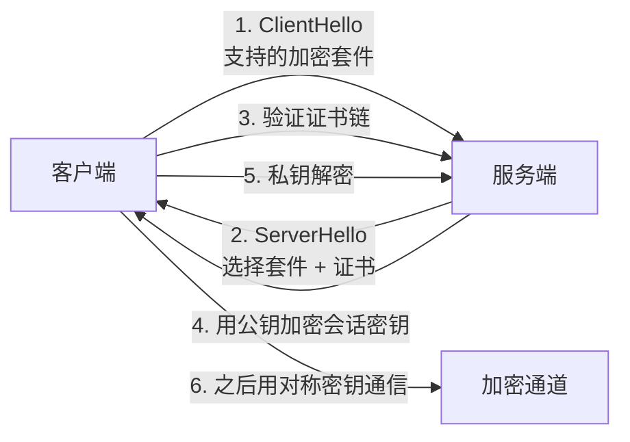
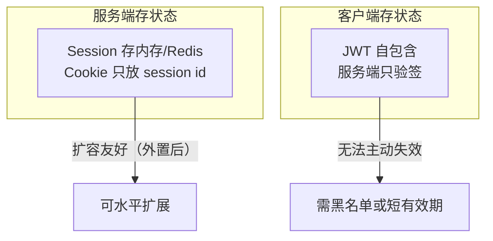

# HTTP 与 Web 通信 — 无状态协议上的状态工程

> 一句话：HTTP 本身什么都不记得，所有「登录态」「缓存命中」「幂等重试」都是你在它之上额外设计出来的；想清这一点，401/403、缓存不生效、重复提交这些问题就有统一解释。

## 🎯 这 20% 能解决哪些问题

| 你遇到的困惑 | 本质原因 | 马上能改的动作 |
|---|---|---|
| 用户明明登录了，接口还是 401 | 凭证没带上或已过期，服务器无法记住状态 | 用 `curl -v` 看请求头是否携带 Authorization/Cookie |
| 401 和 403 分不清，前端提示乱 | 语义没落到状态码上 | 未认证 = 401，已认证但无权 = 403，写进团队约定 |
| 改了代码，用户还是看到老页面 | 强缓存 `max-age` 未失效 | 静态资源用内容哈希文件名 + 长缓存，HTML 用 `no-cache` |
| POST 重试造成重复下单 | POST 非幂等，客户端不知道能否重试 | 给写接口加幂等键（`Idempotency-Key` 或业务唯一键） |
| Session 扩容后用户掉线 | 状态存在单机内存 | 状态外置到 Redis/JWT，服务器保持无状态 |
| 接口越来越慢，排查不到点 | 没有分段耗时数据 | 看 DNS/连接/TLS/首字节/下载五段，定位再优化 |

---

## 一、请求-响应：一次性的对话



**三条核心规律**：

- HTTP 是**无状态**的：每次请求相互独立，服务器不记得上一次。
- 状态是「叠加」出来的：Cookie / Session / Token 都是应用层设计。
- 语义靠三样东西表达：**方法**（做什么）、**状态码**（结果如何）、**Header**（附加约定）。

---

## 二、方法与状态码：语义要能对齐实现

### 2.1 方法

| 方法 | 安全（不改状态） | 幂等（重复同效果） | 用途 |
|---|:---:|:---:|---|
| GET | ✅ | ✅ | 查询资源 |
| POST | ❌ | ❌ | 创建 / 提交动作 |
| PUT | ❌ | ✅ | 全量替换 |
| PATCH | ❌ | ❌（取决于实现） | 部分更新 |
| DELETE | ❌ | ✅ | 删除资源 |

> **实践含义**：只有幂等的操作才允许自动重试。给 POST 加幂等键，是「客户端重试」与「不重复扣款」共存的前提。

### 2.2 状态码

| 类别 | 含义 | 常用 |
|---|---|---|
| 2xx | 成功 | 200 OK、201 Created、204 No Content |
| 3xx | 重定向 | 301 永久、302 临时、304 未修改（走缓存） |
| 4xx | 客户端问题 | 400 参数、401 未认证、403 无权限、404 不存在、409 冲突、422 校验失败、429 限流 |
| 5xx | 服务端问题 | 500 异常、502 网关后端错、503 过载、504 后端超时 |

**判据**：5xx 会触发服务端告警与重试，4xx 不会。把「参数错误」返回 500，等于把自己的告警刷满、把可重试语义传给客户端。

### 2.3 关键 Header

| Header | 作用 | 易错点 |
|---|---|---|
| `Content-Type` | 请求体类型 | 发 JSON 却是 `form-urlencoded`，服务端解析成空 |
| `Accept` | 期望响应类型 | 版本协商时常用它区分 |
| `Authorization` | 认证凭证 | `Bearer` 前缀拼写；401 响应带 `WWW-Authenticate` |
| `Cookie` / `Set-Cookie` | 携带/下发 Cookie | `SameSite`、`Secure`、`HttpOnly` 三件套 |
| `Cache-Control` | 缓存策略 | `no-cache` ≠ 不缓存，是不直接用（先验证） |
| `X-Forwarded-For` | 经代理后的真实 IP | 只有信任链清晰才可信，否则可伪造 |
| `Idempotency-Key` | 写操作幂等键 | 需服务端持久化并设过期 |

---

## 三、HTTPS：HTTP 跑在 TLS 之上



| 概念 | 一句话 | 常见事故 |
|---|---|---|
| 证书链 | 站点证书 ← 中间 CA ← 根 CA（内置信任） | 漏配中间证书，浏览器能过、App/ curl 失败 |
| 有效期 | 证书会过期 | 无监控导致某天全站 HTTPS 报错 |
| SNI | 一个 IP 承载多域名证书 | 老客户端不支持 SNI 握手失败 |
| HSTS | 强制走 HTTPS | 一旦下发，降级回 HTTP 会被浏览器拒绝 |

> TLS 握手细节与 TCP 层关系见 [网络协议栈与 DNS](01-network-protocol-stack.md)。

---

## 四、状态管理：Session、Cookie、Token 是三件事



| 方案 | 状态存哪 | 优点 | 代价 |
|---|---|---|---|
| 内存 Session | 单机 | 实现最简单 | 重启即失效，无法多实例 |
| 集中式 Session | Redis | 可共享、可踢人 | 多一次网络查询 |
| JWT / Token | 客户端 | 无状态、跨服务传递方便 | 签发难撤销；payload 不能放敏感数据 |

**安全底线**：Cookie 加 `HttpOnly`（防 XSS 窃取）+ `Secure`（只走 HTTPS）+ `SameSite=Lax/Strict`（缓解 CSRF）；JWT 必须校验 `exp` 与签名算法，禁止接受 `alg: none`。

---

## 五、版本演进：性能问题出在同一处

| 版本 | 关键变化 | 解决了什么 | 遗留问题 |
|---|---|---|---|
| HTTP/1.1 | 持久连接 + 管线化 | 反复建连开销 | 同连接内请求串行，靠开多连接绕过 |
| HTTP/2 | 二进制分帧 + 多路复用 + 头部压缩 | 队头阻塞（应用层） | TCP 层丢包仍阻塞全部流 |
| HTTP/3 | 基于 QUIC（UDP） | TCP 队头阻塞 + 连接迁移 | 中间设备支持度与运维复杂度 |

**实践结论**：静态资源仍要做域名合并与打包，因为连接数与握手成本依旧是主要开销；不要指望 HTTP/2 自动解决加载慢。

---

## 六、缓存：三层命中，一次讲清

| 层 | 控制方式 | 典型配置 |
|---|---|---|
| 浏览器强缓存 | `Cache-Control: max-age=31536000, immutable` | 带内容哈希的 JS/CSS/图片 |
| 协商缓存 | `ETag` / `Last-Modified` → 304 | HTML 入口文件用 `no-cache` |
| CDN / 反向代理 | `s-maxage`、`Cache-Key`、Vary | 静态与准静态内容 |

| 需求 | 配置 |
|---|---|
| 完全不缓存 | `Cache-Control: no-store` |
| 每次向服务器验证 | `Cache-Control: no-cache` |
| 一年内直接用（文件内容变则名字变） | `max-age=31536000, immutable` |
| HTML 即时更新 | `no-cache` + ETag |

**判据**：`Vary` 里没写的维度，缓存就会串内容——按语言/登录态返回不同结果时必须 `Vary` 或干脆不缓存。

---

## 七、超时、重试与限流：客户端的三件套

| 项 | 建议 | 原因 |
|---|---|---|
| 连接超时 | 1–3 秒 | 建连失败要快，重试才有意义 |
| 读超时 | 按 P99 × 1.5 设置 | 太长会拖垮调用方线程池 |
| 重试次数 | ≤2 次，仅幂等操作 | 避免重试风暴放大故障 |
| 退避 | 指数退避 + 抖动 | 防止同步重试打挂服务 |
| 限流响应 | 429 + `Retry-After` | 让客户端有正确行为 |

---

## 八、实战排查：分段计时定位慢在哪

| 段 | 指标（curl -w） | 慢了说明 |
|---|---|---|
| DNS | `time_namelookup` | DNS 服务器或记录问题 |
| TCP 连接 | `time_connect` | 网络链路或后端负载高 |
| TLS | `time_appconnect` | 证书链/握手/CPU |
| 首字节 | `time_starttransfer` | **服务端处理慢**，去看应用与 SQL |
| 总耗时 | `time_total` | 带宽或响应体过大 |

```
响应慢的下一步（服务端）
├── 1. EXPLAIN 慢 SQL，看是否全表扫描
├── 2. 检查 N+1 查询与缺失的预加载
├── 3. 看缓存命中率与穿透比例
├── 4. 统计外部 API 调用耗时与超时设置
└── 5. 看进程/连接池是否饱和（排队即延迟）
```

---

## 🎓 实战场景（TIL）

- **场景**：用户快速双击提交，数据库多出两条订单。**本质**：把「幂等」当成调用方的道德约束，服务端没有去重。**要点**：写接口强制携带 `Idempotency-Key`（或业务单号）并在服务端存结果；GET 不得改变状态。
- **场景**：登录态偶发丢失，刷新又好了。**本质**：多台实例本地存 session，请求被负载均衡到另一台。**要点**：会话外置（Redis）或改 JWT；排查时先看 `Set-Cookie` 的 `Domain`/`SameSite`/`Secure`。
- **场景**：上线 CDN 后用户看到旧页面。**本质**：缓存键不含版本，`Cache-Control` 给得太长。**要点**：静态资源带指纹文件名 + 长缓存，`index.html` 给 `no-cache`；接口缓存放服务端。
- **场景**：接口升级后小程序报错，网关日志看不出问题。**本质**：HTTP 状态码与业务码混用，200 里包错误。**要点**：传输层失败用 4xx/5xx，业务失败用 200 + 结构化的 `code/message`，并统一给监控可识别的错误率口径。

---

## 📋 一页速查

| 我要判断 | 照着做 |
|---|---|
| 能不能自动重试 | 只有幂等（GET/PUT/DELETE 或带幂等键的 POST）可重试 |
| 返回哪个状态码 | 参数错 400/422，未登录 401，无权限 403，过载 503，后端超时 504 |
| 静态资源怎么缓存 | 内容哈希文件名 + `max-age=1年, immutable` |
| HTML 怎么缓存 | `no-cache` + ETag，保证即时更新 |
| 登录态放哪 | 多实例就外置 Redis 或用短有效期 JWT |
| 慢在哪一段 | `curl -w` 五段计时，首字节慢才查服务端 |
| 是否被限流 | 429 + `Retry-After`，客户端退避重试 |
| Cookie 安全 | `HttpOnly` + `Secure` + `SameSite`，缺一不可 |

---

## 🔗 相关链接

- 上级：[网络基础](index.md)
- 下层：[网络协议栈与 DNS](01-network-protocol-stack.md) — TCP 握手、拥塞与解析链
- 安全：[系统安全设计](03-system-security-design.md) — 认证授权与常见漏洞防护
- 实现：[后端开发](../fundamentals/software/06-backend-engineering.md) — 接口设计、幂等与限流落地
- 前端：[前端开发](../fundamentals/software/05-frontend-engineering.md) — 请求层与缓存的浏览器侧行为
