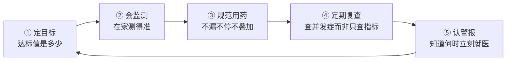

# 慢性病管理核心 20% — 一套模板管好所有慢病

> **一句话**：慢病管理不是"治病"，而是把几个关键数字长期按在目标区间里。做到这一点，80% 的并发症风险就躲过去了。

---

## 🎯 这 20% 能解决哪些问题

| 常见困惑 | 本质 | 本页答案 |
|----------|------|----------|
| 指标忽高忽低，要不要紧？ | 缺少"达标"概念 | 先定目标值，再谈波动 |
| 感觉没事能不能停药？ | 把"症状"当成"病情" | 慢病指标正常是因为在吃药 |
| 一年查一次够不够？ | 没有监测节奏 | 按风险分层定复查频率 |
| 吃保健品能不能替代药？ | 分不清治疗与保健 | 见「用药四条铁律」 |
| 什么时候必须去急诊？ | 不认识危险信号 | 见「六个必须立刻就医的信号」 |

---

## 一、所有慢病共用的五件事

慢病种类很多（高血压、糖尿病、血脂异常、慢阻肺、慢性肾病……），但管理逻辑完全同构：

| 环节 | 做不到的后果 | 做到的标准 |
|------|--------------|------------|
| 定目标 | 永远在"差不多"，医生无法调药 | 能说出自己的 2–3 个目标值 |
| 会监测 | 数据不准 → 治疗方案被误导 | 规范测量，家庭记录成表 |
| 规范用药 | 指标反复、并发症提前 | 漏服有补救规则，不擅自停 |
| 定期复查 | 发现时已是并发症 | 知道下次查什么、多久查 |
| 认警报 | 小问题拖成急症 | 能背出危险信号清单 |

---

## 二、关键数字速查（这 5 行背下来就够用）

> 具体目标以个人医生设定为准，下表是**一般成人**的常用参考区间。

| 指标 | 常用达标范围 | 明显异常 | 该做什么 |
|------|--------------|----------|----------|
| 家庭自测血压 | 低于 135/85 mmHg | ≥ 180/110 mmHg | 静坐 5 分钟复测，仍高立即就医 |
| 空腹血糖 | 4.4–7.0 mmol/L | ≥ 13.9 mmol/L 或 ≤ 3.9 mmol/L | 查酮体/补糖，联系医生 |
| 糖化血红蛋白 | 一般 < 7.0% | > 9.0% | 说明近 3 个月普遍失控 |
| 低密度脂蛋白 | 按风险分层，多数 < 2.6 mmol/L | 已患病者 > 3.4 mmol/L | 复查并调整降脂方案 |
| 体重/腰围 | BMI 18.5–24；男性腰围 < 90 cm | 短期体重骤增 2 kg 以上 | 提示水肿或心衰，尽早就医 |

**慢阻肺另外记一条**：日常爬楼气促明显加重、痰量或痰色突变 → 提示急性加重，尽早就诊。

---

## 三、家庭监测的标准动作

大部分人测出来的数字是"无效数据"，因为它们不符合规范。

### 3.1 血压

1. 测前 30 分钟不吸烟、不喝咖啡、不运动，排空膀胱
2. 静坐 5 分钟，背靠椅背、双脚落地、手臂与心脏同高
3. 测量 2 次，间隔 1 分钟，取平均值
4. 早上（起床后 1 小时内、吃药前）与晚上各一次，连续记录 7 天

### 3.2 血糖

| 时间点 | 意义 |
|--------|------|
| 空腹（8 小时未进食） | 看基础控制 |
| 餐后 2 小时（从第一口算起） | 看饮食与用药匹配度 |
| 睡前 | 防夜间低血糖 |
| 出现心慌、出汗、手抖时 | 立即测，警惕低血糖 |

### 3.3 记录方式

用一张表比用 App 更可靠，每次就诊直接给医生看：

| 日期 | 时间 | 数值 | 当时状态（服药/饮食/运动/不适） |
|------|------|------|----------------------------------|
| | | | |

> 关键：**记录"当时状态"**。没有上下文的数字，医生无法判断原因。

---

## 四、用药四条铁律

1. **不漏不停**：指标正常是药物在起作用，擅自停药等于撤掉防线
2. **漏服有规则**：想起时若接近下次服药时间，跳过这一次，**绝不双倍补服**（具体以药品说明书或药师意见为准）
3. **不自行叠加**：不同科室开的药可能成分重叠；每次新增药物都要告知医生完整用药清单
4. **警惕"替代"**：保健品、理疗、偏方不能替代处方药；宣称"根治慢病、可以停药"的一律视为风险信号

---

## 五、六个必须立刻就医的信号

| 信号 | 可能提示 |
|------|----------|
| 胸痛胸闷持续 15 分钟不缓解，伴出汗、放射至左肩/下颌 | 急性冠脉事件 |
| 突然一侧肢体无力、口角歪斜、说话含糊 | 脑卒中（记发病时间，争分夺秒） |
| 血压 ≥ 180/110 且伴头痛、视物模糊、呕吐 | 高血压急症 |
| 血糖极高伴口渴、多尿、恶心、呼吸有烂苹果味 | 酮症酸中毒 |
| 意识模糊、大汗、手抖、心跳快 | 严重低血糖 |
| 平静时也喘不上气，夜间憋醒需坐起 | 心功能失代偿 |

---

## 六、新手 7 天上手清单

- [ ] 第 1 天：抄下自己的诊断名称、目标值、全部在服药物（含剂量）
- [ ] 第 2 天：买一台经过验证的上臂式血压计/血糖仪，学会规范测量
- [ ] 第 3–5 天：连续记录 3 天数据，包含用药与饮食
- [ ] 第 6 天：核对下一次复查时间与项目，写入日历
- [ ] 第 7 天：把上面六个危险信号抄在手机备忘录里

> 做到这七步，你已经超过大多数慢病患者的管理水平。

---

## 🔗 相关链接

| 主题 | 链接 |
|------|------|
| 临床医学 | [临床医学](../clinical-medicine/index.md) |
| 营养与饮食 | [营养学核心 20%](../nutrition/01-essentials.md) |
| 心理健康 | [心理健康核心 20%](../mental-health/01-essentials.md) |
| 家庭健康 | [家庭健康核心 20%](../family-health/01-essentials.md) |
| 基础医学 | [基础医学](../basic-medicine/index.md) |
