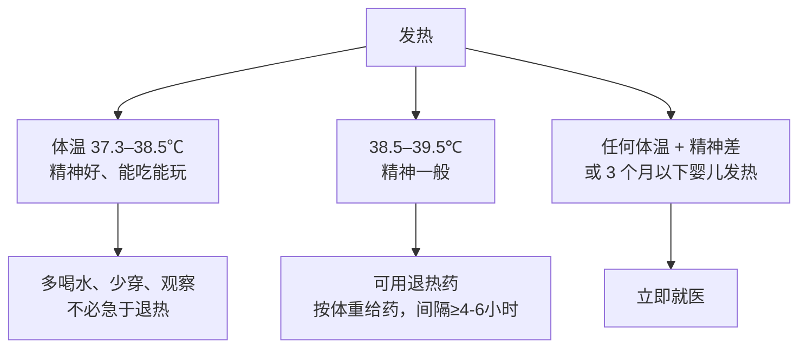

# 家庭健康核心 20% — 家里那 20% 的准备，解决 80% 的突发

> **一句话**：居家健康真正高频的只有四件事——一个合格的药箱、一套发热判断标准、一份防跌倒清单、四招关键急救。

---

## 🎯 这 20% 能解决哪些问题

| 常见困惑 | 本质 | 本页答案 |
|----------|------|----------|
| 家里该备什么药？ | 备得多≠备得对 | 见「家庭药箱 9 件套」 |
| 孩子发烧要不要马上退？ | 只看体温不看状态 | 见「发热三级判断」 |
| 老人摔一跤为什么这么严重？ | 跌倒=骨折+卧床+肺炎链球菌 | 见「防跌倒清单」 |
| 卡喉、烫伤、出血会处理吗？ | 急救知识缺口 | 见「四招急救」 |
| 什么时候必须去医院？ | 没有判断标准 | 见「红旗信号」 |

---

## 一、家庭药箱 9 件套

> 原则：**少而精、定期清、不外借、儿童可及但不对成人敞开**。所有药品放在儿童打不开的容器里。

| 类别 | 具体物品 | 用途 |
|------|----------|------|
| 退热镇痛 | 对乙酰氨基酚或布洛芬（择一，勿叠加） | 发热、头痛、牙痛 |
| 口服补液 | 口服补液盐 | 腹泻、呕吐防脱水 |
| 抗过敏 | 氯雷他定/西替利嗪 | 荨麻疹、过敏性鼻炎 |
| 外伤消毒 | 碘伏棉签（优于酒精，刺激性小） | 擦伤、划伤 |
| 包扎 | 无菌纱布、创可贴、弹力绷带 | 止血、固定 |
| 体温计 | 电子体温计（腋温） | 判断发热 |
| 器械 | 镊子、圆头剪刀、一次性手套 | 取异物、处理伤口 |
| 慢病备药 | 家人长期用药至少 7 天余量 | 突发断药 |
| 清单 | 药品名+有效期+用法，贴在盒内 | 紧急时他人也能用 |

**每半年做一次**：查有效期、补耗材、更新用药清单。

> 抗生素、激素类药膏、成人处方药**不应**自行储备滥用；儿童用药按体重计算，不可用成人剂量"减半"。

---

## 二、发热三级判断（以儿童为重点）

体温数字只是参考，**精神状态才是关键**。

| 情况 | 处理 |
|------|------|
| 精神好、能喝水、尿量正常 | 居家观察，24 小时复测 |
| 退热后精神明显好转 | 多为普通感染，继续观察 |
| 退热后仍萎靡、拒食、尿少 | 就医 |
| 3 个月以下婴儿体温 ≥ 38℃ | **立即就医** |
| 发热超过 3 天不退、伴皮疹/抽搐/呼吸急促 | 就医 |

**物理降温说明**：温水擦浴仅用于舒适，**不要用酒精擦浴**，也不要捂汗。

---

## 三、老人防跌倒清单

跌倒是老年人失能的第一位原因，且"摔一次→卧床→肺炎/血栓"的连锁反应比骨折本身更危险。

| 区域 | 改造动作 |
|------|----------|
| 卫生间 | 加装扶手、防滑垫、坐便椅、夜间小夜灯 |
| 卧室 | 床边扶手、拖鞋防滑、通道清空杂物与电线 |
| 客厅 | 去掉地毯边缘、茶几换成圆角、沙发高度便于起身 |
| 照明 | 走道全程有灯，开关位置在床头与门口双控 |
| 用药 | 复核镇静类、降压药是否引起头晕（与医生沟通） |
| 身体 | 每天做 3 分钟单脚站立/坐站练习，补足蛋白质与维生素 D |
| 起身 | 遵循"躺 30 秒 → 坐 30 秒 → 站 30 秒"再走 |

---

## 四、四招关键急救

| 场景 | 正确做法 | 常见错误 |
|------|----------|----------|
| **气道异物**（不能说话、不能咳嗽） | 成人：海姆立克腹部冲击；婴儿：背部拍击 5 次 + 胸部按压 5 次，交替 | 用手指乱掏、喂水 |
| **烫伤** | 立即用流动凉水冲 15–20 分钟，覆盖干净纱布 | 涂酱油/牙膏/香灰、挑破水泡 |
| **外伤出血** | 直接加压止血 10 分钟不松手，抬高患肢 | 反复松手查看、用绳子紧扎 |
| **抽搐** | 侧卧防误吸、移开硬物、记录时间，不要按压肢体 | 往嘴里塞东西、强按四肢 |

**同时记住**：任何意识丧失、呼吸停止 → 立即呼叫急救并开始胸外按压（100–120 次/分）。

---

## 五、必须去医院的红旗信号

| 人群 | 红旗 |
|------|------|
| 儿童 | 3 个月以下发热、抽搐、呼吸急促、皮疹压之不褪、拒食尿少 |
| 成人 | 胸痛 15 分钟不缓解、突发单侧无力/言语不清、呕血黑便、剧烈腹痛 |
| 老人 | 跌倒后髋部疼痛不能站立、意识改变、发热伴咳痰 |

---

## 📋 一页速查

| 场景 | 第一步 |
|------|--------|
| 家人发热 | 看精神状态 → 再决定是否用药或就医 |
| 老人跌倒 | 不要急于扶起，先问疼痛部位与能否活动 |
| 误服药物/清洁剂 | 保留包装，立即就医，不要自行催吐 |
| 停电/停水 | 药箱里有 7 天慢病备药，冰箱备饮用水 |

---

## 🔗 相关链接

| 主题 | 链接 |
|------|------|
| 慢性病管理 | [慢性病管理核心 20%](../chronic-disease/01-essentials.md) |
| 心理健康 | [心理健康核心 20%](../mental-health/01-essentials.md) |
| 营养与饮食 | [营养学核心 20%](../nutrition/01-essentials.md) |
| 亲子教育 | [亲子教育](../life/child/index.md) |
| 临床医学 | [临床医学](../clinical-medicine/index.md) |
