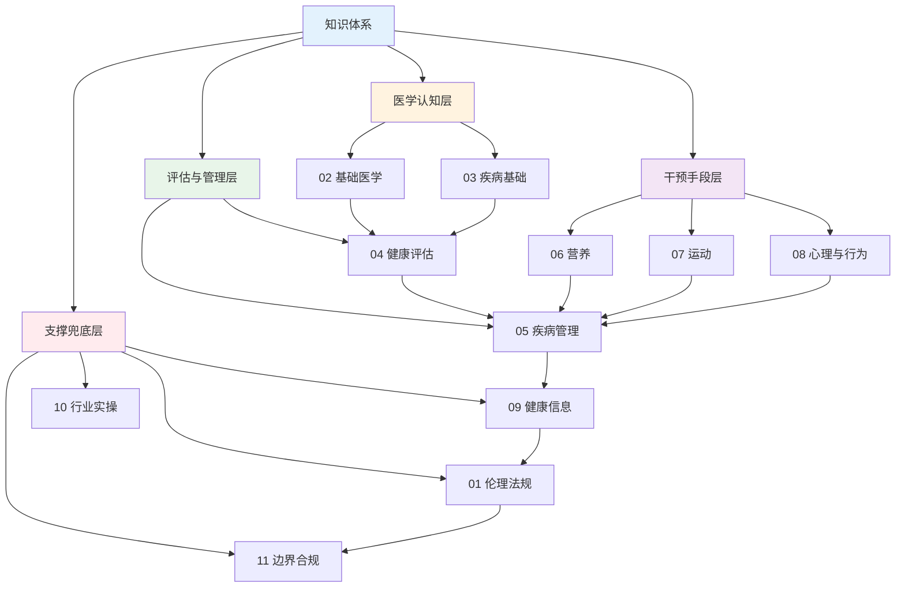
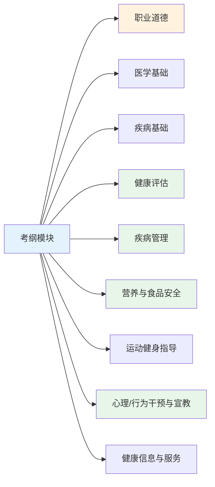

# 知识体系全景 — 模块依赖、考试结构与备考路线

> **费曼学习法**：整张图一句话——**先懂人（医学基础）→ 再懂病（疾病）→ 学会评估 → 做出管理 → 用营养/运动/心理三个抓手干预 → 用信息和法规兜底**。

---

## 一、模块关系全景

**依赖关系说明：**

| 依赖 | 含义 |
|------|------|
| 02 → 04 | 不懂生理指标（血压/血糖正常值），评估读不出异常 |
| 03 → 05 | 疾病基础是管理路径的前提，05 在 03 之上做"流程" |
| 04 → 05 | 管理的第一步永远是评估，评估完才能定管理目标 |
| 06/07/08 → 05 | 营养、运动、行为是慢病干预的三大抓手 |
| 01/11 兜底 | 伦理法规决定"能不能做"，先于一切干预 |

---

## 二、考试结构与题型

| 项 | 内容 |
|----|------|
| 科目 | 《理论知识》（90min）+《操作技能》（60min） |
| 合格线 | 双科均 ≥60 分；各省对成绩是否保留 1 年的规定不同，以当地考试公告为准 |
| 理论题型 | 单选、多选、判断（多选漏选/错选均不得分） |
| 技能题型 | 综合分析题（简答/论述/案例分析），以当地考核通知为准 |

**理论卷考纲权重（官方考核大纲口径）：**

| 模块 | 权重 | 对应文件 |
|------|------|----------|
| 医学基础知识 | 16% | [02 基础医学](../02-basic-medicine/index.md) + [03 疾病基础](../03-disease-basics/index.md) |
| 流行病与卫生统计 | 12% | [09 健康信息](../09-health-info/index.md) |
| 健康教育 | 7% | [08 心理与行为](../08-psychology-education/index.md) |
| 健康保险 | 2% | 业务了解（不进 01~09） |
| 职业道德 | 5% | [01 伦理法规](../01-ethics-legal/index.md) |

**技能卷考纲权重（固定权重表）：**

| 技能项 | 权重 | 对应文件 |
|--------|------|----------|
| 信息采集（含体格测量） | 20% | [04 测量](../04-health-assessment/index.md) |
| 健康风险评估与分析 | 10% | [04 风险因素](../04-health-assessment/index.md) |
| 健康教育 | 5% | [08 心理与行为](../08-psychology-education/index.md) |
| 干预方案实施 | 10% | [05 疾病管理](../05-disease-management/index.md) |
| 随访管理 | 10% | [05 全流程](../05-disease-management/index.md) |

**考纲 9 大模块（对应 01~09 文件）：**

> 绿色（04/05/06/08）为权重最高的四大模块，约占总题量一半以上；橙色的职业道德考点密度低但必考。

---

## 三、学习优先级（30/60/90 天路线）

| 阶段 | 天数 | 内容 | 目标 |
|------|------|------|------|
| 第 1 段 | 1–30 | 04 评估 + 05 管理 + 06 营养（三大高分模块） | 拿下约 50% 分值 |
| 第 2 段 | 31–60 | 02 医学基础 + 03 疾病基础 + 08 心理行为 | 补上知识地基 |
| 第 3 段 | 61–90 | 01/07/09 + 错题回顾 + 10/11 行业实操（非考纲，业务用） | 收尾 + 业务落地 |

**优先级排序依据：**

| 优先级 | 模块 | 理由 |
|--------|------|------|
| ★★★ | 04、05、06、08 | 题量大、实操业务高频 |
| ★★ | 02、03、07 | 基础支撑，分值中等 |
| ★ | 01、09 | 考点少、易混项多，靠速记 |
| 业务 | 10、11 | 不进考纲，但职业直接需要 |

---

## 四、一页速查

| 问题 | 答案 |
|------|------|
| 理论卷权重最高的模块 | 医学基础知识 16% + 流行病卫生统计 12%（合计近 1/3 分值） |
| 技能卷核心考点 | 信息采集 20% + 风险评估分析 10% + 干预实施 10% + 随访 10% |
| 先学什么 | 理论卷 02/03 医学知识 → 04 评估/风险 → 05 管理；技能卷 04 测量 + 08 教育 |
| 题型 | 理论卷全客观（单选/多选/判断）；技能卷综合分析题（简答/论述/案例） |
| 健康管理师能做 | 评估、建议、随访、健康教育、转诊提醒 |
| 健康管理师不能做 | 诊断、开处方、治疗决策（详见 [11 边界](../11-boundaries/index.md)） |
| 学完能干什么 | 体检机构、健管公司、社区、保险、养老——见 [10 行业实操](../10-industry-practice/index.md) |

---

## 五、推荐阅读

- 《健康管理师》（三级，勘误第 2 版）— 人民卫生出版社
- 《健康管理师基础知识》— 人民卫生出版社
- 《中国居民膳食指南》最新版 — 中国营养学会
- 《内科学》（配套院校教材，查疾病目标值用）— 人民卫生出版社
