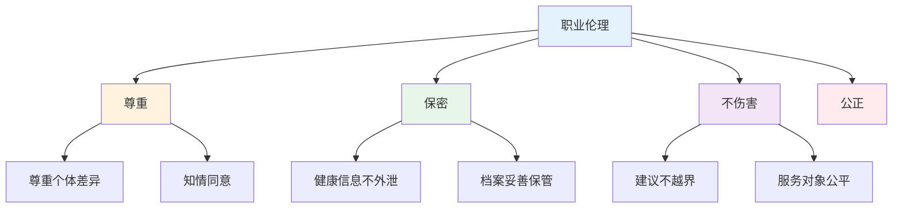

# 职业道德与法规 — 伦理红线与法规考点详解

> **费曼学习法**：这个模块考的是"什么话不能说、什么事不能做"——职业伦理的底线题，背几组对照就够。

---

## 一、职业道德核心

### 1.1 健康管理师职业行为要点

**高频考点（单选/判断最爱考）：**

| 要点 | 考试口径 |
|------|----------|
| 保密原则 | 健康信息仅用于服务目的；委托第三方须征得同意（法定例外除外） |
| 知情同意 | 干预方案实施前须告知目的、方法、风险，由服务对象自主决定 |
| 不伤害 | 不做超出职责的医疗行为；发现危急情况建议转诊 |
| 客观公正 | 不夸大宣传、不贬低竞品；建议基于证据 |

### 1.2 与相关职业的角色边界

| 职业 | 能做 | 与健康管理师的分工 |
|------|------|--------------------|
| 医生 | 诊断、处方、治疗决策 | 健康管理师提供评估与建议，诊疗交回医生 |
| 护士 | 护理操作、医嘱执行 | 健康管理师做健康教育与随访，不做护理操作 |
| 营养师（注册） | 营养诊疗、临床营养处方 | 三级健康管理师给膳食建议，深度营养诊疗转营养师 |
| 心理咨询师 | 心理诊断与治疗 | 心理健康问题转介，不做心理治疗 |

---

## 二、卫生法规基础（考点速记）

### 2.1 必记法规清单

| 法规 | 考试要旨 |
|------|----------|
| 《基本医疗卫生与健康促进法》 | 我国卫生健康领域基本法；确立"以人民为中心"的卫生工作方针 |
| 《医师法》（2022） | 医师执业注册制度；非医师不得从事诊疗活动 |
| 《护士条例》 | 护理执业范围与护士权利 |
| 《食品安全法》 | 食品生产经营许可；保健食品须注册/备案后方可销售，标签须声明"本品不能代替药物" |
| 《广告法》 | 食品/保健食品广告不得涉及疾病预防、治疗功能 |
| 《个人信息保护法》 | 健康信息属敏感个人信息，处理须单独同意 |
| 《传染病防治法》 | 甲类管理（鼠疫、霍乱）；防控属地管理 |
| 《精神卫生法》 | 非自愿住院的条件与程序 |

> 考法通常是「判断：该行为是否违法/是否须备案」，记住法规要旨即可，不考条文号。

### 2.2 健康管理相关法规判断高频考点

| 情景 | 判断 |
|------|------|
| 健康管理师口头建议客户"停用降压药" | 违规：涉及处方药调整须由医师决定 |
| 健管机构向第三方出售客户体检数据 | 违规：违反个人信息保护 |
| 保健食品广告写"辅助降血压" | 合规前提：须为已注册/备案产品且标注批准文号；暗示治疗功效则违规 |
| 体检中心将阳性结果直接告知家属 | 须先告知本人并征得其同意（法定例外除外） |

---

## 三、易混淆点 / 常见坑

| 误区 | 正确做法 |
|------|----------|
| 觉得"给建议=诊断"没区别 | 建议基于评估数据与生活方式；诊断是医师对疾病的定性判断 |
| 客户授权后才能共享数据，口头同意就行 | 敏感个人信息须**单独同意**，留痕可追溯 |
| 健康管理师可指导用药 | 仅能做"遵医嘱用药"的教育与提醒，不能调整药量/停药 |
| 传染病报告只能由疾控做 | 医疗机构是责任报告单位，发现须依法报告 |
| 保健品是"药食同源"可以吃很多 | 保健品须按标签剂量，且不能替代药物 |

---

## 四、相关链接

| 主题 | 链接 |
|------|------|
| 模块总览 | [职业道德与法规](index.md) |
| 边界与合规（行业版） | [11 边界与合规](../11-boundaries/index.md) |
| 健康信息（模块 09） | [09 健康信息与服务](../09-health-info/index.md) |
