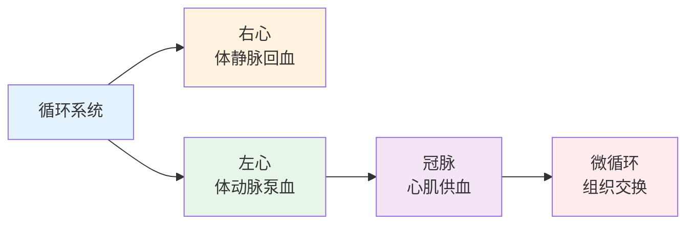
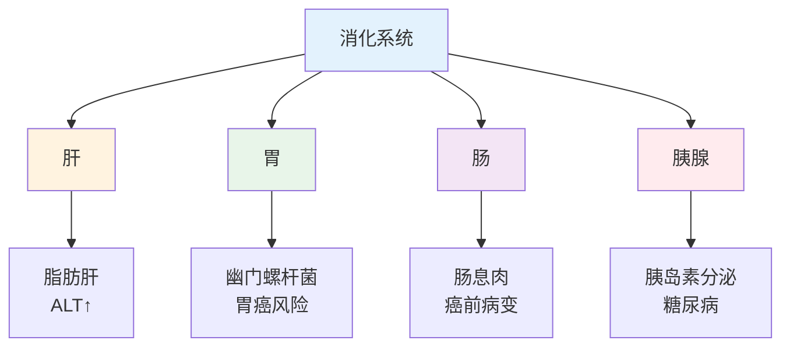
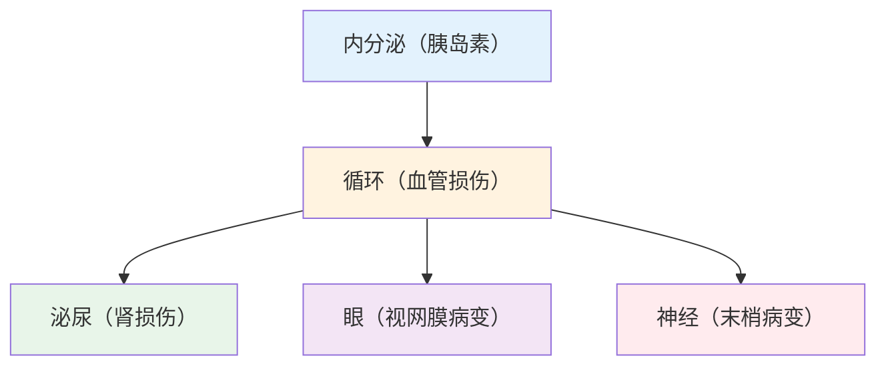

# 人体解剖高频考点

> **费曼学习法**：解剖不用背全部结构，记住"哪个系统出问题，看哪个指标"就够了。

---

## 一、五大系统解剖与指标对应

### 1.1 循环系统

| 解剖结构 | 功能 | 健康管理关注点 |
|----------|------|----------------|
| 心脏（四腔） | 泵血 | 心电图异常提示心功能 |
| 主动脉 | 体循环主血管 | 高血压损伤血管内皮 |
| 冠状动脉 | 心肌供血 | 狭窄 → 心绞痛/心梗 |
| 微血管 | 组织交换 | 微循环障碍 → 外周动脉病 |

**高频考点：**
- 冠状动脉狭窄 >70% 通常引起缺血性心绞痛
- 主动脉硬化 → 脉压差增大（舒张压降低）

### 1.2 呼吸系统

| 解剖结构 | 功能 | 健康管理关注点 |
|----------|------|----------------|
| 肺泡 | 气体交换 | 吸烟 → 肺气肿 → 慢阻肺 |
| 支气管 | 气道传导 | 痉挛 → 哮喘 |
| 胸膜 | 润滑 | 感染 → 胸膜积液 |

**慢阻肺（COPD）：**
- 定义：气流受限不可逆（FEV₁/FVC <0.70 吸入支气管舒张剂后）
- 高危因素：吸烟（首要）、空气污染、职业粉尘
- 三级预防落点：一级戒烟 + 减少暴露；二级肺功能检测早发现；三级康复训练 + 氧疗

### 1.3 消化系统

| 解剖结构 | 功能 | 健康管理关注点 |
|----------|------|----------------|
| 胃 | 消化吸收 | 幽门螺杆菌 → 胃炎 → 胃癌 |
| 肝 | 代谢/解毒 | 脂肪肝、转氨酶升高 |
| 胰腺 | 消化酶 + 胰岛素 | 胰腺炎、糖尿病 |
| 肠道 | 吸收/免疫 | 肠息肉、炎症性肠病 |

**高血压与消化：** 胃排空异常（老年）影响降压药吸收；需提醒服药前后注意。

### 1.4 泌尿系统

| 解剖结构 | 功能 | 健康管理关注点 |
|----------|------|----------------|
| 肾小球 | 滤过 | eGFR 是肾功能核心指标 |
| 肾小管 | 重吸收 | 糖尿病肾早期：微量白蛋白尿 |
| 输尿管 | 排尿 | 结石 → 肾绞痛 |

**肾功能指标（成人）：**

| 指标 | 正常值 | 预警 |
|------|--------|------|
| 肌酐（男） | 57-111μmol/L | 升高查 eGFR |
| 肌酐（女） | 45-84μmol/L | 升高查 eGFR |
| eGFR | >90mL/min/1.73m² | <60 持续3月 慢性肾病 |
| 尿白蛋白/肌酐 | <30mg/g | 30-300 微量白蛋白尿 |

### 1.5 内分泌系统

| 结构 | 关键激素 | 健康管理关注点 |
|------|----------|----------------|
| 甲状腺 | T3/T4/TSH | 甲亢：心悸消瘦；甲减：怕冷乏力 |
| 胰腺 β 细胞 | 胰岛素 | 2型糖尿病：抵抗 + 功能减退 |
| 肾上腺 | 皮质醇 | 库欣综合征：满月脸、向心性肥胖 |
| 下丘脑-垂体 | 多种 | 激素调节轴 |

---

## 二、系统间关联（考试综合题）

**糖尿病并发症链路（高频综合题）：**
胰岛素抵抗 → 高血糖 → 血管内皮损伤 → 心/脑/肾/眼/神经多靶器官病变。

---

## 三、易混淆点 / 常见坑

| 误区 | 正确做法 |
|------|----------|
| 心率 = 心功能 | 心率正常不代表心功能好，需结合心超、心电图 |
| 肺泡是气体交换的唯一场所 | 气体交换主要发生在肺泡；支气管只负责气道传导，不交换气体 |
| 肌酐正常 = 肾功能正常 | 肾功能下降约 30% 后肌酐才开始升高，eGFR 是更敏感的指标 |
| 脂肪肝是"胖才有" | 瘦人也可有脂肪肝（代谢性脂肪肝），B超诊断 |
| 胰岛素只降低血糖 | 胰岛素也促进蛋白合成、脂肪合成，非单纯降糖 |

---

## 四、一页速查

| 问题 | 答案 |
|------|------|
| 冠状动脉狭窄引发心绞痛的阈值 | >70%（临床口径） |
| 慢阻肺诊断（吸入后） | FEV₁/FVC <0.70 |
| 肌酐清除率 <30 的意义 | 多数经肾排泄药物须减量 |
| 糖尿病早期肾损伤标志 | 微量白蛋白尿（>30mg/g） |
| 甲状旁腺激素 | 调节血钙磷平衡 |
| 胃幽门螺杆菌根除方案 | PPI + 铋剂 + 2种抗生素，14天 |
| 胰岛素分泌减少 = 几型糖尿病 | 1型（自身免疫），2型以抵抗为主 |

---

## 五、相关链接

| 主题 | 链接 |
|------|------|
| 基础医学总览 | [02 基础医学](index.md) |
| 疾病基础（03） | [03 疾病基础](../03-disease-basics.md) |
| 健康评估（04） | [04 健康评估](../04-health-assessment/index.md) |
